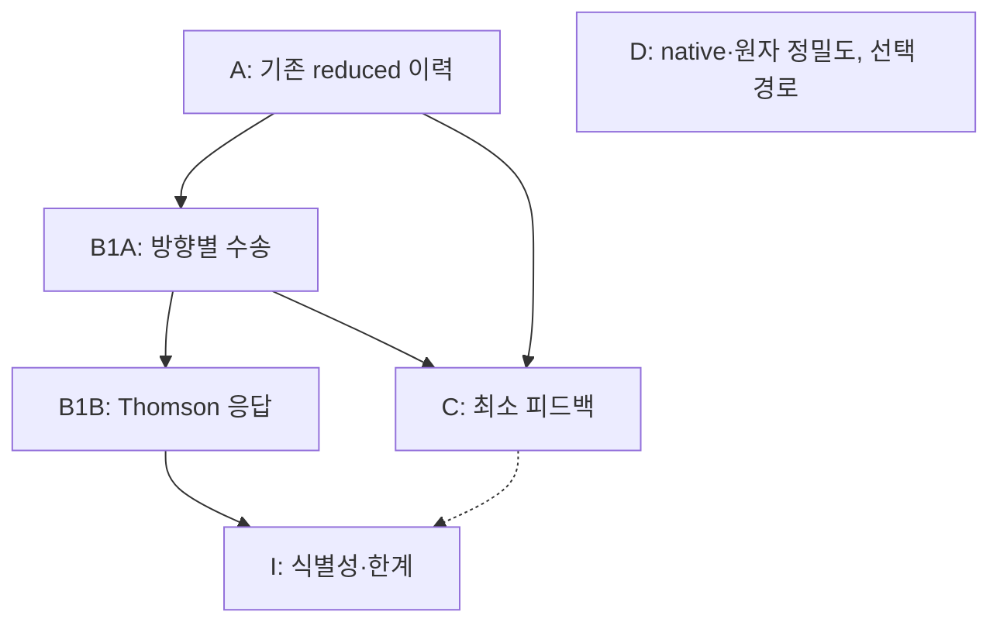

# rei_bianchi 개발계획 조정 — SCIENTIFIC_FAST_TRACK_RESET

결정일: 2026-10-12. 근거: 사용자가 제공한 전략 감사와 PR #83, #104, #110, #112, #113의 고정 소스. 이 문서는 개발 우선순위를 변경한다. 이번 변경에서 새 물리 계산, PHYS36, native 실행, 테스트 재실행은 수행하지 않았다.

## 1. 결정

**다음 필수 작업을 `FT-B1A: 기존 재이온화 이력과 Bianchi 방향별 수송의 연결`로 바꾼다.** 이미 얻은 reduced history를 사용해 방향별 intensity와 quadrupole을 먼저 산출하고, 실제 Thomson 충돌 연산자를 연결한 결과와 최소 이온화 피드백으로 이어 간다. Full native 원자·복사 이력과 PHYS36의 국소 계수 섭동 증명은 이 경로의 선행 조건에서 제외한다.

PR104의 reduced baseline은 이미 얻은 과학 결과다. 이를 다시 승인받거나 같은 수치 실험을 반복하는 단계를 만들지 않는다. PHYS35까지의 채택 결과와 실패·HOLD 기록도 그대로 유지한다. 바꾸는 것은 앞으로 어떤 결과를 우선 만들 것인가이다.[R104][P35]

이번 계획의 완료물은 다음과 같다.

- 실행 순서와 성공 기준을 정한 이 문서 및 `PLAN.json`.
- 다음 작업자가 바로 구현할 수 있는 `CODEX_START_KO.md`.
- 재사용 가능한 코드·데이터와 한계를 적은 `ASSET_REGISTER_KO.md`, 출처를 고정한 `SOURCE_MAP.json`.
- 상위 `CURRENT_PLAN.json`과 기존 `CODEX_SYNC_KO.md`의 최신 진입 안내. 과거 PHYS35 인계문은 수정하지 않고, 그 안의 PHYS36 우선순위만 이 계획이 대체한다.

## 2. 감사 반영표

| 감사의 쟁점 | 채택한 변경 | 유지할 물리적 한계 |
|---|---|---|
| Full native 완성을 기다리느라 결과가 늦어진다 | A·B·C에서 native 의존성을 제거하고 D로 분리 | D의 기존 정확도와 실패 기준을 낮추지 않는다 |
| 이미 있는 reduced history를 충분히 쓰지 않는다 | PR104의 baseline·그림·이력과 시나리오 민감도를 재사용 | 부분 광학깊이를 전체 CMB 광학깊이로, 시나리오 범위를 확률적 불확실성으로 바꾸지 않는다 |
| Bianchi의 방향 효과를 먼저 보여야 한다 | 같은 평균 H를 갖는 등방 수송 대조군과 방향별 수송을 비교 | 충돌 없는 신호는 전자 이력에 반응하지 않는다. Thomson 결과는 충돌 연산자 이후에 주장한다 |
| 모든 원자 상태에 같은 과도한 정밀도를 요구한다 | 새 fast-track 실행의 수치 오차를 최종 관측량 차이에 배분 | 양성성·차원·핵종 장부·복사 수량/에너지 장부는 별도 필수 조건이다 |
| 검사·재검사·전달 작업이 과학 경로를 지배한다 | 바뀐 알고리즘과 새 주장에 필요한 검증을 한 번 수행하고 기존 증거를 재사용 | 소스·입력·단위·경계가 달라지면 그 변화에 관련된 검증은 수행한다 |
| threshold stiffness가 native 진행을 막는다 | 동결 선형 흡수의 정확 부분단계 등은 D의 유한한 알고리즘 실험으로 둔다 | stiffness 원인·속도 향상·비선형 결합 정확도는 아직 입증되지 않았다 |
| NCP를 쓰면 해결된다는 기대가 있다 | 독립 사례를 병렬화할 때만 비용 측정 후 사용 | 하나의 순차 적응 시간 이력이 64코어에 선형 가속된다고 가정하지 않는다 |
| 국소 증명 확장이 계속 다음 필수 단계가 된다 | PHYS36을 `DEFERRED_NONBLOCKING / NOT_RUN`으로 둔다 | PHYS35의 제한된 정리와 사용한 계산 예산을 보존한다 |

감사의 구조적 전환은 채택한다. 감사에 언급된 자산이 곧바로 완전한 실행기로 연결된다는 가정은 실제 소스에서 확인한 범위로 제한한다.

## 3. 독립 경로와 산출물

| 경로 | 지금의 출발점 | 다음 산출물 | 선행 조건 | 완료 판단 |
|---|---|---|---|---|
| A: reduced history | PR104 baseline 채택 완료 | 기존 Q(z), τ와 천체물리 시나리오 비교의 재사용·필요한 재도식화 | 고정된 PR104 자료 | 재이온화 구간·폐쇄식·시나리오 의미가 명확한 결과 표/그림 |
| B1A: prescribed-history 수송 | PR83 ray/packet API와 PR104 배경·이력 | 시간 어댑터, 방향별 I_E, I20/I00, 별도 τ 기록 | A의 이력과 실제 시간·배경 매핑 | 동일 H 등방 대조군과의 차이, 새 투영/보간 오차 및 장부 확인 |
| B1B: 실제 Thomson 응답 | B1A의 runner·관측량 투영 | prescribed x_e에 반응하는 intensity; 편광 준비 시 Stokes 결과 | 적용 가능한 보존적 산란 연산자; 편광에는 screen 기저 | 산란 유입/유출·영점·등방 극한·x_e 반응과 목표 관측량 수렴 |
| C: 최소 복사–이온화 피드백 | A의 reduced 폐쇄와 B1A 수송 | 일방향 대 양방향 결합의 ΔQ, Δτ, 복사 moment 비교 | 물리적으로 정의된 Γ/가열 입력 | 동일 입력 비교, event/energy 장부, 관측량 오차 및 피드백 크기 |
| I: 식별 가능성 | 평균 H의 퇴화 구분은 지금 적용 | 방향 응답과 nuisance 변화의 구분 또는 비식별성 한계 | B1B의 실제 응답; C의 결과는 준비되면 추가 | 유한 해상도 검출과 관측 식별성을 구별한 주장 |
| D: full native·정밀 원자 | PR110 checkpoint 및 독립 원자 경로 | 필요가 입증된 fidelity 개선 | A·B·C를 막지 않는 별도 유한 예산 | 해당 경로의 기존 물리·수치 기준으로 독립 판정 |

그림의 I에 들어가는 두 화살표는 결과의 합류를 뜻한다. B1B 결과만으로 초기 식별성 분석을 시작하며 C의 완성을 기다리지 않는다. C 역시 편광 완성을 기다리지 않는다. A의 추가 시나리오 정리도 B와 병행한다.

### A에서 지금 사용할 기준값

PR104의 `RUN002` 보고서는 다음 값을 제시한다. **적분 범위는 z=20에서 z=4+까지이며 전체 CMB 광학깊이가 아니다.**[R104]

| 항목 | 기존 채택 값/범위 |
|---|---:|
| FLRW τ 기여 | 0.03744182127 |
| 초기 r=s_i/H_i=0.1의 τ 기여 | 0.03741570902 |
| 같은 사례의 Δτ | −2.61122×10⁻⁵ |
| 전체 reduced 사례 | 14개, n=16384 |
| 엄격한 DOP853 참조 대조 | FLRW와 최대 shear 두 사례 |
| 그 대조의 최대 Q 차이 | 1.08065×10⁻⁸ |
| 그 대조의 최대 τ 차이 | 1.78572×10⁻¹⁰ |

이 수치는 해당 계산의 수치 대조 결과다. 연속 구간의 엄밀한 오차 인증이나 천체물리 폐쇄의 정확도 인증은 아니다. 방출률·clumping·온도 변화 결과는 시나리오 민감도이다. prior·likelihood가 없으므로 posterior나 1σ 범위로 표현하지 않는다.

기존 PNG는 그대로 재사용할 수 있다. `preview.csv`를 새 어댑터의 입력으로 쓸 때는 저장 시의 thinning과 새 시간 보간 오차를 따로 확인한다. 그 오차가 목표에 충분하면 사용하고, 충분하지 않을 때 해당 원시 이력만 복구한다. 기존 그림을 설명하기 위해 전체 archive를 먼저 복구하는 단계는 만들지 않는다.

## 4. 다음 한 번의 실행: FT-B1A

목표는 **실제 배경·이력에 연결된 최소 방향별 수송 결과**다. 새로운 계약 문서나 전체 저장소 감사만으로 한 회차를 끝내지 않는다. `CODEX_START_KO.md`에 입력과 실행 순서를 정했다.

1. PR104에 정의된 LRS dust+Λ+shear 배경과 이력을 입력으로 사용한다. `research/physical_provider_20261010/background.py`의 고정 소스를 구현 시 읽어 단위·정규화·시간 매핑을 연결한다. PR83의 `ConstantHubbleBackground`를 재이온화 우주의 실제 배경으로 대체 사용하지 않는다.
2. `GeometryBackground::snapshot(t_s)` 어댑터와 ray/packet 호출, 관측량 투영을 하나의 작은 runner로 연결한다. proper time, a_i, H_i, proper n_H, per-H x_e, 초기 스펙트럼, tetrad, 시간 경계를 명시한다.
3. 표준 FLRW 사례, 실제 Bianchi 사례, 그리고 같은 평균 H의 등방 수송 대조군을 구분한다. 대조군은 같은 n_e·초기 복사·광원·시간 경계를 갖는다. 우선 관측량은 I_E(μ)와 I20/I00이다. 전자 이력의 τ는 별도 열에 기록한다.
4. 원래 ray 수식을 다시 전면 검증하지 않는다. 이번에 새로 생긴 시간 보간, 밀도/각도/에너지 단위 변환, 투영 및 경계 장부를 확인하고 목표 관측량에 필요한 작은 해상도 비교를 수행한다.
5. 첫 그림, 실행 가능한 코드, 실제 실행 명령과 간단한 재현 자료를 남긴다. 이 단계의 제목에 `collisionless transport diagnostic`을 명시한다. x_e 의존 산란이나 CMB 예측으로 승격하지 않는다.

이후 B1B에서는 알려진 Thomson 이론/커널 위치를 한 번 제한적으로 확인해 가져오거나 최소 보존적 연산자를 구현한다. 현 PR83의 조사 범위에서는 polarized Thomson 실행기를 찾지 못했다. 이는 모든 branch에 없다는 주장이 아니다. Stokes 기저 이동·산란 행렬·screen convention이 연결되기 전에는 편광 산출을 약속하지 않는다. 해당 작업이 길어지면 B1A의 intensity와 C의 비편광 피드백 작업은 계속 진행한다.[G][A83][L83]

## 5. 바꾸면 안 되는 물리적 해석

### 5.1 평균 팽창과 방향 효과

PR104의 LRS 배경은 a_perp=a exp(−b), a_parallel=a exp(2b), s=b_dot=s0 a⁻³이며 평균 팽창은 H²=H_fid²(Ω_m a⁻³+Ω_Λ)+s0²a⁻⁶ 형태다.[R104] 같은 H(z), 방출·재결합 함수, 초기값을 쓰는 reduced scalar ODE에서는 같은 Q(z)와 τ를 얻는다. 따라서 이 scalar 계산만으로는 shear 기원의 a⁻⁶ 항을 유효 stiff 성분과 식별할 수 없다. 이것은 그 폐쇄식 안의 퇴화이며 전체 Bianchi 관측량에 대한 불가능성 정리는 아니다.

방향별 특성선은 E(t)=c[Σ_i k_i²/a_i²(t)]^(1/2)에 의해 각 축의 팽창을 따로 본다. B에서는 기존 `CharacteristicRay`를 사용해 이 차이를 직접 관측량에 투영한다. 같은 H 등방 수송은 방향 효과를 분리하는 진단용 대조군이다. 이를 같은 물질 내용의 Einstein-FLRW 해라고 부르지 않는다.[G]

### 5.2 Q, x_e, τ

일반적으로 Q_HII는 이온화된 부피의 비율이며 x_e=n_e/n_H와 같지 않다. PR104를 처음 가져오는 폐쇄에서는 이온화 영역을 HII+HeII, 나머지를 중성으로 두어 **평균 n_e=Q(n_H+n_He)**를 사용한다. 따라서 x_e=(1+y_He)Q이며 추가 Q를 다시 곱하지 않는다. residual ionization이나 HeIII를 새로 넣으려면 별도 모델 변경이다.[R104]

일반 종 분율 입력에서는 x_e=x_HII+y_He(x_HeII+2x_HeIII)이고 각 종 분율의 분모를 명시한다. proper density와 comoving density를 혼용하지 않는다.

균질하고 comoving인 차가운 전자의 Thomson 근사에서 고정된 cosmic-time 경계 사이의 τ=∫cσ_T n_e dt는 방향독립이다. 비등방성 때문에 관측 redshift가 방향별로 달라지는 문제는 경계 시각을 특성선으로 바꾸는 문제와 함께 다룬다. 평균 부피 redshift를 방향별 관측 redshift라고 쓰지 않는다. 적분 시작시간에 대한 τ 미분과 양의 국소 opacity rate의 부호도 구별한다.

충돌 없는 runner의 I는 입력 x_e를 바꿔도 달라지지 않는다. Thomson에는 산란 유출과 유입이 모두 필요하다. 단순 e^(−τ) 감쇠만으로 보존적 산란 결과를 주장하지 않는다. 차가운 전자의 탄성 Thomson 단계에 새로운 온도·원자 네트워크를 필수로 붙이지 않는다. thermal/recoil/bulk-motion 보정이 목표가 될 때 해당 상태를 추가한다.

### 5.3 최소 피드백의 물리적 장부

B의 CMB형/기하 진단용 스펙트럼과 C의 이온화 UV 공급자는 별개다. CMB 광자 moment를 H photoionization/heating 공급자로 재사용하지 않는다. B1A에서 사용할 초기 스펙트럼과 정규화는 다음 실행에서 고정하고, 제한된 z=20→4+ 구간의 진단을 전체 CMB 예측으로 부르지 않는다.

C는 우선 유효 H photoionization·primary heating moment를 사용해 복사장과 Q 또는 명시한 종 상태를 연결한다. He를 단순화하면 흡수·전자·에너지 폐쇄와 적용 범위를 적는다. photon number에서 임의 평균 광자 에너지를 곱해 물리적 가열 공급자를 만들지 않는다. Case B on-the-spot 처리와 명시적 diffuse recombination source를 동시에 더하지 않는다. 고에너지 꼬리의 무시도 물리적 오차 항목으로 다룬다.

PR112의 synthetic RCT step과 PR113의 nominal rate-only 노출은 별도 알고리즘/number-rate 진단 자산이다. 물리적 escaping-energy moment와 RCT-ON 중요도는 제공하지 않는다. 따라서 C의 가열 입력으로 자동 채택하지 않는다.[R112][R113]

## 6. 수치 오차·검증·계산 자원

새 fast-track에서는 관측량 차이 ΔO를 기준으로 실행 직전 최소 detectable target A_target과 절대 오차 floor를 명시하고, **E_num(ΔO) ≤ 0.1 A_target**을 출발 예산으로 삼는다. 0.1은 이번 개발계획의 제안값이며 물리적 정확도나 관측 유의성 보장이 아니다. pilot에서 목표를 만족하지 못하면 해상도를 조정하거나 해상도 한계를 보고한다. 신호가 0에 가까울 때 상대 오차만으로 승인하지 않는다.

예를 들어 PR104의 |Δτ|≈2.61122×10⁻⁵를 분해하는 새 비교라면 10% 수치 예산은 약 2.61×10⁻⁶이다. 기존 PR104/PR110의 채택 기준을 소급 변경하는 뜻은 아니다. 차분은 가능하면 짝지은 입력·격자로 계산하고, 새 보간·각도·에너지·시간 오차를 최종 차이에 맞춰 배분한다. 천체물리 시나리오 변화와 수치 오차는 구별하여 제시한다.

필수 조건은 모형에 맞는 양성성, Stokes를 쓰면 물리적 편광 상태, 차원/정규화, 핵종 보존, source·absorption·escape·cosmological work를 포함한 수량/에너지 장부다. 단순 clipping으로 위반을 감추지 않는다. 우주 팽창 중 복사 에너지가 상수여야 한다는 잘못된 보존 조건도 사용하지 않는다.

검증은 변경 때문에 생긴 위험에만 추가한다. 새 물리 주장 또는 새 수치 알고리즘은 범위를 정한 독립 검토를 받는다. 같은 소스·입력·환경에서 이미 통과한 검사를 문서 수정이나 hash 확인 때문에 다시 실행하지 않는다. 포맷·전달 변경에는 관련 파일 구조와 변경 범위만 확인한다. 최종 산출물과 장시간 실행의 checkpoint를 보존하되, 모든 작은 문서 변경마다 전체 자료 복원 검증을 선행시키지 않는다. 전달 실패와 과학적 실패는 별도 상태다.

실행 가능한 작은 pilot는 현재 환경에서 먼저 수행한다. 환경에 실제로 없는 compiler/데이터/런타임이 필요할 때 그 특정 작업을 로컬 Codex로 넘긴다. NCP 64코어·128GB는 독립 shear·emissivity·초기조건·해상도 사례를 병렬화할 때 측정된 비용을 보고 선택한다. 한 이력의 적응 시간 루프는 순차적이므로 코어 수로 ETA를 나누지 않는다. 각 사례의 thread 수와 동시 실행 수를 제한한다. 이 계획 변경 자체는 NCP 작업이나 자동화를 정지·재시작하지 않았다.

## 7. D와 PHYS36의 보존·복귀 조건

PR110 native C12는 gen96 checkpoint를 보존한다. cursor102는 accepted96+rejected6이고 외부 실패 debit3을 포함해 cap105가 소진된 상태다. `ALLOCATION_EXHAUSTED`는 예산 종료이며 새 수치 실패 또는 broad-history 통과가 아니다. z≈15.83095에서 끝났고 1/129는 초기 epoch만을 뜻한다. 전체 시간·스펙트럼 목표는 아직 미평가다.[R110]

마지막 full-step 대 two-half-step Γ_HI signed 차이에서 threshold cell24의 비중이 99.908401%라는 진단은 전 구간 실제 오차 비율이 아니다. stiff order reduction은 가설이다. 보존된 gen96에서 h/h2/h4를 비교하는 설계는 아직 실행하지 않았다.[R110]

동결된 선형 식 dN/dt=S−κN의 정확 부분단계

\[
N_{n+1}=e^{-\kappa h}N_n+h\varphi_1(-\kappa h)S,\qquad
\varphi_1(z)=\frac{e^z-1}{z}
\]

는 κ→0 극한을 `expm1` 등으로 안정하게 처리하면 S,N,κ≥0에서 양성성을 갖는다. 이 사실은 계수가 변하는 전체 복사–원자 결합계의 정확도나 속도 향상을 보장하지 않는다. D에서 시험한다면 새로운 제어식 식별자와 유한 예산, 계수 변화·비선형 결합 오차를 함께 다룬다. 현재의 10⁻⁹ 기준을 완화해 pass로 바꾸지 않는다.

**D 복귀 조건:** A·B·C가 얻은 목표 관측량의 지배적 모델 오차를 특정하고, native/원자 개선이 그것을 줄일 수 있다는 연결이 있으며, 해당 공급자·폐쇄가 물리적으로 정의되고, 예상 비용에 맞는 유한 실험이 제시될 때다. 다른 소유자의 독립 원자 연구는 자체 목표에 따라 계속할 수 있다. 그 완료가 fast-track의 허가 조건은 아니다.

**PHYS36 복귀 조건:** 특정 radiation-moment/shape 폐쇄가 실제 관측량 오차를 지배하고, J 또는 계수 구조 안정성 정보가 그 오차를 줄이는 데 필요할 때다. PHYS35는 고정 소스와 두 개의 서로 다른 A 값에서 얻은 제한된 결과다. root-gap을 Δτ나 우주론 예측으로 변환하지 않는다. PHYS35의 first 1/replay 1 소진 상태도 그대로 보존한다.[P35]

기존 protected 상태인 Physical HOLD, [160,161] FAIL, tick160, auxiliary escape FAIL, HH/RCT/CR OFF, precision atomic PARKED를 이 계획이 승격하지 않는다. 새 계획을 이유로 실패 기록을 초기화하거나 기존 계산 예산을 재발급하지 않는다.

## 8. 중단·방향 전환과 보고 기준

- B1A에서 방향 신호가 보이면 수송 기하 진단으로 보고하고 B1B로 간다. 해상도 아래이면 상한/수치 floor와 다음에 필요한 관측량을 제시한다.
- B1B에서 x_e 의존 응답이 없으면 Thomson 연결·대칭·입력 조건을 확인한다. 응답이 물리적으로 작거나 nuisance와 퇴화하면 그것도 결과다. 정밀 원자 연구를 무기한 선행시키지 않는다.
- C의 피드백이 목표 예산보다 작으면 해당 범위에서 one-way 근사의 적합성을 제한적으로 보고한다. 크면 지배적인 물리 항을 보강한다.
- I에서 구별이 안 되면 비식별성 범위와 필요한 추가 관측량을 정리한다. noise·likelihood 없이 detection significance나 신규성 확정을 주장하지 않는다.
- 이후의 진행 보고는 새 관측량/그림, 남은 물리 가정, 달라진 구현, 필요한 다음 행동을 먼저 제시한다. 검사 개수나 archive 개수를 연구 성과로 대체하지 않는다.

## 출처

사용자 감사 원문의 SHA-256 및 고정 source pin은 `SOURCE_MAP.json`에 있다. 소스별 직접 확인 범위와 미확인 자산은 `ASSET_REGISTER_KO.md`에 있다.

외부 방법론의 참고로 CLASS는 여러 prescribed x_e(z) 표현과 `reio_inter`를 제공하고, CAMB는 매개변수화된 reionization 모델을 별도 구성 요소로 둔다. 이는 전자 이력을 먼저 공급해 수송을 연구하는 분리가 실행 가능한 설계라는 참고이며, Bianchi 커널이 이미 구현되었다는 증거는 아니다.[CLASS][CAMB] FlexRT는 복사 수송과 불투명도 모형의 계산 비용·정밀도를 분리해 조정하는 연구 사례다.[FLEXRT] 구체 구현 시 외부 코드는 사용 버전을 고정한다.

[R104]: https://github.com/cosmosapjw-quantum/rei_bianchi/blob/f66929c23ea3fa6e39dd4808e5b27d136c568a03/research/broad_history_20261010/REPORT_KO.md
[P35]: https://github.com/cosmosapjw-quantum/rei_bianchi/blob/6bf81d268e827942614669f2edd978e23b78b0d1/docs/fastest_track_chat/REI-PHYS35-20261012/report/PHYS35_REPORT_KO.md
[G]: https://github.com/cosmosapjw-quantum/rei_bianchi/blob/6bf81d268e827942614669f2edd978e23b78b0d1/rust/rei_microphysics/src/bianchi_i.rs
[A83]: https://github.com/cosmosapjw-quantum/rei_bianchi/blob/6bf81d268e827942614669f2edd978e23b78b0d1/rust/rei_microphysics/src/angular_photons.rs
[L83]: https://github.com/cosmosapjw-quantum/rei_bianchi/blob/6bf81d268e827942614669f2edd978e23b78b0d1/rust/rei_microphysics/src/lib.rs
[R110]: https://github.com/cosmosapjw-quantum/rei_bianchi/blob/17f8d0daa72e0f76a49cde01b110f650a6688c42/research/accel02_20261011/q1b/c12/REPORT_KO.md
[R112]: https://github.com/cosmosapjw-quantum/rei_bianchi/blob/2cae28f8d156d33511d38de9725983f59c03549c/rust/rei_microphysics/tests/rct_step01.rs
[R113]: https://github.com/cosmosapjw-quantum/rei_bianchi/blob/efb63623c4ed0f6c270a677fab3eb0a81ce80e34/research/rct_rate_only_p01_20261011/REPORT_KO.md
[CLASS]: https://github.com/lesgourg/class_public/blob/master/explanatory.ini
[CAMB]: https://camb.readthedocs.io/en/latest/reionization.html
[FLEXRT]: https://arxiv.org/abs/2409.04521
