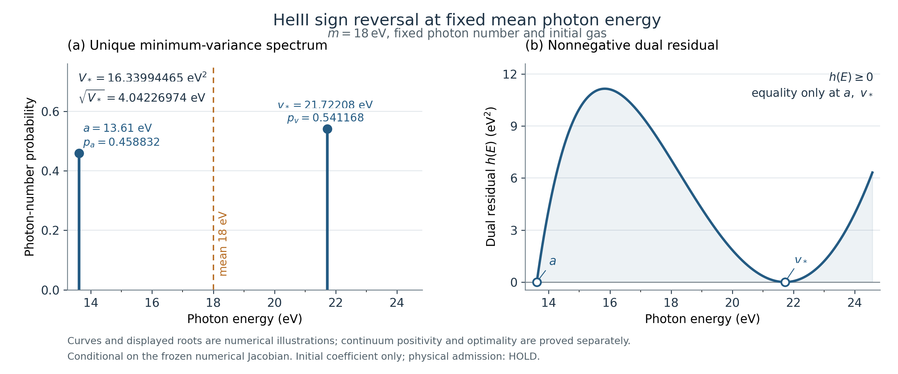

# REI PHYS25 — 최소 분산으로 HeIII 초기 응답의 부호를 바꾸기

평균 18 eV, 고정 수치 J·기체·광자 수, [13.61,24.58] eV에서 비음수 초기 HeIII 응답의 유일한 최소 분산을 구했다.

- 최소 분산: 약 16.33994465459 eV², RMS 약 4.04226974045 eV.
- 최적 두 선: 13.61 eV와 약 21.72208306483 eV, 확률 약 0.458831971404와 0.541168028596.
- 정확한 해는 보고서의 유일 영점으로 정의한다. 작은 음수 잔차를 가진 유한 중점을 정확 feasible이라고 선언하지 않는다.
- 독립 판정: PROMOTE_SCOPED, Physical HOLD. 첫 정확 부호 17/17, 첫 수치 127/127 PASS.
- 새 두 과학 main의 portability replay 결과는 최초 원 결과와 바이트 일치했다. 최종 ZIP 복원은 전체 manifest를 확인했고 과학 실행은 0회다.

## 읽는 순서

1. [연구 보고서](report/PHYS25_REPORT_KO.md)와 [수치 요약](report/PHYS25_RESULTS_SUMMARY.json).
2. [독립 최종 판정](independent/DECISION_REVIEW_KO.md).
3. [전역 변분 증명](contributions/variational/VARIANCE_MINIMUM_DERIVATION_KO.md), [도함수 인증](contributions/derivative/THIRD_DERIVATIVE_DERIVATION_KO.md), [수치 설명](contributions/numerics/VARIANCE_NUMERICS_KO.md).
4. [다음 단일 질문 PHYS26](next/PHYS26_NEXT_HANDOFF_KO.md).
5. [연구 종료](state/CLOSEOUT.json), [재현 receipt](portability/REPLAY_RECEIPT.json), [완성 archive identity](ARCHIVE_IDENTITY.json).

## 이 Git 문서 투영과 완성 재현 묶음

이 경로에는 읽기와 검토에 필요한 코드·입력·원 결과·증명·판정·그림·기록을 게시한다. 완성 ZIP과 바이트 inventory가 같은 디렉터리라고 주장하지 않는다. 루트 reproduce.py와 MANIFEST.json, 그림 PDF·241점 display JSON, replay 결과의 중복 원 JSON은 생략했다. 남아 있는 기여별 manifest와 재현·freeze 기록은 원래 전체 archive 문맥의 증거다.

엄격한 전체 재현에는 ARCHIVE_IDENTITY.json이 가리키는 완성 ZIP과 그 안의 README_REPRODUCE_KO.md를 사용한다. 이 Git 경로만으로 누락 파일을 무시하며 전체 archive 검증을 통과했다고 선언하지 않는다. 최종 복원 기록은 실제 로컬 ZIP 복원이고 원격 전체 재다운로드 복원은 아니다.

과학 소스·기본값·runtime을 변경하지 않았다. Physical HOLD, [160,161] FAIL, tick160, auxiliary escape FAIL, HH/RCT/CR OFF, precision atomic PARKED를 유지한다. 게시 commit, nonforce expected-head CAS, 전체 원격 tree와 선택 본문 readback은 별도 PHYS25_PUBLICATION_RECEIPT.json에 기록한다.
