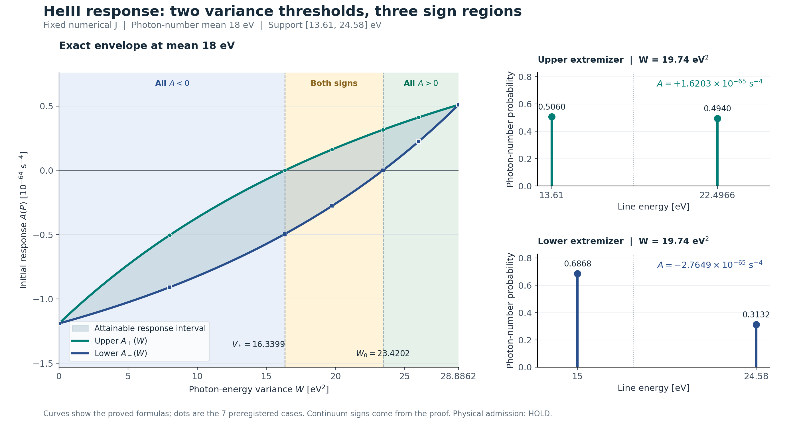

# PHYS26 — 평균·분산 고정 HeIII 초기 응답의 정확한 구간

연구 식별자: REI-PHYS26-20261011 · MEAN18_FIXED_VARIANCE_RESPONSE_ENVELOPE  
연구 날짜: 2026-10-11 KST · 실행 시각 UTC  
프로젝트: cosmosapjw-quantum/rei_bianchi  
입력 커밋: 2c5fb6b89908e5ac91395aeef8558b728bd4ce7b  
과학 source tree: cb69b4736dd046e4675557577eb8e0ead037d1f3

## 1. 이번에 닫은 질문과 결론

평균 광자 에너지가 18 eV이고 에너지 분산도 \(W\)로 같을 때, HeIII 초기 응답은 얼마나 달라질 수 있는가? PHYS25는 비음수 응답이 처음 가능한 최소 분산을 찾았다. 이번에는 **모든 허용 분산에서 가능한 응답의 정확한 전체 구간과, 각 경계를 달성하는 유일한 스펙트럼**을 구했다.

\[
\boxed{\mathcal A(W)=[A_-(W),A_+(W)]},
\qquad 0\le W\le28.8862\ {\rm eV}^2.
\]

부호를 가르는 두 분산은

\[
\boxed{V_*\simeq16.339944654589707345109\ {\rm eV}^2},
\qquad
\boxed{W_0\simeq23.420218992353392972114\ {\rm eV}^2}.
\]

이 두 수의 역할은 다르다. \(V_*\)는 비음수 응답이 가능한 최소 분산이고, \(W_0\)는 **같은 분산의 모든 허용 스펙트럼이 비음수 응답을 내는 최소 분산**이다. 두 값 사이에서는 광자 수·평균·분산이 전부 같아도 음·영·양 응답을 각각 만들 수 있다.

| 정확한 분산 조건 | 모든 허용 스펙트럼에 대한 결론 |
|---|---|
| \(0\le W<V_*\) | 모두 \(A<0\) |
| \(W=V_*\) | 모두 \(A\le0\); 영 응답은 상단의 두 선 측도 하나뿐 |
| \(V_*<W<W_0\) | 음수·영·양수 응답 모두 가능 |
| \(W=W_0\) | 모두 \(A\ge0\); 영 응답은 하단의 두 선 측도 하나뿐 |
| \(W_0<W\le28.8862\) eV² | 모두 \(A>0\) |

표의 경계는 §6의 **정확한 유일근으로 정의한 값**이다. 인쇄된 소수는 이전 원 수치 결과의 근사이며 엄밀 근 구간이나 물리적 오차 범위가 아니다. PHYS25에서 비교 경로의 영점에 머물렀던 \(W_0\)가 이제 전체 응답 하단의 영점이라는 지위를 얻었다. 이 승격은 새 근 계산에서 나온 것이 아니라 새 전역 극값 정리에서 나왔다.

전역 결론은 연속구간 이차 dual의 직접 증명이 담당한다. 첫 수치 실행은 7개의 사전 고정 분산에서 281/281 PASS였고 실제 커널 평가는 18회였다. 새 근 탐색과 도함수 부호 campaign은 0회다. [직접 유도](../contributions/theory/ENVELOPE_DERIVATION_KO.md), [첫 수치 원 결과](../contributions/numerics/FIXED_VARIANCE_ENVELOPE_FIRST.json), [검산 설명](../contributions/numerics/NUMERICS_NOTE_KO.md).

이 보고서는 고정된 연구 후보와 원 증거를 기술한다. 생성·검산 설계에 참여하지 않은 별도 검토자의 최종 판정은 [독립 판정문](../independent/DECISION_REVIEW_KO.md), 실제 완료 범위는 [CLOSEOUT.json](../state/CLOSEOUT.json)과 detached PHYS26_PUBLICATION_RECEIPT.json을 따른다. **물리적 채택은 HOLD**다.

## 2. 고정 물리 계약과 입력의 의미

에너지와 분포를

\[
I=[a,b]=[13.61,24.58]\ {\rm eV},\quad m=18\ {\rm eV},
\quad L=m-a=4.39\ {\rm eV},\quad H=b-m=6.58\ {\rm eV}
\]

로 둔다. \(P=d\nu_0/N_0\)는 I 위의 비음수 Borel 확률측도이며 델타 선을 허용한다. 가중치는 에너지 기준이 아닌 **광자 수 기준**이다.

\[
\int_I dP=1,\qquad \int_I E\,dP=m,\qquad
\int_I(E-m)^2dP=W.
\]

초기 \(\epsilon^2t^4\) HeIII 응답 계수를

\[
A(P)=\int_I k(E)dP(E),\qquad [A]=[k]={\rm s}^{-4}
\]

로 쓴다. \(W\)의 단위는 eV²다. 기존 초기 기체를 고정한 에너지 미분에서

\[
D=E\partial_E,\qquad\mathscr C=D(D+3),\qquad
\lambda(E)=c\,n_H(1-x_{HII})\sigma(E)=\kappa\sigma(E),
\]

\[
g(E)=\frac14\{J_x\mathscr C\lambda
+J_w\mathscr C[\lambda(E)(E-\chi)]\},
\qquad
k(E)=\frac{qN_0}{45}g(E).
\]

\(k\)에는 양의 정규화 \(qN_0/45\)가 이미 들어 있으므로 다시 곱하지 않는다. \(q=2\,{\rm shear}^2\), \({\rm shear}=[{\rm f64}(1.01\times10^{-14})-{\rm f64}(0.99\times10^{-14})]/2\)다. 빛의 속도는 cgs 소스 상수로 유지한다. Metric은 (-+++), 시간은 기체 동행 관측자의 proper seconds, 열 변수 \(w\)는 eV/H다. \([\epsilon^2]=\tfrac12\partial_\epsilon^2|_0\)이고 시간계수에 추가 factorial이 없다.

초기 기체는 \(H_{\rm expansion}=10^{-14}\ {\rm s}^{-1}\), \(n_H=10^{-4}\ {\rm cm}^{-3}\), \(f_{He}=0.083\), \(x_{HII}=0.9\), \(x_{HeII}=0.3\), \(x_{HeIII}=0.6\), \(T=50000\) K의 기존 소스 입력이다. 여기서 \(H_{\rm expansion}\)은 구간 길이 \(H=b-m\)와 구별한다. \(N_0\)는 binary64 리터럴 0.05 photon/H의 정확한 실수 해석이며 총 광자 에너지는 정확히 \(18N_0\) eV/H다.

\(J_x,J_w\)는 [PHYS22_INITIAL_COEFFICIENTS.json](../inputs/PHYS22_INITIAL_COEFFICIENTS.json)의 results.baseline_local.J_nonphoto[2][0], [2][3]이다. 약 \(-6.01326833811097\times10^{-17}\), \(+2.52759476961633\times10^{-18}\)이며 계산에는 전체 직렬화 소수를 사용했다. 이 소수들을 정확한 실수 상수로 고정한 조건부 수학 결과다. 원래 Jacobian의 오차를 새로 둘러싼 것은 아니다. Source binary64 리터럴을 정확 실수로 해석하는 계약도 native 각 연산의 반올림 이력과 구별한다.

원 HI 적합식은

\[
\sigma(E)=\sigma_0c_{\rm area}(x-1)^2
x^{p/2-11/2}(1+\sqrt{x/y_a})^{-p},\quad x=E/E_0
\]

다. \(E_0={\rm f64}(0.4298)\) eV, \(y_a={\rm f64}(32.88)\), \(p={\rm f64}(2.963)\), \(\sigma_0={\rm f64}(5.475\times10^4)\), \(c_{\rm area}={\rm f64}(10^{-18})\ {\rm cm}^2\)를 유지한다. 결합에너지 \(\chi={\rm f64}(13.598434599702)\) eV와 HI opacity cutoff 13.60 eV는 다른 상수다. I는 HI cutoff와 HeI cutoff 24.59 eV 사이에 있어 같은 매끄러운 식을 사용할 수 있다. [원 source snapshot](../inputs/pinned_source/rust/rei_microphysics/src/atomic_provider.rs).

동결 계약 SHA256은 d4ff7556332f75447d93e0c6a8da4a0d96cb8a86b257f111809d388b7f2b80ce, J 입력 SHA256은 6c7a4f239ef48c2a7c60592fc048600317f1233f3028434ebd1b3c7e55682a79다. 최신 immutable tree와 선택 source 7개의 blob·크기, 상속 입력 24개의 identity를 실제 확인했다. [입력 소비 범위](../evidence/INTAKE_CONSUMPTION_KO.md), [SOURCE_MANIFEST.json](../SOURCE_MANIFEST.json).

## 3. 정확한 응답 경계와 극값 스펙트럼

평균 m인 모든 P에서

\[
\int_I(E-a)(b-E)dP=LH-W
\]

다. 왼쪽이 비음수이므로 허용 분산은 \(0\le W\le LH=28.8862\) eV²다. \(W=0\)에서는 \(P=\delta_m\), \(W=LH\)에서는

\[
P_{\rm end}=\frac{H}{L+H}\delta_a+
\frac{L}{L+H}\delta_b
\]

가 유일하다. 허용 범위 밖은 공집합이므로 부호 명제를 공허하게 확대하지 않는다.

각 W에서

\[
v_W=m+\frac WL,\qquad u_W=m-\frac WH
\]

로 두면, 두 극값 측도는

\[
\boxed{P_W^a=\frac{W}{L^2+W}\delta_a+
\frac{L^2}{L^2+W}\delta_{v_W}},
\]

\[
\boxed{P_W^b=\frac{H^2}{H^2+W}\delta_{u_W}+
\frac{W}{H^2+W}\delta_b}.
\]

질량·평균·분산을 직접 대입하면 각각 1, m, W가 된다. \(0<W<LH\)에서는 \(a<u_W<m<v_W<b\)이고 각 두 선의 확률이 양수다.

정확한 상·하한 함수는

\[
\boxed{
A_+(W)=\frac{Wk(a)+L^2k(m+W/L)}{L^2+W}
},
\]

\[
\boxed{
A_-(W)=\frac{H^2k(m-W/H)+Wk(b)}{H^2+W}
}.
\]

모든 \(P\in\mathcal P_W\)에 대해 \(A_-(W)\le A(P)\le A_+(W)\)이고,

\[
A(P)=A_+(W)\iff P=P_W^a,\qquad
A(P)=A_-(W)\iff P=P_W^b.
\]

두 끝점 분산에서는 이 두 측도와 두 응답이 합쳐진다. 내부 분산에서는 \(A_-<A_+\)가 엄격하다. 여러 선·연속 스펙트럼도 전역 부등식과 등호 분류에 포함된다.

## 4. 모든 측도를 덮는 연속구간 증명

닫힌 입력은 PHYS24의 \(k''>0\)와 PHYS25의 \(k'''<0\)다. 후자는 17차 다항식 분자의 Bernstein 계수 18개가 모두 음수임을 정확 유리수 연산으로 확인한 기존 결과다. 이번에는 그 부호 suite를 다시 실행하지 않는다. [상속 곡률 근거](../inputs/inherited/PHYS24_CURVATURE_DERIVATION_KO.md), [상속 세 번째 도함수 원 인증](../inputs/inherited/PHYS25_THIRD_DERIVATIVE_CERTIFICATE.json).

\(s\in I\)에서 적분 Taylor 나머지를

\[
H_s(E)=\int_0^1(1-t)\,
k''(s+t(E-s))dt
\]

로 두면

\[
k(E)=k(s)+k'(s)(E-s)+(E-s)^2H_s(E).
\]

이 식은 \(E<s\), \(E=s\), \(E>s\)를 함께 처리한다. \(E=s\)에서는 \(H_s(s)=k''(s)/2\)라서 특이점이 없다. 또한

\[
\partial_EH_s(E)=\int_0^1t(1-t)
k'''(s+t(E-s))dt<0.
\]

따라서 \(H_s\)는 E에 대해 엄격히 감소한다. \(v=v_W,\ u=u_W\)로 놓고 이차식

\[
Q_+(E)=k(v)+k'(v)(E-v)+H_v(a)(E-v)^2,
\]

\[
Q_-(E)=k(u)+k'(u)(E-u)+H_u(b)(E-u)^2
\]

를 정의하면

\[
\boxed{Q_+(E)-k(E)
=(E-v)^2[H_v(a)-H_v(E)]\ge0},
\]

\[
\boxed{k(E)-Q_-(E)
=(E-u)^2[H_u(E)-H_u(b)]\ge0}
\]

가 I 전체에서 성립한다. 각 잔차의 영점은 정확히 \(\{a,v\}\), \(\{u,b\}\)다.

같은 질량·평균·분산을 가진 측도는 모든 이차다항식의 적분값이 같다. 이를 두 부등식에 적용하면 \(P_W^a\)의 상단과 \(P_W^b\)의 하단을 얻는다. 비음수 연속 잔차의 적분이 0이면 측도는 잔차 영점에만 지지되어야 하고, 질량과 평균이 두 확률을 유일하게 고정한다. 이로써 극값뿐 아니라 모든 등호 측도까지 정해진다.

내부 분산에서 \(P_W^b\)는 b에 양의 질량을 가지는데 b는 상단 잔차의 영점이 아니다. 따라서 \(A_-(W)<A_+(W)\)다. 이 엄격한 응답 폭도 표본 비교 없이 나온다.

이차식은 한 끝점의 함수값과 다른 접촉점의 함수값·도함수를 맞추는 Hermite 보간식으로 볼 수 있다. 반복 접촉점의 일반 보간·나머지 공식은 [Nicholas Hu의 원 강의 노트](https://math.ucla.edu/~njhu/notes/na/interp/polyinterp/)에서 실제 확인했다. 문헌은 일반 보간의 맥락을 제공하며, 여기의 고정 커널·모멘트·정확한 두 부호 경계는 위 직접 유도로 연결한다. 읽은 범위와 인용 한계는 [LITERATURE_SCOPE.json](../evidence/LITERATURE_SCOPE.json)에 있다.

## 5. 구간 안의 모든 응답은 실제로 가능하다

허용 측도 집합 \(\mathcal P_W\)는 콤팩트 구간 위 확률측도의 닫힌 모멘트 제약으로 정의되므로 약한 수렴에 대해 콤팩트하다. 질량·평균·분산 제약은 측도에 선형이어서 볼록하다. 응답은 연속 선형 함수이므로 그 상은 닫힌 구간이다.

내부 분산에서 목표 응답 \(A_{\rm target}\in[A_-,A_+]\)를 택하면

\[
\theta=\frac{A_{\rm target}-A_-}{A_+-A_-},\qquad
P_\theta=(1-\theta)P_W^b+\theta P_W^a
\]

로 직접 구성할 수 있다. 같은 세 모멘트를 유지하면서 \(A(P_\theta)=A_{\rm target}\)가 된다. 최대 네 선을 쓰는 하나의 구성이다. \(\theta\)는 이 한 매개변수 혼합 안에서 유일하지만, 같은 내부 응답을 내는 모든 가능한 스펙트럼이 유일하다는 주장은 하지 않는다.

특히 \(A_-<0<A_+\)인 구간에서는

\[
\theta_0=\frac{-A_-}{A_+-A_-}
\]

의 혼합이 정확한 영 응답을 준다. 이 계수는 정확한 커널 값으로 정의한다. 유한 소수로 계산한 혼합에는 반올림 잔차가 남을 수 있다.

## 6. 두 부호 경계의 존재·유일성·순서

이전의 닫힌 끝값은

\[
A_\pm(0)=k(m)\simeq-1.18987738293\times10^{-64}<0,
\]

\[
A_\pm(LH)=B(m)
=\frac{Hk(a)+Lk(b)}{L+H}
\simeq+5.09349169344\times10^{-65}>0
\]

다. 위 경계식을 미분하면

\[
A_+'(W)=H_{v_W}(a)>0,\qquad
A_-'(W)=H_{u_W}(b)>0.
\]

마지막 양수성에는 추가 조건 \(k''>0\)를 사용한다. **\(k'''<0\)는 극값의 방향·유일성을, \(k''>0\)는 분산에 따른 단조성을 담당한다.** 따라서 두 연속 경계는 각각 정확히 한 번 0을 지난다.

상단의 정확한 영점은

\[
(v_*-m)k(a)+Lk(v_*)=0,\qquad m<v_*<b,
\qquad V_*=L(v_*-m).
\]

하단의 정확한 영점은

\[
Hk(u_0)+(m-u_0)k(b)=0,\qquad a<u_0<m,
\qquad W_0=H(m-u_0).
\]

PHYS25의 원 수치 결과는 이 두 경로의 근을 이미 평가했다. 이번에는 상단·하단의 전역 정리를 연결했으므로 두 값을 각각 정확한 부호 경계로 해석할 수 있다.

| 경계 | 이동하는 선 eV, 근사 | 해당 영 응답 스펙트럼의 확률, 근사 | RMS 에너지 폭 eV |
|---|---:|---|---:|
| \(V_*\) | \(v_*=21.722083064826812607\) | 13.61에 0.458831971403916649, \(v_*\)에 0.541168028596083351 | 4.042269740453958 |
| \(W_0\) | \(u_0=14.440696201770001068\) | \(u_0\)에 0.648959744272447921, 24.58에 0.351040255727552079 | 4.839444078853830 |

근으로 정의한 정확한 law와 표의 근사 소수를 구별한다. 이전 유한 중점의 응답은 각각 \(-2.27486876684\times10^{-137}\), \(-3.25826546129\times10^{-137}\ {\rm s}^{-4}\)였다. 이번 수치 경로도 이 잔차를 그대로 확인했으며 이를 0으로 재분류하지 않았다.

순서는 소수 비교에 의존하지 않는다. 내부 분산 \(V_*\)에서

\[
A_-(V_*)<A_+(V_*)=0
\]

이고 하단이 엄격 증가하므로

\[
\boxed{0<V_*<W_0<LH}.
\]

이에 따라 §1의 부호 표가 완성된다. 같은 양화 내용을 쓰면, 모든 \(W\in[0,LH]\)에 대해

\[
\begin{aligned}
\exists P:\ A(P)\ge0&\iff W\ge V_*,
&\exists P:\ A(P)>0&\iff W>V_*,\\
\forall P:\ A(P)\ge0&\iff W\ge W_0,
&\forall P:\ A(P)>0&\iff W>W_0,\\
\exists P:\ A(P)=0&\iff V_*\le W\le W_0.
\end{aligned}
\]

각 P는 같은 \(\mathcal P_W\)에 속한다. 모든 law의 엄격 양수성을 보장하는 분산 집합은 \((W_0,LH]\)이므로 최소 원소는 없고 infimum은 \(W_0\)다. 경계에서 영 응답 law가 하나 남는다는 사실을 빠뜨리지 않는다.

## 7. 같은 평균·분산인데 반대 부호인 구체적 예

\(W=19.74\) eV²는 두 경계 사이에 있다. 이때 정확한 응답 구간의 수치 평가는

\[
\boxed{\mathcal A(19.74)\simeq
[-2.76487053624,\,+1.62032722687]\times10^{-65}\ {\rm s}^{-4}}
\]

다. 수치 표시는 근사이며 구간 끝의 정확한 값은 §3의 식으로 정의한다.

| 극값 | 에너지 지지 eV | 광자 수 확률 | 응답 s⁻⁴, 근사 |
|---|---|---|---:|
| 상단 \(P_W^a\) | 13.61, 22.496583143507973 | 0.505996857385273, 0.494003142614727 | \(+1.62032722687\times10^{-65}\) |
| 하단 \(P_W^b\) | 15, 24.58 | 0.686847599164927, 0.313152400835073 | \(-2.76487053624\times10^{-65}\) |

둘 다 광자 수 \(N_0\), 평균 18 eV, 분산 19.74 eV²를 정확한 식으로 보존한다. 차이는 더 자세한 에너지 분포에 남아 있다. 분산만으로 응답값이나 부호를 정할 수 없다는 것을 같은 두 모멘트를 가진 실제 극값 쌍으로 보인다.

이 두 law를 상단 비율 약 0.63050076315880260625로 섞으면 영 응답을 구성할 수 있다. 새 root 탐색은 필요하지 않다. 정확한 혼합식의 응답은 0이고, 유한 Decimal 계산에서 네 선의 직접 합은 \(10^{-224}\ {\rm s}^{-4}\), 응답 두 개의 affine 결합은 반올림상 \(0\times10^{-224}\)였다. 두 계산값을 모두 원 JSON에 남겼다.

곡선은 증명한 식의 표시용 평가이고 점은 사전 검산한 7개 분산이다. 그림은 86개 분산·171개 고유 에너지의 Decimal 80자리 표시 평가를 사용한다. 최초 시각 확인에서 legend가 경계 표기를 가려 배치만 수정하여 다시 표시했다. 표시 실행은 총 2회·342개 커널 평가이며 과학 검산·근·도함수 부호 캠페인으로 세지 않는다. [표시 provenance](../figures/DISPLAY_PROVENANCE.json), [배치 수정 기록](../state/TOOLING_EVENTS.json).

## 8. 첫 수치 실행과 검증의 실제 범위

수치 설계는 새 이론 결과를 읽기 전에 동결했다. PHYS25 순수 원식 helper를 명시적으로 읽고 적응하여 기존 5차 로그 Taylor jet을 필요한 **3차**로 줄였다. \(F=qN_0\kappa/180\), \(f=\sigma[J_x+J_w(E-\chi)]\)에서

\[
k=F(D^2+3D)f,\qquad
k'=\frac FE(D^3+3D^2)f
\]

만 계산한다. \(k''\), \(k'''\)의 새 계산·부호 검사는 하지 않는다.

별도 경로는 원 HI 적합식의 scalar 로그미분 \(\ell_j=D^j\log\sigma\), \(j=1,2,3\)과 곱미분으로 \(k,k'\)를 얻는다. 이 경로는 jet을 사용하지 않는다. 같은 물리식·상수·J를 공유하므로 독립 원자 데이터나 독립 기체 모형으로 검증한 것은 아니다. [전체 새 코드](../contributions/numerics/fixed_variance_envelope.py).

첫 실행 시각은 2026-10-11 00:41:35 UTC이며 Decimal 정밀도는 160, Python은 3.12.14다. 코드·protocol·입력 9개를 실행 전에 동결했고 이후 과학 코드 수정·허용오차 변경·첫 실행 재시도는 없다.

| 항목 | 사전 예산 | 실제 첫 실행 |
|---|---:|---:|
| 고정 분산 | 7 | 7 |
| 별도 원식 비교 에너지 | 5 | 5 |
| Jet 고유 커널 평가 | 최대 15 | 13 |
| Scalar 로그미분 평가 | 최대 5 | 5 |
| 총 커널 평가 | 최대 20 | 18 |
| 원식·모멘트·접촉·혼합 등 검사 | protocol의 고정 항목 | 281/281 PASS |
| 새 근 탐색·새 도함수 부호 캠페인 | 0 | 0 |
| 기존 main/suite·native·gas IVP | 0 | 0 |

캐시 조회 132회와 커널 평가 18회는 다르다. 각 W에서 질량·평균·분산·이차 모멘트·총 광자 수·총 광자 에너지, 이차식의 값·기울기 접촉, 모멘트로 구한 이차식 기대값과 양 후보의 명시적 합을 비교했다. 양 끝점에서는 동일 law로 합쳐지고 내부 5개 분산에서는 응답 순서가 엄격했다. \(a,m,b\)의 dual 잔차 표본 42개는 구현 검사이며 전역 증명이 아니다.

다음 표의 응답 단위는 \(10^{-64}\ {\rm s}^{-4}\)다. 모자는 상속된 유한 root 소수를 사용했음을 뜻한다.

| W, eV² | 하단 후보의 수치 응답 | 상단 후보의 수치 응답 |
|---:|---:|---:|
| 0 | −1.18987738292843534 | −1.18987738292843534 |
| 8 | −0.908398325363494819 | −0.503772352558500409 |
| \(\widehat V_*\simeq16.33994465459\) | −0.494005971482840049 | \(-2.27486876684\times10^{-73}\) |
| 19.74 | −0.276487053624175843 | +0.162032722686606765 |
| \(\widehat W_0\simeq23.42021899235\) | \(-3.25826546129\times10^{-73}\) | +0.315621443899253018 |
| 26 | +0.223978782425133756 | +0.411696804172668786 |
| 28.8862 | +0.509349169343731409 | +0.509349169343731409 |

별도 원식 비교 15개에서 최대 scaled 차이는 \(3.9469\times10^{-157}\), 사전 허용치는 \(10^{-120}\)이었다. \(\sigma,k,k'\)는 각각 \(10^{-18}\ {\rm cm}^2\), \(10^{-64}\ {\rm s}^{-4}\), \(10^{-64}/E\ {\rm s}^{-4}{\rm eV}^{-1}\)로 정규화했다. 이 작은 차이는 구현 경로의 일치 정도이며 물리적 정확도·엄밀 interval 오차가 아니다.

첫 결과 SHA256은 23efff335062c1e32fd6888d86fdf862dc9faca915fb120a97420187d6a9a4fe, 코드 SHA256은 6838ebe1a7a57cfd7155bb8d0c8d8437deb4617c38caf04c1daf7db674525860이다. 사전 동결·원 stdout/stderr·실행 기록을 그대로 보존했다. [PROTOCOL.json](../contributions/numerics/PROTOCOL.json), [EXECUTION.json](../contributions/numerics/EXECUTION.json).

## 9. 독립성, 실패 보존, 재현과 주장 등급

이론 기여자와 수치 기여자는 각자의 새 작업을 다른 PHYS26 결과를 읽지 않고 설계했다. 두 역할 모두 전체 대화 이력·기존 PHYS25 결과·handoff 후보식에 노출된 NONBLIND이며, 이론 기여자는 owner의 제안된 적분 경로에도 노출되어 있다. 이를 맹검이나 서로 다른 입력으로 재현한 것으로 부르지 않는다. 최종 판정은 두 생성자 및 owner와 구분되는 실제 별도 reviewer가 맡는다. [실제 역할·노출 기록](../evidence/INDEPENDENCE_ACTUAL.json).

첫 과학 실패·과학 코드 수정·허용오차 변경은 모두 0이다. 읽기 중 잘못된 기존 source 경로를 바로잡은 사건, 큰 도구 출력의 잘림과 선택 재열람, 처음 PHYS26 계약에 남아 있던 과거 질문·시간 메타데이터의 위임 전 수정, 그림 legend 배치 수정, 비어 있는 공유 출력 디렉터리를 재현 준비의 미존재 조건이 거부한 사건은 도구·문서 사건으로 보존했다. 재현 준비 오류는 과학 실행 전에 발생했고 파일별 새 생성 조건을 유지하여 바로잡았다. 최초 계약 메타데이터는 state/INTAKE_CONTRACT_INITIAL_METADATA.json에 있으며 현재 유효 계약은 본문에 고정한 SHA의 PHYSICS_CONTRACT.json이다.

포터빌리티는 새 PHYS26 프로그램만 한 번 재현하도록 제한했다. 필요한 과학 payload 12개를 정확히 복사한 별도 staging ZIP을 새 경로에 풀고, manifest 확인 후 새 main을 한 번 실행하여 원 JSON과 전체 구조·바이트 identity를 비교한다. 이 기록은 [REPLAY_RECEIPT.json](../portability/REPLAY_RECEIPT.json), 실제 staging 범위는 [PORTABILITY_SCOPE.json](../portability/PORTABILITY_SCOPE.json)을 따른다. 이는 독립 물리 증거를 추가하는 계산이 아니다.

최종 완성 ZIP은 판정·보고·상태까지 포함한 전체 payload를 새 경로에 풀어 **검증만** 수행한다. 과학 main 실행은 0이다. Git 게시본은 문서·코드·선별 증거의 projection이며, 그 tree·blob 확인을 ZIP 전체 복원으로 간주하지 않는다. 현재 branch 최신 head를 확인한 nonforce expected-head CAS와 게시 뒤 source tree 보존의 실제 결과는 detached 게시 receipt에 남긴다. [재현 안내](../README_REPRODUCE_KO.md).

| 주장 | 증거 등급 |
|---|---|
| 정확한 고정 분산 응답 구간·모든 극값 law·끝점 퇴화 | derived, 닫힌 \(k'''<0\)에 조건부 |
| 각 경계의 엄격 증가·정확한 두 영점 순서·모든 부호 영역 | derived, 추가 \(k''>0\)와 끝값 부호에 조건부 |
| 기존 두 근의 소수 값·7개 응답 표·혼합 수치 | numerically checked |
| 원식 두 경로·모멘트·접촉·사전 실행 예산 | implementation-verified |
| 표시 곡선 | display only |
| 최종 채택·게시·전달 완료 | 별도 독립 판정과 closeout·publication receipt |

모든 현재 주장과 의존 관계는 [CLAIM_DAG.json](../claims/CLAIM_DAG.json)에 연결했다. \(k\) 전체에 양의 상수를 곱하면 응답 크기만 바뀌고 두 extremizer와 분산 경계는 유지된다. 반면 J·초기 기체·원자 적합식처럼 커널의 모양을 바꾸는 변화는 이 불변성으로 처리할 수 없다.

## 10. 물리적 해석의 한계와 다음 한 질문

음·양 부호는 초기 \(\epsilon^2t^4\) 응답 계수의 부호다. 이온 분율 자체가 음수라는 뜻이 아니며, 유한 시간의 전체 HeIII 편차 부호를 보장하지도 않는다. 영 응답 경계에서 더 높은 시간차수나 유한 epsilon 나머지가 0이라는 결론은 없다. 높은 계산 자릿수도 원 Jacobian·원자 데이터의 정확도를 뜻하지 않는다.

Physical HOLD, [160,161] FAIL, tick160, auxiliary escape FAIL, HH/RCT/CR OFF, precision atomic PARKED를 유지한다. Native·gas IVP·생산 source/default/runtime 변경은 0이다. 새로운 J 불확실성 범위, 물리 방출원 admission, 모든 평균의 위상도 또는 세계 최초성을 주장하지 않는다.

다음 한 질문은 **델타 선을 반폭 0.05 eV의 균일 대역으로 제한했을 때 같은 평균·분산 응답 구간과 두 부호 경계가 어떻게 바뀌는가**다. 현재 극값은 델타 선 허용 계약에서 달성되므로, 명시적인 유한 선폭 분포족에서의 안정성을 먼저 확인할 가치가 있다. 이 균일 대역족을 실제 방출원 전체와 동일시하지 않는다.

PHYS27_FINITE_WIDTH_RESPONSE_ENVELOPE 후보의 분포 정의·중심 분산과 실제 광자 분산의 구별·상속 입력·제한된 새 적분 및 두 경계 근 예산·독립 최종 판정·게시 범위를 [단일 후속 handoff](../next/PHYS27_NEXT_HANDOFF_KO.md)에 남겼다. PHYS27은 이번 루프에서 실행하지 않았다.
