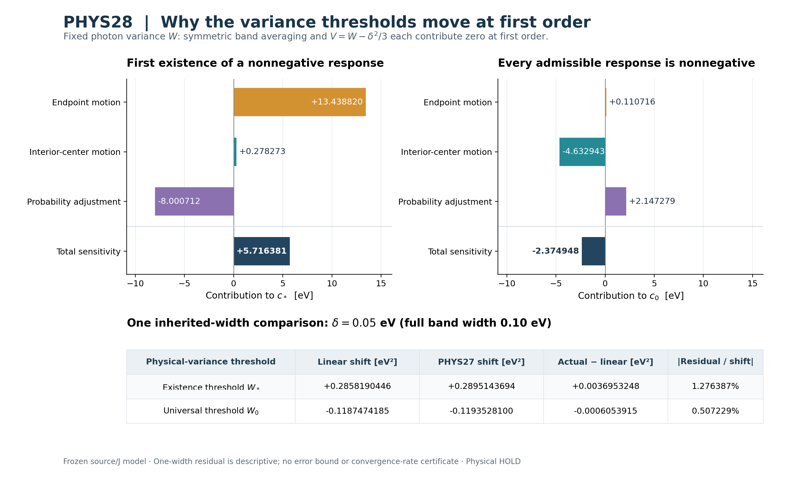

# PHYS28 — 작은 대역폭에서 두 분산 문턱의 이동 원인

**REI-PHYS28-20261011 · SMALL_WIDTH_THRESHOLD_SENSITIVITY · 2026-10-11**  
GPT-6 Astra · research/coding harness v4.0.0  
이론 유도·첫 수치 실행·별도 경로 재현을 완료했다. 최종 승격 권위와 범위는 [독립 판정문](../independent/DECISION_REVIEW_KO.md), [판정 JSON](../independent/DECISION_REVIEW.json)에 있다. **Physical HOLD**를 유지한다.

## 1. 결과와 의미

PHYS27에서 반폭 δ=0.05 eV인 균일 대역을 쓰면 두 분산 문턱이 안쪽으로 이동했다. 이번에는 **같은 실제 광자 분산 W**를 유지하면서 폭을 0에서 늘릴 때의 일차 이동을 계산했다. 존재 문턱은 올라가고 전체 비음수 문턱은 내려가며, 두 방향은 상속된 곡률 조건으로 해석적으로 결정된다.

\[
W_{*,\delta}=V_{*,0}+c_*\delta+o(\delta),\qquad c_*>0,
\]
\[
W_{0,\delta}=W_{0,0}+c_0\delta+o(\delta),\qquad c_0<0.
\]

저장된 PHYS26 근에서 새로 평가한 수치 근사와 PHYS27 한 폭의 비교는 다음과 같다. δ는 **반폭**이고 c의 단위는 eV다. 분산 단위 eV²를 반폭 단위 eV로 미분한 값이며 전체 폭에 대한 미분계수와 구별한다.

| 문턱 | 일차계수 c, eV | .05c, eV² | PHYS27 실제 이동, eV² | 실제−선형, eV² | 절대잔차/실제 이동 |
|---|---:|---:|---:|---:|---:|
| 비음수 응답이 처음 존재 | +5.71638089140 | +0.285819044570 | +0.289514369390 | +0.00369532482000 | 1.27638736% |
| 모든 응답이 비음수 | -2.37494837006 | -0.118747418503 | -0.119352810041 | -0.000605391537981 | 0.50722856% |

가장 큰 물리적 결론은 **대칭 균일 평균화 자체는 일차항을 만들지 않는다**는 점이다. 이번 일차 이동은 대역을 원 지원구간 안에 유지하기 위한 끝점·내부 중심·광자 확률의 공동 조정에서 나온다. 평균화와 중심 분산 보정은 이차부터 관여하며 그 이차 문턱 계수는 이번에 계산하지 않았다. [전체 유도](../contributions/theory/DERIVATION_KO.md), [첫 수치 원자료](../contributions/numerics/SMALL_WIDTH_FIRST.json).

그림의 막대는 c의 각 항이다. 각 패널의 앞 세 막대를 합하면 마지막 막대가 된다. 표는 δ=.05의 기존 수치값과 새 일차식의 비교다. 그림을 위해 새 커널이나 영점을 계산하지 않았다.

## 2. 고정한 물리 계약

원 광자 지원은 [a,b]=[13.61,24.58] eV, 평균은 m=18 eV, L=m−a=4.39 eV, H=b−m=6.58 eV다. 중심 분포 Q는 광자 수 확률측도이며 각 중심을 동일한 반폭 δ의 균일 대역으로 펼친다.

\[
p_\delta(E)=\frac1{2\delta}\int\mathbf1_{[c-\delta,c+\delta]}(E)dQ(c),
\qquad f_\delta(c)=\frac12\int_{-1}^1k(c+\delta z)dz.
\]

\[
\alpha=a+\delta,\quad\beta=b-\delta,\quad
\ell=L-\delta,\quad h=H-\delta,\quad
V=W-\frac{\delta^2}{3}.
\]

실제 허용 분산은 δ²/3≤W≤(L−δ)(H−δ)+δ²/3다. 이번 미분은 0<W<LH의 고정 W를 대상으로 하며 충분히 작은 양의 폭에서 그런 W가 실제로 허용됨을 사용한다. W=0과 W=LH는 같은 W를 유지한 양의 폭 경로에 포함하지 않는다.

응답 A와 커널 k는 **초기 HeIII ε²t⁴ 계수**, 단위 s⁻⁴다. 시간은 gas-comoving proper seconds, metric은 (−,+,+,+), 열 변수 w는 eV/H다. [ε²]는 2차 ε 도함수의 절반이며 시간 다항식 계수에 추가 factorial을 넣지 않는다.

\[
k(E)=\frac{qN_0\kappa}{180}(D^2+3D)
\{\sigma(E)[J_x+J_w(E-\chi)]\},\qquad D=E\partial_E.
\]

원 HI fit, source binary64 상수의 정확 실수 해석, PHYS22의 전체 직렬화 J 두 성분을 유지했다. 기체 상태·J·광자 수·평균을 폭과 함께 변경하지 않는다. k의 공통 정규화는 한 번만 포함하며 k′는 에너지 도함수다. J SHA256은 `6c7a4f239ef48c2a7c60592fc048600317f1233f3028434ebd1b3c7e55682a79`다. 상속한 조건은 k∈C³([a,b]), k″>0, k‴<0 및 기존 끝값 부호가 지지하는 내부 단순근의 존재다. 닫힌 PHYS24/25 곡률 인증을 재실행하지 않았다. [계약](../PHYSICS_CONTRACT.json), [현재 소스 결합](../SOURCE_MANIFEST.json).

## 3. 일차항을 빠짐없이 분리했다

PHYS27의 두 정확 경계는

\[
A_{\delta,+}(W)=\frac{Vf_\delta(\alpha)+\ell^2 f_\delta(m+V/\ell)}{\ell^2+V},
\qquad
A_{\delta,-}(W)=\frac{h^2 f_\delta(m-V/h)+Vf_\delta(\beta)}{h^2+V}.
\]

δ=0에서 v=m+W/L, u=m−W/H, D_L=L²+W, D_H=H²+W라 두자. 실제 W를 고정하면 α′=1, β′=−1, v′=W/L², u′=−W/H²다. 끝점 확률 p= W/D_L, r=W/D_H의 도함수는 각각 2LW/D_L², 2HW/D_H²다. 내부 확률의 도함수는 그 반대 부호다.

고정 내부 중심에서는

\[
\left.\partial_\delta f_\delta(c)\right|_{0^+}
=\frac12\int_{-1}^1zk'(c)dz=0,
\qquad\left.\partial_\delta V\right|_{W,0}=0.
\]

원 끝점 a,b에 고정한 양의 폭 평균은 허용되지 않는다. 그곳에서는 실제 허용 경로 fδ(a+δ), fδ(b−δ)를 미분하여 각각 k′(a), −k′(b)를 얻는다. 원 지원 밖으로 커널을 외삽할 필요가 없다.

이를 모두 합하면

\[
B_+(W):=\left.\partial_\delta A_{\delta,+}\right|_0
=\frac{Wk'(a)}{D_L}+\frac{Wk'(v)}{D_L}
+\frac{2LW[k(a)-k(v)]}{D_L^2},
\]
\[
B_-(W):=\left.\partial_\delta A_{\delta,-}\right|_0
=-\frac{Wk'(b)}{D_H}-\frac{Wk'(u)}{D_H}
+\frac{2HW[k(b)-k(u)]}{D_H^2}.
\]

순서대로 끝점 이동, 내부 중심 이동, 확률 조정의 기여다. 개별 항은 서로 상쇄되므로 일부 항의 부호만으로 전체 부호를 판정하지 않는다.

## 4. 두 일차계수의 비영성과 부호

다음 차이를 정의하면

\[
T(x,y)=k'(x)+k'(y)-2\frac{k(y)-k(x)}{y-x},\qquad x<y,
\]

두 번 부분적분하여

\[
\boxed{T(x,y)=\frac1{y-x}\int_x^y(E-x)(y-E)k'''(E)dE<0}
\]

를 얻는다. 내부 가중치는 양수이고 k‴는 음수이므로 엄격한 부호다. 따라서

\[
\boxed{B_+(W)=\frac{W}{L^2+W}T(a,v)<0,\qquad
B_-(W)=-\frac{W}{H^2+W}T(u,b)>0.}
\]

PHYS27의 엄격 포함만으로는 일차계수가 0일 가능성을 배제할 수 없다. 이번 가중 적분식이 그 추가 사실을 준다. 반대로 k가 이차 다항식이면 T=0이고 고정한 질량·평균·실제 분산만으로 응답이 결정되어 폭에 무관하다. 이 대수 극한 점검은 세 번째 도함수의 역할을 분명히 한다.

상속된 양의 분산 기울기는

\[
C_+(W)=\frac{k(a)-k(v)+(v-a)k'(v)}{(v-a)^2}>0,
\quad
C_-(W)=\frac{k(b)-k(u)-(b-u)k'(u)}{(b-u)^2}>0.
\]

여기서 양수성은 k″>0에 의존한다. 정확 내부근에서

\[
\boxed{c_*=-\frac{B_+(V_{*,0})}{C_+(V_{*,0})}>0,\qquad
c_0=-\frac{B_-(W_{0,0})}{C_-(W_{0,0})}<0.}
\]

B는 s⁻⁴ eV⁻¹, C는 s⁻⁴ eV⁻²이므로 c는 eV다. 전체 커널의 공통 양의 배율은 이 비에서 상쇄된다. 원 J의 상대 성분이나 커널 모양의 변화까지 상쇄된다는 뜻은 아니다.

## 5. 물리적으로 허용되는 한쪽 근 전개

원근 w가 (0,LH) 내부에 있으므로 그 양옆의 고정된 작은 W구간은 충분히 작은 양의 δ에서도 허용된다. 명시적 경계식과 연속 도함수는 양쪽 끝의 응답 부호 및 양의 W 기울기를 보존한다. 이로부터 새 근 w(δ)의 국소 존재·유일성과 w(δ)→w를 얻는다.

W에 대한 평균값정리로

\[
0=A_\delta(w(\delta))
=A_\delta(w)+\partial_W A_\delta(\xi_\delta)[w(\delta)-w]
\]

이며, δ로 나누고 δ↓0을 취하면 (w(δ)−w)/δ→−B(w)/C(w)다. 이것이 이번에 필요한 우미분과 o(δ) 전개를 정당화한다. 음의 폭이나 원 지원 밖 물리 커널을 도입하지 않았다. [상세 증명 T28.24–26](../contributions/theory/DERIVATION_KO.md).

암묵함수의 일반 미분 형태와 C¹·비영 분모 조건은 [UNSW MATH2111 강의노트](https://web.maths.unsw.edu.au/~potapov/2111_course_notes/Implicit-Function-Theorem_002c-Statement-of-Theorem.html), [University of Kentucky Lecture4](https://www.ms.uky.edu/~ken/ma570/lectures/lecture4/inverse.web)의 실제 해당 절을 읽어 연결했다. 현재 문제의 한쪽 물리 영역 처리는 위 직접 논증의 결과이며 외부 문헌이 우리 커널이나 수치 문턱을 검증한 것은 아니다. [열람 범위](../evidence/LITERATURE_SCOPE.json).

## 6. 수치 크기와 항별 상쇄

| 저장된 원근에서 평가한 양 | 상단 경계 A+ | 하단 경계 A− |
|---|---:|---:|
| B=∂δA, s⁻⁴ eV⁻¹ | -2.90622276692e-65 | +1.93990583292e-65 |
| C=∂WA, s⁻⁴ eV⁻² | +5.08402575359e-66 | +8.16820212758e-66 |
| 저장된 원근의 유한 응답 잔차, s⁻⁴ | -2.27485871103e-137 | -3.25825144144e-137 |

실제 평가 에너지는 a=13.61, v*≈21.7220830648, u0≈14.4406962018, b=24.58 eV 네 곳이다. 위 잔차를 0으로 대체하지 않았고 일반 B/C 식을 사용했다. 정확근에서만 가능한 간략식과 일반식의 차이는 유도문 T28.29에 원근 잔차로 명시했다. 매우 긴 소수나 작은 잔차 자체를 정확근의 구간 인증으로 취급하지 않는다.

각 B항을 −C로 나눈 c의 분해는 다음과 같다.

| c의 기여, eV | 존재 문턱 c* | 전체 비음수 문턱 c0 |
|---|---:|---:|
| 지원 끝점의 이동 | +13.4388201762 | +0.110715757966 |
| 내부 중심의 이동 | +0.278273155170 | -4.63294346843 |
| 광자 확률의 조정 | -8.00071243999 | +2.14727934040 |
| 고정 중심에서의 대역 평균화 | 0 | 0 |
| V=W−δ²/3 보정 | 0 | 0 |
| **합계** | **+5.71638089140** | **-2.37494837006** |

존재 문턱에서는 낮은 에너지 끝점의 이동 효과 일부를 확률 조정이 상쇄한다. 전체 비음수 문턱에서는 낮아지는 내부 중심의 효과 일부를 확률 조정이 상쇄한다. 이 해석은 현재 동결 커널과 두 저장근의 수치값에 대한 것이다. 개별 항의 우세를 모든 커널·평균·지원구간에 일반화하지 않는다.

## 7. PHYS27의 δ=.05 결과를 얼마나 설명하는가

| 문턱 | PHYS26 원값, eV² | 일차식의 .05 예측, eV² | PHYS27 .05 원값, eV² |
|---|---:|---:|---:|
| W* | 16.3399446546 | 16.6257636992 | 16.6294590240 |
| W0 | 23.4202189924 | 23.3014715739 | 23.3008661823 |

양·음 응답이 공존하는 분산 구간의 폭 Gδ=W0,δ−W*,δ는

\[
G_\delta=G_0+(c_0-c_*)\delta+o(\delta),
\quad c_0-c_*\simeq-8.09132926146\ {\rm eV}.
\]

δ=.05의 일차식은 폭 감소량을 약 **0.404566463073 eV²**로 예측한다. PHYS27의 실제 저장 감소량은 **0.408867179431 eV²**이고 차이는 **0.00430071635798 eV²**, 실제 감소량의 약 **1.05186148%**다. 따라서 이번 한 폭에서는 일차항이 이동량 대부분을 설명하며 관측된 남은 이동은 같은 방향으로 더해진다.

이 잔차는 실제 이동량을 분모로 사용했다. 전체 문턱값 대비 상대오차나 커널의 상대오차가 아니다. 단일 폭의 비교이며 이차 수렴률, .05까지의 엄밀 유효 구간, 고차 나머지 상계, 임의 양의 두 폭 사이의 단조성·분포족 포함을 인증하지 않는다. 유도한 문턱 전개는 o(δ)로 제한한다. PHYS27 δ=.05 근을 재계산하지 않았다.

## 8. 실제 계산·재현·독립성

실행 전에 물리·구현 계약, 모든 입력 identity, Decimal80, 네 노드, 두 대수 경로, 정규화·scale·허용오차를 동결했다. 실제 첫 실행은 **120/120 PASS**, exit0, 0.114708678004초였다. 새 physical root 탐색은 0회다.

주 계산은 실제 읽은 PHYS26/27의 3차 log-energy Taylor Jet 순수식을 새 standalone 코드로 적응했다. 다른 표현은 같은 HI 원식의 해석적 log 도함수 ell1·ell2·ell3를 사용한다. 옛 모듈을 import하거나 main을 실행하지 않는다. k,k′와 두 경계의 B,C,c, 모멘트 및 질량·평균·실제 W의 미분 보존을 비교했다. 두 표현은 같은 fit·source-real 상수·J·Decimal 초월함수에 의존하므로 독립 물리 데이터의 검증이 아니다.

| 비교 | 관측 최대 정규화 차이 | 사전 허용오차 |
|---|---:|---:|
| 두 대수 표현의 σ,k,k′ | 1.44×10⁻⁷⁷ | 10⁻⁶⁰ |
| 두 표현의 B,C,c | 1.1988×10⁻⁷⁷ | 10⁻⁶⁰ |

정규화 scale은 σ에서 10⁻¹⁸ cm², k에서 10⁻⁶⁴ s⁻⁴, k′·B에서 10⁻⁶⁴/18, C에서 10⁻⁶⁴/18²이며 c와 무차원 대수 검사는 max(1,|actual|,|expected|)를 썼다. 이 차이를 원근·계수·물리 모델의 오차상계로 바꾸지 않는다. [사전 protocol](../contributions/numerics/PROTOCOL.json), [실행 영수증](../contributions/numerics/EXECUTION.json), [수치 설명](../contributions/numerics/NUMERICS_NOTE_KO.md).

| 실제 실행 | 첫 과학 실행 | 새 경로 재현 |
|---|---:|---:|
| 새 PHYS28 main | 1 | 1 |
| 고정 에너지 노드 | 4 | 같은 4 |
| Joint (k,k′) 평가 | 8=4 Jet+4 scalar | 8=4 Jet+4 scalar |
| k 출력 / k′ 출력 | 8 / 8 | 8 / 8 |
| 새 물리 영점 탐색 | 0 | 0 |
| 과거 PHYS19–27 main·suite·영점 | 0 | 0 |
| 새 도함수 부호 캠페인 / native / gas IVP | 0 / 0 / 0 | 0 / 0 / 0 |

새 경로 재현은 다른 실행자가 runtime22개 파일과 첫 실행 증거를 포함한 **28 payload+manifest** 묶음을 복구하고 수행했다. 복구 전후 모든 payload의 hash·size·mode와 manifest를 확인했다. 결과 **76,416바이트가 첫 JSON과 byte 및 parsed JSON 모두 일치**, 120/120 PASS, exit0, 0.139303828000초다. 전체 실제 main2회, joint평가16회이며 재현의 독립 물리 credit은 0이다. 표시용 추가 커널/도함수/영점은 0회다. [재현 기록](../portability/REPLAY_RECEIPT.json), [사용법](../portability/USAGE_KO.md).

이론 생성자, 수치 설계자, 재현 실행자와 최종 판정자를 분리했다. 모두 현재 대화의 cloud 작업이며 full-history 노출을 **NONBLIND**로 기록한다. 최종 판정자는 후보 생성·검증 설계에 참여하지 않았다. owner의 통합·수식 재검토는 독립 최종 판정과 구별한다.

## 9. 첫 기록 보존과 근거의 한계

과학·수치 첫 실패와 실행 후 과학 코드 수정은 0이다. 과학 실행 전에 수치 구현 계약의 수식 구분자 오류 한 곳을 고쳤다. 최초 동결본5개를 `contributions/numerics/preexecution_versions/v1/`에 보존하고 새 동결을 만들었으며 상수·알고리즘·허용오차·실행계획은 변하지 않았다. 새 프로그램의 차이는 기대 protocol SHA 문자열뿐이다. 이를 결과를 본 뒤 수정한 것으로 소급하거나 최초 기록을 숨기지 않았다.

이론 provenance 작성 중 ZIP의 state와 templates/state를 suffix로 중복 선택한 metadata assertion은 exact entry 선택으로 고쳤다. 최초 traceback을 보존했으며 과학·유도문 변경은 없었다. 그림의 첫 배치에서는 숫자 라벨이 겹쳐 원 그림·코드·영수증을 보존한 뒤 같은 결과 데이터로 라벨 위치를 수정했다. 그림은 실제로 두 번 열어 확인했으며 추가 커널 평가는 0이다. 그 밖의 출력 절단·초기 입력 선택 보완은 [도구 사건](../state/TOOLING_EVENTS.json)과 각 PROVENANCE에 남겼다.

| 근거 상태 | 이번에 주장하는 내용 |
|---|---|
| derived | 고정 실제 W의 모든 일차항, B± 적분식과 비영 부호, 조건부 one-sided근 전개, 공존폭의 일차 감소 |
| numerically checked | 저장된 두 근에서의 c값·기여 분해, 네 노드의 두 표현 일치, .05의 실제 이동과 선형 예측 잔차 |
| implementation-verified | 사전 identity·실제 첫 main·별도 경로의 byte 동일 재현 |
| contextual literature | 일반 암묵함수의 C¹·비영 분모 조건과 미분 형태 |
| 미승격 | 엄밀 root/계수 enclosure, 정량 고차 나머지, J·원자·기체 불확실성, native 동등성, 실제 emitter·history·novelty |

현재 intake head는 `4d95fe98dd1b1fc1bff0054d5bc36a7861ea1a70`, 과학 source subtree는 `cb69b4736dd046e4675557577eb8e0ead037d1f3`다. 선택 Rust 7개의 blob·size·mode가 실제 tree와 일치했다. PHYS27 원 ZIP의 94 payload가 현재 파일·manifest와 모두 일치함을 확인했고 옛 계산을 재실행하지 않았다. 최종 판정 이후의 전체 산출물 ZIP 검증, Git 게시 및 파일 전달 완료는 **분리된 PHYS28_PUBLICATION_RECEIPT.json**의 실제 후속 기록을 따른다. 이 보고서가 그것을 선제 완료 주장하지 않는다.

## 10. 보호 상태와 다음 한 질문

이번 c는 초기 ε²t⁴ 계수의 영점에 대한 국소 민감도다. 유한 시간 HeIII 총편차나 이온분율 자체의 부호, 실제 우주 재이온화 history를 승인하지 않는다. **Physical HOLD; [160,161] FAIL; tick160; auxiliary escape FAIL; HH/RCT/CR OFF; precision atomic PARKED**를 유지한다. production source/default/runtime 변경은 0이다.

다음은 **PHYS29_SMALL_WIDTH_SECOND_ORDER_DECOMPOSITION**이다. 같은 실제 W에서 두 문턱의 이차계수를 구해, 일차에 없던 균일 대역 평균화와 V=W−δ²/3 보정이 지원·확률 이동의 이차항과 어떻게 합쳐지는지 분리하고 기존 .05 잔차와 비교한다. 기존 원근과 PHYS27 한 폭 값은 재탐색하지 않는 이론·고정점 도함수 과제로 제안했다. [다음 인수문](../next/PHYS29_NEXT_HANDOFF_KO.md)은 **PROPOSED / NOT_RUN**이며 이 보고서는 PHYS29 실행 증거가 아니다.
