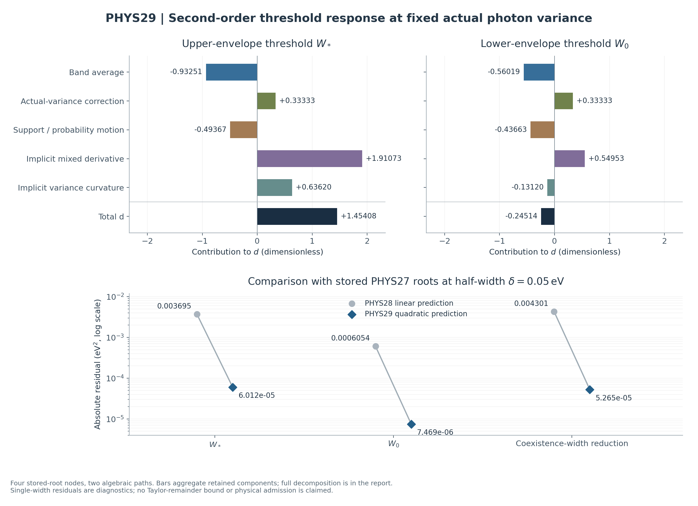

# PHYS29 — 작은 대역폭의 이차 문턱 이동과 항별 분해

연구 식별자: **REI-PHYS29-20261011 / SMALL_WIDTH_SECOND_ORDER_DECOMPOSITION**  
선행 연구: PHYS28 작은 폭의 일차 문턱 민감도  
모델·실행: GPT-6 Astra 계열의 research/coding harness v4.0.0, assistant cloud의 제한된 계산  
판정 권위: [distinct 최종 판정](../independent/DECISION_REVIEW.json)과 [종료 상태](../state/CLOSEOUT.json). 본 보고서의 후보는 그 판정 전에 동결하며, 실제 게시·전달 영수증은 별도로 둔다.

## 1. 이번 루프의 답

**실제 광자 분산을 고정한 작은 반폭 전개에서 이차계수를 유도하고, 그 기여를 모두 분리했다.** 저장된 수치근과 동결된 초기 응답 모델에서 얻은 값은

\[
\widehat d_*\simeq 1.45408210662,\qquad
\widehat d_0\simeq-0.245144110608.
\]

여기서

\[
W_j(\delta)=w_j+c_j\delta+d_j\delta^2+o(\delta^2),\qquad
d_j=\tfrac12W_j''(0^+)
\]

이며, \(\delta\)는 eV 단위의 **반폭**, \(W\)는 eV² 단위의 실제 분산이다. 따라서 \(c\)는 eV, \(d\)는 무차원이다. 수치 표기의 약 12유효숫자는 전달용 반올림이며 물리 불확실성이나 엄밀 오차 구간을 뜻하지 않는다. 상단·하단은 각각 응답의 위·아래 경계를 뜻한다. 상단 응답이 0이 되는 분산 \(W_*\)는 하단 응답이 0이 되는 분산 \(W_0\)보다 작다. [근거: 새 이론 유도와 첫 raw, E1–E2]

두 문턱 모두에서 실제 분산과 중심 분산의 차이가 주는 기여는 정확히 **\(+1/3\)**이다. 균일 대역 평균의 기여는 음수이고, 위치·확률 이동과 암묵근 미분까지 더해야 전체 \(d\)를 얻는다. 전체 부호를 사전에 가정하거나 PASS 기준으로 사용하지 않았다. 양 문턱의 공통 \(+1/3\)은 문턱 간격의 이차계수에서 정확히 상쇄된다.

기존 PHYS27의 \(\delta=0.05\,\mathrm{eV}\) 수치근을 그대로 사용한 비교에서, 실제 이동과 이차 예측의 잔차는 각각 **\(+6.01195534502\times10^{-5}\)**, **\(+7.46873854034\times10^{-6}\,\mathrm{eV}^2\)**로 줄었다. 아래 문턱은 이차 보정이 기존 음의 선형 잔차를 조금 넘어서 잔차 부호가 양수로 바뀌었다. 이는 한 폭의 관측된 개선이며, 정량 Taylor 나머지나 유효폭의 인증은 아니다. [E2, E4]

첫 Decimal80 계산은 **238/238 PASS**였고, 별도 경로에 복원한 프로그램을 한 번 실행한 결과도 **238/238 PASS**, 첫 raw와 **바이트·파싱 JSON 모두 동일**했다. 총 새 main은 2회, 새 물리 영점 탐색은 0회다. 서로 다른 수식 경로의 일치와 같은 프로그램의 재현은 구현 검증이며, 독립 물리 데이터나 원자·기체 불확실성의 검증을 대신하지 않는다. [E3, E5]

## 2. 고정한 물리 문제와 선행 증거

이번 대상은 초기 HeIII의 \(\epsilon^2t^4\) 스펙트럼 응답계수다. 계수의 단위는 s⁻⁴, 시간은 기체와 함께 움직이는 관측자의 고유초, 에너지는 eV, 열상태 \(w\)는 eV/H다. 계량 부호는 \((-+++ )\)다. \([\epsilon^2]\)는 두 번째 \(\epsilon\) 미분의 절반이며, 시간 계수에 추가 팩토리얼을 붙이지 않는다. 유한 시간의 history나 실제 emitter의 허용 여부를 판정하는 계산은 수행하지 않았다. [PHYSICS_CONTRACT.json, E6]

지원구간과 평균을

\[
a=13.61,\quad b=24.58,\quad m=18,\quad
L=m-a=4.39,\quad H=b-m=6.58\quad(\mathrm{eV})
\]

로 유지한다. 반폭 \(\delta\geq0\)에서 중심의 허용 끝점과 거리는

\[
\alpha=a+\delta,\quad\beta=b-\delta,\quad
\ell=L-\delta,\quad h=H-\delta
\]

이며, 실제 분산과 중심 분산의 관계는

\[
\boxed{V=W-\delta^2/3}
\]

다. 모든 \(\delta\) 편미분에서 고정하는 양은 **실제 \(W\)**다. 균일 대역 평균과 두 경계 응답은

\[
f_\delta(c)=\frac12\int_{-1}^{1}k(c+\delta z)\,dz,
\]

\[
A_{\delta,+}(W)=
\frac{Vf_\delta(\alpha)+\ell^2f_\delta(m+V/\ell)}{\ell^2+V},
\]

\[
A_{\delta,-}(W)=
\frac{h^2f_\delta(m-V/h)+Vf_\delta(\beta)}{h^2+V}.
\]

이 두 중심 분포족의 실제 분산 허용 조건은

\[
\delta^2/3\leq W\leq(L-\delta)(H-\delta)+\delta^2/3.
\]

따라서 영폭의 내부근 근처에서는 충분히 작은 물리 반영역을 택할 수 있다. 음의 물리 반폭이나 원래 지원구간 밖의 kernel 값은 필요하지 않다. [E1; 상속된 PHYS26–28 계약·유도]

PHYS26–28의 경계 분포, \(C=\partial_WA_{0,\pm}>0\), 영점의 유일성, \(c_*>0,c_0<0\) 구조를 재사용했다. \(k''>0,k'''<0\)의 동결 모델에 대한 상속 증거와 수치적으로 지지된 끝점 부호를 구분한다. **정확 영점 존재의 사용은 그 전제에 조건부**이고, 저장된 긴 소수 근 자체를 정확근의 interval enclosure로 취급하지 않는다. PHYS24/25 부호 인증이나 PHYS26–28 근 계산을 다시 실행하지 않았다. [E6, E7]

입력 소스는 intake commit `eea60e380f79b016c667b0621db429f07c5fdefd`, scientific source subtree `cb69b4736dd046e4675557577eb8e0ead037d1f3`에 묶었다. 실제 원격 전체 tree와 선택한 7개 소스의 바이트·Git blob·크기·모드를 대조했다. PHYS22의 \(J_{h2,x},J_{h2,w}\)는 원 JSON의 전체 직렬화 값을 사용한다. 소스의 binary64 상수는 그 값의 정확 실수 해석을 Decimal80으로 계산하며 native 부동소수점 실행을 모사한 결과는 아니다. 소스와 J를 고정했다는 사실이 그 물리 불확실성을 제거하지는 않는다. [E6]

## 3. 한쪽 이차 근 전개의 정당화

\(F(\delta,W)=A_{\delta,\pm}(W)\)로 놓고, 영폭의 정확한 내부 단순근을 \(w\)라 하자. 실제 지원을 벗어나지 않는 충분히 작은 \([0,\eta]\times[w-\rho,w+\rho]\)를 택한다. 그 반영역에서 분모는 양수이며, 평균 적분에 들어가는 모든 경로는 \([a,b]\)에 남는다. 연속인 \(k,k',k''\)로 적분 안의 경로를 두 번 미분할 수 있어 \(F\)와 필요한 편미분이 물리 경계 \(\delta=0\)까지 연속이다.

\(F_W(0,w)>0\)와 연속성으로 작은 반영역에서 \(F_W\)의 양의 하한을 얻는다. 근 좌우의 부호를 유지하면 각 작은 \(\delta\geq0\)에 대해 연속이고 유일한 근이 있고, 양의 폭에서 암묵 미분한 식을 오른쪽 끝으로 연속시킬 수 있다. 이에 따라

\[
W'(\delta)=-\frac{F_\delta}{F_W},\qquad
W''(\delta)=-\frac{F_{\delta\delta}+2F_{\delta W}W'+F_{WW}(W')^2}{F_W}
\]

의 우극한이 존재한다. 두 번 적분하거나 연속 Hessian의 Taylor 식을 쓰면 \(o(\delta^2)\) 전개를 얻는다. 여기서는 열린 영역의 표준 정리를 그대로 물리 경계에 적용했다고 말하지 않고, 허용된 경로와 단조 근 논증을 직접 확인했다. 표준 Taylor·암묵 미분의 배경은 Stanford와 MIT 자료에서 확인했다. 그 자료들은 이 소스 모델의 계수, 정확근 존재, 또는 유한폭의 수치 오차를 증명하는 근거가 아니다. [E1; L1–L2]

\((0,w)\)에서

\[
B=F_\delta,\quad C=F_W,\quad
K=F_{\delta\delta},\quad M=F_{\delta W},\quad N=F_{WW}
\]

라고 쓰면 새 이차식은

\[
\boxed{c=-\frac BC,\qquad
d=-\frac{K+2Mc+Nc^2}{2C}}.
\]

분모의 2는 \(d=W''/2\)에서 온다. \(B,C,K,M,N\)의 단위는 차례로 s⁻⁴/eV, s⁻⁴/eV², s⁻⁴/eV², s⁻⁴/eV³, s⁻⁴/eV⁴다. 모든 \(d\) 항의 단위는 무차원이다. [E1–E2]

### 두 경계를 한 표기로 나타낸 편미분

상단에 \(s=+1,R=L\), 하단에 \(s=-1,R=H\)를 대응시키고

\[
e=m-sR,\quad x=m+sW/R,\quad D=R^2+W,\quad
p=W/D,\quad q=R^2/D
\]

로 쓴다. \(k_e=k(e),k_x=k(x)\) 표기를 사용하면

\[
B=\frac{sW}{D}(k'_e+k'_x)+\frac{2RW}{D^2}(k_e-k_x),
\]

\[
C=\frac{R^2}{D^2}(k_e-k_x)+\frac{sR}{D}k'_x,
\]

\[
M=\frac{sR^2k'_e+s(R^2-2W)k'_x}{D^2}
+\frac{W}{RD}k''_x
+\frac{2R(R^2-W)}{D^3}(k_e-k_x),
\]

\[
N=\frac{k''_x}{D}-\frac{2sR}{D^2}k'_x
-\frac{2R^2}{D^3}(k_e-k_x).
\]

또한

\[
C=\int_0^1t\,k''\bigl(e+t(x-e)\bigr)\,dt,
\qquad
N=\frac{s}{R}\int_0^1t^2\,k'''\bigl(e+t(x-e)\bigr)\,dt.
\]

따라서 상속된 엄격 부호 전제에서 \(C>0\), \(N_+<0,N_->0\)다. 이에 따라 암묵근 분산 곡률항 \(-Nc^2/(2C)\)는 상단에서 양수, 하단에서 음수다. 이것은 전체 \(d\)의 부호를 단독으로 정하지 않는다. [E1]

## 4. 평균화·실제 분산·위치·확률의 이차 기여

\(K=F_{\delta\delta}\)는 **전체 이차 미분**이다. 고정 중심에서의 균일 대역 평균은

\[
f_\delta(c)=k(c)+\frac{\delta^2}{6}k''(c)+o(\delta^2)
\]

이므로, 평균화가 \(K\)에 주는 항은 \((pk''_e+qk''_x)/3\)이다. 한편 \(V''(0)=-2/3\)이므로 실제 분산 보정은 \(-2C/3\)이다. 따라서

\[
\boxed{d_{\rm avg}=-\frac{pk''_e+qk''_x}{6C}<0,\qquad
d_V=+\frac13.}
\]

이외의 위치·확률 기여는 중심 분산 V를 고정한 기하 이동으로 먼저 계산하고, 위 \(V''\) 효과를 한 번만 추가한다. 이 분리는 실제 W 고정과 V 고정을 혼동하거나 같은 보정을 두 번 더하는 것을 막는다. [E1–E2]

완전한 \(K\) 분해는 다음과 같다. 여기의 분모 D와 모든 kernel 값은 영폭에서 평가한다.

| 원인 | \(K=F_{\delta\delta}\)에 주는 항 |
|---|---|
| 균일 대역 평균 | \((pk''_e+qk''_x)/3\) |
| 실제 분산 보정 | \(-2C/3\) |
| 끝점 속도 제곱 | \(pk''_e\) |
| 내부 중심 속도 제곱 | \(qW^2k''_x/R^4\) |
| 끝점 가속도 | 0 |
| 고정 V에서 내부 중심 가속도 | \(2sqWk'_x/R^3\) |
| 고정 V에서 확률 가속도 | \((8R^2W/D^3-2W/D^2)(k_e-k_x)\) |
| 확률 × 끝점 속도 | \(4sRWk'_e/D^2\) |
| 확률 × 내부 중심 속도 | \(-4sW^2k'_x/(RD^2)\) |

각 행에 \(-1/(2C)\)를 곱하고, 암묵근 항 \(-Mc/C\), \(-Nc^2/(2C)\)를 더한 실제 수치 분해는 다음과 같다. 모든 값은 무차원이다. [E2, E4]

| \(d\)의 기여 | 상단 문턱 \(*\) | 하단 문턱 \(0\) |
|---|---:|---:|
| 균일 대역 평균 | −0.932510140576 | −0.560189550264 |
| 실제 분산 V 보정 | +0.333333333333 | +0.333333333333 |
| 끝점 속도 제곱 | −2.63157624431 | −0.0245288409636 |
| 내부 중심 속도 제곱 | −0.119297480143 | −0.484561719197 |
| 끝점 가속도 | 0 | 0 |
| 내부 중심의 고정 V 가속도 | +0.0633879624533 | −0.704094752041 |
| 확률의 고정 V 가속도 | −1.06129916561 | +0.260388454872 |
| 확률 × 끝점 속도 | +3.31328465668 | +0.0218389270446 |
| 확률 × 내부 중심 속도 | −0.0581688475515 | +0.494331203626 |
| 암묵근 \(\delta,W\) 교차 | +1.91073026702 | +0.549534821999 |
| 암묵근 W 곡률 | +0.636197765325 | −0.131195989018 |
| **전체 \(d\)** | **+1.45408210662** | **−0.245144110608** |

지원 끝점·내부 중심·확률의 일곱 기하 항을 합하면 각각 약 −0.493669118480, −0.436626726659다. 상단에서는 큰 양의 암묵근 교차항과 분산 곡률항이 전체를 양수로 만든다. 하단에서는 교차항이 양수지만 평균화·기하 항과 음의 분산 곡률항을 모두 상쇄하지 못해 전체가 음수다. 이 해석은 해당 동결 입력에서 계산된 분해의 해석이다. [E2]

그림의 위 패널은 기하 일곱 항을 합산하여 표시한다. 아래 패널은 부호를 제거한 잔차를 로그축으로 그린다. 아래 문턱 잔차의 부호 반전은 다음 표의 부호 있는 값으로 확인해야 한다. 그림은 저장된 결과의 표시만 수행했으며 새로운 kernel·근 계산은 0회다.

## 5. 저장된 수치근에서 실제로 계산한 양

| 양 | 상단 문턱 | 하단 문턱 |
|---|---:|---:|
| 영폭 저장근 \(\widehat w\) [eV²] | 16.3399446546 | 23.4202189924 |
| 유지한 응답 \(A\) [s⁻⁴] | −2.2748589e−137 | −3.2582515e−137 |
| \(B\) [s⁻⁴/eV] | −2.90622276692e−65 | +1.93990583292e−65 |
| \(C\) [s⁻⁴/eV²] | +5.08402575359e−66 | +8.16820212758e−66 |
| \(K\) [s⁻⁴/eV²] | +1.11121136622e−65 | +1.08389255829e−65 |
| \(M\) [s⁻⁴/eV³] | −1.69936224864e−66 | +1.89002487751e−66 |
| \(N\) [s⁻⁴/eV⁴] | −1.97964610240e−67 | +3.79986951992e−67 |
| \(\widehat c\) [eV] | +5.71638089140 | −2.37494837006 |
| \(\widehat d\) | +1.45408210662 | −0.245144110608 |

위 응답 A는 계산에서 0으로 치환하지 않았다. 저장된 유한 소수 근에서 일반 편미분 식을 평가하면, 엄밀하게는 그 점을 지나는 **동일 응답 수준 \(F=A\)**의 국소 계수를 계산한다. 이를 정확 영점 계수의 수치 근사로 쓰되, 정확 영점의 인증 오차는 주장하지 않는다. 실제 작은 응답의 표시 자릿수가 적은 것은 큰 상대 소거가 있는 Decimal80 합의 결과다. [E2–E4]

분자를 \(\mathcal N\), 분모를 \(Q=(R-\delta)^2+W-\delta^2/3\)라 하면 \(Q_{\delta\delta}=4/3\)이다. 비영 A를 유지한 분자식의 확인은

\[
\widehat c=-\frac{\mathcal N_\delta+2RA}{\mathcal N_W-A},
\]

\[
\widehat d=-\frac{\mathcal N_{\delta\delta}
+2\mathcal N_{\delta W}\widehat c
+\mathcal N_{WW}\widehat c^2-\tfrac43A}
{2(\mathcal N_W-A)}
\]

로 했다. 정확근용 분자 축약식을 A가 남은 점에 무조건 적용하지 않았다. \(-A/C\)도 raw에 진단으로만 남겼으며, 근 이동에 적용하거나 엄밀 근 오차 상계로 부르지 않았다. [E1–E2]

## 6. PHYS27의 반폭 0.05 eV 결과와 비교

이 비교는 PHYS27의 기존 근과 PHYS28의 직렬화된 선형 이동을 읽어, 새 \(d\delta^2\)를 더한 것이다. 새 \(c\)와 기존 \(c\)의 차이는 상단 −7e−79, 하단 −1e−79 eV다. 새 \(d\)는 새 내부 \(c\)로 계산하고, 비교 표의 선형 이동은 기존 값을 그대로 쓴다. 기존 \(c\)를 대입한 \(d\)도 사전 허용치로 교차 점검했다. 이 유한 정밀도 입력 선택은 raw에 명시되어 있고 근 재계산은 없다. [E2, E4]

퍼센트 행을 제외한 다음 표의 단위는 eV²다.

| 비교량 | 상단 문턱 \(W_*\) | 하단 문턱 \(W_0\) |
|---|---:|---:|
| 실제 저장된 문턱 이동 | +0.289514369390 | −0.119352810041 |
| PHYS28 선형 예측 이동 | +0.285819044570 | −0.118747418503 |
| 새 이차 추가량 \(d\delta^2\) | +0.00363520526655 | −0.000612860276521 |
| 선형+이차 예측 이동 | +0.289454249836 | −0.119360278780 |
| 실제−선형 잔차 | +0.00369532482000 | −0.000605391537981 |
| **실제−이차 잔차** | **+0.0000601195534502** | **+0.00000746873854034** |
| 이차 예측 문턱 | 16.6293989044 | 23.3008587136 |
| 기존 PHYS27 문턱 | 16.6294590240 | 23.3008661823 |
| 잔차 / 실제 이동의 절댓값 [%] | **0.0207656544222** | **0.00625769811182** |

기존 선형 잔차 중 새 이차항이 설명한 **부호 있는 비율**은 상단 98.3730915040%, 하단 101.233703822%다. 하단의 100% 초과는 이차항이 기존 음의 잔차보다 조금 더 음수이기 때문이다. 따라서 잔차 부호는 바뀌지만 절대값은 작아진다. 이 비율은 적합도나 승인 점수로 사용하지 않았다.

문턱 간격 \(\Gamma=W_0-W_*\)의 이차계수는

\[
d_0-d_*=-1.69922621723
\]

다. \(d_V=1/3\)이 양쪽에서 상쇄하므로 이 값에는 두 경계의 평균화·기하·암묵근 항의 차이가 남는다.

| 문턱 간격 비교 | 값 [eV²] |
|---|---:|
| 영폭의 저장 간격 | 7.08027433776 |
| PHYS27의 실제 간격 | 6.67140715833 |
| 실제 간격 감소량 | 0.408867179431 |
| PHYS28 선형 감소 예측 | 0.404566463073 |
| 새 이차 감소 추가량 | 0.00424806554307 |
| 선형+이차 감소 예측 | 0.408814528616 |
| **실제 감소−이차 예측 잔차** | **+0.0000526508149098** |

감소량 잔차는 실제 감소량의 **0.0128772416957%**다. 이차 예측 간격은 6.67145980915 eV²로 저장된 실제 간격보다 그 잔차만큼 크다. [E2]

하나의 양의 반폭에서는 \(O(\delta^3)\) 수렴률을 판정할 수 없다. 이번 정리는 \(o(\delta^2)\)이고, 그 상수를 수치로 제한하지 않았다. \(\delta=0.05\)까지의 인증된 유효폭, 다른 모든 양의 반폭에서의 분포족 포함 또는 폭 단조성도 결론에 포함하지 않는다.

## 7. 계산 경로와 사전 검증 기준

### kernel과 응답 후처리를 각각 다른 방식으로 계산

물리 kernel의 평가 노드는 상속된 네 점 \(a,v_*,u_0,b\)뿐이다. 대략 13.61, 21.7220830648, 14.4406962018, 24.58 eV이고, 실제 코드는 원 직렬화 값에서 정해지는 전체 Decimal 값을 쓴다. 각 경로는 네 노드에서 \(k,k',k''\)를 함께 산출했다.

첫 경로는 네 차수의 log-energy Taylor Jet다. 두 번째는 \(\log\sigma\)의 명시적 네 번째 도함수와 Bell 다항식을 사용하는 scalar 표현이다. \(\mathcal D=E\partial_E\), \(\phi=\sigma(E)[J_x+J_w(E-\chi)]\), \(\mathcal K=q_\Sigma N_0\kappa/180\)라 쓰면 다음과 같다. 여기의 \(q_\Sigma=\mathrm{tr}\,\Sigma^2\)는 shear 불변량이며 위의 확률 q와 구별한다. \(\kappa\)는 동결된 photo-rate \(\lambda(E)=\kappa\sigma(E)\)의 에너지 독립 계수다.

\[
k=\mathcal K(\mathcal D^2+3\mathcal D)\phi,
\quad
k'=\frac{\mathcal K}{E}(\mathcal D^3+3\mathcal D^2)\phi,
\]

\[
\boxed{k''=\frac{\mathcal K}{E^2}
(\mathcal D^4+2\mathcal D^3-3\mathcal D^2)\phi.}
\]

\(k''\)에는 네 번째 log 미분이 필요하므로 PHYS28의 \(k,k'\) 경로를 단순히 재명명하지 않았다. 실제 순수 코드를 읽고 명시적으로 확장했다. 과거 모듈을 import하거나 실행하지 않았다. [E1, E3]

편미분과 근 계수도 분리했다. Jet kernel 값에는 명시적 위치·확률 chain rule을 적용하고, scalar kernel 값에는 \(\delta\)와 \(W-w\)의 독립 이변수 이차 계수 대수를 적용했다. 후자는 전자의 편미분·근 계수 함수를 호출하지 않는다. 물리 fit, J, 상수, Decimal 초월함수와 분포족은 공유한다. 따라서 대수·구현 결함을 찾는 교차 검증 범위이며 독립적인 물리 모형 검증은 아니다.

### 오차 척도와 실제 결과

사전에 scaled 허용치를 \(10^{-60}\)으로 동결했다. kernel·응답의 기준 척도는 \(S_0=10^{-64}\,\mathrm{s}^{-4}\), 미분 차수 j에 \(S_j=S_0/18^j\), 단면적에는 \(10^{-18}\,\mathrm{cm}^2\)를 사용한다. 값에 맞는 단위 척도와 두 값의 크기 중 최대값으로 나눈 오차를 비교한다. 무차원·모멘트·근 계수 비교에는 해당 프로토콜의 `max(1, abs(a), abs(b))` 척도를 쓴다. 저장근 응답에 대한 별도 scaled 판정은 \(10^{-65}\)이며 근 오차 enclosure가 아니다. [E3]

| 비교 | 실제 최대 scaled 차이 | 사전 허용치 |
|---|---:|---:|
| 두 kernel 표현: sigma, k, k′, k″ | 3.6936e−76 | 1e−60 |
| 두 응답·근 계수 알고리즘 | 1.732104e−75 | 1e−60 |

질량 1, 평균 m, 실제 분산 W를 이변수 계수까지 확인했다. \(V''\) 항과 \(-2C/3\), 평균화 항, 전체 분해 합, 근 전개의 \(\delta\)·\(\delta^2\) 계수 소거, 비영 A를 유지한 분자식도 검사했다. 과거 raw의 \(k,k',B,C,c\) 등은 읽기 비교만 했다. [E2–E3]

검증용 quadratic 함수 \(k_{\rm toy}(E)=(E-m)^2-w\)에서는 질량·평균·실제 분산으로부터 정확히 \(F_{\rm toy}=W-w\)가 된다. 따라서 \(C=1\), \(B=K=M=N=c=d=0\)이고, 평균의 \(-1/3\)과 실제 분산의 \(+1/3\)이 정확히 상쇄한다. 두 경계와 두 알고리즘에서 이 결과를 **Fraction의 정확 유리수 등호**로 확인했다. 물리 kernel 평가가 추가된 시험은 아니며, 이 quadratic 함수에 엄격 \(k'''<0\)를 적용하지 않는다.

## 8. 실제 실행, 변경 보존, 재현

| 실행 사실 | 첫 계산 | 별도 경로 재현 |
|---|---|---|
| UTC 시작 | 2026-10-11 06:48:30.264255 | 2026-10-11 06:52:55.749094 |
| UTC 종료 | 2026-10-11 06:48:30.358291 | 2026-10-11 06:52:55.864023 |
| 측정 wall | 0.094018978 s | 0.114370453 s |
| 실제 exit / stderr | 0 / 0 B | 0 / 0 B |
| 검사 | 238/238 PASS | 238/238 PASS |
| main | 1 | 1 |
| joint(k,k′,k″) | 8 | 8 |
| k / k′ / k″ 산출 | 각 8 | 각 8 |
| 새 물리 root | 0 | 0 |

두 실행은 같은 cloud host·Python 3.12.14에서 서로 다른 절대 경로를 사용했다. 재현 묶음은 runtime 파일 26개와 manifest 1개로 구성했고, 실행 전후 모든 파일의 바이트·해시·크기·모드와 정확한 파일 집합을 확인했다. 첫 raw와 재현 raw는 모두 **137,037 B**, SHA256 `40d686d2646ac7dbaff1bd768a789fcfdbaf5043a16b26512c42ffbedbdd8d6f`다. 이 재현에 독립 물리 증거 점수를 더하지 않는다. [E3, E5]

합계는 main 2회, joint 16회, k 16개·k′ 16개·k″ 16개로 총 48성분이다. old PHYS19–28 main/suite/root/import, 새 root 탐색·보정, 유한차분, quadrature, 폭 sweep, 도함수 부호 campaign, native, gas IVP, dense LP는 모두 0회다. 보고서와 그림 작성은 저장된 결과를 표시·합산한 작업이며 새 과학 프로그램을 호출하지 않았다.

첫 과학 실행 전에 sparse 이변수 계수의 기본 0이 부동소수점으로 변환될 수 있는 문제를 정적 읽기로 발견하여 typed zero로 수정했다. 이어 문서의 절대 응답 표기와 Markdown 구분자를 고쳤다. draft1, freeze_v1, freeze_v2 및 실제 diff를 보존했다. 최종 동결 뒤 과학 코드·프로토콜·허용오차의 변경은 0회, 과학 실행 실패와 재시도도 0회다. 그림은 실제 시각 점검에서 제목 겹침과 범례 위치를 수정했으며 각 이전 그림·소스·관측을 보존했다. 이런 표시 수정은 과학 값이나 수치 판정과 분리되어 있다. [E3, E8]

후보 생성·검증 설계에 참여한 owner, theory, numerics와 최종 판정 역할을 분리한다. 최종 reviewer는 동결 후보를 읽는 distinct NONBLIND 검토이며 blind 또는 다른 물리 데이터를 사용한 검토라고 부르지 않는다. 구체적 승격 범위·미해결 사항은 [최종 검토문](../independent/DECISION_REVIEW_KO.md)을 따른다.

## 9. 주장 범위와 남은 한계

| 주장 | 증거 지위 |
|---|---|
| 물리 반영역에서의 한쪽 C² 근 전개와 d 식 | 명시한 정칙성·정확 내부 단순근 전제 아래 직접 유도 |
| \(d_V=1/3\), 평균화 기여의 식, 완전한 기하 분해 | 직접 대수 유도; 구현 교차 점검 |
| \(C>0\), \(N_+<0,N_->0\) | 상속된 kernel 미분 부호 전제 아래 직접 적분식 |
| 표시한 d의 값과 부호 | 동결 모델·저장 수치근에서 numerically checked |
| \(\delta=.05\)의 잔차 개선 | 기존 저장 근을 이용한 한 폭 진단 |
| 두 표현 및 별도 경로 raw 일치 | implementation-verified |
| 정확근 오차 구간·Taylor 나머지 상계 | 미인증 |
| 원자·J·기체 입력의 물리 불확실성 | 미포함 |
| 유한 시간·유한 epsilon·실제 history의 허용 | 미판정, Physical HOLD |

이번 식을 임의 평균·지원구간·J나 다른 emitter/history에 자동 적용하지 않는다. kernel 미분의 정확실수 해석과 실제 native 프로그램의 수치 동작도 구별한다. 문헌 조사는 표준 수학 방법을 확인하는 범위였으며, 새 우선권·독창성 주장을 뒷받침하는 전면 조사는 수행하지 않았다.

보호 상태는 **Physical HOLD; [160,161] FAIL; tick160; auxiliary escape FAIL; HH/RCT/CR OFF; precision atomic PARKED; production source/default/runtime changes 0**이다. 별도 atomic lane의 활성화, merge, 타인에게 메시지 전송은 수행하지 않는다.

## 10. 다음 한 질문

다음 PHYS30은 **고정 대칭 대역 프로파일에서 이차계수의 프로파일 의존성이 이차 모멘트 하나로 결정되는가**를 묻는다. 평균 0인 같은 \([-1,1]\) 외곽 지원의 고정 확률 프로파일을 사용하고, 중심 허용구간을 동일하게 유지해야 한다. 프로파일의 실제 지원이 더 좁다는 이유로 중심 구간까지 바꾸면 다른 문제다.

이 질문과 가능한 식은 [PHYS30 인수문](../next/PHYS30_NEXT_HANDOFF_KO.md)에 **PROPOSED / NOT_RUN**으로 분리했다. 이번 PHYS29에서는 다른 프로파일의 kernel·근 계산이나 새 보편성 정리를 실행·승격하지 않았다.

## 근거 문서

- **E1** — [새 이론 유도](../contributions/theory/DERIVATION_KO.md), [이론 주장·전제](../contributions/theory/THEORY_CLAIMS.json).
- **E2** — [첫 결과 원자료](../contributions/numerics/SECOND_ORDER_FIRST.json). 전체 정밀도, 두 표현, 항별 분해, 238개 판정을 보존한다.
- **E3** — [사전 수치 프로토콜](../contributions/numerics/PROTOCOL.json), [최종 실행 전 동결](../contributions/numerics/PREEXECUTION_FROZEN.json), [실제 첫 실행](../contributions/numerics/EXECUTION.json), [수치 코드](../contributions/numerics/second_order_width.py), [실행 전 변경](../contributions/numerics/PREEXECUTION_CHANGES.json).
- **E4** — [수치 기여 설명](../contributions/numerics/NUMERICS_NOTE_KO.md).
- **E5** — [한 번 재현 영수증](../portability/REPLAY_RECEIPT.json), [재현 프로토콜](../portability/PORTABILITY_PROTOCOL.json), [재현 결과](../portability/REPLAY_RESULT.json).
- **E6** — [현재 물리 계약](../PHYSICS_CONTRACT.json), [소스 manifest](../SOURCE_MANIFEST.json), [실제 원격 intake](../evidence/INTAKE_REMOTE.json), [상속 입력 manifest](../evidence/INHERITED_INPUT_MANIFEST.json).
- **E7** — [PHYS28의 실제 PHYS29 인수문](../inputs/PHYS28/next/PHYS29_NEXT_HANDOFF_KO.md), [PHYS28 최종 판정](../inputs/PHYS28/independent/DECISION_REVIEW.json), `inputs/inherited/`의 PHYS24/25 인증 원자료.
- **E8** — [그림 검증 기록](../figures/DISPLAY_RECEIPT.json), `figures/versions/`의 보존된 표시 수정 기록.
- **L1** — Stanford Mathematics, [Math 51H — Mean value theorem, Taylor’s theorem and integrals](https://web.stanford.edu/class/math51h/taylor.pdf), pp.2–3의 이차 Taylor 식·연속 Hessian 나머지. 2026-10-11 실제 전체 PDF 텍스트 확인. 개인 저자·발행일은 확인되지 않았다.
- **L2** — MIT Mathematics, [18.022 — The implicit function theorem](https://math.mit.edu/~larsh/teaching/F2007/handouts/implicit.pdf), pp.1–2의 C¹ 단순근 조건·암묵 미분. 2026-10-11 실제 전체 PDF 텍스트 확인. 물리 한쪽 C² 논증은 E1의 직접 유도를 따른다.

문헌의 실제 읽기 범위·적용 한계는 [문헌 원장](../evidence/LITERATURE_LEDGER.json), 전체 주장 의존성은 [CLAIM_DAG.json](../evidence/CLAIM_DAG.json), 기계 판독 요약은 [PHYS29_RESULTS_SUMMARY.json](PHYS29_RESULTS_SUMMARY.json)에 둔다.
