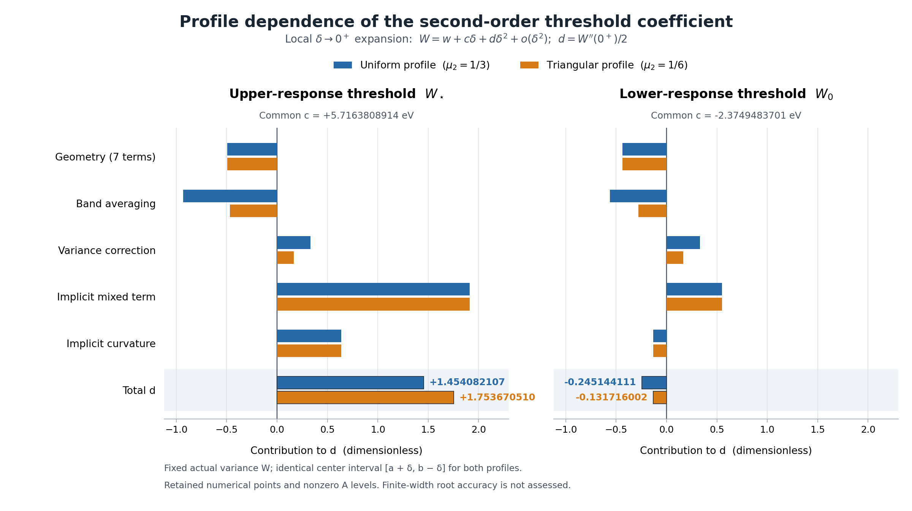

# PHYS30 연구 보고서 — 고정 대칭 프로파일의 이차 보편성

**REI-PHYS30-20261011 · SYMMETRIC_PROFILE_SECOND_ORDER_UNIVERSALITY**

과학 내용 상태는 **FROZEN_SCIENTIFIC_REPORT**다. 실제 최초 계산과 단일 별도 경로 재현은 모두 성공했다. 승격의 최종 권위는 [별도 판정](../independent/DECISION_REVIEW.json)과 [종료 기록](../state/CLOSEOUT.json)이다. 이 보고서는 최종 판단 전에 고정한 과학 내용을 담으며 판정 성공을 미리 기록하지 않는다.

## 1. 이번 루프에서 얻은 답

동일한 중심 허용구간과 실제 광자 분산 \(W\)를 사용하는 **고정 대칭 확률 프로파일** \(\nu\)에서 문턱의 일차계수 \(c\)는 프로파일에 무관하다. 이차계수 \(d\)의 프로파일 의존성은 이차 모멘트 \(\mu_2\) 하나로 결정된다. 정확한 내부 단순근을 전제로

\[
W_{j,\nu}(\delta)=w_j+c_j\delta+d_{j,\nu}\delta^2+o(\delta^2),
\qquad d_{j,\nu}=\frac12W_{j,\nu}''(0^+),
\]
\[
\boxed{
c_{j,\nu}=c_{j,\mathrm{unif}},\qquad
d_{j,\nu}=d_{j,\mathrm{unif}}+
\left(\mu_2-\frac13\right)
\left(1-\frac{\mathcal H_j}{2C_j}\right).
}
\]

여기서 \(C_j=F_W(0,w_j)>0\), \(\mathcal H_j=p_jk''(e_j)+q_jk''(x_j)\)다. \(\mathcal H\)는 거리 \(H=b-m\)와 다르다. 같은 \(\mu_2\)를 가진 두 프로파일은 같은 정확근에서 이차 전개를 공유하고, 문턱 차이는 \(o(\delta^2)\)다. 양의 유한폭에서 문턱 전체가 같다는 뜻은 아니다. [직접 증명 T30.3, T30.34–43](../contributions/theory/DERIVATION_KO.md)

PHYS29 저장값을 사용하는 새 대수 main 한 번에서 **56/56 검사 그룹**이 통과했고, 다른 절대 경로의 재현 한 번도 같은 결과를 냈다. 그룹 내부 비교 성분 384개와 별도 identity 멤버 행 17개를 보존했다. 두 raw는 **231,082 bytes 전체와 parsed JSON이 동일**하다. 새 물리 커널·도함수·에너지 노드·근 계산, 과거 PHYS19–29 프로그램 import/main은 모두 0이다. [최초 raw](../contributions/numerics/PROFILE_SECOND_ORDER_FIRST.json), [실행](../contributions/numerics/EXECUTION.json), [재현](../portability/REPLAY_RECEIPT.json)

## 2. 물리 의미와 허용 분포족

응답 \(k,F,A\)는 기존 초기 HeIII의 \(\epsilon^2t^4\) 스펙트럼 응답 계수이며 단위는 s⁻⁴다. 계량 \((-+++)\), 기체 고유초, 에너지 eV, source-real 정규화와 원 \(J\)를 유지한다. 유한 시간 이온화 이력이나 방출원에 대한 새 물리 허용은 추가하지 않는다. [PHYSICS_CONTRACT.json](../PHYSICS_CONTRACT.json)

| 고정량 | 값 또는 의미 |
|---|---|
| 지원과 평균 | \([a,b]=[13.61,24.58]\) eV, \(m=18\) eV |
| 양쪽 거리 | \(L=4.39,\ H=6.58\) eV |
| 폭 | \(\delta\ge0\), 공통 외곽 반폭 한계, eV |
| 중심 구간 | 모든 프로파일에서 동일한 \([a+\delta,b-\delta]\) |
| 실제 분산과 중심 분산 | \(W\)와 \(V=W-\mu_2\delta^2\), 모두 eV² |
| 프로파일 | \([-1,1]\) 위 비음수 대칭 Borel 확률측도; \(\delta,W\), 중심, branch와 독립 |
| 국소 계수 | \(c\)는 eV, \(d=W''(0^+)/2\)는 무차원 |

중심 측도 \(\rho\)와 독립적인 \(Z\sim\nu\)로 \(E=Y+\delta Z\)를 정의했다. 이 곱측도의 밀어내기는 지원 \([a,b]\), 질량 1, 평균 \(m\)을 보존하며

\[
\operatorname{Var}(E)=V+\mu_2\delta^2=W.
\]

중심 구간에서 \((Y-a-\delta)(b-\delta-Y)\ge0\)를 적분하면 \(0\le V\le(L-\delta)(H-\delta)\)다. 반대로 평균 \(m\)인 양 끝점 측도와 \(\delta_m\)의 혼합이 사이의 모든 분산을 만든다. 따라서 \(0\le\delta<\min(L,H)\)에서 허용 구간은 정확히

\[
\boxed{\mu_2\delta^2\le W\le(L-\delta)(H-\delta)+\mu_2\delta^2}
\]

다. [T30.7–12](../contributions/theory/DERIVATION_KO.md)

평균 커널 \(f_{\delta,\nu}(y)=\int k(y+\delta z)d\nu(z)\)를 사용한 두 점 중심 측도가 응답의 상·하단 경계를 달성한다. 경계는 **공통 프로파일 중심 혼합족 내부**에 한정한다. 양의 폭에서 같은 지원·평균·분산을 가진 모든 광자 측도의 극값으로 확대하지 않는다.

이 경계는 이차 Hermite 보간과 Rolle 나머지로 직접 증명했다. 상단의 접점을 왼쪽 끝점 \(\alpha\), 내부 이중 접점 \(v\)로 잡으면 나머지 \(f'''(\xi)(y-\alpha)(y-v)^2/6\le0\)가 이차 상한을 준다. 하단은 내부 이중 접점 \(u\), 오른쪽 끝점 \(\beta\)에서 반대 부등식을 얻는다. 이차 다항식의 기대값이 질량·평균·분산만으로 정해진다는 사실이 극값을 닫는다. [T30.18–23](../contributions/theory/DERIVATION_KO.md)

PHYS29의 \(k\in C^3([a,b])\), \(k''>0,\ k'''<0\)를 상속 전제로 사용했다. 프로파일에 매끄러운 밀도는 요구하지 않는다. 고정 유한 측도와 compact 지원의 유계 도함수로 미분과 적분의 교환을 정당화하므로 원자 프로파일에도 유도가 적용된다. 정확한 영폭 내부근의 존재도 조건부 정리의 전제다. 기존 근 문자열·끝값 부호를 새 interval enclosure로 승격하지 않았다.

## 3. 프로파일 의존성이 생기는 두 항

고정 중심 분산에서의 응답을 \(G_\nu(\delta,V)\)로 두면

\[
F_\nu(\delta,W)=G_\nu(\delta,W-\mu_2\delta^2).
\]

\(\mu_1=0\), \(V_\delta(0)=0\) 때문에 영폭의 \(B=F_\delta,C=F_W,M=F_{\delta W},N=F_{WW}\) 및 고정 \(V\)의 기하 항 7개는 프로파일에 무관하다. 그 기하 합을 \(\mathcal G\)로 쓰면

\[
\boxed{K_\nu:=F_{\delta\delta}
=\mathcal G+\mu_2\mathcal H-2\mu_2C.}
\]

평균화 자체가 \(\mu_2\mathcal H\)를 주고, 고정 실제 분산의 \(V_{\delta\delta}=-2\mu_2\)가 \(-2\mu_2C\)를 준다. 두 기여를 한 번씩만 포함해야 한다. 확률·중심 가속도에 \(V_{\delta\delta}\)를 직접 포함했다면 이를 다시 더하지 않는다.

정확근의 물리 한쪽 \(C^2\) 존재도 형식 계수 비교와 별도로 증명했다. 정확 내부근 주위의 작은 닫힌 분산 구간은 충분히 작은 양의 폭에서 허용구간 내부에 남고,

\[
F_W=\int_0^1t\,f_{\delta,\nu}''(e_\delta+t(x-e_\delta))dt>0
\]

가 성립한다. 양 끝 부호와 연속성으로 유일한 근을 얻고, 연속적인 우편미분과 암묵 미분을 사용하면

\[
c=-B/C,\qquad
d_\nu=-\frac{K_\nu+2Mc+Nc^2}{2C}.
\]

적분형 Taylor 식이 \(o(\delta^2)\) 나머지를 준다. 음의 물리 폭이나 원 지원 밖의 커널값은 사용하지 않았다. 근방의 존재만 얻었으며 유효 폭의 수치 하한은 없다. [T30.24–43 및 부록 A](../contributions/theory/DERIVATION_KO.md)

완전한 분해는

\[
d_\nu=-\frac{\mathcal G}{2C}
-\frac{\mu_2\mathcal H}{2C}
+\mu_2-\frac{Mc}{C}-\frac{Nc^2}{2C}.
\]

따라서 평균화 항은 \(d_{\rm avg}=-\mu_2\mathcal H/(2C)\), 실제 분산 보정은 \(d_V=\mu_2\)다. \(\mu_2>0\)에서 전자는 음수, 후자는 양수지만 전체 \(d\)와 \(S=1-\mathcal H/(2C)\)의 보편적인 부호는 결론내리지 않는다. 대칭 프로파일이어도 중심 구간이 폭에 선형으로 움직이므로 일차항이 일반적으로 없어지지 않는다.

## 4. 실제 계산 결과

균일 밀도 \(1/2\), 삼각 밀도 \(1-|z|\)의 질량 1·평균 0·이차 모멘트 \(1/3,1/6\)을 Fraction 다항 원시함수로 확인했다. 수치 적분은 0회다. 다음 숫자는 실제 raw의 동일 \(A\)-level 계수를 소수 12자리로 반올림한 것으로, 정확근의 12자리 인증이 아니다.

| 경계의 근 | 공통 \(c\) [eV] | 균일 \(d\) | 삼각 \(d\) | 삼각−균일 \(\Delta d\) |
|---|---:|---:|---:|---:|
@NUMBER_TABLE@

프로파일 기울기는

\[
S_*=-1.7975304217269973037\ldots,\qquad
S_0=-0.6805686507905779593\ldots.
\]

이번 고정 모델에서는 \(\mu_2\)를 \(1/3\)에서 \(1/6\)으로 줄였을 때 두 \(d\)가 모두 커졌다. 부호와 순서는 PASS 조건이 아니며 다른 커널이나 분포족의 순서 정리로 확장하지 않는다. [raw의 branch_profile_slopes 및 profile_results](../contributions/numerics/PROFILE_SECOND_ORDER_FIRST.json)

### 4.1 이차계수의 11개 기여

모든 값은 무차원이다. 첫 두 행만 프로파일에 따라 바뀌고, 기하 7항과 암묵근 2항은 같다.

| \(d\) 기여 | \(W_*\) 균일 | \(W_*\) 삼각 | \(W_0\) 균일 | \(W_0\) 삼각 |
|---|---:|---:|---:|---:|
@TERM_TABLE@

그림은 기하 7항을 raw의 기존 합으로 묶은 것이다. 막대는 영폭의 계수이며 유한폭의 실제 문턱이나 오차 곡선이 아니다.

### 4.2 문턱 간격

\(\Gamma=W_0-W_*\)에서 공통 \(d_V=\mu_2\)는 정확 이론상 상쇄된다. 나머지 profile 의존성은 두 곡률 비의 차이다. 저장값은

\[
c_\Gamma=-8.091329261460306742\ldots\ {\rm eV},
\]
\[
d_{\Gamma,u}=-1.699226217229408570\ldots,\qquad
d_{\Gamma,\rm tri}=-1.885386512385478461\ldots,
\]
\[
d_{\Gamma,\rm tri}-d_{\Gamma,u}
=-0.186160295156069891\ldots.
\]

실제 Decimal의 공통 분산 항 차이는 균일 \(-2\times10^{-80}\), 삼각 \(0\times10^{-80}\)으로 보존했다. 정확 항등식의 유한 산술 잔여를 raw에서 0으로 덮어쓰지 않았다. 특정 유한폭의 간격 정확도나 전역 순서는 여기서 평가하지 않았다.

## 5. 비영 응답 \(A\)와 판별 가능한 시험함수

저장점의 응답은 두 branch에서 각각 \(-2.2748589\times10^{-137}\), \(-3.2582515\times10^{-137}\) s⁻⁴다. 이 점에서 일반 미분식이 주는 계수는 **같은 \(F=A\) 수준의 계수**다. 정확한 영점 정리는 정확 내부근을 전제로 별도로 성립한다. 새 근 보정·근 오차 상계·원 \(J\) 불확실성 제거는 하지 않았다.

\(F=\mathscr N/\mathscr Q\), \(\mathscr Q=(R-\delta)^2+W-\mu_2\delta^2\)이면

\[
\mathscr Q_{\delta\delta}=2(1-\mu_2),
\quad
c=-\frac{\mathscr N_\delta+2RA}{\mathscr N_W-A},
\]
\[
d_\nu=-\frac{\mathscr N_{\delta\delta}+2\mathscr N_{\delta W}c+
\mathscr N_{WW}c^2-2(1-\mu_2)A}{2(\mathscr N_W-A)}.
\]

독립 series의 상수 응답과 원 \(A\) 사이에는 각각 \(2\times10^{-144}\), \(-10^{-144}\) s⁻⁴의 차이가 남아 있다. 작은 물리 \(A\)는 현재 척도·허용치에서 보정항 누락을 판별하기에 충분하지 않으므로, 물리 두 표현의 수치 일치만을 그 항의 강한 검증으로 세지 않았다.

정확 시험함수 \(k_{\rm toy}(E)=(E-m)^2-w+1\)에서는 \(F_{\rm toy}(\delta,w+\eta)=1+\eta\), \(A=1,C=1,c=d=0\)이다. 평균 항 \(-\mu_2\)와 분산 항 \(+\mu_2\)가 정확히 상쇄된다. 두 branch×두 프로파일의 네 경우가 Fraction의 정확 등호로 통과했다. 보정항 \(-A\mathscr Q_{\delta\delta}\)만 버린 대조값은

\[
d_{\rm bad}=-(1-\mu_2)/(R^2+w)\ne0
\]

였으며, 그 예상 유리수 값과 비영성도 확인했다. 이는 별도 무차원 대수 사례이고 물리 커널 평가가 아니다. [T30.44–54](../contributions/theory/DERIVATION_KO.md), [raw의 exact_quadratic_toys](../contributions/numerics/PROFILE_SECOND_ORDER_FIRST.json)

## 6. 구현과 실제 검증

경로 A는 PHYS29의 균일 계수와 11항 분해에서 아핀 전달식을 사용한다. 경로 B는 여섯 ordinary coefficient \((1,\delta,\eta,\delta^2,\delta\eta,\eta^2)\)의 직접 곱·삼각 나눗셈 recurrence로 확률, 중심, 국소 평균 커널을 조립한다. 자체 응답 계수에서 \(c,d\)를 구하며 경로 A나 공통 근 후처리 함수를 호출하지 않는다.

과거 이변수 소스를 읽은 사실은 공개했고 과거 모듈은 import하지 않았다. 두 경로는 같은 PHYS29 jet cache의 4개 노드·12개 \(k,k',k''\), 분포족·모멘트·Decimal80을 공유한다. 검증은 대수 구현의 교차 확인이며 독립적인 물리 데이터 비교가 아니다. [설계](../contributions/numerics/NUMERICS_DESIGN_KO.md), [소스](../contributions/numerics/profile_second_order.py), [provenance](../contributions/numerics/PROVENANCE.json)

| 사전 검사 부류 | 그룹 수 | 실제 결과 |
|---|---:|---|
| Decimal 계수·모멘트·분자·분해·간격 | 31 | PASS |
| 정확 모멘트·시험함수·실제 이벤트 횟수 | 15 | PASS |
| 파일·상태·기하·산술·밀도·검사 목록 | 10 | PASS |
| 합계 | 56 | 실패 0, exception 없음 |

384개 내부 성분에는 실행 횟수의 이산 비교가 포함되며, 17개 identity 멤버는 별도 행이다. 이 숫자를 독립 물리 실험 횟수로 세지 않는다. Decimal은 80자리 ROUND_HALF_EVEN, 허용치는 \(10^{-60}\)이다. 차원 있는 비교는 공급한 고정 \(S_0=10^{-64}\) s⁻⁴, \(S_j=S_0/18^j\)를 사용하며 실제 값에 맞춰 척도를 늘리지 않는다. 분자 척도는 \(S_0 18^2,S_0 18,S_0,S_0,S_1,S_2\)다. 그 밖의 모멘트·근 계수는 eV convention에서 \(\max(1,|x|,|y|)\) 규칙을 쓴다.

저장된 Decimal 검사 전체의 최대 scaled discrepancy는 **\(1.62\times10^{-77}\)**였다. 이는 대수 일치의 척도이고 물리 입력·근·Taylor 나머지의 오차 상계가 아니다. 사후 tolerance 변경은 0이다. [사전 protocol](../contributions/numerics/PROTOCOL.json), [실제 결과 intake](../evidence/OWNER_FIRST_RESULT_INTAKE.json)

| 실제 작업 | 최초 main | 별도 replay | 이번 합계 |
|---|---:|---:|---:|
| cached 대수 main | 1 | 1 | 2 |
| 프로파일 다항 모멘트 원시함수 | 6 | 6 | 12 |
| branch별 저장값 기울기 조합 | 2 | 2 | 4 |
| affine profile×branch 조합 | 4 | 4 | 8 |
| cache 기반 이변수 응답 series | 4 | 4 | 8 |
| 질량·평균·분산 series | 4 | 4 | 8 |
| 정확 이차 coefficient pair | 2 | 2 | 4 |
| 정확 비영 A 시험함수 profile×branch | 4 | 4 | 8 |
| 새 물리 커널·도함수·노드·근 | 0 | 0 | 0 |
| PHYS19–29 import/main/suite | 0 | 0 | 0 |
| 유한차분·quadrature·폭 sweep·native·gas IVP | 0 | 0 | 0 |

정확 시험함수 응답 및 모멘트 series는 각 main에서 각각 4회다. PHYS29의 기존 main 2회, joint kernel node 평가 16회는 과거 이력이며 이번에 반복하지 않았다. 최초 main은 @FIRST_TIME@초, replay는 @REPLAY_TIME@초였고 둘 다 exit 0이었다. 과학 protocol의 60초 상한보다 엄격한 controller의 30초 제한을 실행 전에 고정했다.

재현은 새 절대 경로의 runtime에 14개 payload와 원경로 manifest를 복원하고 형제 run 디렉터리에 결과를 썼다. 실행 전후 15개 파일의 정확 집합·SHA256·size·mode·원본 bytes를 확인했다. 같은 host와 Python 재현이므로 환경·제공자 다양성이나 독립 물리 증거를 추가하지 않는다.

## 7. 증거의 단계와 남는 한계

| 주장/항목 | 근거 상태 | 범위 |
|---|---|---|
| 지원·모멘트·허용구간 | 직접 유도 | 고정 독립 프로파일, 동일 중심 구간 |
| 평균 커널 정칙성과 중심 극값 경계 | 조건부 직접 유도 | 상속 k 전제, 지정한 혼합족 내부 |
| c 불변·d의 μ2 의존 | 조건부 직접 유도 | 정확 내부근의 물리 한쪽 이차 전개 |
| 균일/삼각 수치 계수 | numerically checked | 비영 A-level, 유한 산술 |
| 두 대수 구현 및 별도 경로 재현 | implementation-verified | 공유 cache/host/Python, 물리 credit 0 |
| 정확근·J 불확실성, 정량 나머지·유효폭 | unresolved / 범위 밖 | 새 인증이나 상계 없음 |
| 같은 μ2의 다음 고차 구별 | 제안 | PHYS31 NOT_RUN |

\(\mu_2=0\)이면 \(\nu=\delta_0\), \(\mu_2=1\)이면 양 끝점에 반반인 원자 프로파일이다. 그래도 중심 구간은 계약대로 축소된다. 실제 profile 지원 반경이 1보다 작아도 중심 구간을 넓히지 않는다. \(\delta>0\)에서 profile이 절대연속이면 광자 밀도를 얻지만, 일반 원자 측도 계약만으로 밀도를 보장하지 않는다. 모든 원자 profile이 광자 밀도를 금지한다는 역방향 주장도 하지 않는다.

이론 생성, 수치 생성·검증 설계, 재현, 최종 판단 역할을 분리했다. 모든 agent는 같은 대화의 NONBLIND 역할이며 같은 host·모델·history를 공유한다. 신뢰된 모델 지정은 GPT-6 Astra Pro, 적용 하네스는 GPT-6 Astra v4.0.0이다. 생성·검증 설계와 다른 reviewer가 동결 후보를 판단하며 creator self-check를 독립 최종 판단으로 부르지 않는다.

Root는 이번 루프에서 연구·코딩 하네스 핵심 17개를 실제로 읽고 canonical ZIP 바이트와 대조했다. 같은 패키지의 기존 PHYS29 실제 구조 검증 영수증을 보존했으며 중복 구조 실행은 하지 않았다. 템플릿 상태는 실제 실행 근거가 아니다. [하네스 적용](../evidence/HARNESS_APPLICATION.json)

외부 원전은 John K. Hunter, *Measure Theory* (2011), Chapter 4, 정리 4.24, 인쇄 p.49의 지배수렴 정리와 증명 부분을 확인했다. 저자·연도는 서문에서 확인했다. 전체 장·책 완독 주장은 하지 않는다. 이 참고는 고정 유한 측도 아래의 극한·미분 교환의 일반 배경이며 새 전달식·물리 부호 인증·근 수치를 대신하지 않는다. 문헌 우선권·신규성 조사도 하지 않았다.

- [Hunter, Chapter 4](https://www.math.ucdavis.edu/~hunter/measure_theory/measure_notes_ch4.pdf)
- [Hunter, 서문](https://www.math.ucdavis.edu/~hunter/measure_theory/measure_notes_intro.pdf)
- [실제 문헌 열람 범위](../evidence/LITERATURE_LEDGER.json)

## 8. 실제 이력과 후속 단계

과학 main/replay 실패는 0이다. 입력 수집의 첫 metadata 시도는 기존 문서 이름을 잘못 지정해 중단했고 실제 이름으로 수정했다. 이론의 README suffix 중복 조회, 수치 문서의 inline TeX 표시, root 문서 add-file patch의 hunk 형식 오류도 첫 실패와 해결을 보존했다. 후보 science 소스·protocol·입력·허용오차·raw는 재현 이후 변경하지 않았다.

그림은 최초 raw의 기존 필드를 float 표시로만 사용했다. 첫 배치의 범례 겹침을 고쳤고, 두 번째 렌더는 PNG 저장 뒤 기존 provenance의 exclusive-write에서 exit 1이었다. 그 실패와 원 provenance를 보존하고 실제 최종 PNG에 metadata를 맞췄다. 원인을 동시쓰기로 단정하지 않는다. 세 번째 렌더나 추가 과학 계산은 없었다. [그림 이력](../figures/DISPLAY_METADATA_FAILURE.json), [문서 patch 이력](../evidence/REPORT_PATCH_FIRST_FAILURE.json)

입력 commit은 `45bd460d779e5a189fc75663d4ae61249e514751`, tree는 `7ca6547cd7be726f38738d7601f16486e10fbdba`다. 실제 tree의 7개 pinned source의 identity를 대조했다. 과학 source subtree는 `cb69b4736dd046e4675557577eb8e0ead037d1f3`다. [원격 입력 확인](../evidence/REMOTE_INTAKE.json), [source manifest](../SOURCE_MANIFEST.json)

PHYS31의 한 질문은 **같은 \(\mu_2\)를 갖고 고차 모멘트가 다른 대칭 프로파일이 문턱 이동의 어느 다음 차수에서 처음 구별되는가**다. 필요한 추가 커널 정칙성과 고차 전개의 존재부터 고정한다. 현재 고차 정리·도함수·근·profile 계산은 수행하지 않았다. [다음 handoff](../next/PHYS31_NEXT_HANDOFF_KO.md)

**Physical HOLD; [160,161] FAIL; tick160; auxiliary escape FAIL; HH/RCT/CR OFF; precision atomic PARKED; production source/default/runtime changes0.**

전체 패키지에는 이 보고서와 완전한 직접 증명, 코드·사전 protocol·입력 동결, 첫 raw·로그, 재현·검토·manifest가 들어간다. 같은 branch의 새 PHYS30 docs만 추가한 실제 후속 Git 결과와 최종 전달의 ACK는 각 시점의 분리된 기록으로 확인한다. 이 보고서는 아직 일어나지 않은 publication·전달 성공을 미리 선언하지 않는다.

| 핵심 증거 | bytes | SHA256 |
|---|---:|---|
| 최초 raw | 231082 | `5184af6139423792abc0a95e53bd5ccabca459820761aa1a3f350bda4ac7082e` |
| 수치 프로그램 | 40492 | `19232f405f3f8fba77e63c82ffcc2c52f3e0ef8651edfc9cff4fcde77316e859` |
| 사전 protocol | 16492 | `74ad883b3bd04d822ed8d0fc5a9bce67509839ce6fad68e4596100f1dae031f2` |
| 전체 이론 증명 | 30651 | `1a334dcf1acc73d2cff227d49a17abfe0612203f7fcfe98c559321bb646c27ef` |
| 재현 영수증 | 26650 | `24d524143200502d2039fe9695cc9dc23d2be325833f81cb47a1bcdab1e7e950` |

전체 저장 계수는 [PHYS30_RESULTS_SUMMARY.json](PHYS30_RESULTS_SUMMARY.json), 주장 의존성과 증거 연결은 [CLAIM_LEDGER.json](../evidence/CLAIM_LEDGER.json)에 있다.

