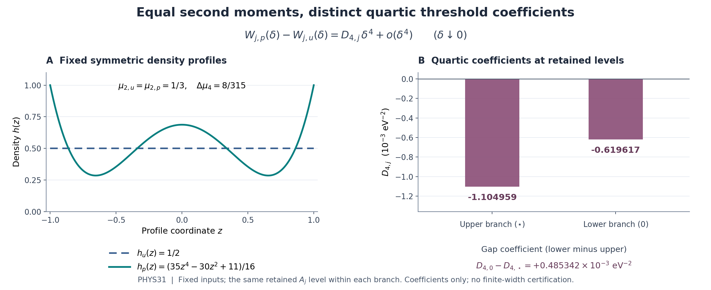

# PHYS31 — 같은 분산 모멘트의 스펙트럼을 구별하는 사차 문턱 이동

**REI-PHYS31-20261011 · EQUAL_SECOND_MOMENT_QUARTIC_PROFILE_SPLITTING**

같은 이차 모멘트를 가진 고정 대칭 프로파일은 문턱 전개에서 **삼차까지 일치한다**. 현재 고정 물리 커널은 연구 구간에서 해석적이므로 사차 전개가 가능하고, 프로파일 차이는 사차 모멘트와 네 번째 커널 도함수의 가중평균으로 정해진다. 선택한 양의 절대연속 프로파일 쌍에서 저장점의 사차 차이 계수는 두 문턱 모두 음수로 계산되었다.

이 보고서는 직접 증명, 실제 고정 입력 계산, 재현 근거와 남은 한계를 함께 담는다. 전체 증명은 부록 A, 고정 물리 식의 정칙성·프로파일 구성은 부록 B에 포함했다. 생성과 분리된 최종 판정의 권위는 동봉된 [판정서](../independent/DECISION_REVIEW_KO.md)와 [기계 판독 판정](../independent/DECISION_REVIEW.json)에 있다. 부록의 역할·시점 설명은 작성 당시 기록을 보존한다.

## 1. 이번에 해결한 질문

PHYS30은 이차 문턱계수가 프로파일의 \(\mu_2\)에만 의존한다는 결과를 남겼다. 이번 질문은 **같은 \(\mu_2\)를 가지되 더 높은 모멘트가 다른 프로파일이 그다음 어느 차수에서 구별되는가**였다.

답은 정칙성에 따라 나뉜다.

| 전제 | 이번 직접 증명 | 판정 범위 |
|---|---|---|
| \(k\in C^3\), 같은 \(\mu_2\), 대칭 | \(\Delta W=o(\delta^3)\), 삼차까지 공통 | \(O(\delta^4)\)는 따라오지 않음 |
| 추가 \(k\in C^4\) | \(\Delta W=D_4\delta^4+o(\delta^4)\) | \(D_4\ne0\)일 때 실제 첫 비영 차수는 4 |
| \(D_4=0\) | 사차 차이 소거 | 다음 차수가 반드시 6인 것은 아님 |
| 현재 고정 source-real 커널 | 구간의 열린 근방에서 \(C^\omega\) | C4 적용 가능; 수치 오차 인증과 별개 |

C3 한계는 추측으로 남기지 않았다. 같은 양의 밀도 쌍에 대해 임의의 \(3<p<4\)에서 \(\Delta W\sim C_p\delta^p\), \(C_p\ne0\)인 허용 커널을 구성했다. 사차가 소거된 뒤에는 비영 \(\delta^5\) 항이 먼저 나타날 수 있는 매끄러운 예도 제시했다.

## 2. 정의와 보호한 물리 의미

\[
a=13.61,\quad b=24.58,\quad m=18,\quad
L=m-a=4.39,\quad H=b-m=6.58\quad(\mathrm{eV}).
\]

폭 \(\delta\ge0\)는 바깥 반폭이고, 중심 \(Y\)의 공통 구간은 \([a+\delta,b-\delta]\)다. 광자 에너지는 \(E=Y+\delta Z\), 프로파일 \(\nu\)는 \([-1,1]\) 위의 고정 대칭 확률측도다. 프로파일은 폭·중심·실제 분산·분지와 독립이다.

\[
\mu_2=\mathbb E Z^2,\qquad
W=\operatorname{Var}(E),\qquad
V=\operatorname{Var}(Y)=W-\mu_2\delta^2.
\]

따라서 실제 실현가능 구간은

\[
\mu_2\delta^2\le W\le
(L-\delta)(H-\delta)+\mu_2\delta^2,\qquad
0\le\delta<\min(L,H).
\]

같은 \(\mu_2\)에서는 이 구간, 중심 위치, 확률, 응답의 분모가 두 프로파일에 정확히 공통이다. 물리 편미분에서는 실제 \(W\)를 고정한다. 중심분산 \(V\)를 고정한 계산으로 바꾸지 않았다.

\(k(E)\)는 초기 HeIII의 \(\epsilon^2t^4\) 응답 커널이고 단위는 \(\mathrm{s}^{-4}\)다. 기존 전체 정규화, proper time, eV, metric \((-,+,+,+)\), 열 변수 eV/H, \([\epsilon^2]=\tfrac12\partial_\epsilon^2|_0\)를 유지한다. \(c_{\rm light},\hbar,k_B\)를 새로 1로 놓지 않았다.

상속한 \(k''>0,k'''<0\)의 극값 해석은 **고정 공통 프로파일을 사용하는 중심 혼합족**에 한정한다. 임의 광자 분포 전체의 유한폭 극값이라는 의미를 추가하지 않았다.

## 3. 왜 사차 모멘트가 처음 남는가

프로파일 평균은 \(f_{\delta,\nu}(y)=\int k(y+\delta z)\,d\nu(z)\)다. 두 프로파일은 질량·일차·이차·삼차 모멘트가 같으므로, C4 Taylor 전개의 차이에서 처음 남을 수 있는 항은

\[
f_{\delta,\nu}(y)-f_{\delta,\widetilde\nu}(y)
=\frac{\Delta\mu_4}{24}\,k^{(4)}(y)\delta^4+o(\delta^4)
\]

다. 부록 A는 허용되는 모든 중심에서 나머지가 균일함을 직접 증명한다. 일반 측도와 원자를 허용하며 프로파일 밀도를 미분하지 않는다.

분지 \(j\)의 영폭 끝점과 내부 중심을 \(e_j,x_j\), 해당 확률을 \(p_j,q_j\)라 쓰자. 응답을 \(F_{j,\nu}\), 공통 수준을 \(A_j\), 기준점을 \(w_j\)라 하면

\[
F_{j,\nu}(0,w_j)=A_j,\qquad
C_j=F_{j,W}(0,w_j)>0,
\]

\[
\mathcal H_{4,j}=p_jk^{(4)}(e_j)+q_jk^{(4)}(x_j).
\]

두 근 사이의 평균값정리와 양의 \(F_W\) 하한을 사용하면

\[
\boxed{
W_{j,\nu}(\delta)-W_{j,\widetilde\nu}(\delta)
=-\frac{\Delta\mu_4\mathcal H_{4,j}}{24C_j}
\delta^4+o(\delta^4).
}
\]

이는 실제 물리 한쪽 \(\delta\downarrow0\)의 결과다. 부록은 근의 오른쪽 C3/C4 정칙성과 Taylor 전개 자체를 증명하며 형식적 급수만 전제하지 않는다. 개별 문턱의 삼차계수가 0이라는 주장은 아니다. 움직이는 중심 때문에 개별 홀수 차수 항은 남지만 같은 \(\mu_2\)의 두 프로파일에서 그 항이 공통이다.

단위는 \([\mathcal H_4]=\mathrm{s}^{-4}\mathrm{eV}^{-4}\), \([C]=\mathrm{s}^{-4}\mathrm{eV}^{-2}\), \([D_4]=\mathrm{eV}^{-2}\)다. 따라서 \(D_4\delta^4\)는 분산의 단위 eV²를 갖는다. \(D_4\)는 ordinary 사차 계수이며 네 번째 도함수 자체가 아니다.

## 4. 실제 비교한 두 양의 밀도

\[
h_u(z)=\frac12,\qquad
h_p(z)=\frac{35z^4-30z^2+11}{16}
=\frac{35}{16}\left(z^2-\frac37\right)^2+\frac27.
\]

두 밀도는 \([-1,1]\) 전체에서 양수이고 대칭·정규화·지원이 같다. 구간 안에서 연속이며 0으로 연장하면 끝점에 점프가 생긴다. 절대연속 확률측도라는 성질에는 문제가 없다.

| 양 | 균일 \(h_u\) | 다항식 \(h_p\) |
|---|---:|---:|
| 총질량 | 1 | 1 |
| 평균·삼차 모멘트 | 0 | 0 |
| \(\mu_2\) | \(1/3\) | \(1/3\) |
| \(\mu_4\) | \(1/5\) | \(71/315\) |
| 밀도 하한 | \(1/2\) | \(2/7\) |

\[
\Delta\mu_4=\frac8{315},\qquad
\boxed{D_{4,j}^{p-u}=-\frac{\mathcal H_{4,j}}{945C_j}.}
\]

그림의 프로파일 곡선은 정의된 다항식의 표시용 표본이고, 막대는 이미 계산한 계수다. 유한폭 근이나 스펙트럼 적분을 추가로 평가한 그림이 아니다.

## 5. 고정 물리 커널의 계산 결과

새로운 근이나 에너지 지점을 만들지 않고, 기존 네 에너지 문자열에서 \(k^{(4)}\)만 계산했다. 아래 수치는 원시 JSON의 log-energy 경로를 표시용으로 반올림한 것이다.

| 노드 | 보존 에너지 (eV, 표시값) | \(k^{(4)}\;(\mathrm{s}^{-4}\mathrm{eV}^{-4})\) |
|---|---:|---:|
| a | 13.610000000000000 | 1.115495502033654E-65 |
| v_* | 21.722083064826813 | 3.518645599960258E-67 |
| u_0 | 14.440696201770001 | 7.297975730474766E-66 |
| b | 24.580000000000000 | 1.330264370658987E-67 |

두 도함수 조립 경로는 모두 각 노드에서 같은 부호를 반환했다. 이것은 해당 유한 산술점의 관측이며 구간 전체의 엄밀한 사차 도함수 부호 인증은 아니다.

| 양 | 상단 문턱 \(W_*\) | 하단 문턱 \(W_0\) |
|---|---:|---:|
| 보존 기준 분산 \(\widehat w\), eV² | 16.339944654589707… | 23.420218992353393… |
| 보존 \(C\), \(\mathrm{s}^{-4}\mathrm{eV}^{-2}\) | 5.084025753589138E-66 | 8.168202127578144E-66 |
| 새 \(\mathcal H_4\), \(\mathrm{s}^{-4}\mathrm{eV}^{-4}\) | 5.308667853168911E-66 | 4.782790098241574E-66 |
| \(D_4^{p-u}\), \(\mathrm{eV}^{-2}\) | **-0.001104958592291833** | **-0.000619616589313443** |

저장점의 같은 \(A_j\) 수준에서

\[
W_{*,p}-W_{*,u}\sim
-0.00110495859229183348\,\delta^4,
\]
\[
W_{0,p}-W_{0,u}\sim
-0.000619616589313442784\,\delta^4.
\]

표시한 계수의 단위는 eV⁻²이고 \(\delta\)는 eV다. 간격 \(\Gamma=W_0-W_*\)의 사차계수 변화는 원시 결과에서

\[
\boxed{D_{4,\Gamma}^{p-u}
=0.000485342002978390693\ \mathrm{eV}^{-2}}
\]

였다. 두 문턱의 계산된 사차 계수가 모두 음수이고 상단의 변화량이 더 커서 간격의 사차계수 변화는 양수다. **양의 유한 폭에서 실제 문턱이나 간격을 계산하거나 그 부호를 인증한 것은 아니다.** 사차 근사에 수치적으로 보장된 유효 폭은 아직 없다.

## 6. 작은 비영 잔차를 보존한 이유

보존 기준점의 응답은

\[
A_*=-2.2748589\times10^{-137},\qquad
A_0=-3.2582515\times10^{-137}\quad(\mathrm{s}^{-4})
\]

다. 이를 0으로 바꾸거나 기준근을 보정하지 않았다. 같은 \(\mu_2\)에서는 공통 분모 \(Q\)를 쓰므로

\[
F_\nu=N_\nu/Q,\quad N_\nu-AQ=0,\quad
Q=R^2+w\quad(\delta=0),
\]
\[
N_W=k(e)+sRk'(x),\qquad N_W-A=QC.
\]

두 번째 수치 경로는 보존된 \(k(e),k'(x)\)로 \(N_W\)를 직접 만들고

\[
D_{4,N}
=-\frac{\Delta\mu_4[\,w k^{(4)}(e)+R^2k^{(4)}(x)\,]}
{24(N_W-A)}
\]

를 계산했다. 분모를 \(QC+A\)에서 역으로 만들어 같은 식을 확인하는 데 그치지 않았다. 그 결과는 확률로 가중한 첫 quotient와 사전 허용치 안에서 일치했다. 하위 도함수·분산·확률·J의 입력 계보를 공유한다는 한계는 유지한다.

정확 영점에 대한 정리와 저장 숫자에서의 유한 산술 평가는 구별해야 한다. 원 J의 오차, 저장근의 정확 영점과의 거리, 반올림된 내부 에너지 문자열과 이상적 중심의 미소 차이는 이번에 enclosure하지 않았다.

## 7. 두 도함수 구현과 정확한 오류 검출

원 식은

\[
\phi(E)=\sigma(E)[J_x+J_w(E-\chi)],\qquad
k=K(D^2+3D)\phi,\quad D=E\partial_E
\]

다. 현재 fit은 H I cutoff와 He I cutoff 사이의 같은 해석적 분기다. 고정된 source binary64 리터럴을 정확한 실수 상수로 해석하고, 직렬화된 J를 고정한다. native floating point 반환 사상의 미분가능성이라는 뜻은 아니다.

Log-energy 경로는 \(\phi(Ee^t)\)의 여섯 번째까지의 Taylor 계수와

\[
k^{(4)}=\frac K{E^4}
(D^6-3D^5-7D^4+27D^3-18D^2)\phi
\]

를 쓴다. Ordinary energy 경로는 독립적인 generalized-binomial 곱으로 \(a_n=[u^n]\phi(E+u)\)를 조립하여

\[
k^{(4)}=K(720E^2a_6+1440Ea_5+672a_4)
\]

를 쓴다. 두 구현은 같은 원 입력·fit·Decimal의 scalar log/exp를 공유한다. 독립 물리 데이터로 세지 않았다.

정확한 Fraction 산술에서는 프로파일 모멘트 10개와 \(\phi=E^n,\ n=0,\ldots,6\)의 도함수 관계를 확인했다. 이어 같은 비영 A를 사용하는 cubic/quartic toy의 문턱을 사차까지 직접 형식 전개했다.

| toy, 분지 | 정확한 \(A\) | 정확한 \(C\) | \(D_4^{p-u}\) |
|---|---:|---:|---:|
| cubic, 상단 | \(43/20\) | \(11/10\) | 0 |
| cubic, 하단 | \(37/20\) | \(9/10\) | 0 |
| quartic, 상단 | \(873/400\) | \(451/400\) | \(-32/142065\) |
| quartic, 하단 | \(753/400\) | \(371/400\) | \(-32/116865\) |

모든 toy에서 삼차까지의 프로파일 차이는 정확히 0이었다. Quartic 응답 차이는 정확히 \((2/7875)\delta^4\)였고, normalized 식과 \(N-AQ\) 식의 근 잔차는 0–4차에서 모두 0이었다. \(1/24\)를 빠뜨린 식과 분모의 A를 빠뜨린 식은 각각 두 quartic 분지에서 오답으로 검출했다. Cubic의 모든 허용 폭에서의 동일성은 유한차수 관측의 외삽이 아니라 다항식 평균의 직접 항등식으로 증명했다.

## 8. 실제 실행과 재현

| 항목 | 첫 실행 | 새 경로 재현 |
|---|---:|---:|
| 새 프로그램 main | 1 | 1 |
| 고정 검사 | 79/79 PASS | 79/79 PASS |
| 새 물리 \(k^{(4)}\) 평가 | 8 | 8 |
| 사용한 기존 에너지 노드 | 4 | 동일한 4 |
| 새 물리 에너지 노드·근 | 0 | 0 |
| 원 프로그램 import/main/suite | 0 | 0 |
| 실제 종료 코드 | 0 | 0 |
| 실제 wall time | 0.375232 s | 0.387342 s |

79개에는 이론·수치 비교 62개와 입력·산술환경·회계 검사 17개가 포함된다. 두 실행은 같은 79개를 수행했으며 별개의 158개 과학 검증이라고 세지 않는다.

계약대로 Decimal80 / ROUND_HALF_EVEN과 고정 정규화 허용치 \(10^{-60}\)를 사용했다. 실제 최대 오차는

\[
\max|\mathrm{difference}|/\mathrm{fixed\ scale}
=4.6819296\times10^{-74}.
\]

이는 두 수치 표현의 차이이며 물리 오차의 상한이 아니다. 결과를 본 뒤 허용치·precision을 바꾸지 않았다. precision sweep이나 구간 연산을 했다는 주장도 하지 않는다.

최소 runtime 10파일과 manifest를 ZIP에서 새 디렉터리로 복원했다. 파일의 SHA256·크기·mode를 확인한 뒤 같은 프로그램을 한 번 실행했고, 첫 결과와 재현 결과의 **69,411 bytes 전체 및 JSON 내용이 동일**했다. SHA256은 843335dd8754bfaf57d201d9db888e80a7713d95a8147de08ffdb97db609e66a다. 같은 호스트와 Python 3.12.14을 사용했으므로 독립 물리 증거의 credit은 0이다. 원격 저장소에서 전체 ZIP을 다시 내려받아 복원했다는 뜻은 아니다.

실제 기록은 [첫 실행](../execution/first/EXECUTION.json), [재현 실행](../execution/replay/EXECUTION.json), [복원·비교 receipt](../portability/REPLAY_RECEIPT.json)에 있다. [고정 프로토콜](../contributions/numerics/PROTOCOL.json)과 [실행 코드](../contributions/numerics/quartic_profile_split.py)는 입력 경로·허용치·79개 ID·횟수를 보존한다. 이번 루프의 first/replay 예산은 모두 사용했다.

## 9. 실패·정정과 근거의 수준

과학 main·물리 평가·toy 실행에서는 실패나 재시도가 없었다. 첫 실행 전에 직접 유도한 A·C·D4 oracle을 기존 검사에 추가하고 gap 표시 필드를 보강했으며, 이전 대기 버전도 보존했다. 이론 기여의 최초 ZIP member 선택에서는 경로 suffix가 중복되어 metadata assertion이 실패했다. 정확한 archive member 경로로 수정했으며 과학 실행 0인 상태의 원 실패·수정 기록을 남겼다. 숫자나 허용치를 바꾸는 수정은 아니었다.

| 근거 수준 | 해당 결과 |
|---|---|
| derived | 공통 삼차, C4 사차 전달, C3 한계 반례, 퇴화 때 5차 항 가능성, 비영 A 식 |
| derived from fixed source | 현재 커널의 해석성, 두 도함수 표현, 정확 프로파일 쌍 |
| numerically checked | 네 저장점의 사차 도함수와 두 문턱의 사차 차이 계수 |
| implementation-verified | 고정 입력·79개 검사·8+8회 호출·분리 경로 raw 재현 |
| unresolved | J·정확근의 오차 enclosure, 수치 나머지 상계, 유효 폭, 전역 순서 |

정확한 주장별 근거는 [주장 목록](../evidence/CLAIM_LEDGER.json)과 최종 판정에 연결했다. 해시와 재현 일치는 증명·물리 모델 타당성·승인 권위를 대신하지 않는다.

## 10. 다음에 풀 문제와 유지 상태

이번 결과는 사차 차이의 방향과 크기를 제공한다. 다음 물리 질문은 **이 국소 계수를 실제 유한 폭의 정량적 비교로 옮길 수 있는가**다. [PHYS32 인수문](../next/PHYS32_NEXT_HANDOFF_KO.md)은 커널의 연속성 모듈러스 또는 고차 도함수 상계, 근의 양의 기울기 하한을 연결하여 나머지와 충분조건을 구하는 제한된 과제를 제안한다. PHYS32의 새로운 정리·수치 실행은 아직 수행하지 않았다.

물리 admission은 **HOLD**다. 원래 [160,161] FAIL, tick 160, auxiliary escape FAIL, HH/RCT/CR OFF, precision atomic PARKED를 유지한다. production source·default·runtime 변경은 0이다. 이번 문턱 국소 결과로 기체 이력·우주론 재이온화·원자 데이터 정확도를 승격하지 않는다.

## 11. 출처와 고정 상태

현재 입력 commit은 **5ac0bceaac2629682f777bc8223fbba07be810b9**, 실제 tree는 **22216f47b19bdb481e8cc16722222272d64edf34**다. 현재 완전 tree와 보존 source를 대조하여 pinned 7파일이 일치함을 확인했다. Source subtree는 **cb69b4736dd046e4675557577eb8e0ead037d1f3**이며 [SOURCE_MANIFEST.json](../SOURCE_MANIFEST.json)에 식별자를 남겼다. 새 문서 게시의 실제 commit과 PR 상태는 완료 후 생성되는 별도 publication receipt로 확인한다.

적용한 연구·코딩 하네스는 명시적으로 호출된 physmath-research-loop의 GPT-6 Astra v4.0.0이다. 신뢰 가능한 현재 모델 표시는 GPT-6 Astra Pro이며 모델 전환·성능 비교를 수행하지 않았다. 하네스 구조 검사나 파일 읽기를 물리 검증으로 세지 않았다.

원 photoionization fit의 일차 출처는 [Verner et al. (1996), ApJ 465, 487](https://arxiv.org/abs/astro-ph/9601009v2) 및 [저자 자료 페이지](https://www.pa.uky.edu/~verner/photo.html)다. 이번에는 초록·서지·저자 페이지를 직접 확인했고 논문 전체를 읽었다고 표시하지 않는다. 실제 계산을 통제하는 식은 고정 Rust source와 보존 PHYS29 수학적 커널 정의다. 이번 모멘트·문턱 정리는 직접 유도이며 해당 논문이 증명한 결과로 귀속하지 않는다. 문헌 전체에 대한 신규성 검색이나 fit 정확도 재인증은 수행하지 않았다.

---

# 부록 A. 전체 한쪽 전개·근 전달·반례 증명

# PHYS31 — 같은 이차 모멘트의 대칭 프로파일을 구별하는 첫 국소 차수

연구 기여: **REI-PHYS31-20261011 · EQUAL_SECOND_MOMENT_QUARTIC_PROFILE_SPLITTING**. 기여자 /root/phys31_theory.  
상태: **직접 유도 후보 완성 — 실제 PHYS31 계약을 읽고 적용했으며 별도 최종 판정 대기**.  
근거: **직접 유도**, 고정 커널과 명시한 정칙성·단순근 전제에 조건부.  
역할: 같은 host·GPT-6 Astra Pro·부모 대화 이력을 사용하는 NONBLIND 후보 생성자이며 최종 독립 판정자가 아니다.

## 0. 답과 적용 범위

PHYS30의 고정 중심 구간, 실제 분산, 일반 대칭 확률측도 정의를 유지한다. 같은 이차 모멘트를 가진 두 프로파일의 차이를 첫째 프로파일에서 둘째 프로파일을 뺀 방향으로 정의한다.

상속한 \(k\in C^3([a,b])\)만으로도 같은 정확한 기준 수준의 두 문턱은 삼차까지 같은 전개를 가지며

\[
W_{j,\nu}(\delta)-W_{j,\widetilde\nu}(\delta)=o(\delta^3)
\qquad(\delta\downarrow0)
\tag{T31.1}
\]

이다. 이 결과를 \(O(\delta^4)\)로 강화하려면 추가 전제가 필요하다. 아래의 같은 양의 밀도 프로파일 쌍에 대해, 허용되는 \(C^3\) 커널의 문턱 차이가 임의의 \(3<p<4\)에 대해 비영 \(\delta^p\) 항부터 시작하는 반례를 구성한다.

추가로 \(k\in C^4([a,b])\)를 가정하면

\[
\boxed{
\Delta b_{4,j}
=-\frac{\Delta\mu_4}{24C_j}\mathcal H_{4,j},\qquad
\mathcal H_{4,j}=p_j k^{(4)}(e_j)+q_j k^{(4)}(x_j),\qquad
C_j=F_W(0,w_j)>0,
}
\tag{T31.2}
\]

\[
W_{j,\nu}(\delta)-W_{j,\widetilde\nu}(\delta)
=\Delta b_{4,j}\delta^4+o(\delta^4).
\tag{T31.3}
\]

여기서 \(b_{4,j,\nu}=W_{j,\nu}^{(4)}(0^+)/24\)다. **사차는 첫 허용 정수 차수이며, \(\Delta\mu_4\mathcal H_{4,j}\ne0\)일 때만 실제 첫 비영 차수**다. 사차 계수가 소거되면 다음 차수가 반드시 육차라는 결론은 나오지 않는다.

주 수치 비교에 넘기는 프로파일은 균일 밀도와 아래의 양의 사차 다항식 밀도다. 둘 다 \(\mu_2=1/3\)이고 \(\Delta\mu_4=8/315\)이므로

\[
\boxed{\Delta b_{4,j}^{P_4-u}=-\frac{\mathcal H_{4,j}}{945C_j}.}
\tag{T31.4}
\]

이 기여자는 새 물리 도함수 값이나 이 계수의 소수값을 계산하지 않았다. 물리 커널의 추가 정칙성 확인과 고정 노드의 \(k^{(4)}\) 수치값은 다른 기여의 실제 근거를 필요로 한다.

## 1. 실제로 읽은 선행 근거와 불변조건

현재 [PHYS31 물리 계약](../PHYSICS_CONTRACT.json) 전체를 실제 읽고 이 기여의 범위를 고정했다. PHYS30의 [물리 계약](../inputs/PHYS30/PHYSICS_CONTRACT.json), [PHYS31 인수문](../inputs/PHYS30/next/PHYS31_NEXT_HANDOFF_KO.md), [전체 이론 유도](../inputs/PHYS30/contributions/theory/DERIVATION_KO.md)와 [주장 목록](../inputs/PHYS30/contributions/theory/THEORY_CLAIMS.json), [최종 검토 한국어 본문](../inputs/PHYS30/independent/DECISION_REVIEW_KO.md)을 직접 읽었다. 최종 decision JSON에서는 실제 PROMOTE_SCOPED, fatal_issue_count 0, 수학 평가, 남은 한계와 다음 질문의 PROPOSED / NOT_RUN 상태를 선별적으로 읽었다. PHYS30의 판정은 이차 결과를 승인한 것이며 이 문서의 고차 결과를 선행 승인한 것이 아니다. 선행 파일의 실제 읽기는 원래 PHYS30 경로에서 수행했다. 위 링크는 root가 identity를 보존하여 가져오는 이동 가능한 사본을 가리키며, 실제 읽기 경로·범위와 identity는 [PROVENANCE.json](../contributions/theory/PROVENANCE.json)에 분리했다. 이 문서는 후보 생성자의 직접 유도이며 최종 승격 판정은 별도 검토자의 역할이다.

고정 에너지와 거리의 수치는

\[
a=13.61,\quad b=24.58,\quad m=18,\quad
L=m-a=4.39,\quad H=b-m=6.58\quad({\rm eV})
\tag{T31.5}
\]

이다. 폭은 물리적으로 \(\delta\ge0\)이고

\[
0\le\delta<\min(L,H),\qquad
Y\in[a+\delta,b-\delta].
\tag{T31.6}
\]

두 프로파일 \(\nu,\widetilde\nu\)는 \([-1,1]\) 위의 비음수 대칭 Borel 확률측도다. 폭, 실제 분산 \(W\), 중심 \(Y\), 분지 \(j\)와 독립인 고정 측도다. 밀도의 존재나 매끄러움은 일반 정리에 요구하지 않으며 원자를 허용한다. 모든 홀수 모멘트는 0이고

\[
\mu_2=\int z^2d\nu=\int z^2d\widetilde\nu,\qquad
\Delta\mu_4=\int z^4d\nu-\int z^4d\widetilde\nu.
\tag{T31.7}
\]

광자 법칙은 중심 법칙과 프로파일의 독립 곱측도를 \(E=Y+\delta Z\)로 밀어낸 것이다. PHYS30에서 직접 증명한 정확한 모멘트 관계는

\[
W=V+\mu_2\delta^2,\qquad
V=W-\mu_2\delta^2,\qquad
\mu_2\delta^2\le W\le(L-\delta)(H-\delta)+\mu_2\delta^2.
\tag{T31.8}
\]

같은 \(\mu_2\) 때문에 두 프로파일의 중심 분산, 허용 분산 구간, 중심 위치와 확률은 모든 허용 \((\delta,W)\)에서 정확히 같다. 프로파일의 실제 지원이 좁다는 이유로 중심 구간을 넓히지 않는다.

상속 커널 전제는

\[
k\in C^3([a,b]),\qquad k''>0,\qquad k'''<0.
\tag{T31.9}
\]

끝점 미분은 물리 구간 안에서의 한쪽 미분과 연속 극한이다. 추가 \(C^4\) 전제는 필요할 때 명시한다. 여기서 T31.9의 부호나 물리 모델의 \(C^4\) 여부를 재인증하지 않는다.

\(k,F,A\)의 단위는 초기 HeIII의 \(\epsilon^2t^4\) 응답 계수인 \({\rm s}^{-4}\)다. 기존 metric \((-,+,+,+)\), gas-comoving proper seconds, 에너지 eV, 열 변수 eV/H, \([\epsilon^2]=\tfrac12\partial_\epsilon^2|_0\)와 시간계수의 추가 factorial 없음이라는 정의를 보존한다. \(c_{\rm light},\hbar,k_B\)를 새로 1로 놓지 않는다.

## 2. 비교에 쓰는 공통 중심 기하

끝점 확률을 먼저 쓰는 두 분지의 공통 표기를 유지한다.

| 분지 | \(s\) | \(R\) | \(e=m-sR\) | \(x(0,W)=m+sW/R\) | 영폭 기준점 |
|---|---:|---|---|---|---|
| 상단 응답 \(F_+\) | \(+1\) | \(L\) | \(a\) | \(m+W/L\) | \(w_*\) |
| 하단 응답 \(F_-\) | \(-1\) | \(H\) | \(b\) | \(m-W/H\) | \(w_0\) |

\[
r=R-\delta,\quad e_\delta=e+s\delta,\quad
x_{\delta,W}=m+\frac{sV}{r},\quad
p_{\delta,W}=\frac{V}{r^2+V},\quad
q_{\delta,W}=1-p_{\delta,W},\quad V=W-\mu_2\delta^2,
\tag{T31.10}
\]

\[
f_{\delta,\nu}(y)=\int k(y+\delta z)d\nu(z),\qquad
F_\nu(\delta,W)=p_{\delta,W}f_{\delta,\nu}(e_\delta)
+q_{\delta,W}f_{\delta,\nu}(x_{\delta,W}).
\tag{T31.11}
\]

\(p,q,e_\delta,x_{\delta,W}\)는 두 프로파일에 공통이다. 따라서 두 응답의 차이는 평균 커널 차이 두 개의 같은 비음수 가중합이다. 이 구조가 기하의 복잡한 고차 미분을 전부 새로 계산하지 않고도 프로파일 차이를 구할 수 있게 한다.

T31.9의 Hermite 부호 아래에서 이 두 응답이 극값이라는 PHYS30의 증명은 **해당 고정 공통 프로파일의 중심 혼합족 안에서만** 사용한다. 양의 폭에서 임의 광자 모멘트 법칙 전체의 극값으로 확장하지 않는다. 비교 정리 자체에는 T31.11의 응답 정의와 \(F_W\ne0\)가 핵심이며, Hermite 부호는 이 응답의 극값 해석을 지지한다.

정확한 수준 \(A\)와 내부 기준점 \(w\in(0,LH)\)를 택하고

\[
F_\nu(0,w)=F_{\widetilde\nu}(0,w)=A
\tag{T31.12}
\]

라고 한다. \(A=0\)이면 정확한 영폭 문턱이고, 유한 저장 기준점을 쓸 때는 정의된 비영 수준 \(A=F(0,\widehat w)\)를 그대로 유지한다. 정확한 영점의 존재나 저장점 오차의 수치 enclosure는 이 정리의 결과가 아니다.

## 3. 일반 측도에 대한 균일 Taylor 나머지

\(n=3\) 또는 \(4\)이고 \(k\in C^n([a,b])\)라 하자. \(k^{(n)}\)의 연속성 모듈러스를

\[
\omega_n(h)=\sup\{|k^{(n)}(u)-k^{(n)}(v)|:
u,v\in[a,b],\ |u-v|\le h\}
\tag{T31.13}
\]

로 두면 \(\omega_n(h)\to0\)이다. \(y,y+h\in[a,b]\)이면 그 사이 선분도 이 구간에 있고, 반복한 미적분의 기본정리로

\[
k(y+h)=\sum_{\ell=0}^{n}\frac{h^\ell}{\ell!}k^{(\ell)}(y)
+r_n(y,h),\qquad
|r_n(y,h)|\le\frac{|h|^n}{n!}\omega_n(|h|).
\tag{T31.14}
\]

실제로 \(n-1\)차 적분 나머지는
\(h^n/(n-1)!\int_0^1(1-t)^{n-1}k^{(n)}(y+th)dt\)다.
여기에서 \(k^{(n)}(y)\)를 더하고 빼면 T31.14를 얻는다. \(h\)의 부호와 무관하며 끝점에서는 원 구간 안의 선분만 사용한다.

각 \(\delta\)에서 \(y\in[a+\delta,b-\delta]\)이고 \(|z|\le1\)이므로 \(h=\delta z\)를 넣을 수 있다. 두 측도에 대해 적분하고 빼면

\[
f_{\delta,\nu}(y)-f_{\delta,\widetilde\nu}(y)
=\sum_{\ell=0}^n\frac{\delta^\ell\Delta\mu_\ell}{\ell!}
k^{(\ell)}(y)+\mathcal R_n(\delta,y),
\tag{T31.15}
\]

\[
|\mathcal R_n(\delta,y)|
\le\frac{\delta^n\omega_n(\delta)}{n!}
\left(\int|z|^n d\nu+\int|z|^n d\widetilde\nu\right)
\le\frac{2\delta^n\omega_n(\delta)}{n!}.
\tag{T31.16}
\]

질량과 \(\mu_2\)가 같고 대칭이므로 \(\Delta\mu_\ell=0\) for \(\ell=0,1,2,3\). 따라서 \(C^3\)에서

\[
\boxed{\Delta f_\delta(y)=o(\delta^3)}
\tag{T31.17}
\]

가 허용되는 모든 중심에서 균일하게 성립한다. \(C^4\)에서는

\[
\boxed{
\Delta f_\delta(y)=\frac{\Delta\mu_4}{24}
k^{(4)}(y)\delta^4+o(\delta^4)
}
\tag{T31.18}
\]

가 균일하게 성립한다.

이는 일반 유한 측도에 대한 직접 나머지 적분이다. 프로파일의 도함수·밀도·수치 적분·커널의 지원 밖 연장을 쓰지 않았다. T31.16은 미지의 \(\omega_n\)로 표현한 해석적 부등식이며, 물리 모델의 수치 나머지 상계나 안전한 폭을 계산한 것은 아니다.

## 4. 움직이는 중심의 삼차·사차 미분 점검

T31.15만으로도 응답 차수는 정해지지만, 움직이는 중심 때문에 대칭성이 모든 홀수 폭 미분을 없앤다고 오해하지 않도록 chain rule을 명시한다.

허용되는 매끄러운 경로 \(Y(\delta,W)\)에 대해
\(\Psi_\nu=\int k(Y+\delta z)d\nu\)라 하고, 영폭에서 \(u=Y_\delta\), \(v=Y_{\delta\delta}\), \(t=Y_{\delta\delta\delta}\), \(h=Y_{\delta\delta\delta\delta}\)라 쓰자. 모든 값은 실제 \(W\) 고정 편미분이다. 직접 곱미분으로

\[
\Psi_{\delta\delta\delta}
=k'''(Y)(u^3+3u\mu_2)+3k''(Y)uv+k'(Y)t,
\tag{T31.19}
\]

\[
\begin{aligned}
\Psi_{\delta\delta\delta\delta}
={}&k^{(4)}(Y)(u^4+6u^2\mu_2+\mu_4)\\
&+6k'''(Y)v(u^2+\mu_2)
+3k''(Y)v^2+4k''(Y)ut+k'(Y)h.
\end{aligned}
\tag{T31.20}
\]

삼차식에는 \(\mu_3=0\)이 사용되었지만 \(u^3+3u\mu_2\)는 일반적으로 0이 아니다. 즉 개별 프로파일의 삼차 폭 응답이나 삼차 문턱계수가 사라지는 것은 아니다.

같은 \(\mu_2\)이면 \(V\)와 \(Y\)의 모든 도함수가 공통이고, T31.19가 공통이다. T31.20의 차이는 \(\Delta\mu_4 k^{(4)}(Y)\) 하나다. 확률을 곱미분한 항 중 확률의 도함수가 한 번이라도 작용한 항은 평균 커널의 폭 미분 차수가 3 이하이므로 프로파일 차이가 0이다.

더 일반적으로, \(\partial_\delta^a\partial_W^b\Psi\)의 적분항에서 \(z\)의 차수는 최대 \(a\)다. \(W\) 미분은 \(z\)를 새로 만들지 않는다. 따라서

\[
\partial_\delta^a\partial_W^b\Delta F(0,W)=0
\quad(a+b\le3),
\tag{T31.21}
\]

그리고 \(C^4\)에서 총차수 4인 편미분의 차이도 \((a,b)=(4,0)\) 이외에는 0이다. 남는 한 성분은

\[
\boxed{\Delta F_{\delta\delta\delta\delta}(0,W)
=\Delta\mu_4\left[p\,k^{(4)}(e)+q\,k^{(4)}(x)\right].}
\tag{T31.22}
\]

끝점 경로는 \(a+\delta(1+z)\), \(b+\delta(z-1)\)이므로 \(u=\pm1\)이고, 이 역시 실제 지원 안에서 T31.19–20을 만족한다. 음의 물리 폭은 사용하지 않는다.

## 5. 실제 물리 한쪽 근의 존재와 고차 정칙성

\(w\in(0,LH)\) 주위의 작은 닫힌 구간 \(J\subset(0,LH)\)를 고르면, T31.8의 양 끝 연속성 때문에 어떤 \(\delta_0>0\)에 대해 모든 \(W\in J\), \(0\le\delta\le\delta_0\)가 실현가능 내부에 놓인다. 모든 분모는 양수이고 \(r>0\)다.

\(k\in C^n\)이면 \(k^{(\ell)}\), \(0\le\ell\le n\), 는 유계다. 합성 미분의 항은 유계인 기하 도함수, \(|z|\le1\), 유계 커널 도함수의 곱이므로 고정 확률측도에 대한 지배함수가 있다. 따라서 \(F_\nu\)는 이 물리 반직사각형에서 \(n\)차까지 미분 가능하고 모든 편미분은 \(\delta=0\)에 오른쪽으로 연속 접한다. 원자 측도에도 동일하다.

PHYS30의 직접 분산 미분식을 다시 쓰면, \(g=f_{\delta,\nu}\)에 대해

\[
F_W
=\frac{g(e_\delta)-g(x)+(x-e_\delta)g'(x)}{(x-e_\delta)^2}
=\int_0^1 t\,g''(e_\delta+t(x-e_\delta))dt>0.
\tag{T31.23}
\]

\(m_2=\min_{[a,b]}k''>0\)가 존재하므로 \(g''\ge m_2\), \(F_W\ge m_2/2\)다. 여기서 \(m_2\)는 해석적 존재값이며 새 수치 최소값이 아니다.

\(F(0,W)-A\)는 \(w\) 양쪽의 가까운 점에서 부호가 다르다. 연속성은 그 부호를 작은 양의 폭에서 보존한다. 중간값정리와 T31.23은 유일한 근 \(W_\nu(\delta)\in J\)를 주고, 구간을 줄이면 \(W_\nu(\delta)\to w\)다. 평균값정리와 \(F(\delta,w)-A=O(\delta)\)는 \(W_\nu(\delta)-w=O(\delta)\)를 준다.

\(\delta>0\)의 내부에서는 암묵함수 미분이 가능하다. 첫 식 \(W'=-F_\delta/F_W\)와 그 반복 미분에서 최고 근 도함수의 계수는 언제나 \(F_W\)다. \(r\)차 근 도함수는 \(r\)차 이하의 \(F\) 편미분과 \(r-1\)차 이하 근 도함수의 다항식을 \(F_W\)로 나눈 것이다. 귀납하면 \(r\le n\)인 모든 근 도함수는 \(\delta=0\)에 유한한 연속 극한을 가진다. 한 단계 낮은 근 도함수의 평균값정리를 적용하면 이 극한이 그 함수의 실제 오른쪽 도함수다.

이로써 \(W_\nu\)는 물리 한쪽 \(C^n\)이고

\[
W_\nu(\delta)=w+c\delta+d\delta^2+b_3\delta^3
+b_{4,\nu}\delta^4+o(\delta^4)
\tag{T31.24}
\]

가 \(n=4\)에서 성립한다. \(n=3\)에서는 사차 항을 제외하고 나머지를 \(o(\delta^3)\)로 쓴다. 계수는 각각 \(W^{(r)}(0^+)/r!\)이다. 나머지는 근의 연속된 최고 도함수에 대한 적분 Taylor 식에서 얻으며 형식적 급수만 가정한 것이 아니다.

## 6. 근의 공통 삼차와 사차 차이

\(C=F_W(0,w)>0\)이고 PHYS30의 \(c,d\)를 사용하면 삼차계수는

\[
b_3=-\frac{
F_{\delta\delta\delta}
+3F_{\delta\delta W}c
+3F_{\delta WW}c^2
+F_{WWW}c^3
+6(F_{\delta W}+F_{WW}c)d
}{6C}.
\tag{T31.25}
\]

같은 \(\mu_2\)의 두 프로파일은 T31.21에 의해 모든 삼차 이하 편미분과 \(c,d\)를 공유하므로 \(b_3\)도 공통이다. 이 사실은 새 \(k'''\) 수치값이나 삼차 계수 소수값 없이 증명된다.

사차 차이는 두 근 사이의 평균값정리로 짧고 직접적으로 옮길 수 있다. \(W_\nu,W_{\widetilde\nu}\) 사이의 \(\xi_\delta\)에 대해

\[
W_\nu(\delta)-W_{\widetilde\nu}(\delta)
=-\frac{\Delta F(\delta,W_{\widetilde\nu}(\delta))}
{F_{\nu,W}(\delta,\xi_\delta)}.
\tag{T31.26}
\]

T31.17, T31.11, 양의 분모 하한으로 \(C^3\)에서 T31.1을 얻는다. \(C^4\)에서

\[
\Delta F(\delta,W)
=\frac{\Delta\mu_4}{24}\delta^4
\left[p_{\delta,W}k^{(4)}(e_\delta)
+q_{\delta,W}k^{(4)}(x_{\delta,W})\right]+o(\delta^4).
\tag{T31.27}
\]

나머지는 \(J\)에서 균일하다. \(W_{\widetilde\nu}(\delta)\to w\)이므로 대괄호는 \(\mathcal H_4(0,w)\)로, 분모는 \(C\)로 간다. 따라서 T31.2–3을 얻는다. 비영 계수이면 \(\Delta W/\delta^4\)가 비영 상수로 수렴하므로 정확히 사차부터 구별된다.

원하는 비교의 수치 계산에는 각 기존 분지의 \(p,q,C\)와 끝점·내부 중심의 \(k^{(4)}\)만 필요하다. 개별 \(b_3\)나 \(b_{4,\nu}\) 전체를 계산할 필요가 없다. 상단과 하단의 기존 네 노드를 넘어서는 노드나 새 근도 이 차이 공식에는 필요하지 않다. 실제 평가의 허용 횟수와 오차 기준은 새로운 실행 계약·프로토콜이 정한다.

동일 프로파일을 두 분지에 쓸 때 간격 \(\Gamma=W_0-W_*\)의 사차계수 변화는

\[
\Delta b_{4,\Gamma}
=-\frac{\Delta\mu_4}{24}
\left(\frac{\mathcal H_{4,0}}{C_0}
-\frac{\mathcal H_{4,*}}{C_*}\right).
\tag{T31.28}
\]

각 분지의 정확한 기준 수준이 따로 정해졌다는 전제 아래 성립한다. 두 저장 \(A_j\)가 서로 같다는 가정은 필요하지 않고, 각 분지 안에서 비교하는 두 프로파일의 \(A_j\)가 같아야 한다. 간격 계수의 부호는 이 식만으로 보편적으로 정해지지 않는다.

## 7. 같은 비영 A 수준과 분자 경로

같은 \(\mu_2\)이므로 두 프로파일에 공통인 분모와 각 분자는

\[
\mathscr Q=(R-\delta)^2+W-\mu_2\delta^2,\qquad
\mathscr N_\nu=(W-\mu_2\delta^2)f_{\delta,\nu}(e_\delta)
+(R-\delta)^2f_{\delta,\nu}(x_{\delta,W}),
\qquad F_\nu=\frac{\mathscr N_\nu}{\mathscr Q}.
\tag{T31.29}
\]

정확한 수준 \(A\)의 근 방정식은

\[
\mathscr G_\nu=\mathscr N_\nu-A\mathscr Q=0.
\tag{T31.30}
\]

\(D=R^2+w\)로 쓰면 영폭에서

\[
\mathscr G_W=\mathscr N_W-A=DC,\qquad
\Delta\mathscr G=\Delta\mathscr N=\mathscr Q\,\Delta F.
\tag{T31.31}
\]

같은 \(\mu_2\)의 하위 편미분 차이가 0이므로

\[
\Delta\partial_\delta^4\mathscr G(0,w)
=D\,\Delta\mu_4\,\mathcal H_4.
\tag{T31.32}
\]

삼차까지 공통인 근 다항식 \(W_{<4}=w+c\delta+d\delta^2+b_3\delta^3\)에 \(\mathscr G_\nu\)를 대입하고 \(\delta^4\) 계수를 취하자. 미정 \(b_{4,\nu}\)를 더하면 그 계수에 \((\mathscr N_W-A)b_{4,\nu}\)만 추가된다. 두 프로파일을 빼면

\[
\boxed{
\Delta b_4
=-\frac{D\,\Delta\mu_4\,\mathcal H_4}
{24(\mathscr N_W-A)}
=-\frac{\Delta\mu_4\,\mathcal H_4}{24C}.
}
\tag{T31.33}
\]

사차 **차이의 분자**에서는 공통 \(A\mathscr Q\)가 소거되지만, 분모 \(\mathscr N_W-A\)와 공통 하위 근 계수의 A 보정을 버리면 안 된다. \(A=0\)일 때만 정확한 영점용으로 단순화할 수 있다. \(A\ne0\)에서 잘못 \(\mathscr N_W\)로 나누면, 그 분모가 0이 아닌 경우 잘못된 차이는 올바른 차이의 \(DC/(DC+A)\)배가 된다.

유한 저장 숫자를 이 식에 대입하는 것은 저장 기준점의 같은 A 수준에 대한 대수다. 실제 직렬화된 \(A\)·\(C\) 값의 반올림, 원 \(J\) 및 물리 입력 불확실성은 정확한 실수 함수의 T31.30–33과 별개다. 작은 저장 잔차를 0으로 덮어쓰거나 이것으로 정확한 영점 정밀도를 인증하지 않는다.

## 8. 실제 비교용 양의 절대연속 프로파일

주 비교는

\[
h_u(z)=\frac12,\qquad
P_4(z)=\frac{35z^4-30z^2+3}{8},\qquad
h_{P_4}(z)=\frac{1+P_4(z)}2,\quad -1\le z\le1
\tag{T31.34}
\]

이며 구간 밖 밀도는 0이다. \(P_4'(z)=\tfrac52 z(7z^2-3)\)이므로 끝점과 세 내부 정지점을 대입하면

\[
-\frac37\le P_4(z)\le1,\qquad
\frac27\le h_{P_4}(z)\le1.
\tag{T31.35}
\]

따라서 두 프로파일 모두 같은 닫힌 구간 전체에 지지되는 양의 절대연속 확률측도다. \(P_4\)는 짝함수다. 정규화와 이차 모멘트의 차이는 다음 다항식 적분으로 정확히 0이다.

\[
\int_{-1}^1P_4(z)dz
=\frac18\left(35\frac25-30\frac23+3\cdot2\right)=0,
\]

\[
\int_{-1}^1z^2P_4(z)dz
=\frac18\left(35\frac27-30\frac25+3\frac23\right)=0.
\tag{T31.36}
\]

사차 모멘트의 차이는

\[
\frac12\int_{-1}^1z^4P_4(z)dz
=\frac1{16}\left(\frac{70}{9}-\frac{60}{7}+\frac65\right)
=\frac8{315}.
\tag{T31.37}
\]

| 프로파일 | 질량 | 평균 | \(\mu_2\) | \(\mu_4\) |
|---|---:|---:|---:|---:|
| 균일 \(h_u\) | 1 | 0 | \(1/3\) | \(1/5\) |
| \(h_{P_4}\) | 1 | 0 | \(1/3\) | \(71/315\) |
| \(P_4-u\) | 0 | 0 | 0 | \(8/315\) |

따라서 T31.4가 정확히 따른다. 이 기여의 모멘트 값은 해석적인 다항 적분이며 수치 프로그램 실행이나 quadrature 결과가 아니다. \(\delta>0\)에서는 각 프로파일의 밀도와 임의 중심 확률법칙의 혼합으로 광자 밀도가 존재한다. 일반 원자 프로파일을 허용한 주 정리 전체에 이 밀도 성질을 자동 확대하지 않는다.

## 9. C3만으로 더 높은 거듭제곱을 보장할 수 없다는 반례

같은 T31.34의 양의 밀도 쌍을 그대로 사용한다. \(3<p<4\), \(E_0>0\)를 정하고 \(t=(E-a)/E_0\), \(T=(b-a)/E_0\)로 둔다. \(K>0\)의 단위는 s⁻⁴이고

\[
k_{\rm ex}(E)=K\left[\Lambda t^2-t^3+\varepsilon t^p-B\right],\qquad
\Lambda>3T,\quad
0<\varepsilon<
\frac6{p(p-1)(p-2)T^{p-3}}
\tag{T31.38}
\]

로 정의한다. \(B\)는 원하는 상단 내부 기준점 \(w\)에서 \(F(0,w)=A\)가 되도록 정하는 고정 상수다. 상수 이동은 아래 부호를 바꾸지 않는다.

\[
k_{\rm ex}''=\frac K{E_0^2}
\left[2\Lambda-6t+\varepsilon p(p-1)t^{p-2}\right]>0,
\]

\[
k_{\rm ex}'''=\frac K{E_0^3}
\left[-6+\varepsilon p(p-1)(p-2)t^{p-3}\right]<0.
\tag{T31.39}
\]

이 커널은 원 구간에서 \(C^3\)이고 T31.9의 엄격한 부호를 만족한다. \(t=0\)에서 \(t^{p-4}\)가 발산하므로 \(C^4\)는 아니다.

상단 끝점에서 \(E=a+\delta(1+z)\)다. 두 프로파일의 비다항 성분 평균 차이는

\[
K\varepsilon\left(\frac\delta{E_0}\right)^p I_p,\qquad
I_p=\frac12\int_{-1}^1(1+z)^pP_4(z)dz.
\tag{T31.40}
\]

직접 다항 미분으로
\(P_4(z)=\frac1{2^4\,4!}\frac{d^4}{dz^4}(z^2-1)^4\)다.
네 번 부분적분하면 경계항이 모두 0이고

\[
I_p=
\frac{p(p-1)(p-2)(p-3)}{2^5\,4!}
\int_{-1}^1(1+z)^{p-4}(1-z^2)^4dz
=
\frac{2^p p(p-1)(p-2)(p-3)}
{(p+1)(p+2)(p+3)(p+4)(p+5)}
>0.
\tag{T31.41}
\]

두 번째 등식은 \(u=1+z\)를 넣어 \(u^p(2-u)^4\)를 구간 \([0,2]\)에서 적분해 얻는다. \(p>3\)이므로 끝점의 적분과 부분적분 경계 극한이 유한하다. 이는 새 특수함수·수치 적분 호출이 없는 직접 적분이다.

영폭의 내부 중심 \(x_0=m+w/L\)는 \(a\)에서 양의 거리만큼 떨어져 있다. 그 근방에서는 \(t^p\)가 매끄러우므로 내부 중심의 두 프로파일 평균 차이는 \(O(\delta^4)\)다. 이차·삼차 다항 성분은 같은 0–3차 프로파일 모멘트 때문에 정확히 소거된다. 끝점 확률은 \(p_{\rm end}(\delta,W)\to p_0=w/(L^2+w)>0\)이므로

\[
\Delta F(\delta,W_{\widetilde\nu}(\delta))
=\frac{K\varepsilon p_0 I_p}{E_0^p}\delta^p+o(\delta^p).
\tag{T31.42}
\]

T31.26에 의해

\[
\boxed{\Delta W(\delta)
=-\frac{K\varepsilon p_0 I_p}{C E_0^p}\delta^p+o(\delta^p),\qquad 3<p<4.}
\tag{T31.43}
\]

계수는 비영이다. 따라서 C3 전제만으로 \(O(\delta^4)\)를 말할 수 없다. 더 강하게, 임의의 \(\eta>0\)에 대해 \(3<p<\min(4,3+\eta)\)를 택하면 이 반례의 차이는 \(O(\delta^{3+\eta})\)도 아니다. **C3는 공통 삼차와 \(o(\delta^3)\)를 보장하지만, 고정된 양의 추가 거듭제곱은 보장하지 않는다.**

이는 명시한 함수 전제만의 한계를 보이는 해석적 반례다. 동결 물리 커널이 실제로 이 비매끄러운 함수라는 주장이 아니며 물리 코드·커널·source를 바꾸지 않는다.

## 10. 사차 퇴화와 다음 홀수 차수의 가능성

C4 정리에서 실제 사차 분리는 \(\Delta\mu_4\mathcal H_4\ne0\)를 요구한다. 다음 경우를 구별한다.

- \(\Delta\mu_4=0\): 두 프로파일의 사차 이하 응답 미분과 근 계수가 같고 차이는 \(o(\delta^4)\)다. 더 높은 모멘트의 차이를 쓰려면 추가 정칙성이 필요하다.
- \(\mathcal H_4=0\), \(\Delta\mu_4\ne0\): 해당 기준점의 사차 근 차이가 소거된다. 이것은 두 프로파일이 유한폭에서 같다는 뜻이 아니다.
- \(\mu_2=0\) 또는 1: 대칭 확률측도는 각각 \(\delta_0\), \((\delta_{-1}+\delta_1)/2\)로 유일하다. 같은 \(\mu_2\)를 가진 서로 다른 프로파일을 그 경계에서 만들 수 없다. 전자는 \(z^2\ge0\)의 기대값이 0이라는 사실, 후자는 \(1-z^2\ge0\)의 기대값이 0이라는 사실과 대칭성으로 따른다.
- \(C=0\) 또는 비내부 기준점: 이 단순근 전달 정리를 적용하지 않는다.

움직이는 중심 때문에 \(\mathcal H_4(0,w)=0\) 뒤의 첫 차수가 반드시 6일 수는 없다. 이를 직접적인 매끄러운 예로 확인한다. \(X=E-m\)라 하고

\[
k_{\rm deg}(E)=K_2X^2-K_3X^3
+\gamma(X^6-15wX^4)-B,\qquad K_2,K_3>0
\tag{T31.44}
\]

로 둔다. \(K_2>3K_3\max(L,H)\)를 먼저 택하고 충분히 작은 비영 \(\gamma\)를 쓰면, 콤팩트 구간에서 \(k''>0,k'''<0\)를 유지한다. 계수들은 각 항이 s⁻⁴가 되는 단위를 갖는다. \(B\)로 \(F(0,w)=A\)를 맞춘다.

이 커널의 사차 도함수 가중합은 중심 평균·분산만으로

\[
\mathcal H_4(\delta,W)=360\gamma(V-w),
\quad\text{따라서}\quad \mathcal H_4(0,w)=0.
\tag{T31.45}
\]

같은 \(\mu_2\), 대칭성, 같은 중심 법칙을 사용해 육차와 사차 모멘트를 전개하면 정확히

\[
\Delta F(\delta,W)
=15\gamma\Delta\mu_4(V-w)\delta^4
+\gamma\Delta\mu_6\delta^6.
\tag{T31.46}
\]

공통 근에서 \(V-w=c\delta+O(\delta^2)\)이고, \(\gamma=0\)인 cubic baseline의
\(F_\delta=-K_3s\,w(1+w/R^2)\ne0\)이므로 작은 \(\gamma\)에서도 \(c\ne0\)다.
따라서 \(\Delta\mu_4\ne0\)인 두 프로파일은

\[
\Delta W(\delta)
=-\frac{15\gamma\Delta\mu_4 c}{C}\delta^5+o(\delta^5)
\tag{T31.47}
\]

로 구별될 수 있다. 이 예에서는 커널이 다항식이라 필요한 정칙성이 모두 성립한다. 주 물리 모델의 5차 계수를 계산하거나 유한폭 오차를 인증한 결과로 해석하지 않는다. T31.47은 사차 소거 뒤의 짝수 차수 단정을 막는 직접 기호 반례이며 새 고차 물리 계산을 뜻하지 않는다.

한편 커널이 차수 3 이하의 다항식이면 모든 양의 폭에서도 동일 \(\mu_2\)·대칭 두 프로파일의 평균 응답이 정확히 같다. T31.15의 유한 다항식 항이 전부 소거되기 때문이다. 이 경우에는 그 응답으로 정의된 같은 유일 근도 같다. 이는 특별한 다항식 퇴화이지 일반 물리 커널의 유한폭 동일성이 아니다.

## 11. 동결된 정확 산술 시험함수의 해석적 기준

새 계약은 무차원 진단으로 지원 \([-2,2]\), \(m=0\), \(R=2\), \(w=1\), 두 분지 \(s=\pm1\)를 정한다. 이 절은 그 기준을 직접 유도하며 프로그램을 실행하지 않는다. 두 시험함수는

\[
k_3(X)=1+X^2-X^3/10,\qquad
k_4(X)=1+X^2-X^3/10+X^4/100.
\tag{T31.49}
\]

중심 평균이 0일 때 T31.10의 두 점 법칙을 직접 적분하면

\[
M_{3,Y}=sV(V/r-r),\qquad
M_{4,Y}=V r^2-V^2+V^3/r^2.
\]

프로파일 대칭성과 독립성은

\[
M_{2,E}=W,\quad M_{3,E}=M_{3,Y},\quad
M_{4,E}=M_{4,Y}+6\mu_2\delta^2V+\mu_4\delta^4
\tag{T31.50}
\]

를 준다. 따라서 \(F_3=1+W-M_{3,Y}/10\), \(F_4=F_3+M_{4,E}/100\)이다. cubic 응답은 두 프로파일에 대해 모든 허용 폭과 실제 분산에서 정확히 같다. quartic 응답은 정확히

\[
F_{4,P_4}-F_{4,u}=\frac{\Delta\mu_4}{100}\delta^4
=\frac2{7875}\delta^4.
\tag{T31.51}
\]

영폭 \(r=2,V=W=1\)에서 \(M_3=-3s/2\), \(M_4=13/4\), \(\partial_WM_3=-s\), \(\partial_WM_4=11/4\)이므로 다음 정확한 기준이 나온다.

| 시험함수 | 같은 기준 수준 \(A_s\) | \(C_s=F_W(0,1)\) | \(\Delta b_4^{P_4-u}\) |
|---|---|---|---|
| cubic | \(2+3s/20\) | \(1+s/10\) | \(0\) |
| quartic | \((813+60s)/400\) | \((411+40s)/400\) | \(-32/[315(411+40s)]\) |

quartic의 두 분지 차이는 각각 \(-32/142065\), \(-32/116865\)이며, \(k_4^{(4)}=6/25\)와 T31.2로도 얻는다. 이 값은 물리 에너지·응답의 단위를 갖는 수치가 아니라 계약의 무차원 진단값이다.

같은 비영 A의 분자식에서 \(D=5\), \(\mathscr N_W-A=5C\)를 유지해야 한다. 각 \(A_s>0,C_s>0,\Delta b_4\ne0\)이므로 A를 분모에서 버리면 T31.33의 편향 인자 \(5C/(5C+A)\ne1\)가 된다. 사차 미분에서 ordinary 계수로 옮길 때 \(1/24\)를 빠뜨리면 정확히 24배의 오답이 된다. 이 두 대조는 tiny physical A에 의존하지 않는 해석적 오류 검출 기준이다. 실제 exact Fraction 결과·formal root 계수 실행과 PASS 여부는 별도 수치 기록을 따른다.

## 12. 단위, 계산으로 넘기는 형태와 근거 상태

| 양 | 단위 |
|---|---|
| \(z,\mu_2,\mu_4,\Delta\mu_4,p,q\) | 무차원 |
| \(E,a,b,m,L,H,R,\delta,c\) | eV |
| \(V,W,w,D\) | eV² |
| \(d\) | 무차원 |
| \(b_3\) | eV⁻¹ |
| \(b_4,\Delta b_4\) | eV⁻² |
| \(k,F,A\) | s⁻⁴ |
| \(C=F_W\) | s⁻⁴ eV⁻² |
| \(k^{(4)},\mathcal H_4\) | s⁻⁴ eV⁻⁴ |
| \(\mathscr Q,\mathscr N,\mathscr N_W-A\) | 각각 eV², s⁻⁴ eV², s⁻⁴ |

\(\mathcal H_4/C\)는 eV⁻²이고 \(\delta^4\)를 곱하면 근 차이의 eV²가 된다. 사차 미분의 차이에는 \(24\)로 나누지 않고, ordinary 사차 계수 \(b_4=W^{(4)}/24\)로 옮길 때만 \(24\)를 넣는다. \(C>0\)일 때 프로파일 변화의 사차 부호는 \(-\Delta\mu_4\mathcal H_4\)의 부호다. 상속한 \(k''>0,k'''<0\)만으로 \(k^{(4)}\)나 \(\mathcal H_4\)의 부호는 정해지지 않는다.

실제 물리 차이 계산에 넘기는 형태는 다음과 같다.

\[
D_j=R_j^2+w_j,\quad
p_j=w_j/D_j,\quad q_j=R_j^2/D_j,\quad
\mathcal H_{4,j}=p_jk^{(4)}(e_j)+q_jk^{(4)}(x_j),
\]

\[
\Delta b_{4,j}^{P_4-u}
=-\frac{\mathcal H_{4,j}}{945C_j}.
\tag{T31.48}
\]

기존 캐시에 \(k,k',k''\)만 있다는 사실을 \(k^{(4)}\) 값이 이미 있다는 뜻으로 바꾸지 않는다. 이론상 필요한 새 값은 네 기존 노드의 사차 도함수이며, 물리 커널의 추가 정칙성과 두 표현·정밀도·허용오차의 실제 확인은 별도 기여와 동결 프로토콜을 따른다. 이 기여의 수치·symbolic 코드 실행은 0이다.

| 주장 | 근거 상태 | 근거·한계 |
|---|---|---|
| 같은 \(\mu_2\)의 정확한 공통 기하 | derived, PHYS30 전제 재사용 | T31.7–11; 중심 구간 고정 |
| C3의 공통 삼차와 \(o(\delta^3)\) | conditional derived | T31.14–17, 21, 23–26 |
| C4의 사차 응답·근 차이 | conditional derived | T31.18, 20, 22, 26–27 |
| 같은 비영 A 분자식 | derived | T31.29–33; A와 denominator 보존 |
| 양의 AC 쌍의 같은 \(\mu_2\), 다른 \(\mu_4\) | derived | T31.34–37; 정확 다항 적분 |
| C3 가정의 sharpness | derived counterexample | T31.38–43; 실제 물리 커널 교체 없음 |
| 사차 퇴화 뒤 5차 가능성 | derived counterexample | T31.44–47; 별도 매끄러운 시험함수 |
| 계약 cubic/quartic toy의 exact oracle | derived | T31.49–51 및 A·C 표; 실행 결과와 구별 |
| 물리 \(k^{(4)}\)와 계수의 소수값 | 이 기여에서 NOT_RUN | 별도 실제 정칙성·수치 근거 필요 |
| 새 정확근·J 오차·수치 유효폭·global ordering | 미주장 | 기존 한계 유지 |
| 최종 독립 판정 | 이 역할의 범위 밖 | 생성·설계와 분리된 reviewer 필요 |

이 문서의 검토는 THEORY_CONTRIBUTOR_SELF_CHECK다. PHYS30 과학 main·suite·import를 반복하지 않았다. 새 과학 main, 물리 커널·도함수·근·노드, 수치 toy, quadrature, finite difference, 폭 스윕, portable replay 및 코드 과학 산술 실행은 모두 0이다. 파일·해시·ZIP member 대조는 읽기와 메타데이터 작업으로 분류한다.

**Physical HOLD; [160,161] FAIL; tick160; auxiliary escape FAIL; HH/RCT/CR OFF; precision atomic PARKED; production source/default/runtime changes0**을 유지한다. 원자·기체·방출원·유한 역사 admission, local Codex 또는 heavy native 작업을 열지 않는다. 외부 원전·우선권·신규성 조사는 이 기여에서 수행하지 않았으며, 위 새 결과는 직접 증명과 실제 읽은 선행 전제에 근거한다.

기계 판독 주장은 [THEORY_CLAIMS.json](../contributions/theory/THEORY_CLAIMS.json), 원본 읽기·동결 계약·하네스 identity·실행 범위는 [PROVENANCE.json](../contributions/theory/PROVENANCE.json), 최초 metadata 실패와 초안 변경은 [PRE_FREEZE_EVENTS.json](../contributions/theory/PRE_FREEZE_EVENTS.json)에 있다.

# 부록 B. 실제 고정 커널의 정칙성과 프로파일 구성

# PHYS31 — 고정 물리 커널 정칙성과 정확 프로파일 쌍

기여자: `/root/phys31_kernel` · **NONBLIND** · 후보 입력/정칙성 조사 및 직접 유도.  
모델 근거: trusted developer designation **GPT-6 Astra Pro**, full-history fork, 모델 변경 없음.  
하네스: GPT-6 Astra research **v4.0.0**의 관련 핵심 10파일을 실제로 읽었다.  
역할: 최종 decision reviewer가 아니며, 같은 모델·호스트·입력 계보를 공유한다. **독립 물리 데이터 검증 credit은 0**이다.

초안 작성 후 root가 고정한 현재 `../../PHYSICS_CONTRACT.json`을 전체 읽었다. 이 기여의 실행 0과 후속 PHYS31 계약이 허용하는 기존 네 노드의 \(k^{(4)}\) 평가(first 1회·replay 1회)는 서로 다른 기록이다. 현재 계약의 동일 프로파일·지원·단위·원 입력·보호 상태와 충돌하지 않는다.

## 1. 결론과 근거 상태

**Derived, fixed-source interpretation.** PHYS29에서 실제로 사용하는 연속 실수 커널은 고정 구간 \([13.61,24.58]\) eV를 포함하는 열린 구간에서 real analytic이다. 따라서 \(C^4\)뿐 아니라 \(C^\infty\) 정칙성을 원 식에서 직접 정당화할 수 있다. 여기서 수학적 커널은 source binary64 리터럴을 정확한 실수 상수로 해석하고, 저장 \(J_x,J_w\)를 고정한 함수다. native binary64 프로그램의 입력→반환 사상이 미분가능하다는 주장은 아니다.

**Derived, exact profile example.** 다음 두 고정 대칭 밀도는 \([-1,1]\)에서 연속이고 비음수이며, 정규화와 전지원이 같고

\[
\mu_{2,u}=\mu_{2,p}=\frac13,\qquad
\mu_{4,u}=\frac15,\qquad
\mu_{4,p}=\frac{71}{315},\qquad
\Delta\mu_4:=\mu_{4,p}-\mu_{4,u}=\frac8{315}
\]

를 정확히 만족한다. 이 결과는 아래에 적은 다항식의 원시함수 계산이며 수치 적분·과학 프로그램 실행이 아니다.

**Unresolved / not evaluated in this contribution.** 정칙성은 \(k^{(4)}\)의 특정 노드값·부호, 가중합의 비영성, 원 \(J\)의 오차 또는 정확근의 오차를 보장하지 않는다. PHYS29의 \(k,k',k''\) cache에서 새 물리 \(k^{(4)}\) 값을 얻었다고 주장하지 않는다. 동일 \(\mu_2\) 프로파일의 문턱 차이와 그 첫 비영 차수는 root의 별도 이론 기여에서 판정한다.

## 2. 실제 읽은 물리 정의

원본 위치와 읽은 범위는 `PROVENANCE.json`에 기록한다. 핵심 직접 근거는 다음과 같다.

- PHYS30 `PHYSICS_CONTRACT.json`, `SOURCE_MANIFEST.json`, 다음 PHYS31 handoff와 PHYS30 이론 전체: 고정 지원, actual variance, source-real 해석, 원 \(J\)·근 불확실성 및 실행 경계.
- 현재 PHYS31 `PHYSICS_CONTRACT.json` 전체: 후속 네 고정 노드·두 표현의 한정 평가 계약. 새 source/input 사본의 이동 검증은 owner의 intake 기록으로 분리한다.
- 보존 PHYS29 `contributions/theory/DERIVATION_KO.md`의 정의와 §9–10: 식 T29.34–35의 정확한 물리 커널 및 동일 비영 \(A\) 수준의 해석.
- 보존 PHYS29 `contributions/numerics/second_order_width.py` 1–260행: 실제 source-real 상수, log-energy 연산자 구현의 정의, 반환 항 및 미분 차수. 이 파일을 읽기만 했고 import·main 호출은 하지 않았다.
- pinned Rust `atomic_provider.rs` 327–356행: 실제 H I/He I/He II fit cutoff, 식과 상수.
- pinned Rust `coupled_primary.rs` 1–115행: binding energy와 각 absorber의 cross section 호출. fit cutoff와 binding energy를 구별했다.

다음 기호를 쓴다.

\[
\mathscr D=E\partial_E,\qquad
\phi(E)=\sigma_{\rm HI}(E)\,[J_x+J_w(E-\chi)],
\]
\[
\mathcal P=\frac{qN_0 c_{\rm light}n_H(1-x_{HII})}{180},
\qquad
\boxed{k(E)=\mathcal P(\mathscr D^2+3\mathscr D)\phi(E).}
\tag{K31.1}
\]

원 \(J\)는 기체 상태를 고정한 상수이며 \(\mathscr D\)는 이 상수를 미분하지 않는다. \(q\), \(N_0\), \(c_{\rm light}\), \(n_H\), \(x_{HII}\), \(\chi\)도 이번 폭·프로파일 비교에서 고정이다. 커널의 전체 정규화를 다시 곱하거나 제거하지 않는다. \(k\)의 단위는 s⁻⁴이고, \(E\)는 eV다.

H I의 pinned fit에서는 \(y_0=y_1=y_w=0\)이므로 양의 에너지에서 \(y=x=E/E_0\)이며

\[
\boxed{\sigma_{\rm HI}(E)
=\sigma_0 A_{\rm cm^2}(x-1)^2
x^{P/2-5.5}\left(1+\sqrt{x/y_a}\right)^{-P}.}
\tag{K31.2}
\]

여기서 \(A_{\rm cm^2}\)는 source `1e-18`의 정확한 실수 해석이다. \(E_0,P,y_a,\sigma_0\)는 각각 source `0.4298`, `2.963`, `32.88`, `5.475e4`가 표현하는 binary64 값을 고정 실수로 해석한 것이다. 표시된 유한 십진 리터럴을 수학적인 정확 십진 상수로 조용히 교체하지 않는다. PHYS29 실제 code의 `f64()`가 이 convention을 구현한다.

fit의 H I cutoff는 source `13.60`이며 He I cutoff는 source `24.59`다. \(\chi\)는 H I binding energy source `13.598434599702`다. 이 서로 다른 값들을 하나의 threshold로 동일시하지 않는다.

## 3. 열린 근방의 정칙성을 직접 정당화

\[
I_0=(\operatorname{real}({\tt f64}(13.60)),
      \operatorname{real}({\tt f64}(24.59)))
\]

로 둔다. 고정 연구 지원 \([a,b]=[13.61,24.58]\) eV는 \(I_0\) 안에 엄격하게 포함된다. 각 끝점의 0.01 eV 여유는 해당 source literal의 binary64 표현 오차보다 크므로 이 포함을 훼손하지 않는다. 이는 새 kernel 또는 derivative 값의 평가가 아니라 원 분기의 정의역 확인이다.

\(I_0\)에서 H I는 하나의 above-cutoff 식 K31.2를 쓰고, He I와 He II cross section은 below-cutoff 분기로 0이다. 또한 코드의 `energy_ev > 50000.0` domain 경계와 떨어져 있다. 따라서 구간 내부에서 absorber cutoff나 예외 분기를 넘지 않는다.

정칙성은 다음 합성 구조로 충분히 보인다.

1. \(x=E/E_0>0\), \(y_a>0\), \(1+\sqrt{x/y_a}>0\)다.
2. 양의 실수 위에서 \(x^r=\exp(r\log x)\)는 고정 실수 \(r\)에 대해 real analytic이다. 제곱근도 같은 표현으로 정의한다.
3. 따라서 K31.2는 다항식·양의 실수 거듭제곱·곱의 합성인 real analytic 함수다. H I 구간에는 \(x=0\)이나 비양의 거듭제곱 밑이 없다. 실제 scalar log-derivative 표현에 나타나는 \(x-1\)도 이 구간에서 0이 아니다.
4. \([J_x+J_w(E-\chi)]\)는 affine 함수다. 그것이 어느 위치에서 0이 되더라도 곱 \(\phi\)의 정칙성은 사라지지 않는다. \(\log\phi\)를 정의할 필요가 없다.
5. \(\mathscr D^2+3\mathscr D\)는 해석적인 계수를 가진 유한 차수 미분 연산자이므로 해석적 함수를 해석적 함수로 보낸다.

그러므로

\[
\boxed{k\in C^\omega(I_0)\subset C^\infty(I_0),\qquad
k|_{[a,b]}\in C^4([a,b]).}
\tag{K31.3}
\]

특히 각 유한 차수 도함수는 \([a,b]\)에서 연속·유계다. 다만 여기서 존재하는 bound의 **숫자**를 구하지는 않았다. 정량적 Taylor 나머지·유효 폭 certificate는 별도 의무다.

이 주장은 전체 에너지축의 piecewise provider, cutoff를 가로지르는 물리 문제 또는 finite precision 반환 함수로 확대되지 않는다. root가 물리 \(\delta\ge0\)의 한쪽 증명을 할 때는 이 열린 근방의 존재와 별개로, 모든 실제 photon support를 원래 \([a,b]\) 안에 유지해야 한다.

## 4. 네 번째 도함수의 형식과 필요한 정보

임의의 충분히 매끄러운 함수 \(h\)에 대해

\[
\partial_E(E^{-n}h)=E^{-n-1}(\mathscr D-n)h
\]

이므로 귀납적으로

\[
\partial_E^n=E^{-n}\prod_{r=0}^{n-1}(\mathscr D-r).
\tag{K31.4}
\]

K31.1에 \(n=4\)를 적용하면

\[
k^{(4)}(E)=\frac{\mathcal P}{E^4}
\mathscr D(\mathscr D-1)(\mathscr D-2)(\mathscr D-3)
(\mathscr D^2+3\mathscr D)\phi(E).
\]

\(\mathscr D(\mathscr D-1)(\mathscr D-2)(\mathscr D-3)
=\mathscr D^4-6\mathscr D^3+11\mathscr D^2-6\mathscr D\)를 직접 곱하면

\[
\boxed{k^{(4)}(E)=\frac{\mathcal P}{E^4}
(\mathscr D^6-3\mathscr D^5-7\mathscr D^4
+27\mathscr D^3-18\mathscr D^2)\phi(E).}
\tag{K31.5}
\]

\(k^{(4)}\)의 단위는 s⁻⁴ eV⁻⁴다. 식의 유도는 새 수치 물리 미분 평가가 아니다. PHYS29의 degree-4 log Taylor source는 \(\phi\)의 log derivative를 네 번째까지 구성하여 \(k,k',k''\)를 반환했다. K31.5의 실제 값에는 여섯 번째까지의 log derivative 정보가 필요하므로 기존 함수의 이름이나 반환 필드를 바꾸는 것만으로 새 물리 값이 생기지 않는다.

다음 항목은 서로 독립적인 근거 의무로 남는다.

| 주장 | 이 기여의 상태 |
|---|---|
| 고정 실수 커널의 \(C^4\) 이상 정칙성 | **derived**, K31.1–3 |
| PHYS30에서 상속한 \(k''>0,k'''<0\) | 상속 전제, 이번 새 부호 인증 0 |
| 특정 \(e_j,x_j\)에서의 \(k^{(4)}\) 값·부호 | **NOT_EVALUATED** |
| \(p_jk^{(4)}(e_j)+q_jk^{(4)}(x_j)\)의 비영성·부호 | **unresolved**; 정칙성만으로 결론 불가 |
| \(J\)와 물리 입력의 오차 enclosure | **unresolved**, 상속 한계 유지 |
| 저장 \(\widehat w_j\)와 정확 영점의 거리 | **unresolved**, 새 근 평가 0 |
| 저장점의 비영 \(A\)를 0으로 대체 | 허용하지 않음 |

\(C=F_W\)의 단위가 s⁻⁴ eV⁻²이므로, 만약 별도 문턱 차이 유도에서 \(\Delta\mu_4\,[pk^{(4)}(e)+qk^{(4)}(x)]/(24C)\) 형태가 나타난다면 그 차원은 eV⁻²다. 이는 \(\delta^4\)에 곱해 분산 eV²를 만드는 계수의 올바른 단위다. 이 차원 점검 자체가 해당 근 차이 공식이나 비영성을 증명하지는 않는다.

## 5. 같은 \(\mu_2\), 다른 \(\mu_4\)의 정확한 연속 프로파일 쌍

\([-1,1]\)에서 다음을 정의하고, 확률밀도로 쓸 때는 바깥에서 0으로 둔다.

\[
P_4(z)=\frac{35z^4-30z^2+3}{8},\qquad
h_u(z)=\frac12,\qquad
h_p(z)=\frac{1+P_4(z)}2
=\frac{35z^4-30z^2+11}{16}.
\tag{K31.6}
\]

다항식의 명칭이나 직교성을 인용하는 대신 필요한 성질을 직접 확인한다. 둘 다 짝함수이며 \(\delta,W\), 중심·branch와 무관한 고정 함수다. \(h_p\)의 음이 아닌 성질은 다음 완전제곱으로 즉시 보인다.

\[
\boxed{h_p(z)=\frac{35}{16}
\left(z^2-\frac37\right)^2+\frac27>0.}
\tag{K31.7}
\]

또한 \(P_4'(z)=\frac52z(7z^2-3)\)이므로 정지점은 \(0,\pm\sqrt{3/7}\)다. \(P_4(0)=3/8\), \(P_4(\pm\sqrt{3/7})=-3/7\), \(P_4(\pm1)=1\)을 대입하면 전체 범위는 \([-3/7,1]\)이고

\[
\frac27\le h_p(z)\le1
\qquad(-1\le z\le1)
\tag{K31.8}
\]

이다. 두 밀도는 전 구간에서 양수이므로 확률측도의 support는 모두 정확히 \([-1,1]\)이다. 동일 중심 구간 \([a+\delta,b-\delta]\)를 유지하는 데 추가적인 support convention이 필요하지 않다.

대칭성으로 모든 홀수 모멘트는 0이다. 짝수 다항식의 원시함수 \(\int_{-1}^1z^{2n}dz=2/(2n+1)\)를 사용하면

\[
\int_{-1}^1h_pdz
=\frac18\left(\frac{35}{5}-\frac{30}{3}+11\right)
=\frac18(7-10+11)=1,
\tag{K31.9}
\]

\[
\int_{-1}^1z^2h_pdz
=\frac18\left(\frac{35}{7}-\frac{30}{5}+\frac{11}{3}\right)
=\frac18\left(5-6+\frac{11}{3}\right)=\frac13,
\tag{K31.10}
\]

\[
\int_{-1}^1z^4h_pdz
=\frac18\left(\frac{35}{9}-\frac{30}{7}+\frac{11}{5}\right)
=\frac18\,\frac{568}{315}=\frac{71}{315}.
\tag{K31.11}
\]

균일 밀도에서는 총질량 1, \(\mu_2=1/3\), \(\mu_4=1/5=63/315\)다. 따라서 차이는 정확히 \(8/315\)다. 계산은 표에 적은 유리수 원시함수 전개까지이며 Python·CAS·quadrature 호출을 하지 않았다.

| 성질 | \(h_u\) | \(h_p\) |
|---|---:|---:|
| 구간 안 연속성 | 다항식 상수 | 다항식 |
| 총질량 | 1 | 1 |
| 평균, 모든 홀수 모멘트 | 0 | 0 |
| \(\mu_2\) | \(1/3\) | \(1/3\) |
| \(\mu_4\) | \(1/5\) | \(71/315\) |
| support | \([-1,1]\) | \([-1,1]\) |
| 밀도 하한 | \(1/2\) | \(2/7\) |

**연속성의 정확한 의미.** 두 밀도는 닫힌 프로파일 구간 \([-1,1]\) 위에서 연속이다. 그러나 0으로 연장한 함수는 \(z=\pm1\)에서 점프하므로 \(C^0(\mathbb R)\)라고 부르지 않는다. PHYS30의 고정 Borel 측도 조건과 photon law의 절대연속성에는 이 끝점 점프가 문제가 되지 않는다. kernel 평균의 \(\delta\) 미분은 밀도를 미분하지 않고 \(k\)를 미분하기 때문이다. 이 예시를 사용하면서 프로파일 자체의 전 실수축 매끄러움이 필요하다고 새로 가정하지 않는다.

## 6. 실행·권한·보존

이 기여의 새 물리 kernel/도함수 평가, 물리 노드, 근 탐색·보정, numerical moment/quadrature, science main, 과거 프로그램 import/main/suite/replay는 모두 **0회**다. actual source 읽기, 파일 identity 계산과 문서 쓰기만 수행했다. 하네스 템플릿은 계산 실행 증거로 쓰지 않는다.

기여 파일은 `phys31/contributions/kernel_scope/`에만 추가하며, 이전 PHYS30와 원 source를 수정하지 않는다. 최종 판정·root 실행·publication 및 전달은 이 역할의 권한이나 완료 주장이 아니다.

**Physical HOLD; [160,161] FAIL; tick160; auxiliary escape FAIL; HH/RCT/CR OFF; precision atomic PARKED; production source/default/runtime changes0**을 유지한다. 외부 문헌의 Verner 원 논문을 이번 역할에서 열람했다고 표시하지 않는다. 여기의 정칙성은 실제 고정 코드 식에 대한 직접 유도이고, 관측·원자 데이터의 별도 정확도 인증이 아니다.
