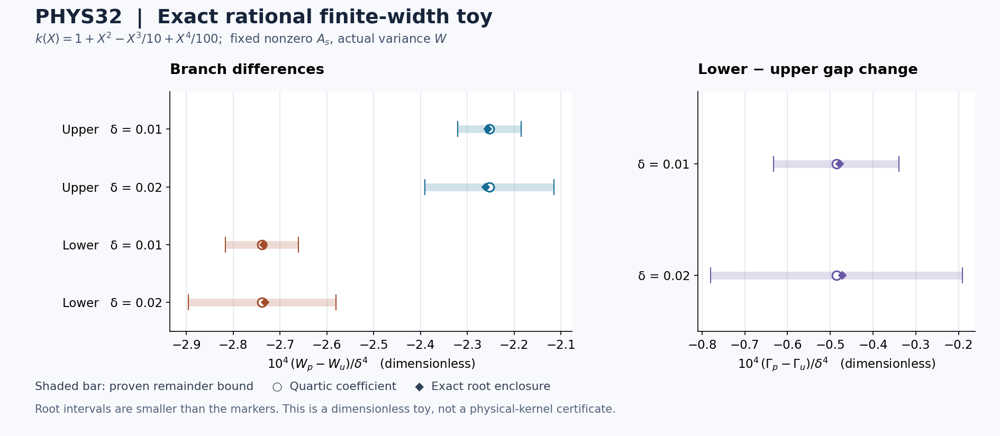

# PHYS32 — 사차 프로파일 차이의 유한 폭 나머지와 근 안정성

연구 단위: REI-PHYS32-20261011  
이어받은 과제: QUARTIC_SPLITTING_REMAINDER_AND_CONDITIONING  
과학 작업 상태: 조건부 정리 도출 및 고정 exact-rational 검증 완료  
최종 채택 권위: [별도 실제 검토서](../independent/DECISION_REVIEW_KO.md)와 [판정 JSON](../independent/DECISION_REVIEW.json)  
물리 admission: **HOLD 유지**

## 1. 이번 루프에서 실제로 달라진 것

PHYS31은 같은 이차 모멘트의 대칭 프로파일이 사차에서 처음 구별될 수 있음을 보였고,
\(\Delta W=D_4\delta^4+o(\delta^4)\)의 계수를 얻었다.
PHYS32는 그 나머지를 근의 이동과 조건수까지 포함하는 명시적 상계로 바꾸었다.
또한 실제 사용한 두 프로파일의 차이에 양의 적분 표현이 있음을 확인했다.
이 구조는 추가 구간 부호 증거가 있을 때 사차 근사 오차를 거치지 않고도
같은 수준의 유한 폭 근 순서를 직접 결정하게 해 준다.

| 결과 | 근거 상태 | 채택 범위 |
|---|---|---|
| 일반 C4 사차 근 나머지와 근 존재·이탈 조건 | derived | 고정 동일 \(\mu_2\), 실제 W, 동일한 정확 A, 내부 튜브, 양의 기울기 |
| C5에서 명시적인 \(K_R\delta^5\) 상계 | derived | 도함수 상계와 전체 폭 구간 조건이 주어진 경우 |
| 선택한 쌍의 정확한 양의 Peano 적분 표현 | derived; exact-rational identity checked | \(h_p\)와 균일 \(h_u\), C4 커널, 실제 지원 안 |
| 비영 A·움직이는 기하의 유한 폭 toy 근 8개 | numerically checked; implementation-verified | 두 사전 고정 폭, 두 분지, 두 프로파일, 무차원 다항식 |
| 근·노드·J·평가오차에서 계수·부호·gap으로의 전파식 | derived | 필요한 입력 오차가 실제로 제공되는 경우 |
| 실제 물리 커널의 인증 폭·부호·원 J 정확도 | unresolved | 새 물리 평가 및 해당 enclosure 없음 |

단위와 source·모델·실행 장소를 바꾸지 않았다.
연구·코딩 하네스는 현재 trusted developer designation의 GPT-6 Astra 계열에 맞는
v4.0.0을 실제 읽어 적용했다. 모델 전환·경험적 모델 신원 검증·성능 비교를 수행한 것은 아니다.

## 2. 비교 대상과 공통 기하

\[
a=13.61,\quad b=24.58,\quad m=18,\quad
L=4.39,\quad H=6.58\quad(\mathrm{eV})
\]

를 유지한다. 프로파일은 \([-1,1]\) 위의 고정 대칭 확률측도이며
\(\delta,W,\) 중심과 분지에서 독립이다. 일반 정리는 원자도 허용한다.
물리 폭은 \(\delta\ge0\), 중심 구간은 \([a+\delta,b-\delta]\)다.
같은 이차 모멘트 \(\mu_2\)에서 중심 분산과 실제 분산은

\[
V=W-\mu_2\delta^2,\qquad
\mu_2\delta^2\le W\le(L-\delta)(H-\delta)+\mu_2\delta^2.
\]

한 분지에서 \(s=\pm1,\ R=L\) 또는 \(H,\ e=m-sR\)라 하면

\[
r=R-\delta,\quad e_\delta=e+s\delta,\quad
x_{\delta,W}=m+sV/r,\quad p=\frac{V}{r^2+V},\quad q=1-p,
\]
\[
F_\alpha(\delta,W)
=p\int k(e_\delta+\delta z)d\alpha(z)
+q\int k(x_{\delta,W}+\delta z)d\alpha(z).
\]

두 프로파일의 기하와 확률이 정확히 같다. 모든 W 미분은 실제 W에 대한 미분이다.
각 분지에서 \(F_\alpha(0,w)=A\)인 정확한 내부 기준근을 가정한다.
두 분지의 수준은 서로 달라도 되지만, 한 분지 안에서 두 프로파일이 쓰는 A는 정확히 같아야 한다.
기존 비영 A를 0이나 새로 정의한 수준으로 바꾸지 않는다.

## 3. 근의 존재를 먼저 보장하는 정량 조건

고정 튜브 \(W\in[w-\eta,w+\eta]\), 폭 \(0\le\delta\le d\)에 대해

\[
d<\min(L,H),\qquad
\mu_2d^2<w-\eta,\qquad
w+\eta<(L-d)(H-d)
\tag{R32.1}
\]

이면 전체 튜브가 실현가능 내부에 놓인다.
원 구간에서 \(k''\ge m_2>0\)를 두고 \(\kappa=m_2/2\)라 하면

\[
F_{\alpha,W}=
\int_0^1t\int k''((1-t)e_\delta+t x_{\delta,W}+\delta z)
d\alpha(z)\,dt\ge\kappa.
\tag{R32.2}
\]

이 식은 상단·하단 모두에서 성립하며, 이미 존재하는 근을 가정하지 않고 먼저 얻는 하한이다.
영폭 기준 확률·중심을 \(p_0,q_0,x_0\), W=w에서 폭만 이동시킨 값을
\(p_\delta,q_\delta,x_\delta\)라 쓰고 \(M_i\ge\sup|k^{(i)}|\)라 하자.

\[
B(\delta)=|p_\delta-p_0|\,|k(e)-k(x_0)|
+M_1\!\left[p_\delta\delta+q_\delta|x_\delta-x_0|\right]
+\frac{\mu_2M_2}{2}\delta^2
\tag{R32.3}
\]

는 두 프로파일 모두에서 \(|F_\alpha(\delta,w)-A|\)를 감싼다.
앞의 두 항은 움직이는 기하, 마지막 항은 대칭 프로파일 평균의 이차 오차다.
따라서

\[
B(\delta)<\kappa\eta
\quad\Longrightarrow\quad
\text{두 유일근 존재},\qquad |W_\alpha(\delta)-w|\le\rho(\delta)=B(\delta)/\kappa.
\tag{R32.4}
\]

증명은 튜브 양 끝의 반대 잔차 부호와 단조성이다.
근이 존재한다고 먼저 가정한 뒤 그 가정으로 근을 제어하는 순환을 피했다.

## 4. 일반 C4 사차 나머지

\(\omega_n\)을 원 구간에서 \(k^{(n)}\)의 연속성 모듈러스라 하자.
다음은 실제 두 근과 그 사이에서 성립하는 명시적 상계다.

\[
h=\max\left\{\delta,\frac{\rho+w\delta/R+\mu_2\delta^2}{R-\delta}\right\},
\]
\[
P=\min\left\{1,
\frac{R^2(\rho+\mu_2\delta^2)+w\delta(2R-\delta)}
{((R-\delta)^2+w-\rho-\mu_2\delta^2)(R^2+w)}
\right\},
\]
\[
B_H=P|k^{(4)}(e)-k^{(4)}(x_0)|+\omega_4(h),\qquad
S_C=\frac12\omega_2(h+\delta),
\]
\[
r_4=\frac{\mu_{4,\nu}+\mu_{4,\sigma}}{24}\omega_4(\delta).
\tag{R32.5}
\]

여기서 h는 중심 이동, P는 끝점 확률의 변화, \(B_H\)는 사차 가중합의 이동,
\(S_C\)는 분산 기울기의 이동을 제어한다.
기울기 식에는 이미 확률과 내부 중심의 W 미분이 정확히 합쳐져 있다.

\[
\mathcal H_4=p_0k^{(4)}(e)+q_0k^{(4)}(x_0),\quad
C=F_W(0,w)>0,\quad
D_4=-\frac{\Delta\mu_4\mathcal H_4}{24C}.
\]

두 근 사이의 정확 평균 기울기를 \(\overline C\)라 하면
\(\overline C\ge\kappa\), \(|\overline C-C|\le S_C\)다.
같은 A 때문에 \(\overline C\Delta W+\Delta F(\delta,W_\sigma)=0\).
응답 차이에서 사차항을 더하고 빼고 이 quotient의 오차를 정리하면

\[
\boxed{
|\Delta W-D_4\delta^4|\le\delta^4\mathcal R(\delta),\qquad
\mathcal R=
\frac{|\Delta\mu_4|B_H/24+r_4+|D_4|S_C}{\kappa}.
}
\tag{R32.6}
\]

마지막 \(|D_4|S_C/\kappa\)가 근 기울기 이동의 비용이다.
응답 차이가 정확한 사차여도 이 항은 일반적으로 남는다.
분모를 \(\max\{\kappa,C-S_C\}\)로 개선할 수도 있지만,
\(\rho,h,P,S_C\)를 얻을 때 사용한 기존 \(\kappa\)는 유지한다.

C4에서는 \(\mathcal R(\delta)\to0\).
C5와 \(M_3\ge\sup|k'''|,M_5\ge\sup|k^{(5)}|\)가 있으면
\(\omega_2(t)\le M_3t,\ \omega_4(t)\le M_5t\)이고,
명시한 전체 구간 조건에서 \(K_R\delta^5\) 형태로 바꿀 수 있다.
그 \(K_B,K_h,K_P,K_R\)의 닫힌 식과 증명은 이 파일의 부록 A §8에 전부 수록했다.
대칭성만으로 근 나머지를 육차로 만들지는 않는다.

## 5. 선택한 쌍에는 정확한 양의 적분 표현이 있다

이번에 계속 쓰는 프로파일은

\[
h_u=\frac12,\qquad
h_p=\frac{35z^4-30z^2+11}{16}.
\]

차이는 \(P_4/2\)다. \(Q(z)=(1-z^2)^4\)로 놓으면
\(h_p-h_u=Q^{(4)}/768\).
\(Q,Q',Q'',Q'''\)가 양 끝에서 0이므로 네 번 부분적분해

\[
\boxed{
f_p(\delta,y)-f_u(\delta,y)
=\frac{\delta^4}{945}\int k^{(4)}(y+\delta z)d\pi(z),\qquad
d\pi=\frac{315}{256}(1-z^2)^4dz
}
\tag{R32.7}
\]

를 얻는다. \(\pi\)는 양의 확률측도이고, 이 식에는 Taylor 절단 오차가 없다.
표준 Legendre 다항식 정규화는 [NIST DLMF 18.5](https://dlmf.nist.gov/18.5)를 실제 확인했다.
새 근·나머지 정리와 동일 수준 조건은 직접 유도했으며 그 문헌에 귀속하지 않는다.

공통 기하에서
\(\Delta F=\delta^4\mathcal S/945\),
\(\mathcal S\)는 두 packet의 \(k^{(4)}\) 양의 가중평균이다.
따라서 같은 A의 두 근에서

\[
\Delta W=-\frac{\delta^4\mathcal S(\delta,W_u)}{945\overline C}.
\tag{R32.8}
\]

R32.5의 기하 상계로

\[
E_4=P|k^{(4)}(e)-k^{(4)}(x_0)|+\omega_4(h+\delta)
\]

라 두면 이 특수 쌍에 더 직접적인 나머지는

\[
\boxed{\mathcal R_p=
\frac{E_4+|\mathcal H_4|S_C/C}{945\kappa}.}
\tag{R32.9}
\]

또한 실제 두 photon packet 전체에서 \(0<m_4\le k^{(4)}\le M_4\),
기울기에 필요한 선분 전체에서 \(0<m_2\le k''\le M_2\)가 보장되면

\[
-\frac{2M_4}{945m_2}\delta^4
\le W_p-W_u
\le-\frac{2m_4}{945M_2}\delta^4<0.
\tag{R32.10}
\]

이는 조건부 유한 폭 순서다. 사차 도함수의 부호에는 해당 두 packet의 합집합만으로
충분할 수 있지만, \(k''\) 기울기 하한에는 두 중심 사이 선분과 profile shift도 필요하다.
정의역을 혼동하지 않는다. 실제 소스의 네 점이 양수라는 사실을 이 구간 전제로 대체하지 않았다.
두 분지 각각의 음의 이동은 두 분지 간격 차이의 부호를 결정하지 않는다.

## 6. 저장 입력의 오차와 같은 비영 A

저장 w가 정확한 목표 A의 근이라는 등식은 별도 enclosure를 필요로 한다.
인증된 잔차 \(\varepsilon_r\)와 feasible box의 양의 기울기로

\[
|w-\widehat w|\le\varepsilon_w=\varepsilon_r/\kappa,\qquad
|x(w)-\widehat x|\le\varepsilon_w/R+\eta_x,
\tag{R32.11}
\]

여기서 \(\eta_x=|\widehat x-(m+s\widehat w/R)|\)다.
이런 근·노드·가중치 오차를 도함수의 modulus와 합쳐
\(|H-\widehat H|\le\varepsilon_H,\ |C-\widehat C|\le\varepsilon_C\)를 확보해야 한다.
\(\alpha=\Delta\mu_4/24\)라 하면

\[
|D_4-\widehat D_4|
\le\varepsilon_D=
|\alpha|\left[
\frac{\varepsilon_H}{\kappa}
+\frac{|\widehat H|\varepsilon_C}{\kappa|\widehat C|}
\right]+\varepsilon_{D,\mathrm{asm}}.
\tag{R32.12}
\]

모든 값과 도함수 bound에 불확실성을 일관되게 포함한 뒤에만

\[
|\widehat D_4|>\varepsilon_D+\mathcal R(\delta)
\tag{R32.13}
\]

를 엄격한 부호의 충분조건으로 사용할 수 있다.
Gap에는 두 분지의 계수 오차와 나머지를 더한다.
공통 입력을 사용했다는 이유만으로 오차 상쇄를 가정하지 않는다.

분자식 \(G=N-AQ\)에는 중요한 구분이 있다.

\[
G_W=N_W-A=QF_W+(F-A).
\tag{R32.14}
\]

따라서 \(G_W=QF_W\)는 해당 A의 정확한 근에서만 성립한다.
두 근 사이의 임의 평균점 또는 저장 근사점에는 잔차가 남는다.
새 정리는 정규화된 F의 평균 기울기를 사용해 이 잔차를 조용히 버리지 않았다.
기존 작은 비영 A의 값을 0으로 바꾸지 않는다.

고정 source-real 커널의 도함수는
\[
k^{(r)}=K\{E^2\phi^{(r+2)}+(2r+4)E\phi^{(r+1)}
+r(r+3)\phi^{(r)}\}
\tag{R32.15}
\]
이므로 \(k^{(4)}\) 제어에는 \(\phi\)의 6차까지,
\(k^{(5)}\) 제어에는 7차까지의 정보가 필요하다.
함수값의 원자 fit 오차를 고차 도함수 오차로 그대로 사용할 수 없다.
고정 다른 입력 아래 J 의존성은 선형이지만, 원 J 오차와 계수 함수의 구간 norm은
이번 루프에서 수치 평가하지 않았다. 전체 조건부 전파식은 부록 C에 있다.

## 7. 실제 수행한 exact-rational 유한 폭 검증

검증은 무차원 다항식
\[
k(X)=1+X^2-X^3/10+X^4/100,\quad X\in[-2,2],\quad R=2,\ m=0,\ w=1
\]
에 대해 수행했다. 사전에 고정한 폭은 1/100, 1/50이며,
두 분지의 수준은 \(A_s=(813+60s)/400\)로 비영이다.
두 프로파일마다 이 수준의 유일근을 정확 유리수로 감쌌다.

직접 평균 경로와 중심·전체 모멘트 경로를 별도로 조립해 새 근 구간의 양 끝에서
같은 잔차를 주는지 확인했다. 각 근은 80회의 정확 이분법으로
폭 \(2^{-81}\)의 구간에 들었다. 두 근 구간을 바깥 방향으로 빼서
\(\Delta W/\delta^4\)의 전체 구간을 만들고 상계와 비교했다.

아래 값은 원자료의 정확 유리수를 읽기 쉽게 반올림한 표시다.
모든 양은 **무차원 toy 값**이며 물리 eV 폭이나 실제 커널의 문턱이 아니다.

| 분지 | \(\delta\) | \(D_4\) | 실제 \(\Delta W/\delta^4\), 표시값 | 나머지 상계 \(\mathcal R\) |
|---|---:|---:|---:|---:|
| 상단 | 0.01 | −0.000225249005737 | −0.000225643802004 | \(6.82229962\times10^{-6}\) |
| 상단 | 0.02 | −0.000225249005737 | −0.000226038530155 | \(1.37384776\times10^{-5}\) |
| 하단 | 0.01 | −0.000273820219912 | −0.000273499667768 | \(7.82074191\times10^{-6}\) |
| 하단 | 0.02 | −0.000273820219912 | −0.000273178882625 | \(1.57487654\times10^{-5}\) |

네 경우 모두 전체 근 차이 구간이 사차 나머지와 MVT 범위 안에 들고,
\(\mathcal R<|D_4|\)를 만족했다. 실제 근 차이는 엄격히 음수이며,
유한 폭에서 \(\Delta W=D_4\delta^4\)와 정확히 같지는 않다.
이 toy는 \(k^{(4)}=6/25\)가 상수라 응답 차이는 정확한 사차다.
근 차이의 나머지는 움직이는 분모에서 나온다.

Gap의 사차계수는 −0.0000485712141751이다.
두 폭에서 나머지 합은 각각 0.0000146430415295, 0.0000294872429604로
그 절댓값보다 작았다. 실제 scaled gap 변화는 약 −0.0000478558657642,
−0.0000471403524705이며 둘 다 음수다.
이 부호를 PHYS31 실제 물리 cache의 양의 gap 계수에 옮기지 않는다.
커널과 기준 수준이 다른 진단이다.

표시 그림은 이미 끝난 정확 유리수 결과만 읽었다.
사차 기준값 주위의 상계 구간과 실제 근 차이 구간을 비교한다.
근의 인증 구간은 마커보다 작다. 그림에는 새 커널·근 평가가 없다.

| 실제 실행 항목 | 첫 main | 한 번의 복원 replay | 합계·해석 |
|---|---:|---:|---|
| 실행 exit | 0 | 0 | stderr 각각 0 bytes |
| 검사 묶음 | 21/21 | 21/21 | 같은 19 수학 묶음+2 계약·회계 묶음 |
| 새 toy 근 구간 | 8 | 8 | 같은 8개 사례의 재현 |
| 정확 이분법 단계 | 640 | 640 | 합계 1,280 |
| moment 응답 호출 | 680 | 680 | 합계 1,360 |
| 직접 평균 응답 호출 | 24 | 24 | 합계 48 |
| 새 물리 kernel/derivative/root 평가 | 0 | 0 | 0 |
| 과거 과학 import/main/suite | 0 | 0 | 0 |
| 수치 quadrature·finite difference | 0 | 0 | 0 |
| main wall time | 0.064959 s | 0.068680 s | 실제 process receipt 기준 |

첫 원자료와 replay 원자료는 **31,328 bytes 전체와 parsed JSON이 같다**.
SHA256: 852a895d3fa52519717cbaaaee602ced253fb49c4e140ef6b1885dc9edc2d417.
최소 runtime의 5개 payload와 manifest를 다른 경로에 복원했고,
payload의 bytes·SHA·mode를 replay 전후 확인했다.
같은 호스트·Python 3.12.14·입력 계보의 재현이며 독립 물리 데이터 credit은 0이다.
첫 main 1회와 replay 1회의 과학 예산을 모두 사용했다.

## 8. 실제 소스와 남겨 둔 물리 한계

최신 intake에서 [PR 83](https://github.com/cosmosapjw-quantum/rei_bianchi/pull/83)의 head는
13436210ea925be268b4dc9034baf4a37b6dc091,
tree는 242aae1871e1bf2ad19e37ea653d21b06f22559f였다.
전체 tree는 6,363 entries, truncated=false였다.
고정한 소스 7개의 Git blob·크기·mode와 복원된 bytes가 모두 맞았고,
과학 src subtree는 cb69b4736dd046e4675557577eb8e0ead037d1f3이다.
이 식별자들은 내용 동일성 근거이며 물리 정확도의 증명은 아니다.

H I fit 출처는 [Verner et al.의 arXiv 서지·초록](https://arxiv.org/abs/astro-ph/9601009)과
[저자 자료 페이지](https://www.pa.uky.edu/~verner/photo.html)를 직접 확인했다.
전체 논문·표·Fortran 또는 정확도 검증을 수행했다고 주장하지 않는다.
실제 소스의 분석 구간은 cutoff를 가로지르지 않는 하나의 양의 해석적 분기에 놓인다.
Source binary64 리터럴을 정확 실수 상수로 읽고 직렬화 J를 고정한 모델의 정칙성과,
native 반환값의 반올림·원자 fit 및 원 J의 불확실성은 구별한다.

기존 물리 계수는 PHYS31의 저장 입력 결과로 유지한다.

| 물리 cache | 상단 | 하단 |
|---|---:|---:|
| 기존 비영 A, s⁻⁴ | \(-2.2748589\times10^{-137}\) | \(-3.2582515\times10^{-137}\) |
| 기존 \(D_4^{p-u}\), eV⁻² | −0.00110495859229183348 | −0.000619616589313442784 |

이번에는 이 값들을 다시 평가하지 않았다.
원 J, 기준근·저장 노드의 오차, 점별 도함수 평가오차,
구간 \(m_2,M_3,M_5,\omega_2,\omega_4\)의 숫자를 0으로 두지 않았다.
따라서 실제 물리 커널에서 어느 eV 폭까지 사차 근사가 부호를 보증하는지는 여전히 미평가다.
두 표현의 일치·재현·해석성은 그 누락된 enclosure를 대신하지 않는다.

## 9. 검토·수정·종료와 다음 질문

후보 생성자는 owner와 두 기여자이고, 최종 decision reviewer는 생성·검증 설계에 참여하지 않은
별도 실제 역할이다. 같은 host·model·input lineage의 NONBLIND 검토이며
독립 물리 실험으로 세지 않는다. 최종 판정의 실제 상태·범위는 앞의 판정서 링크를 따른다.

통합 중 선두 표시식 T32.1의 더하기 기호 한 글자 누락을 발견했다.
올바른 합은 상세 유도와 기계 판독 주장에 이미 있었고,
수정 전 전체 본문을 보존한 뒤 표시식만 수정했다.
이는 EDITORIAL_EQUATION_OMISSION으로 기록했다.
조건 분석 문서의 상대 링크 한 곳도 실제 파일명으로 바로잡았다.
과학 main 실패·재시도·허용치 변경은 없었다.
읽기 출력의 truncation은 해당 범위를 다시 표시해 보완했으며 과학 실행으로 세지 않는다.

다음 PHYS33의 제안은 **고정 source-real 모델에서 최소 국소 부호 인증의 가능성**이다.
먼저 정확하게 같은 수준, feasible root tube, 기울기와 두 photon packet의 \(k^{(4)}\) 부호에
필요한 증거를 정한다. Branch 순서만 목표라면 R32.7–10을 사용해
사차 근 나머지의 수치값 없이도 접근할 수 있다.
Gap 부호는 별도의 정량 오차 조건이 필요하므로 같은 성과로 묶지 않는다.
PHYS33은 PROPOSED_NOT_RUN이며 새로운 계산은 새 계약 전에는 실행하지 않는다.

**Physical HOLD; [160,161] FAIL; tick 160; auxiliary escape FAIL;
HH/RCT/CR OFF; precision atomic PARKED; production source/default/runtime changes 0.**

완료한 직접 증명 세 본문을 아래 부록에 수록한다.
단독 보고서에서도 정의·가정·유도·조건부 오차식을 확인할 수 있다.
코드·정확 원자료·실행 기록·전체 개별 주장·보존 입력은 함께 제공하는 연구 묶음에 있다.

---

## 부록 A — 일반 정량 나머지의 전체 증명

# PHYS32 — 움직이는 공통 기하에서 사차 근 차이의 정량 나머지

연구 기여: **REI-PHYS32-20261011 · QUARTIC_SPLITTING_REMAINDER_AND_CONDITIONING**.  
기여자: /root/phys32_theory. 상태: **조건부 직접 유도 후보 완성, 별도 최종 판정 대기**.  
역할: 같은 호스트·상속 GPT-6 Astra Pro·부모 대화 문맥을 사용하는 NONBLIND 이론 생성자. 최종 독립 판정자가 아니다.

## 0. 결론과 근거의 범위

PHYS31의 같은 이차 모멘트·실제 분산·같은 정확한 수준 \(A\)를 유지하면, 근의 존재를 먼저 보장하는 고정 구간 조건 아래

\[
\boxed{
|\Delta W(\delta)-D_4\delta^4|
\le \delta^4\mathcal R(\delta),\qquad
\mathcal R(\delta)=
\frac{|\Delta\mu_4|B_H(\delta)/24+r_4(\delta)
+|D_4|S_C(\delta)}{\kappa}
}
\tag{T32.1}
\]

를 얻는다. 여기서 \(\kappa>0\)는 응답의 실제 분산 미분 하한, \(B_H\)는 사차 도함수 가중합의 이동 상계, \(r_4\)는 두 프로파일 평균의 사차 Taylor 나머지, \(S_C\)는 근 사이 평균 기울기의 기준값 이탈 상계다. 각 양은 아래에서 근을 미리 안다고 가정하지 않고 정의한다. \(k\in C^4\)이면 \(\mathcal R(\delta)\to0\)이며, 유계 오차를 가진 입력과 도함수 상계가 실제로 확보되면 이 부등식은 유한 폭에서 사용할 수 있다.

추가 \(C^5\) 전제에서는 명시적인 상수 \(K_R\)로

\[
|\Delta W(\delta)-D_4\delta^4|\le K_R\delta^5
\tag{T32.2}
\]

라는 보수적인 충분조건을 준다. 대칭성만으로 이동하는 기하와 분모에서 나오는 오차까지 육차가 된다고 하지는 않는다. 엄격한 부호의 충분조건은 \(\mathcal R(\delta)<|D_4|\)다. 두 분지의 간격에는 각각의 나머지를 더해야 한다.

이 문서는 **직접 유도**다. 새로운 물리 커널·노드·도함수·근의 수치 평가 또는 과학 프로그램 실행은 0이다. 기존 물리 cache의 소수값을 구간 상계로 승격하지 않았다. 물리적으로 인증된 유효 폭의 숫자, 실제 원자 fit 오차 또는 실제 기체 이력의 승격은 이 결과에 포함하지 않는다.

## 1. 읽은 근거와 유지하는 정의

현재 [물리 계약](../PHYSICS_CONTRACT.json), 실제 [연구 상태](../state/RESEARCH_STATE.md), Astra 연구 하네스의 core와 관련 phase를 읽었다. 선행 과학 내용은 [PHYS31 전체 이론 유도](../inputs/PHYS31/contributions/theory/DERIVATION_KO.md) 및 [PHYS32 인수문](../inputs/PHYS31/next/PHYS32_NEXT_HANDOFF_KO.md)을 직접 읽었다. 읽은 파일·범위·SHA256은 [READ_MANIFEST.json](../contributions/theory/READ_MANIFEST.json)에 둔다. PHYS31의 과학 main을 다시 실행하거나 원 프로그램을 import하지 않았다.

\[
a<m<b,\quad L=m-a,\quad H=b-m,\qquad
a=13.61,\ b=24.58,\ m=18,\ L=4.39,\ H=6.58
\quad({\rm eV})
\tag{T32.3}
\]

를 보존한다. 두 프로파일 \(\nu,\sigma\)는 \([-1,1]\) 위의 고정된 대칭 Borel 확률측도이고

\[
\mu_2=\int z^2\,d\nu=\int z^2\,d\sigma,\qquad
\Delta\mu_4=\mu_{4,\nu}-\mu_{4,\sigma},\qquad
\mu_{4,\alpha}=\int z^4\,d\alpha .
\tag{T32.4}
\]

측도는 \(\delta,W,\) 중심과 분지에서 독립이며 원자를 허용한다. 폭은 \(\delta\ge0\)이다. 중심 구간은 항상 \([a+\delta,b-\delta]\)이고, 실제 분산 \(W\)와 중심 분산 \(V\)의 관계는

\[
V=W-\mu_2\delta^2,\qquad
\mu_2\delta^2\le W\le (L-\delta)(H-\delta)+\mu_2\delta^2.
\tag{T32.5}
\]

한 분지를 고정하고 다음 표기를 쓴다.

| 분지 | \(s\) | \(R\) | \(e=m-sR\) | \(x_0=m+sw/R\) |
|---|---:|---|---|---|
| 상단 \(+\), 선행 \(*\) | \(+1\) | \(L\) | \(a\) | \(m+w/L\) |
| 하단 \(-\), 선행 \(0\) | \(-1\) | \(H\) | \(b\) | \(m-w/H\) |

\[
r=R-\delta,\quad
e_\delta=e+s\delta,\quad
x_{\delta,W}=m+\frac{s(W-\mu_2\delta^2)}r,
\quad
p_{\delta,W}=\frac{W-\mu_2\delta^2}{r^2+W-\mu_2\delta^2},
\quad q_{\delta,W}=1-p_{\delta,W},
\tag{T32.6}
\]

\[
f_{\delta,\alpha}(y)=\int k(y+\delta z)\,d\alpha(z),\qquad
F_\alpha(\delta,W)=
p_{\delta,W}f_{\delta,\alpha}(e_\delta)
+q_{\delta,W}f_{\delta,\alpha}(x_{\delta,W}).
\tag{T32.7}
\]

같은 \(\mu_2\) 때문에 T32.5–7의 기하는 두 프로파일에 정확히 공통이다. 모든 \(W\) 미분은 \(\delta\)를 고정한 **실제 분산 미분**이다.

기준점과 수준은

\[
0<w<LH,\qquad F_\nu(0,w)=F_\sigma(0,w)=A
\tag{T32.8}
\]

를 정확하게 만족한다고 가정한다. \(A\)는 정확히 같은 수준이며 0일 필요가 없다. 저장된 기준점에 대해 \(A=F(0,w)\)를 정확 실수 함수의 정의로 채택하는 경우와, 별도로 저장된 반올림 \(A\)가 그 등식을 만족하는지를 인증하는 경우를 구별한다. 후자는 이 가정만으로 해결되지 않는다.

주 정리에는 \(k\in C^4([a,b])\)와 \(k''>0\)를 쓴다. 끝점 미분은 내부 한쪽 도함수의 연속 극한이다. 상속한 \(k'''<0\)는 중심 혼합족의 극값 해석에 남겨 두지만, 아래 근 나머지 증명에는 필요하지 않다. 이 문서는 상속 부호를 새로운 물리 구간 인증으로 재검증하지 않는다.

기존 metric \((-,+,+,+)\), proper seconds, 에너지 eV, \(k,F,A\)의 단위 s⁻⁴를 유지한다. \(c,\hbar,k_B\)를 1로 놓거나 새로운 단위 변환을 하지 않는다.

## 2. 근의 존재와 독립인 고정 구간 조건

먼저 \(\eta>0\)와 \(d>0\)를 정해

\[
d<\min(L,H),\qquad
\mu_2d^2<w-\eta,\qquad
w+\eta<(L-d)(H-d)
\tag{T32.9}
\]

를 요구한다. 이는 간단한 **충분조건**이다. 모든 \(0\le\delta\le d\)와 \(W\in[w-\eta,w+\eta]\)에 대해

\[
0<V=W-\mu_2\delta^2<(L-\delta)(H-\delta)
\tag{T32.10}
\]

이므로 해당 사각 영역은 실현가능 내부에 있다. 실제로 하한은 T32.9에서 바로 나오고, 상한은
\(V\le W\le w+\eta<(L-d)(H-d)\le(L-\delta)(H-\delta)\)다.
따라서 \(r>0,\ p,q>0\), 모든 중심과 평균에 쓰는 에너지는 원래 구간 안에 있다.

T32.9는 정확 상한의 \(+\mu_2\delta^2\)를 버려 보수적으로 만든 조건이다. 정확 상한
\(U(\delta)=LH-(L+H)\delta+(1+\mu_2)\delta^2\)가 모든 허용 폭에서 단조 감소한다고 가정하지 않았다. 더 넓은 영역이 필요하면 T32.5를 해당 전체 영역에서 직접 인증해 T32.9를 대체할 수 있다.

커널의 유계 상수와 연속성 모듈러스를

\[
m_2=\min_{[a,b]}k''>0,\quad
\kappa=\frac{m_2}{2},\quad
M_j=\sup_{[a,b]}|k^{(j)}|\quad(j=1,2),
\tag{T32.11}
\]

\[
\omega_n(h)=\sup\{
|k^{(n)}(u)-k^{(n)}(v)|:
u,v\in[a,b],\ |u-v|\le h\},\qquad n=2,4
\tag{T32.12}
\]

로 둔다. \(h\ge0\)에서 정의하며 구간 길이를 넘으면 같은 전구간 상계를 사용한다. \(\omega_n\)은 비감소이고 \(\omega_n(0)=0,\ \omega_n(h)\to0\)이다. 인증된 보수적 상·하한을 사용해도 이후 부등식은 유지된다. 단, 해석적으로 존재하는 최소·상한과 실제 숫자로 인증한 bound는 같은 근거가 아니다.

## 3. 양의 기울기의 정확한 적분 표현

\(g=f_{\delta,\alpha}\), \(x=x_{\delta,W}\), \(D=x-e_\delta=s(r^2+V)/r\)라 두자. \(D\ne0\)이며 부호는 \(s\)다. T32.6–7을 실제 \(W\)로 미분하면

\[
F_{\alpha,W}
=\frac{g(e_\delta)-g(x)+Dg'(x)}{D^2}.
\tag{T32.13}
\]

적분 \(\int_0^1t\,g''(e_\delta+tD)\,dt\)에 부분적분을 적용하면 T32.13과 같아진다. \(D<0\)인 하단 분지에서도 같은 식이다. 따라서

\[
\boxed{
F_{\alpha,W}(\delta,W)=
\int_0^1 t\int k''\!\left((1-t)e_\delta+t x_{\delta,W}+\delta z\right)
\,d\alpha(z)\,dt
\ge\kappa .
}
\tag{T32.14}
\]

평균 미분은 콤팩트 구간에서 유계인 \(k''\)로 정당화된다. \(\alpha\)의 밀도는 필요하지 않다. 모든 적분점은 허용 중심 구간의 선분에 \(\delta z\)를 더한 점이므로 \([a,b]\) 안이다.

기준 기울기는 두 프로파일에서 공통이고

\[
C=F_W(0,w)=\int_0^1t\,k''((1-t)e+t x_0)\,dt
\ge\kappa>0.
\tag{T32.15}
\]

T32.14의 전 영역 하한을 근 존재 이전에 얻었다. 이후의 근 이동 상계가 이미 존재하는 근을 전제로 기울기를 추정하는 순환은 없다.

## 4. 기준점의 응답 이동에서 근 존재와 이탈을 얻기

\(p_0=w/(R^2+w)\), \(q_0=1-p_0\)라 하고, 이 절에서
\(p_\delta=p_{\delta,w},\ q_\delta=1-p_\delta,\ x_\delta=x_{\delta,w}\)다.
두 고정 노드의 응답 차이를 \(O_0=|k(e)-k(x_0)|\)로 둔다.

대칭성으로 \(\int z\,d\alpha=0\)이므로 일차 Taylor 식의 적분 나머지에서

\[
|f_{\delta,\alpha}(y)-k(y)|
\le \frac{\mu_2M_2}{2}\delta^2.
\tag{T32.16}
\]

또한

\[
\begin{aligned}
&p_\delta k(e_\delta)+q_\delta k(x_\delta)
-p_0k(e)-q_0k(x_0)\\
&=(p_\delta-p_0)[k(e)-k(x_0)]
+p_\delta[k(e_\delta)-k(e)]
+q_\delta[k(x_\delta)-k(x_0)].
\end{aligned}
\tag{T32.17}
\]

\[
|x_\delta-x_0|=
\frac{|w\delta/R-\mu_2\delta^2|}{R-\delta}
\tag{T32.18}
\]

를 대입하여 다음의 프로파일 공통 상계를 얻는다.

\[
\boxed{
B(\delta)=
|p_\delta-p_0|O_0
+M_1\left[p_\delta\delta+
q_\delta\frac{|w\delta/R-\mu_2\delta^2|}{R-\delta}\right]
+\frac{\mu_2M_2}{2}\delta^2,
\quad
|F_\alpha(\delta,w)-A|\le B(\delta).
}
\tag{T32.19}
\]

\(B(0)=0\)이며 \(B(\delta)=O(\delta)\)다. 끝점과 내부 중심의 이동을 함께 포함하며, 평활화 오차의 두 확률이 합해 1이므로 T32.16의 오차를 두 배 하지 않는다.

이제 주어진 \(\delta\in[0,d]\)에서

\[
B(\delta)<\kappa\eta
\tag{T32.20}
\]

를 확인하면, T32.14와 T32.19가

\[
F_\alpha(\delta,w-\eta)-A
\le B-\kappa\eta<0,\qquad
F_\alpha(\delta,w+\eta)-A
\ge-B+\kappa\eta>0
\tag{T32.21}
\]

를 준다. 연속성과 엄격한 단조성으로 정확한 근
\(W_\alpha(\delta)\in(w-\eta,w+\eta)\)가 유일하게 존재한다. 다시 기울기 하한을 적분하면

\[
\boxed{
|W_\alpha(\delta)-w|\le
\rho(\delta),\qquad
\rho(\delta)=\frac{B(\delta)}{\kappa}<\eta ,
\quad\alpha\in\{\nu,\sigma\}.
}
\tag{T32.22}
\]

이는 새로운 근 탐색을 가정하지 않는, 기준점의 응답 잔차로부터 얻는 존재 및 이탈 정리다. 같은 \(\delta\)에서 두 근을 잇는 전체 선분도 \(|W-w|\le\rho\)에 있다.

## 5. 근 근방의 중심·확률·기울기 이동

### 5.1 중심 이동

\(|W-w|\le\rho\)이면

\[
x_{\delta,W}-x_0
=\frac{s[(W-w)+w\delta/R-\mu_2\delta^2]}{R-\delta}.
\tag{T32.23}
\]

따라서

\[
h_x(\delta)=\frac{\rho+w\delta/R+\mu_2\delta^2}{R-\delta},
\qquad
h(\delta)=\max\{\delta,h_x(\delta)\}
\tag{T32.24}
\]

에 대해 \(|e_\delta-e|\le h,\ |x_{\delta,W}-x_0|\le h\)다. 여기에 프로파일의 \(\delta z\)까지 더한 실제 에너지 선분의 이동은 \(h+\delta\)로 상계된다.

### 5.2 확률 이동

공통 기하에서 직접 통분하면

\[
p_{\delta,W}-p_0=
\frac{R^2(W-w-\mu_2\delta^2)
+w\delta(2R-\delta)}
{(r^2+W-\mu_2\delta^2)(R^2+w)}.
\tag{T32.25}
\]

T32.22와 양의 분모를 사용해

\[
\boxed{
P(\delta)=\min\!\left\{1,\
\frac{R^2(\rho+\mu_2\delta^2)+w\delta(2R-\delta)}
{(r^2+w-\rho-\mu_2\delta^2)(R^2+w)}
\right\}
}
\tag{T32.26}
\]

를 정의하면 \(|p_{\delta,W}-p_0|\le P\)다. 분모의 첫 인자는 T32.9와 \(\rho<\eta\)에서 양수다. \(\delta<R\)이므로 \(\delta(2R-\delta)\ge0\)다. \(P\)는 사용 가능한 닫힌 형태의 충분 상계이며 최적값이라는 주장은 하지 않는다. 필요하면 \(p_{\delta,W}\)의 \(W\) 단조성을 사용한 두 끝점의 최대 편차로 더 작게 잡을 수 있다.

### 5.3 사차 도함수 가중합 이동

\[
H_4(\delta,W)=
p_{\delta,W}k^{(4)}(e_\delta)
+q_{\delta,W}k^{(4)}(x_{\delta,W}),\qquad
H_{4,0}=p_0k^{(4)}(e)+q_0k^{(4)}(x_0),
\tag{T32.27}
\]

\[
O_4=|k^{(4)}(e)-k^{(4)}(x_0)|,\qquad
B_H(\delta)=P(\delta)O_4+\omega_4(h(\delta))
\tag{T32.28}
\]

로 두면 \(|H_4(\delta,W)-H_{4,0}|\le B_H\)다. 증명은 T32.17의 \(k\)를 \(k^{(4)}\)로 바꾸고, 두 노드 이동 항을
\(p\omega_4(\delta)+q\omega_4(h_x)\le\omega_4(h)\)로 상계하는 것이다. 양의 공통 확률이 핵심이다.

### 5.4 실제 분산 기울기 이동

T32.14의 적분점과 T32.15의 적분점을 같은 \(t,z\)로 짝지으면

\[
\left|(1-t)e_\delta+t x_{\delta,W}+\delta z
-[(1-t)e+t x_0]\right|\le h+\delta.
\tag{T32.29}
\]

따라서 각 프로파일에서

\[
\boxed{
|F_{\alpha,W}(\delta,W)-C|
\le S_C(\delta),\qquad
S_C(\delta)=\frac12\omega_2(h(\delta)+\delta).
}
\tag{T32.30}
\]

별도의 확률 미분 상계가 더 붙지 않는 이유는 T32.14가 이미 \(p,q,x\)의 분산 미분을 정확히 결합한 표현이기 때문이다. 기준 기울기 \(C\)와 단지 점별 \(k''\) cache를 혼동하지 않는다.

## 6. 일반 대칭 프로파일의 사차 나머지

반복된 미적분의 기본정리로 \(y,y+u\in[a,b]\)일 때

\[
k(y+u)=\sum_{\ell=0}^4\frac{u^\ell}{\ell!}k^{(\ell)}(y)
+R_4(y,u),\qquad
|R_4(y,u)|\le\frac{|u|^4}{24}\omega_4(|u|).
\tag{T32.31}
\]

이는 3차 적분 나머지에서 \(k^{(4)}(y)\)를 더하고 빼면 얻으며, \(u<0\)에서도 같은 매개화로 성립한다. \(u=\delta z\)를 대입하고 두 프로파일을 빼면 질량·평균·이차·삼차 모멘트가 소거되어

\[
f_{\delta,\nu}(y)-f_{\delta,\sigma}(y)
=\frac{\Delta\mu_4}{24}k^{(4)}(y)\delta^4
+\delta^4\varepsilon_4(\delta,y),
\tag{T32.32}
\]

\[
|\varepsilon_4(\delta,y)|
\le r_4(\delta):=
\frac{\mu_{4,\nu}+\mu_{4,\sigma}}{24}\omega_4(\delta).
\tag{T32.33}
\]

이 상계는 모든 허용 중심에서 균일하다. \(p,q\)가 같은 비음수 확률이므로

\[
\Delta F(\delta,W):=F_\nu-F_\sigma
=\delta^4\left[
\frac{\Delta\mu_4}{24}H_4(\delta,W)+\varepsilon_F(\delta,W)
\right],\qquad
|\varepsilon_F|\le r_4.
\tag{T32.34}
\]

서로 같은 측도처럼 추가 소거가 있는 경우 T32.33은 날카롭지 않을 수 있다. 필요하면 \(\mu_{4,\nu}+\mu_{4,\sigma}\)를
\(\int |z|^4\,d|\nu-\sigma|(z)\)로 대체할 수 있다. 본 정리에는 그 개선이 필요하지 않다.

## 7. 사차 응답 차이를 근 차이로 옮기는 정량 정리

\[
\Delta W=W_\nu-W_\sigma,\qquad
D_4=-\frac{\Delta\mu_4 H_{4,0}}{24C}
\tag{T32.35}
\]

로 정의한다. \(D_4\)는 ordinary 사차 계수의 차이이며 사차 도함수 자체의 차이는 \(24D_4\)다.

두 근에서 **같은 정확한 \(A\)**를 쓰므로

\[
0=F_\nu(\delta,W_\nu)-F_\sigma(\delta,W_\sigma)
=\overline C(\delta)\Delta W
+\Delta F(\delta,W_\sigma),
\tag{T32.36}
\]

\[
\overline C(\delta)=
\int_0^1F_{\nu,W}(\delta,W_\sigma+t\Delta W)\,dt.
\tag{T32.37}
\]

이 표현은 \(\Delta W=0\)에서도 정의된다. 두 근 사이 선분에 T32.14와 T32.30을 적용하면

\[
\overline C\ge\kappa,\qquad
|\overline C-C|\le S_C.
\tag{T32.38}
\]

\(\delta>0\)에서 T32.34–38을 사용해 정확히

\[
\frac{\Delta W}{\delta^4}-D_4
=-\frac{
\frac{\Delta\mu_4}{24}[H_4(\delta,W_\sigma)-H_{4,0}]
+\varepsilon_F(\delta,W_\sigma)
+D_4(\overline C-C)}
{\overline C}.
\tag{T32.39}
\]

따라서 T32.1을 얻는다. \(\delta=0\)에서는 양변이 0이다. 이 부등식에 포함된 세 오차는 각각 사차 가중합 이동, 평균의 Taylor 나머지, 근 사이 분모 이동이다. 응답의 Taylor 나머지만 작다고 해서 마지막 항을 버릴 수 없다.

원한다면

\[
\kappa_{\rm eff}(\delta)=\max\{\kappa,C-S_C(\delta)\}>0
\tag{T32.40}
\]

를 T32.1의 분모에 사용해 개선할 수 있다. \(\rho\)와 \(h,P,S_C\)는 이미 \(\kappa\)로 계산된 것이므로 이 개선에도 순환은 없다.

\(B=O(\delta)\), \(\rho=O(\delta)\), \(h=O(\delta)\), \(P=O(\delta)\)이고 \(\omega_n(t)\to0\)이므로 \(\mathcal R(\delta)\to0\)다. T32.20은 충분히 작은 양의 폭에서 성립한다. 이 결론은 PHYS31의 \(o(\delta^4)\)를 회복하지만, 현재 부등식은 유한 폭에서 확인해야 할 모든 상수를 드러낸다.

## 8. \(C^5\)에서 사용할 수 있는 완전한 상수 형태

이 절에서는 T32.9를 만족하는 \(d\)를 고정한다. 다음의 양수들을 정의한다.

\[
Q_b=(R-d)^2+w-\mu_2d^2,\qquad
Q_t=(R-d)^2+w-\eta-\mu_2d^2,
\tag{T32.41}
\]

\[
u_p=\frac{2wR+R^2\mu_2d}{Q_b(R^2+w)},\qquad
u_x=\frac{w/R+\mu_2d}{R-d},
\tag{T32.42}
\]

\[
K_B=u_pO_0+M_1\max\{1,u_x\}
+\frac{\mu_2M_2d}{2}.
\tag{T32.43}
\]

T32.25에 \(W=w\)를 넣고 분자 절댓값을 상계하면
\(|p_{\delta,w}-p_0|\le u_p\delta\)다. T32.18은
\(|x_{\delta,w}-x_0|\le u_x\delta\)를 준다. T32.19에서 \(p+q=1\)을 쓰면

\[
B(\delta)\le K_B\delta\quad(0\le\delta\le d).
\tag{T32.44}
\]

따라서 추가로 \(K_Bd<\kappa\eta\)를 확인하면 같은 전체 폭 구간의 근 존재가 보장된다. 이는 미지의 근에 대한 조건이 아니라 입력 상수들에 대한 명시적인 충분조건이다.

\[
c_\rho=\frac{K_B}{\kappa},\qquad
K_h=\max\left\{1,\frac{c_\rho+w/R+\mu_2d}{R-d}\right\},
\tag{T32.45}
\]

\[
K_P=
\frac{R^2(c_\rho+\mu_2d)+2wR}{Q_t(R^2+w)}
\tag{T32.46}
\]

라 두면 \(\rho\le c_\rho\delta,\ h\le K_h\delta,\ P\le K_P\delta\)다. 마지막 식은 T32.26의 분모를 \(Q_t(R^2+w)\)로 낮추고 분자를 일차 상계한 결과다.

이제 추가 \(k\in C^5([a,b])\)를 가정하고
\(M_3=\sup|k'''|,\ M_5=\sup|k^{(5)}|\)를 둔다. 평균값정리로
\(\omega_2(t)\le M_3t,\ \omega_4(t)\le M_5t\)다. 또한 4차 Taylor 식의 5차 적분 나머지는

\[
|R_4(y,u)|\le\frac{M_5|u|^5}{120}
\tag{T32.47}
\]

이므로, \(\beta_{5,\alpha}=\int|z|^5\,d\alpha\)라 할 때 T32.33 대신

\[
r_4(\delta)\le
\frac{(\beta_{5,\nu}+\beta_{5,\sigma})M_5}{120}\delta
\tag{T32.48}
\]

를 사용할 수 있다. 이 \(1/120\)은 표준 적분 나머지의 \(1/5!\)이며 사차 계수의 \(1/24\)와 다른 인자다.

결국

\[
\boxed{
K_R=
\frac1\kappa\left[
\frac{|\Delta\mu_4|}{24}(K_PO_4+M_5K_h)
+\frac{(\beta_{5,\nu}+\beta_{5,\sigma})M_5}{120}
+\frac{|D_4|M_3(K_h+1)}2
\right]
}
\tag{T32.49}
\]

가 T32.2를 모든 \(0\le\delta\le d\)에서 보장한다. \(C^5\)의 대칭 프로파일은 5차 모멘트 차이도 0이지만, 여기서는 이미 충분한 보수 상계를 사용했다. 설령 직접 평균의 5차 항이 소거되어도 \(H_4\)와 \(\overline C\)의 일차 이동은 일반적으로 남으므로 근의 나머지를 자동으로 \(O(\delta^6)\)로 바꾸지 않는다.

이 상수식은 최적 폭을 주려는 식이 아니다. 인증 가능한 상수들만으로 검토자가 동일한 충분조건을 확인할 수 있게 하는 식이다. \(M_3,M_5,m_2\)에 수치 enclosure가 없으면 \(K_R\)도 미평가 조건부 상수로 남는다.

## 9. 같은 비영 수준과 분자식을 사용할 때의 주의점

\[
Q=r^2+V,\quad
N_\alpha=Vf_{\delta,\alpha}(e_\delta)+r^2f_{\delta,\alpha}(x_{\delta,W}),
\quad G_\alpha=N_\alpha-AQ,\quad F_\alpha=N_\alpha/Q.
\tag{T32.50}
\]

\(Q\)는 두 프로파일에서 공통이고 양수다. 항상

\[
G_{\alpha,W}=N_{\alpha,W}-A
=QF_{\alpha,W}+(F_\alpha-A).
\tag{T32.51}
\]

따라서 **해당 \(A\)의 근에서만** \(G_{\alpha,W}=QF_{\alpha,W}\)다. 영폭 기준근에서는

\[
N_W(0,w)=k(e)+sRk'(x_0),\qquad
N_W(0,w)-A=(R^2+w)C,
\tag{T32.52}
\]

\[
D_4=
-\frac{\Delta\mu_4\,[w\,k^{(4)}(e)+R^2k^{(4)}(x_0)]}
{24[N_W(0,w)-A]}.
\tag{T32.53}
\]

\(\Delta G=\Delta N=Q\Delta F\)이므로 프로파일 차이의 분자에서 \(AQ\)는 소거된다. 그러나 T32.52–53의 \(-A\)는 남는다. 또한 근 사이 평균값정리의 중간점은 보통 \(F_\nu=A\)를 만족하지 않으므로, 전체 구간에서 \(G_{\nu,W}=QF_{\nu,W}\)라고 놓아 하한을 옮기면 안 된다. 이 문서는 T32.36–38에서 정규화된 \(F\)를 사용해 그 문제를 피했다.

저장된 \(A\)가 작다는 이유로 0으로 놓지 않는다. \(A_\nu\ne A_\sigma\)이면 T32.36에 수준 차이가 추가되어 본 정리의 같은 수준 비교가 아니다. 각 분지 안의 두 프로파일은 같은 정확한 \(A_j\)를 써야 하며 서로 다른 분지의 \(A_+\)와 \(A_-\)가 같을 필요는 없다.

## 10. 부호, 간격, 조건수의 충분조건

\(\delta>0\)에서 T32.1은 실제 차이의 구간

\[
\delta^4(D_4-\mathcal R)
\le\Delta W(\delta)\le
\delta^4(D_4+\mathcal R)
\tag{T32.54}
\]

을 준다. 그러므로 \(D_4\ne0\)이고 \(\mathcal R<|D_4|\)이면
\(\operatorname{sgn}\Delta W=\operatorname{sgn}D_4\)다.
\(\mathcal R=|D_4|\)이면 엄격한 부호까지는 얻지 못한다. \(D_4=0\)이면 이 부등식만으로 부호를 정할 수 없다.

\(C^5\)의 전체 구간 조건 아래에서는 \(K_R>0\)일 때
\[
0<\delta\le d,\qquad \delta<|D_4|/K_R
\tag{T32.55}
\]
가 더 간단한 충분조건이다. \(K_R=0,\ D_4\ne0\)이면 T32.2에서 그 전체 구간의 정확한 사차 차이와 부호가 따른다.

간격 \(\Gamma_\alpha=W_{-,\alpha}-W_{+,\alpha}\)에는 두 분지의 정리를 각각 적용해야 한다. 공통 폭에서 두 분지의 존재·실현가능 조건이 모두 성립하면

\[
D_{4,\Gamma}=D_{4,-}-D_{4,+},\qquad
|\Gamma_\nu-\Gamma_\sigma-D_{4,\Gamma}\delta^4|
\le\delta^4(\mathcal R_-+\mathcal R_+).
\tag{T32.56}
\]

따라서 \(\mathcal R_-+\mathcal R_+<|D_{4,\Gamma}|\)가 간격 차이의 엄격한 부호 조건이다. 각각의 \(\Delta W_j\)가 음수라는 정보만으로 간격의 차이가 양수인지 음수인지 정할 수 없다.

근 조건수의 절대 상한은 \(1/\kappa\)다. 같은 \(\delta\)에서 응답 또는 수준이 \(\varepsilon\)만큼 바뀌고 비교할 두 근의 존재와 같은 기울기 하한이 별도로 보장되면 근 이동은 \(\varepsilon/\kappa\) 이하이다. \(\kappa\)가 작으면 응답 오차, 기하 이동 상계의 \(\rho=B/\kappa\), 최종 나머지까지 함께 나빠진다. \(D_4\)가 0에 가까우면 절대 오차가 작더라도 부호 판별이 어려워진다.

저장 사차 계수 \(\widehat D_4\)를 쓸 때는 인증된 \(|D_4-\widehat D_4|\le E_D\)와 보수적으로 계산한 \(\mathcal R\)가 있어야 한다. 그러면
\[
|\Delta W-\widehat D_4\delta^4|
\le\delta^4(\mathcal R+E_D),
\qquad |\widehat D_4|>\mathcal R+E_D
\tag{T32.57}
\]
가 그 저장 계수의 부호를 전달하는 충분조건이다. \(\mathcal R\) 자체 안의 \(|D_4|\), \(C\), 미분 bound에도 같은 오차 처리가 필요하다. 명목 중앙값만 넣고 \(E_D\)를 마지막에 한 번 더하는 것으로 모든 불확실성이 자동 처리되지는 않는다.

기준점이 근이라는 정확한 조건 T32.8을 대체하려면
\(|F(0,\widehat w)-A|\le\varepsilon_0\)의 인증 상계가 필요하다. 또한
\(\widehat B(\delta)\ge|F_\alpha(\delta,\widehat w)-F(0,\widehat w)|\)를 두 프로파일에 공통으로 다시 확보해야 한다. \(\widehat B\)는 T32.19의 기하·노드·확률을 \(\widehat w\) 중심에서 새로 구성해 얻거나 직접 증명한 상계다. 정확한 \(w\)에서만 성립한 \(B\)를 그대로 이동시키지 않는다. \(\widehat w\) 중심의 고정 구간과 기울기 하한이 보장되면 \(\widehat B+\varepsilon_0<\kappa\eta\)와 \(\rho=(\widehat B+\varepsilon_0)/\kappa\)로 그 근방의 근 존재를 먼저 다룰 수 있다. 그러나 정확한 사차 계수는 실제 영폭 근에서 정의되므로 그 계수 이동·노드 및 source 오차를 별도로 전달해야 한다. 이 문서의 T32.1을 단순히 \(w=\widehat w\)로 바꿔 그 부분까지 인증했다고 하지 않는다. 상세 입력·계수 오차 전파는 PHYS32의 별도 conditioning 기여가 다룬다.

## 11. 단위, 예외와 실제 증거의 한계

| 양 | 단위 |
|---|---|
| \(z,\mu_2,\mu_4,p,q,P,K_h,u_x,\beta_5\) | 무차원 |
| \(a,b,m,L,H,R,\delta,d,h,h_x\) | eV |
| \(W,V,w,\eta,\rho,Q_b,Q_t\) | eV² |
| \(k,F,A,B,O_0\) | s⁻⁴ |
| \(m_2,M_2,\kappa,C,S_C\) | s⁻⁴ eV⁻² |
| \(H_{4,0},O_4,B_H,r_4,\omega_4\) | s⁻⁴ eV⁻⁴ |
| \(D_4,\mathcal R,E_D\) | eV⁻² |
| \(K_B,M_1\) | s⁻⁴ eV⁻¹ |
| \(c_\rho\) | eV |
| \(u_p,K_P\) | eV⁻¹ |
| \(M_3,M_5\) | 각각 s⁻⁴ eV⁻³, s⁻⁴ eV⁻⁵ |
| \(K_R\) | eV⁻³ |

\(\delta^4\mathcal R\)와 \(K_R\delta^5\)는 모두 실제 분산 차이의 단위 eV²다. \(\mu_2=0\) 또는 1에서는 대칭 확률측도가 각각 유일하므로 서로 다른 프로파일 비교가 퇴화한다. \(C=0\), \(m_2\le0\), 경계근, 폭에 따라 변하는 프로파일, 서로 다른 \(\mu_2\), 다른 정확한 수준을 본 정리에 자동 포함하지 않는다. 다른 양의 기울기 하한을 직접 증명하면 \(m_2>0\) 대신 그 하한을 사용할 수 있지만, 그런 확장은 현재 물리 입력을 인증한 결과가 아니다.

실제 물리 숫자를 내기 위해 아직 필요한 것은 기준근과 정확한 \(A\)의 관계, \(m_2\) 또는 그에 대신하는 양의 기울기 enclosure, 필요한 \(M_j\) 또는 \(\omega_j\)의 전 영역 bound, \(D_4\)의 입력·반올림·노드 오차, 그리고 원 \(J\)와 source의 불확실성 근거다. PHYS31의 네 점 cache 및 두 도함수 표현의 일치는 이 전 영역 증거를 제공하지 않는다. source의 정확 실수 해석에서 해석성이 있다는 사실도 숫자가 붙은 최소·상한을 자동 제공하지 않는다.

특수 \(P_4\)–uniform 쌍의 양의 Peano 적분 표현은 별도 PHYS32 기여가 직접 유도하며, 그 특수 구조로 T32.33의 일반 측도 상계를 개선할 수 있다. 이 문서의 일반 정리는 그 특수 양성이나 추가 물리 \(k^{(4)}\) 부호를 전제하지 않는다.

| 주장 | 근거 상태 | 제한 |
|---|---|---|
| 고정 구간의 실현가능성 | derived | T32.9의 충분조건 |
| 실제 \(W\) 기울기 하한 | conditional derived | \(k''\ge m_2>0\), 원 구간 |
| 근 존재·유일성·\(\rho\) | conditional derived | T32.9와 \(B<\kappa\eta\) |
| 일반 \(C^4\) 사차 근 나머지 | conditional derived | T32.1, T32.39, 같은 정확한 \(A\) |
| \(C^5\)의 명시적 \(K_R\delta^5\) | conditional derived | T32.41–49와 전체 구간 조건 |
| 분지·간격의 부호 충분조건 | conditional derived | 엄격한 오차 여유가 필요 |
| 물리 bound의 수치값·인증 폭 | unresolved, NOT_RUN | 본 기여의 계산 예산 0 |
| 저장근·\(J\)·fit 오차의 실제 enclosure | unresolved | 별도 근거 필요 |
| 실제 과학 검증과 최종 승격 | 이 기여의 범위 밖 | 별도 실행 증거 및 분리 reviewer |

본 기여의 점검은 THEORY_CONTRIBUTOR_SELF_CHECK이다. 과학 main·물리 kernel/derivative/root/node·수치 toy·quadrature·finite difference·새 폭 스윕·옛 과학 import 및 main은 모두 0이다. 파일 읽기·작성·해시는 문서와 identity 작업으로만 분류한다. 전체 증명에서 외부 문헌의 새 정리·우선권·신규성 주장을 사용하지 않았다.

**Physical HOLD; [160,161] FAIL; tick 160; auxiliary escape FAIL; HH/RCT/CR OFF; precision atomic PARKED; production source/default/runtime changes 0**을 유지한다. 기계 판독 주장과 실제 읽기·역할·변경 provenance는 [THEORY_CLAIMS.json](../contributions/theory/THEORY_CLAIMS.json), [READ_MANIFEST.json](../contributions/theory/READ_MANIFEST.json), [PROVENANCE.json](../contributions/theory/PROVENANCE.json)에 기록한다.

---

## 부록 B — 양의 Peano 표현과 exact toy 기준

# PHYS32 — 양의 Peano 표현과 유한 폭 검증의 정확 기준

근거 상태: 직접 유도 후보. 작성자 /root, 최종 판정자는 별도 역할이다.
이 문서는 새 프로그램 실행 전에 고정하는 해석적 기준이다.
PHYSICS_CONTRACT.json의 실제 W, 물리 오른쪽 폭, 같은 분지 안의 동일한 정확 수준 A를 따른다.

## P32.1. 특수 프로파일 쌍의 정확 항등식

PHYS31의 두 확률밀도를 그대로 쓴다.

\[
h_u(z)=\frac12,\qquad
h_p(z)=\frac{35z^4-30z^2+11}{16},\qquad -1\le z\le1.
\]

두 밀도는 대칭이고 정규화되며, 공통 이차 모멘트는 1/3이다.
차이는 \(P_4(z)/2\)이다. 표준 \(P_4\) 정규화는
[NIST DLMF 18.5.16](https://dlmf.nist.gov/18.5#E16)에서 실제 확인했다.
아래 나머지·근 전달 정리는 해당 문헌의 결과를 인용한 것이 아니라 직접 유도한 것이다.

\[
Q(z)=(1-z^2)^4,\qquad Q^{(4)}(z)=48(35z^4-30z^2+3),
\]
\[
h_p-h_u=\frac{Q^{(4)}}{768}.
\tag{P32.1}
\]

\(Q,Q',Q'',Q'''\)는 양 끝점에서 모두 0이다.
\(k\in C^4([a,b])\), \(y\in[a+\delta,b-\delta]\), \(\delta\ge0\)이면
네 번 부분적분의 모든 경계항이 사라진다. 네 번의 부호 반전은 양수이며,
합성함수의 네 번째 z 미분은 \(\delta^4 k^{(4)}(y+\delta z)\)다.
따라서 근사 나머지가 없는 정확 항등식은

\[
\boxed{
f_p(\delta,y)-f_u(\delta,y)
=\frac{\delta^4}{768}\int_{-1}^{1}(1-z^2)^4
k^{(4)}(y+\delta z)\,dz
=\frac{\delta^4}{945}\int_{-1}^{1}k^{(4)}(y+\delta z)\,d\pi(z).
}
\tag{P32.2}
\]

여기서

\[
d\pi(z)=\frac{315}{256}(1-z^2)^4\,dz,\qquad
\int_{-1}^1(1-z^2)^4\,dz=\frac{256}{315}.
\tag{P32.3}
\]

\(\pi\)는 양의 대칭 확률측도다. \(1/945=(8/315)/24\)는 PHYS31의
ordinary 사차계수 정규화와 일치한다. \(k\)가 사차보다 높은 함수여도 P32.2는
정확하며, Taylor 급수 수렴을 가정하지 않는다.

## P32.2. 움직이는 공통 기하와 정확 근 차이

각 분지에서 \(s=\pm1,\ R=L\) 또는 \(H,\ e=m-sR\)라 하자.

\[
r=R-\delta,\quad V=W-\delta^2/3,\quad
e_\delta=e+s\delta,\quad x=m+sV/r,\quad
p=\frac{V}{r^2+V},\quad q=1-p.
\]

두 프로파일의 기하가 정확히 같으므로

\[
\Delta F(\delta,W)=\frac{\delta^4}{945}\mathcal S(\delta,W),
\]
\[
\mathcal S(\delta,W)
=p\int k^{(4)}(e_\delta+\delta z)d\pi(z)
+q\int k^{(4)}(x+\delta z)d\pi(z).
\tag{P32.4}
\]

같은 A의 두 근 \(W_p,W_u\)가 같은 실현가능 내부 구간에 있고
\(F_{p,W}>0\)이면, 정확 평균 기울기

\[
\overline C=\int_0^1 F_{p,W}\bigl(\delta,W_u+t(W_p-W_u)\bigr)\,dt
\]

에 대해

\[
\boxed{W_p-W_u=-\frac{\delta^4}{945}
\frac{\mathcal S(\delta,W_u)}{\overline C}.}
\tag{P32.5}
\]

동일한 \(\mathcal Q=r^2+V\), \(\mathcal G=N-A\mathcal Q\)로 계산해도
기준점에서 \(\mathcal G_W=N_W-A=\mathcal Q C\)다.
두 응답의 차이에서 A가 소거된다는 사실은 근 기울기의 A를 버릴 이유가 아니다.

## P32.3. 사차계수에 대한 정량 나머지

일반 정리의 기호를 사용한다. 정확한 기준점 \(F(0,w)=A\)에서
\(p_0=w/(R^2+w),q_0=1-p_0,x_0=m+sw/R\)이고

\[
\mathcal H_4=p_0k^{(4)}(e)+q_0k^{(4)}(x_0),\quad
C=F_W(0,w)>0,\quad D_4=-\frac{\mathcal H_4}{945C}.
\]

근 존재를 먼저 보장한 뒤 두 근과 그 사이에서 다음을 확보했다고 하자.

\[
|W-w|\le\rho,\quad |p-p_0|\le P,\quad
|e_\delta-e|\le h,\quad |x-x_0|\le h,
\quad \overline C\ge\kappa>0,\quad
|\overline C-C|\le S_C.
\]

\(\omega_4\)는 원 구간에서 \(k^{(4)}\)의 비감소 연속성 모듈러스다.
영폭 가중합을 더하고 빼고, \(\pi\)가 확률측도라는 사실을 쓰면

\[
|\mathcal S-\mathcal H_4|
\le P\,|k^{(4)}(e)-k^{(4)}(x_0)|+\omega_4(h+\delta)
=E_4.
\tag{P32.6}
\]

가중치의 변화에는 두 기준값의 차이가 곱해진다.
합성점 이동에는 중심 이동 h와 프로파일 폭 \(\delta\)가 모두 들어간다.
정확 quotient 차이에서

\[
\boxed{
|W_p-W_u-D_4\delta^4|
\le\delta^4\mathcal R_p(\delta),\qquad
\mathcal R_p=
\frac{E_4+|\mathcal H_4|S_C/C}{945\kappa}.
}
\tag{P32.7}
\]

\(\mathcal R_p\)의 단위는 eV⁻²다. \(\omega_4(h+\delta)\)는
s⁻⁴ eV⁻⁴, \(S_C,C,\kappa\)는 s⁻⁴ eV⁻²다.
\(\mathcal R_p<|D_4|\)이면 양의 폭에서 \(W_p-W_u\)의 부호는 \(D_4\)와 같다.
이 부등식은 충분조건이고 필요조건은 아니다. \(D_4=0\)인 경우에는
이 비교로 부호를 정하지 않는다.

\(k\in C^5,\ |k^{(5)}|\le M_5,\ |k'''|\le M_3\)이면

\[
E_4\le M_5\{P|e-x_0|+h+\delta\},\qquad
S_C\le\frac{M_3}{2}(h+\delta).
\tag{P32.8}
\]

근 이동이 \(O(\delta)\)인 내부 튜브에서는 \(\mathcal R_p=O(\delta)\).
따라서 root remainder는 \(O(\delta^5)\)다.
대칭성만으로 기하·기울기의 일차 이동이 없어지지는 않는다.

## P32.4. 사차 도함수 부호가 주는 조건부 유한 폭 순서

두 근과 그 사이의 중심·프로파일 지원에서
\(0<m_4\le k^{(4)}\le M_4\)이며
\(0<m_2\le k''\le M_2\)라 하자.
분산 미분의 정확 적분식으로
\(m_2/2\le F_W\le M_2/2\)다.
P32.4는 \(\mathcal S\in[m_4,M_4]\)이므로

\[
\boxed{
-\frac{2M_4}{945m_2}\delta^4
\le W_p-W_u
\le-\frac{2m_4}{945M_2}\delta^4<0,\qquad\delta>0.
}
\tag{P32.9}
\]

이는 같은 A에서 존재하는 두 근에 관한 조건부 결론이다.
\(k^{(4)}\ge0\)만 주어지면 비엄격한 \(W_p\le W_u\)가 따른다.
반대 부호 조건에서는 순서가 뒤집힌다.
임의 프로파일 쌍 또는 임의 광자 모멘트 법칙으로 확장하지 않는다.
점 네 개에서의 양의 k4는 위 구간 전제의 증거가 아니다.
실제 rei_bianchi 커널에 P32.9를 수치적으로 적용했다고 주장하지 않는다.

## P32.5. 새 유한 폭 toy 검증의 정확 기준

새 검증은 무차원 좌표 X의

\[
k(X)=1+X^2-\frac{X^3}{10}+\frac{X^4}{100},\quad
X\in[-2,2],\quad m=0,\ R=2,\ w=1
\]

에 한정한다. PHYS31의 영폭 formal series를 다시 실행하지 않고,
새로운 양의 폭 \(\delta=1/100,1/50\)에서 실제 같은 수준의 근을 구간으로 감싼다.
각 분지 안에서 사용하는 정확 비영 수준·기준 기울기·사차계수는

\[
A_s=\frac{813+60s}{400},\qquad
C_s=\frac{411+40s}{400},\qquad
D_s=-\frac{32}{315(411+40s)}.
\tag{P32.10}
\]

고정 튜브는 \(w\pm\eta,\ \eta=1/4\)다.
도함수는
\(k''=2-3X/5+3X^2/25\),
\(k'''=-3/5+6X/25<0\)이므로 k''는 감소한다.
끝점 값과 k''의 양수성을 이용하면

\[
m_2=\frac{32}{25},\quad M_2=\frac{92}{25},\quad
M_1=\frac{138}{25},\quad M_3=\frac{27}{25},\quad
k^{(4)}=\frac6{25},\quad M_5=0,\quad \kappa=\frac{16}{25}.
\tag{P32.11}
\]

\(|k(e)-k(x_0)|=(1251+260s)/320\)도 정확한 다항식 대입으로 얻는다.
사차 도함수가 상수이므로 \(E_4=0\)이며

\[
\mathcal R_s=|D_s|S_C/\kappa,\qquad
\Delta F=\frac{2}{7875}\delta^4
\tag{P32.12}
\]

가 성립한다. 나머지를 0이라고 놓지 않는다. \(\overline C\)가 이동하므로
근의 사차 근사는 유한 폭에서 일반적으로 정확하지 않다.

서로 다른 두 구현 경로를 비교한다.

1. 밀도의 정확 모멘트와 이항 전개를 사용한 두 중심의 직접 평균.
2. 중심 모멘트 \(M_{3,Y}=sV(V/r-r)\),
   \(M_{4,Y}=Vr^2-V^2+V^3/r^2\)를 사용한
   \(F=1+W-M_{3,Y}/10+(M_{4,Y}+2\delta^2V+\mu_4\delta^4)/100\).

첫 경로는 평균 커널과 p,q를 직접 조립한다. 둘째는 독립성에 따른 총 모멘트를
조립한다. 둘 다 같은 toy와 정확 모멘트를 공유하므로 독립 물리 데이터는 아니다.
Fraction 이분법의 양 끝 잔차를 두 경로로 교차 확인하며,
부호가 반대인 정확 유리수 구간과 단조성으로 유일근을 감싼다.
80회 뒤 폭은 정확히 \(2^{-81}\)이다.
두 근 구간을 바깥 방향으로 빼서 \(\Delta W/\delta^4\)의 구간을 만들고,
전체 구간이 P32.7과 P32.9 안에 있는지 확인한다.
하단−상단의 차이에 대해서도 두 나머지의 합으로 간격 변화를 감싼다.

표준 Rodrigues 계수·경계항·\(\pi\) 정규화와 함께,
비상수 k4를 갖는 단항식 X⁵, X⁶의 P32.2를 정확한 다항 적분으로 확인한다.
이 두 단항식은 항등식 진단용이고 물리적으로 허용된 커널이라고 주장하지 않는다.
밀도 수치 quadrature, float finite difference, 물리 커널 평가, 과거 과학 프로그램 실행은 없다.

실제 실행 상태는 별도의 PROTOCOL.json, 원시 결과와 receipt가 결정한다.
이 문서 작성만으로 검사 통과·재현 성공을 주장하지 않는다.

---

## 부록 C — 고정 소스·근·입력 오차의 전체 전파

# PHYS32 — 정확한 같은 수준, 근 조건과 사차 계수의 오차 전파

기여자: /root/phys32_conditioning. NONBLIND 조건 분석·직접 유도 역할이며 최종 decision reviewer가 아니다. 같은 GPT-6 Astra Pro, 호스트, 부모 맥락과 입력 계보를 공유한다. 독립 물리 데이터 credit은 0이다.

현재 PHYS32 실행 계약과 Astra research v4.0.0 핵심 10파일을 실제 읽었다. 이 역할의 새 물리 커널·도함수·근·quadrature·toy 평가, 과학 main, 과거 과학 코드 import/main/replay는 모두 **0**이다. 문서 작성과 읽은 파일의 byte identity 기록만 수행한다. 실제 수치 검사는 owner의 별도 고정 프로토콜과 실행 증거에 속한다.

## 1. 결론과 근거의 층위

**Derived, conditional.** 저장된 사차 계수에 유한 폭의 부호를 붙이려면, 정확히 같은 수준 \(A_j\)의 기준근, 그 근을 포함하는 기울기 하한, 저장 노드와 이상적 중심 사이의 거리, \(k^{(4)}\) 값과 변화량의 상계가 필요하다. 아래 식은 각각의 오차가 계수·유한 폭 문턱 차이·두 분지 간격으로 전달되는 방법을 명시한다. 실제 물리 수치 상계는 이번 계약에서 평가하지 않는다.

**Derived, fixed-source interpretation.** 고정 source binary64 상수를 정확한 실수로 읽고 저장 \(J\)를 고정한 커널은 선택 지지 구간의 열린 근방에서 해석적이다. 이는 필요한 도함수와 연속성 모듈러스의 존재를 준다. 그 상계의 숫자, 실제 원자 fit의 도함수 정확도, native floating-point 반환 사상의 미분가능성을 주지는 않는다.

**Derived, exact special-pair identity.** PHYS31의 \(P_4\) 프로파일과 균일 프로파일 사이에는 양의 사차 적분 커널이 있다. 따라서 관련 광자 지지 전체에서 \(k^{(4)}>0\), 양의 근 기울기와 같은 수준의 두 근 존재가 별도로 증명되면, 양의 유한 폭에서 \(W_p<W_u\)를 직접 결론 낼 수 있다. 이 조건은 이번 물리 소스에서 수치 인증되지 않았다. 두 분지 각각의 순서는 두 분지 간격 차이의 부호를 결정하지 않는다.

전체 나머지 \(\mathcal R_j\), 움직이는 중심과 끝점, root tube의 직접 유도는 별도 [이론 기여](../contributions/theory/QUANTITATIVE_REMAINDER_KO.md)에 속한다. 본문 §5는 그러한 정확한 정리에 입력 오차를 접합하는 식이다. 이 문서에서 \(\mathcal R_j\)의 수치값이나 검증 성공을 추정하지 않는다.

## 2. 실제 소스가 정의하는 세 가지 대상

다음 세 대상을 구별한다.

| 대상 | 이번에 사용할 수 있는 근거 | 그 자체로 제공하지 않는 것 |
|---|---|---|
| 정확한 고정 실수 모델 \(k_0\) | pinned source 식, source binary64 리터럴의 정확 실수 해석, 고정 직렬화 \(J\) | 원 \(J\), 원자 fit·기체 상태의 물리 불확실성 |
| 유한 산술 평가 \(\widehat k,\widehat C,\widehat D_4\) | PHYS31 저장값과 두 표현의 실제 일치 기록 | 엄밀한 평가오차 enclosure, 정확한 근·노드 enclosure |
| 불확실한 물리 입력 또는 다른 참조 모델 \(k_*\) | 별도 입력 범위와 모델 오차가 주어질 때의 조건부 전파식 | 현재 미제공 입력 범위나 실험적 물리 정확도 |

직접 읽은 pinned source에서 H I fit은

\[
\sigma_{\rm HI}(E)=\sigma_0 A_{\rm cm^2}(x-1)^2
x^{P/2-5.5}\left(1+\sqrt{x/y_a}\right)^{-P},
\qquad x=E/E_0
\tag{CS32.1}
\]

이다. H I cutoff는 source 13.60 eV, He I cutoff는 24.59 eV이고, H I binding energy \(\chi\)는 별도의 source 13.598434599702 eV다. 연구 지지 \([13.61,24.58]\) eV는 cutoff 사이의 한 분기 안에 있다. 실제 읽은 범위는 atomic_provider.rs 290–375행 중 cross_section 함수 전체, coupled_primary.rs 1–130행의 CHI와 absorber 호출이다. PHYS31 source manifest와 현 계약의 source subtree는 같으며, 현재 원격 head 확인은 owner가 수행했다. 이 역할이 별도 원격 fetch를 했다는 뜻은 아니다.

선행 실제 식은

\[
\phi(E)=\sigma_{\rm HI}(E)[J_x+J_w(E-\chi)],
\quad D=E\partial_E,\quad
k_0(E)=K(D^2+3D)\phi(E),
\tag{CS32.2}
\]

\[
K=\frac{qN_0c_{\rm light}n_H(1-x_{\rm HII})}{180}.
\]

여기서 \(E\)는 eV, \(k\)는 s\(^{-4}\)다. \(c,\hbar,k_B\)를 자연단위로 바꾸지 않는다. 이 국소 커널 식에 \(\hbar,k_B\)를 새로 도입하거나 제거하지 않으며, 기본 metric convention은 \((-+++)\)다.

source binary64 리터럴의 정확 실수 값과 인쇄된 짧은 십진 리터럴을 임의로 교체하지 않는다. \(J\)를 고정한 뒤 에너지 도함수를 취하며 \(J\)의 에너지 의존성을 새로 가정하지 않는다. 양의 기저의 실수 거듭제곱, 제곱근, 곱과 미분의 합성으로 \(k_0\)의 해석성이 따른다. 그러나 각 유한 차수 도함수의 상한이 존재한다는 사실과 **확인된 수치 상한을 알고 있다는 사실**은 다르다.

PHYS31 원시 결과 1–260행을 실제 읽었다. 여기에 네 저장 노드의 \(k^{(4)}\), 같은 비영 \(A_j\), \(C_j\), \(D_{4,j}\), gap 계수, shared Decimal primitives와 claim ceiling이 들어 있다. 원래 PHYS22 \(J\) 파일 또는 PHYS29 실행 전체를 이번 역할이 다시 읽거나 계산했다고 주장하지 않는다. 그 계보는 PHYS31의 실제 kernel_scope 입력 키 문서와 원시 결과의 input identity를 통해 확인했다.

### 2.1 입력 \(J\) 오차와 도함수 오차

다른 모든 입력과 \(\chi\)가 고정돼 있다면

\[
A_r(E)=\partial_E^r\{K(D^2+3D)\sigma(E)\},\qquad
B_r(E)=\partial_E^r\{K(D^2+3D)[(E-\chi)\sigma(E)]\}
\]

로 정의하여 정확히

\[
k^{(r)}(E;J_x,J_w)=A_r(E)J_x+B_r(E)J_w.
\]

따라서 \(|J_x^*-J_x^0|\le\varepsilon_{J_x}\),
\(|J_w^*-J_w^0|\le\varepsilon_{J_w}\)와 구간 \(I\)의 인증 상계가 주어지면

\[
\boxed{\varepsilon_r^{\rm input}
 :=\|k_*^{(r)}-k_0^{(r)}\|_{\infty,I}
 \le \|A_r\|_{\infty,I}\varepsilon_{J_x}
       +\|B_r\|_{\infty,I}\varepsilon_{J_w}.}
\tag{CS32.3}
\]

이는 상관관계가 있어도 안전한 직사각형 상계다. 각 항의 단위는 s\(^{-4}\) eV\(^{-r}\)이며 서로 다른 \(J\) 성분의 단위를 같은 것으로 가정하지 않는다. 위 \(A_r,B_r\)는 kernel 의존성을 분리하는 함수이며, 분지의 목표 수준 \(A_j\)와 다른 기호다. 여기의 norm이나 \(\varepsilon_J\)는 평가되지 않았다.

다른 매개변수 \(\theta_\ell\)가 함께 변하면, 같은 매끄러운 source 분기 안의 매개변수 선분 \(\Theta\)에서

\[
\varepsilon_r^{\rm input}
\le \sum_\ell
\sup_{E\in I,\,\theta\in\Theta}
|\partial_{\theta_\ell}k^{(r)}(E;\theta)|\,
\varepsilon_{\theta_\ell}
\tag{CS32.4}
\]

라는 충분조건을 쓸 수 있다. 이 부등식은 해당 도함수 상계와 \(\Theta\)가 실제 주어질 때 적용한다. cutoff를 넘는 모델 가족에 현재 한 분기 식을 그대로 적용하지 않는다. 실제 원자 모델 차이가 이 매개변수 가족으로 설명된다는 가정도 새로 만들지 않는다.

에너지 값만의 fit 오차는 고차 커널 오차를 보장하지 않는다. 직접 곱미분하면

\[
\boxed{k^{(r)}=
K\{E^2\phi^{(r+2)}+(2r+4)E\phi^{(r+1)}
       +r(r+3)\phi^{(r)}\}.}
\tag{CS32.5}
\]

즉 \(k^{(4)}\)의 제어에는 \(\phi\)의 6차까지, \(k^{(5)}\)의 제어에는 7차까지의 정보가 필요하다. 함수값의 작은 오차만으로 높은 도함수 오차를 제어할 수 없다는 것은 작은 진폭·짧은 파장의 매끄러운 교란을 생각해도 확인된다. 물리 fit의 값 정확도와 사차·오차 상계의 정확도를 같은 수치로 대체하지 않는다.

## 3. 정확한 같은 수준과 저장근의 관계

분지 \(j\)를 고정하고 아래에서는 첨자를 생략한다. \(s=\pm1\), \(R=L\) 또는 \(H\), \(e=m-sR\)이며

\[
F(0,W)=p(W)k(e)+[1-p(W)]k(x(W)),\quad
p(W)=\frac{W}{R^2+W},\quad x(W)=m+\frac{sW}{R}.
\]

정확한 목표 수준 \(A\)의 기준근 \(w\)는 \(F(0,w)=A\)를 만족해야 한다. 저장 문자열 \(\widehat w\), 저장 응답 \(\widehat A\), 저장 기울기 \(\widehat C\)가 존재하는 것만으로 이 등식이 exact-real 의미에서 인증되지는 않는다.

두 서로 다른 선택을 분리한다.

1. **정해진 수준 유지:** 주어진 비영 \(A\)를 정확한 목표로 유지하고 \(\widehat w\)의 잔차를 enclosure한다. 본 연구의 정리를 수치 데이터에 적용할 때 필요한 경로다.
2. **새로운 anchor 정의:** \(A_{\rm anchor}:=F(0,\widehat w)\)라고 정확히 정의하면 \(\widehat w\)가 그 새 수준의 정확근인 것은 항등식이다. 그러나 그 값이 기존 \(A\)와 같다는 근거 없이 이 정의로 바꾸면 목표 수준을 바꾼 것이다. 저장 잔차를 0으로 덮어쓰는 방식으로 사용할 수 없다.

유한 문자열 \(A\)를 정확한 십진 목표로 정의할 경우 그 **정의 자체의 표현 오차**는 0이다. 이는 원래 물리 수준의 불확실성이나 계산된 \(\widehat A\)와 이상적 \(F(0,\widehat w)\) 사이의 오차가 0이라는 뜻이 아니다.

### 3.1 잔차와 양의 기울기로 정확근을 enclosure

\(\widehat w-\eta\)부터 \(\widehat w+\eta\)까지 모두 허용되는 내부 분산이라고 하자. 그 구간에서

\[
F_W(0,W)\ge\kappa>0,\qquad
|F(0,\widehat w)-A|\le\varepsilon_r<\kappa\eta
\tag{CS32.6}
\]

가 **인증돼 있다면**, 양 끝의 응답은 각각 \(A\)보다 작고 크다. 중간값정리와 엄격한 단조성으로 이 구간 안의 유일근 \(w\)가 존재하며

\[
\boxed{|w-\widehat w|\le\varepsilon_w
 :=\frac{\varepsilon_r}{\kappa}.}
\tag{CS32.7}
\]

증명은 \(F(0,\widehat w+\eta)-A\ge-\varepsilon_r+\kappa\eta>0\), 반대 끝에서는 역부등식, 마지막으로 근과 \(\widehat w\) 사이 평균값정리를 적용하는 것이다. 따라서 잔차/기울기 식을 쓰기 전에 근의 존재를 이미 가정해야만 하는 순환이 없다.

만약 \(\widehat r\)가 계산된 잔차이고 그 산술·모델·목표 수준의 불확실성을 분리했다면 충분한 선택은

\[
\varepsilon_r=
|\widehat r|+\varepsilon_{F,{\rm eval}}
+\varepsilon_0^{\rm input}+\varepsilon_A.
\tag{CS32.8}
\]

고정 기하에서 \(F\)는 확률 평균이므로 함수값 입력 오차
\(\varepsilon_0^{\rm input}=\|k_*-k_0\|_\infty\)가 그대로 응답 오차의 상계다. \(\varepsilon_{F,{\rm eval}}\)에는 계산된 잔차를 해석할 때 필요한 평가·산술·기하 구현 오차가 포함돼야 한다. 입력 정의가 달라지면 그 의존성도 따로 추가한다.

같은 논증을 \(0\le\delta\le\delta_0\)의 root tube에 적용할 수 있다. 저장점에서의 이동을 직접
\(|F_\nu(\delta,\widehat w)-F_\nu(0,\widehat w)|\le\widehat B_\nu(\delta)\)로 감쌌다면, 그 저장점의 잔차 상계는 \(\widehat B_\nu+\varepsilon_r\)이고 충분한 근 이탈 상계는 \((\widehat B_\nu+\varepsilon_r)/\kappa\)다. 이 합이 \(\kappa\eta\)보다 작으면 저장점 중심의 같은 tube 안에 근이 존재한다. 정확한 \(w\)에서만 유도한 \(|F_\nu(\delta,w)-A|\le B_\nu(\delta)\)의 값을 추가 근거 없이 \(\widehat w\)에 재사용하지 않는다. 기하 bound를 저장점에서 다시 해석하거나 두 기준점 사이의 응답 차이를 따로 감싸야 한다.

비영 수준 \(A\)의 근과 영수준 근을 모두 포함하는 구간에서 같은 기울기 하한이 있으면 두 근의 거리는 \(|A|/\kappa\) 이하이다. 이 역시 두 근의 존재와 기울기 인증이 필요하다. 현재 작은 \(A\)를 0으로 치환할 근거가 아니다.

### 3.2 같은 수준을 잃으면 생기는 추가 항

두 프로파일의 실제 목표가 \(A_p,A_u\)로 다르면, 두 근 사이 평균 기울기를 \(\overline C_p>0\)라 할 때

\[
\boxed{W_p-W_u=
\frac{A_p-A_u-\Delta F(\delta,W_u)}{\overline C_p}.}
\tag{CS32.9}
\]

따라서 수준 차이 \(\Delta A\)는 \(|\Delta A|/\kappa\) 규모의 추가 근 오차를 만든다. 이 항은 \(\delta^4\)로 작아진다고 보장되지 않는다. 정확한 공통 \(A\)는 프로파일 차이의 사차 소거를 사용하는 실질적인 전제다.

분자 표현도 같은 수준을 유지해야 한다.

\[
Q=(R-\delta)^2+W-\mu_2\delta^2,\qquad
G_\nu=N_\nu-AQ.
\]

정확한 기준근에서만 \(G_W=N_W-A=QC\)를 사용할 수 있다. 임의 근사점에서는
\(G_W=QF_W+(F-A)\), \(Q_W=1\)이므로 잔차 항이 남는다. 이는 approximate base에서 분자와 normalized slope를 연결할 때 놓치기 쉬운 항이다. \(A\)를 분모에서 버리거나 근사점의 잔차를 0으로 가정하지 않는다.

## 4. 근·노드·입력 오차를 \(D_4\) 오차로 전달

### 4.1 내부 중심과 가중치

기하의 \(m,R\)가 정확히 고정됐다고 하자. 저장 내부 에너지 \(\widehat x\)와 저장 분산 \(\widehat w\) 사이의 반올림 불일치를

\[
\eta_x:=\left|\widehat x-\left(m+\frac{s\widehat w}{R}\right)\right|
\]

로 정의하면

\[
\boxed{|x(w)-\widehat x|
\le\varepsilon_x:=\frac{\varepsilon_w}{R}+\eta_x.}
\tag{CS32.10}
\]

\(\eta_x\)는 저장 문자열을 정확 유리수로 읽으면 직접 enclosure할 수 있는 양이다. 이번 역할은 이를 실제 평가하지 않았다. 더 높은 정밀도로 중심을 다시 만들었다고 해서 과거의 저장 노드가 같은 점으로 바뀌지 않는다. 끝점 \(e\)는 현재 고정 구간 정의의 정확한 값이지만, 별도 물리 에너지 불확실성이 있다면 아래에 \(\varepsilon_e\)로 추가해야 한다.

\(\widehat p\in[0,1]\), \(\widehat q=1-\widehat p\)인 정규화된 추정 가중치를 쓰자. \(\eta_p:=|\widehat p-p(\widehat w)|\)를 인증했다고 하고 \(w,\widehat w\ge w_{\min}>0\)이면

\[
\boxed{|p(w)-\widehat p|
\le\varepsilon_p:=\eta_p+
\frac{R^2\varepsilon_w}{(R^2+w_{\min})^2}.}
\tag{CS32.11}
\]

이는 \(p'(W)=R^2/(R^2+W)^2\)에서 따른다. 독립적으로 반올림된 \(p,q\)를 그대로 사용해 그 합이 1이 아니면 위 정규화 가정을 쓰지 말고 두 가중치 오차와 합의 오차를 따로 포함해야 한다.

### 4.2 점별 \(k^{(4)}\)와 가중합 오차

\[
\omega_r^0(h)=
\sup_{\substack{E,E'\in I\\|E-E'|\le h}}
|k_0^{(r)}(E)-k_0^{(r)}(E')|
\]

로 정의한다. 대상 \(k_*\)와 기준 \(k_0\) 사이
\(\|k_*^{(r)}-k_0^{(r)}\|_{\infty,I}\le\varepsilon_r^{\rm input}\)가 주어지고,
저장 점값 \(\widehat k_{4,e},\widehat k_{4,x}\)의 **인증된** 평가오차가
\(\varepsilon_{4,e}^{\rm eval},\varepsilon_{4,x}^{\rm eval}\)라면

\[
\varepsilon_{4,e}=
\varepsilon_{4,e}^{\rm eval}+\varepsilon_4^{\rm input}
+\omega_4^0(\varepsilon_e),\qquad
\varepsilon_{4,x}=
\varepsilon_{4,x}^{\rm eval}+\varepsilon_4^{\rm input}
+\omega_4^0(\varepsilon_x)
\tag{CS32.12}
\]

가 실제 끝점·내부 중심의 사차 도함수 오차를 각각 감싼다. \(k_0\in C^5\)와 인증 상계 \(M_5\ge\|k_0^{(5)}\|_\infty\)가 있으면 \(\omega_4^0(h)\le M_5h\)를 대입할 수 있다. 해석성만으로 \(M_5\)의 숫자를 얻지는 못한다.

\[
H=p\,k_*^{(4)}(e)+q\,k_*^{(4)}(x),\qquad
\widehat H=\widehat p\,\widehat k_{4,e}
+(1-\widehat p)\widehat k_{4,x}
\]

라 쓰면 정확히

\[
H-\widehat H=
p[k_*^{(4)}(e)-\widehat k_{4,e}]
+q[k_*^{(4)}(x)-\widehat k_{4,x}]
+(p-\widehat p)(\widehat k_{4,e}-\widehat k_{4,x})
\]

이므로 충분한 오차 상계는

\[
\boxed{\varepsilon_H
=\max(\varepsilon_{4,e},\varepsilon_{4,x})
+\varepsilon_p|\widehat k_{4,e}-\widehat k_{4,x}|
+\varepsilon_{H,{\rm asm}}.}
\tag{CS32.13}
\]

\(\varepsilon_{H,{\rm asm}}\)은 유한 산술로 \(\widehat H\)를 조립했다면 그 조립 오차다. 유리수로 정의된 추정량을 정확히 조립하는 별도 구현에서는 이 항을 정의에 의해 0으로 둘 수 있지만, 과거 Decimal 조립 오차를 그러한 구현 없이 0으로 선언할 수는 없다. 실제 \(p\)의 interval을 알면 max 대신 \(p\varepsilon_{4,e}+q\varepsilon_{4,x}\)의 interval 상한으로 개선할 수 있다.

### 4.3 기울기 오차와 하한

영폭의 기울기에는 나쁜 뺄셈을 피하는 적분 표현이 있다.

\[
C=F_W(0,w)
=\int_0^1 t\,k_*''(e+t(x-e))\,dt.
\tag{CS32.14}
\]

모든 관련 선분에서 \(k_*''\ge m_2>0\)가 인증되면 \(C\ge m_2/2\). 유한 폭에서도 평균 커널을 사용한 같은 표현으로 root tube의 \(\kappa=m_2/2\)를 얻는다. 여기의 \(m_2\)는 현재 숫자가 없는 조건부 상수다.

\(\widehat C\)가 nominal kernel와 저장 끝점·내부 중심으로 정의한 적분 표현의 추정값이고 그 평가오차가 \(\varepsilon_C^{\rm eval}\)라면

\[
\boxed{\varepsilon_C
=\varepsilon_C^{\rm eval}
+\frac12\varepsilon_2^{\rm input}
+\frac12\omega_2^0(\max(\varepsilon_e,\varepsilon_x))}
\tag{CS32.15}
\]

가 충분하다. 모든 interpolated energy의 차이가 \(\max(\varepsilon_e,\varepsilon_x)\) 이내이고 \(\int_0^1t\,dt=1/2\)이기 때문이다.

\(M_3\ge\|k_0'''\|_\infty\)가 인증됐으면 기하 항을 더 세밀하게

\[
\int_0^1 t\,M_3[(1-t)\varepsilon_e+t\varepsilon_x]dt
=M_3\left(\frac{\varepsilon_e}{6}+\frac{\varepsilon_x}{3}\right)
\tag{CS32.16}
\]

으로 쓸 수 있다. 끝점이 정확히 고정되고 노드 반올림이 없다면 기준근 오차가 기울기에 주는 항은 \(M_3\varepsilon_w/(3R)\) 이하이다.

PHYS31 두 표현의 일치 허용치나 출력 차이는
\(\varepsilon_{4,i}^{\rm eval},\varepsilon_C^{\rm eval}\)의 엄밀한 상계로 주어진 것이 아니다. 같은 입력과 초월함수를 공유한 계산의 상호 일치를 위 식의 enclosure에 직접 대입하지 않는다.

### 4.4 사차 계수의 절대 오차

\[
\alpha=\frac{\Delta\mu_4}{24},\qquad
D_4=-\frac{\alpha H}{C},\qquad
\widehat D_4=-\frac{\alpha\widehat H}{\widehat C}
\]

로 쓴다. 이 문제의 정확 프로파일 쌍에서는 \(\alpha=1/945\)이고 프로파일 모멘트 오차는 없다. \(C\ge\kappa>0\), \(\widehat C\ne0\)와 앞의 오차 상계가 주어지면

\[
\frac{H}{C}-\frac{\widehat H}{\widehat C}
=\frac{H-\widehat H}{C}
+\frac{\widehat H(\widehat C-C)}{C\widehat C}
\]

에서

\[
\boxed{|D_4-\widehat D_4|\le\varepsilon_D
:=
|\alpha|\left[
\frac{\varepsilon_H}{\kappa}
+\frac{|\widehat H|\varepsilon_C}{\kappa|\widehat C|}
\right]+\varepsilon_{D,{\rm asm}}.}
\tag{CS32.17}
\]

추정 기울기만으로 하한을 만드는 경우에는
\(\widehat C>\varepsilon_C\)를 실제 증명한 뒤
\(\kappa_C=\widehat C-\varepsilon_C>0\)를 정확한 **기준점 계수용 하한**으로 대입할 수 있다. 이것만으로 유한 폭 root tube 전체의 기울기 하한이 생기지는 않는다. 구간의 변화량을 별도로 포함해야 한다.

\(\widehat H\ne0,\widehat C>\varepsilon_C\)이고 조립 오차를 제외하면 상대 오차의 충분조건은

\[
\frac{|D_4-\widehat D_4|}{|\widehat D_4|}
\le
\frac{\varepsilon_H/|\widehat H|+\varepsilon_C/\widehat C}
     {1-\varepsilon_C/\widehat C}.
\tag{CS32.18}
\]

작은 기울기에는 \(1/C\)와 \(1/C^2\) 민감도가, 작은 \(H\)에는 상대 부호 불확실성이 나타난다. \(H=0\) 근방에서는 절대 오차 식을 사용해야 하며, 사차의 비영성이나 다음 차수가 짝수라는 결론을 추가하지 않는다. \(\widehat C-\varepsilon_C\le0\)이면 이 추정만으로 양의 수치 기울기를 인증하지 못한 것이고, 허용치를 바꿔 해결할 문제가 아니다.

## 5. 정량 나머지와 계수 오차를 결합한 부호·gap 조건

정확한 같은 \(A\)와 정확한 모델에 대해

\[
|\Delta W_j(\delta)-D_{4,j}\delta^4|
\le\delta^4\mathcal R_j(\delta)
\tag{CS32.19}
\]

가 증명됐다고 하자. 이론의 모든 root tube·support·기울기 전제를 만족하는 폭에서 CS32.17을 합치면

\[
\boxed{|\Delta W_j(\delta)-\widehat D_{4,j}\delta^4|
\le\delta^4[\mathcal R_j(\delta)+\varepsilon_{D,j}].}
\tag{CS32.20}
\]

따라서 \(0<\delta\le\delta_0\)에서

\[
|\widehat D_{4,j}|>
\varepsilon_{D,j}+\mathcal R_j(\delta)
\tag{CS32.21}
\]

가 성립하면 정확한 \(\Delta W_j\)의 부호가 \(\widehat D_{4,j}\)와 같다. 예를 들어
\(\widehat D_{4,j}+\varepsilon_{D,j}+\mathcal R_j(\delta)<0\)이면 \(W_{j,p}<W_{j,u}\)다. equality는 엄격한 부호 증명을 주지 않는다.

두 분지의 간격을 \(\Gamma_\nu=W_{0,\nu}-W_{*,\nu}\)라 하고
\(d_\Gamma=D_{4,0}-D_{4,*}\), 추정값을 \(\widehat d_\Gamma\)라 하면

\[
\varepsilon_\Gamma
\le\varepsilon_{D,0}+\varepsilon_{D,*}
+\varepsilon_{\Gamma,{\rm asm}},\qquad
\mathcal R_\Gamma=\mathcal R_0+\mathcal R_*
\]

가 안전한 상계이며

\[
\boxed{|\widehat d_\Gamma|>
\varepsilon_\Gamma+\mathcal R_\Gamma(\delta)}
\tag{CS32.22}
\]

가 정확한 \(\Gamma_p-\Gamma_u\)의 부호를 보장한다. 원 \(J\)와 다른 입력이 공통이라는 점을 이용한 더 작은 correlated bound를 별도로 증명할 수는 있다. 그러나 공유 입력 또는 같은 부호라는 사실만으로 두 branch 오차가 상쇄한다고 가정하지 않는다.

물리 입력 가족 전체에 결론을 확장하려면 \(\varepsilon_D,\mathcal R,\kappa\), root tube와 같은 \(A\) 조건이 그 가족 전체에 대해 균일하게 인증돼야 한다. 같은 입력이 두 프로파일에 공통으로 변하면 모멘트 소거 구조를 보존할 수 있으므로 모델 오차가 반드시 폭과 무관한 차이로 들어오는 것은 아니다. 반대로 프로파일마다 입력이나 수준을 독립적으로 바꾸면 같은 비교 정리를 그대로 적용할 수 없다.

직접 계산한 유한 폭 근의 차이를 사용할 경우에는 별도 잔차 인증으로
\(|W_\nu-\widehat W_\nu|\le\varepsilon_{W,\nu}\)를 얻어야 한다. 이때 차이의 오차는 최대
\(\varepsilon_{W,p}+\varepsilon_{W,u}\)다. \(\delta^4\) 신호와 비교하려면 이를 \(\delta^4\)로 나눈 항이 추가된다. 높은 자릿수 출력이나 동일 경로 replay만으로 이러한 직접 근 오차가 작다고 인증할 수는 없다.

## 6. 선택한 프로파일 쌍의 정확한 양의 적분 항등식

\([-1,1]\)에서

\[
h_p-h_u=\frac{35z^4-30z^2+3}{16},\qquad
P(z)=(1-z^2)^4
\]

로 둔다. 직접 네 번 미분하면

\[
P^{(4)}(z)=1680z^4-1440z^2+144
=48(35z^4-30z^2+3).
\]

그러므로 \(h_p-h_u=P^{(4)}/768\)이다. \(P\)가 \(z=\pm1\)에서 각각 4중 영점을 가지므로 \(P,P',P'',P'''\)는 양 끝에서 모두 0이다. \(k\in C^4\)이고 \(y+\delta[-1,1]\)이 실제 지지 안에 있으면, 네 번의 부분적분에서 모든 경계항이 사라져

\[
\Delta f_\delta(y)
=\frac{\delta^4}{768}\int_{-1}^1(1-z^2)^4
k^{(4)}(y+\delta z)\,dz.
\tag{CS32.23}
\]

또한 원시함수 계산으로

\[
\int_{-1}^1(1-z^2)^4dz
=2\left(1-\frac43+\frac65-\frac47+\frac19\right)
=\frac{256}{315}.
\]

따라서 양의 확률밀도

\[
\pi_4(z)=\frac{315}{256}(1-z^2)^4
\]

를 쓰면

\[
\boxed{\Delta f_\delta(y)
=\frac{\delta^4}{945}
\int_{-1}^1 k^{(4)}(y+\delta z)\pi_4(z)\,dz.}
\tag{CS32.24}
\]

이는 Taylor 절단이 아닌 모든 허용 폭의 정확한 항등식이다. 여기서 확률밀도 \(\pi_4\)는 root slope 하한 \(\kappa\)와 구별한다. \(\delta=0\)에서는 양변이 0이고, 물리 폭은 \(\delta\ge0\)로 제한한다.

두 프로파일의 actual \(W\), \(\mu_2=1/3\), 움직이는 중심과 비음수 확률이 같으므로 동일 \(W\)에서

\[
\Delta F(\delta,W)
=\frac{\delta^4}{945}\left[
p_{\delta,W}\mathbb E_{\pi_4}k^{(4)}(e_\delta+\delta Z)
+q_{\delta,W}\mathbb E_{\pi_4}k^{(4)}(x_{\delta,W}+\delta Z)
\right].
\tag{CS32.25}
\]

이는 exact \(V=W-\mu_2\delta^2\)를 사용한다. 같은 \(A\)의 두 근 사이 양의 평균 기울기로 나누면

\[
\Delta W=-\frac{\Delta F(\delta,W_u)}{\overline C_p}.
\tag{CS32.26}
\]

관련 photon support 전체에서 \(m_4\le k^{(4)}\le M_4\), \(m_4>0\)와
\(\kappa\le\overline C_p\le\overline K\)가 인증되면

\[
\boxed{-\frac{M_4}{945\kappa}\delta^4
\le \Delta W
\le-\frac{m_4}{945\overline K}\delta^4<0.}
\tag{CS32.27}
\]

상한 \(\overline K\)가 없더라도 \(\overline C_p>0\)와 \(k^{(4)}>0\)는 부호를 준다. \(k^{(4)}\ge0\)만 알면 비엄격한 순서 \(W_p\le W_u\)가 성립한다. 음의 \(k^{(4)}\)에는 반대 순서가 따른다. 이는 \(\Delta\mu_4\) 부호만으로 모든 커널·모든 프로파일을 순서화하는 정리가 아니다.

### 6.1 네 점의 부호를 필요한 구간으로 옮기는 조건

직접 순서에는 반드시 \([a,b]\) 전체의 \(k^{(4)}\) 부호가 필요한 것은 아니다. 고정 branch의 두 근이 인증된 tube 안에 있을 때, 실제 두 photon packet이 방문하는 구간의 합집합이면 충분하다.

예를 들어 기준근에서의 이탈이 \(|W-w|\le\rho(\delta)\), \(w>0\), \(R-\delta>0\)라면

\[
|x_{\delta,W}-x_{0,w}|
\le h_x(\delta):=
\frac{\rho(\delta)}{R-\delta}
+\frac{w\delta}{R(R-\delta)}
+\frac{\mu_2\delta^2}{R-\delta}.
\tag{CS32.28}
\]

끝점 packet은 기준 끝점 \(e\)에서 \(2\delta\) 이내, 내부 packet은 \(x_{0,w}\)에서 \(h_x(\delta)+\delta\) 이내에 있다. 저장 노드에 대한 비교에서는 §4의 \(\varepsilon_e,\varepsilon_x\)를 그 반경에 추가한다.

따라서 인증된 point evaluation error와 modulus가 있다면 각 packet에서

\[
k_*^{(4)}(E)\ge
\widehat k_{4,i}
-\varepsilon_{4,i}^{\rm eval}
-\varepsilon_4^{\rm input}
-\omega_4^0(r_i)
\tag{CS32.29}
\]

를 사용할 수 있다. 여기서 \(r_e=2\delta+\varepsilon_e\),
\(r_x=h_x(\delta)+\delta+\varepsilon_x\)가 충분하다. 오른쪽 하한 둘이 모두 양수라는 사실이 실제로 인증돼야 한다. 네 점에서 양의 숫자가 나왔다는 기존 기록은 이 modulus·반경·평가오차·root tube의 대체물이 아니다.

기울기 인증에 쓰는 \(k''\)의 구간은 두 중심을 잇는 선분과 profile shift를 포함해야 하므로 이 좁은 \(k^{(4)}\) packet 구간과 같다고 가정하면 안 된다. 국소 사차 부호 certificate와 slope certificate의 정의역을 따로 기록해야 한다.

## 7. 현재 남은 근거와 가장 작은 후속 단위

| 필요한 양 | 조건부 수학에서의 역할 | 현재 실제 상태 |
|---|---|---|
| 정확한 같은 \(A_j\), root box | 비교 대상을 유지하고 존재·유일성 보장 | 목표 유지; 저장점과 exact-real 등식의 수치 enclosure 미완료 |
| \(\varepsilon_r,\kappa\) | 정확근 위치, root tube, 안정적 나눗셈 | 물리 수치 상계 미평가 |
| \(\eta_x,\eta_p\) | 저장 노드·가중치와 이상 기하의 차이 | 전파식 유도; 새 값 평가 0 |
| \(\varepsilon_{4,i}^{\rm eval},\varepsilon_C^{\rm eval}\) | finite arithmetic를 exact model로 연결 | 두 표현 일치만 존재; rigor enclosure로 승격하지 않음 |
| \(\omega_2,\omega_4\) 또는 \(M_3,M_5\) | 노드 이동·폭 변화의 오차 | source-real 존재; 수치 bound 미평가 |
| 원 \(J\), 상태·원자 모델 불확실성 | fixed model 밖의 결론 | 입력 범위·도함수 오차 미제공 |
| \(\varepsilon_D,\mathcal R_j\) | 계수 기반 유한 폭 부호·gap | 조건부 공식; 물리 유효 폭 숫자 없음 |
| packet union의 \(k^{(4)}\) 부호 | 특수 쌍의 직접 유한 폭 순서 | 정확 항등식 유도; 실제 소스 구간 부호 미인증 |

**후속 최소 단위는 목적에 따라 구별한다.** 선택한 쌍의 finite-width branch 순서만 원한다면, 고정 폭 범위와 feasible root tube를 먼저 정한 뒤 동일 수준의 근 존재·기울기와 두 photon packet 구간의 \(k^{(4)}\) 부호를 인증하는 것으로 충분하다. CS32.24–27 덕분에 별도의 사차 근 나머지 수치값이 필수는 아니다. 반면 실제 사차 계수의 오차 또는 두 branch gap의 부호를 원한다면, 기준 계수 enclosure와 \(\mathcal R_0+\mathcal R_*\)의 정량 근거가 추가로 필요하다.

그 인증은 부등식을 보증하는 interval arithmetic·명시적 도함수 bound·분석적 부호 분해 같은 방법으로 수행해야 한다. 사용되는 초월함수도 포함한 바깥 반올림 근거와 정의역을 기록하고, 평가 대상·개수·중단 조건을 먼저 정한다. 조밀한 표본, 자릿수 증가, 저장값의 재현 일치를 enclosure로 이름만 바꾸지 않는다. 본 기여는 후속 프로그램·새 평가를 실행하거나 그 예산을 만들지 않는다.

PHYS31에서 보고한 두 음의 \(D_4\)와 양의 gap 계수는 그 저장 입력에서의 유한 산술 결과로 유지한다. 이번 문서는 그것을 확장할 정확한 조건을 제시했으며, 실제 물리 부호·안전한 \(\delta_0\)·기체 이력 admission을 새로 인증하지 않았다.

**유지 상태: Physical HOLD; [160,161] FAIL; tick 160; auxiliary escape FAIL; HH/RCT/CR OFF; precision atomic PARKED; production source/default/runtime changes 0.**

## 8. 근거 포인터와 역할 한계

- [현재 계약](../PHYSICS_CONTRACT.json): 새 physical evaluation 0, toy 실행은 별도 owner 역할, protected state.
- [실제 PHYS31 인수문](../inputs/PHYS31/next/PHYS32_NEXT_HANDOFF_KO.md): 정량 나머지·conditioning의 미실행 목표와 상속 한계.
- [실제 PHYS31 최종 판정](../inputs/PHYS31/independent/DECISION_REVIEW_KO.md): scope 채택, 원 root/J/node enclosure와 finite-width 부호의 미해결.
- [PHYS31 kernel 정칙성](../inputs/PHYS31/contributions/kernel_scope/KERNEL_REGULARITY_AND_PROFILES_KO.md): K31.1–3, exact source-real 해석과 support.
- [PHYS31 입력과 두 표현](../inputs/PHYS31/contributions/kernel_scope/INPUT_KEYS_AND_TWO_EXPRESSIONS_KO.md): 원 입력 key, source-real convention, 공유 의존성.
- [PHYS31 이론](../inputs/PHYS31/contributions/theory/DERIVATION_KO.md): T31.10–12, 23–33을 포함한 실제 읽은 101–137, 244–376행.
- [PHYS31 원시 값](../inputs/PHYS31/contributions/numerics/QUARTIC_PROFILE_FIRST.json): 실제 읽은 1–260행과 명시적 검색 범위. 전체 검사를 재독·재실행했다고 주장하지 않음.
- [읽기 기록](../contributions/conditioning/READ_MANIFEST.json) · [기여 provenance](../contributions/conditioning/PROVENANCE.json) · [주장 목록](../contributions/conditioning/CONDITIONING_CLAIMS.json).

외부 논문을 이 역할에서 직접 열람한 기록은 없다. 문헌상 최초성이나 원자 fit의 외부 정확도 주장을 하지 않는다. 위 수학식은 정의와 직접 미분·부분적분·평균값정리에서 유도한 조건부 결과이며, source와 선행 파일은 그 정의·적용 범위의 근거다. 최종 PROMOTE 권위는 별도 실제 reviewer와 owner의 후속 통합 절차에 있다.
