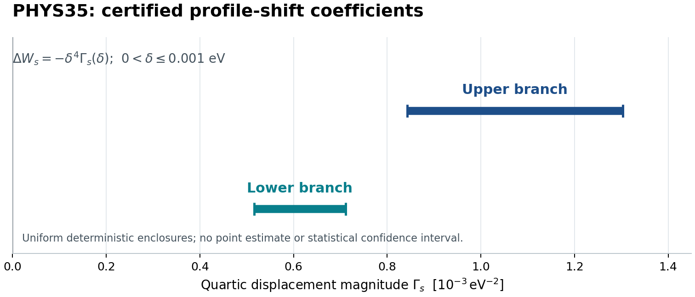

# PHYS35 연구 보고서: 프로파일을 바꾸면 두 수준의 근 간격이 넓어진다

## 판정 대상과 현재 증거 상태

**계산 결과는 PASS_SCOPED다.** 기존 PHYS33·34와 같은 두 고정 수준, 같은 실제 분산, 같은 폭 구간과 근 영역에서, uniform 프로파일을 지정된 P4 프로파일로 바꾸면 하단 근과 상단 근 사이의 간격이 엄격히 증가한다. 새 과학 계산은 저장된 인증 구간을 정확한 유리수로 재조합했으며, 커널·초월함수·근 탐색을 새로 수행하지 않았다.

이 과학 본문은 실행을 완료한 뒤 **독립 최종 판정 전에 고정한 후보**다. 최종 채택 여부는 [최종 상태](../state/FINAL_STATE.md), [닫힘 기록](../state/CLOSEOUT.json), [실제 독립 결정](../independent/DECISION_REVIEW.json)을 함께 읽는다. 실행 전 계약과 이론기여의 NOT_RUN 표지는 그 문서가 고정된 시점의 기록이며, 실행 결과를 덮어쓰지 않는다.

핵심 근거는 [첫 raw](../evidence/CERTIFICATE_FIRST.json), [복원 replay raw](../evidence/CERTIFICATE_REPLAY.json), [실행 영수증](../evidence/EXECUTION_RECEIPT.json), [완전한 비교 유도](../contributions/theory/JOINT_BRANCH_RATIO_DERIVATION_KO.md)다.

## 1. 이번에 닫은 질문

각 분지 안에서 P4 근이 uniform 근보다 작다는 사실은 PHYS33·34가 이미 증명했다. 이번 질문은 **두 음의 이동 중 어느 쪽의 크기가 더 큰가**다. 이를 위해 두 수준의 근 간격을

\[
G_\alpha(\delta;A_-,A_+)
=W_{-,\alpha}(\delta;A_-)-W_{+,\alpha}(\delta;A_+)
\]

로 정의했다. 여기서 \(\alpha=u,p\)는 각각 uniform과 지정된 P4 프로파일이며,

\[
A_+=-2.2748589\times10^{-137}\ {\rm s}^{-4},\qquad
A_-=-3.2582515\times10^{-137}\ {\rm s}^{-4}
\]

를 원래 값 그대로 사용한다. **이 두 수준은 서로 다르다.** 따라서 이번 결과는 이 두 고정 수준에서의 근 간격 변화 정리이며, 두 분지에 공통인 하나의 새로운 \(A\)에 대한 정리를 뜻하지 않는다. [실행 계약](../PHYSICS_CONTRACT.json)과 [전작 인계](../intake/prior_PHYS34/next/PHYS35_NEXT_HANDOFF_KO.md)가 이 정의를 고정한다.

원래 기하도 유지했다.

| 항목 | 상단 \(s=+1\) | 하단 \(s=-1\) |
|---|---:|---:|
| 끝점 \(e_{s,0}\), eV | 13.61 | 24.58 |
| \(R_s\), eV | 4.39 | 6.58 |
| 저장 중심 \(\widehat W_s\), eV² | 원 upper 문자열 전체 | 원 lower 문자열 전체 |
| 근 영역 | \(\widehat W_+\pm0.25\) | \(\widehat W_-\pm0.25\) |
| 폭 | \(0\le\delta\le0.001\) eV | 동일 |
| 도함수 인증 에너지 영역, eV | \([13.61,22]\) | \([14.35,24.58]\) |

평균은 \(m=18\,{\rm eV}\)이고, 두 프로파일은

\[
h_u(z)=\frac12,\qquad
h_p(z)=\frac{35z^4-30z^2+11}{16},\qquad -1\le z\le1
\]

이다. 둘 다 양의 짝함수 확률밀도이며 \(\mu_2=1/3\)을 공유한다. 중심 혼합의 분산을 \(V=W-\delta^2/3\)로 두어, 패킷 내부 분산까지 포함한 **실제 분산은 정확히 \(W\)**가 된다. 저장 근 문자열을 \(A=0\)의 근이나 정확한 중심점으로 바꾸지 않았다.

## 2. 새 결과: 두 변위 계수가 겹치지 않는다

분지별 실제 근 이동을

\[
\Delta W_s=W_{s,p}-W_{s,u}
=-\delta^4\Gamma_s(\delta)
\]

로 쓴다. 이번 결과는 \(\Gamma_s\)를 상수로 근사한 것이 아니다. 아래 구간이 **모든 \(0<\delta\le0.001\ {\rm eV}\)**에서 실제 \(\Gamma_s(\delta)\)를 포함한다.

| 양 | 읽기 쉬운 바깥쪽 경계 | 단위 |
|---|---:|---|
| 상단 \(\Gamma_+\) | \([0.000842416,\ 0.00130303]\) | eV⁻² |
| 하단 \(\Gamma_-\) | \([0.000516001,\ 0.000711208]\) | eV⁻² |
| 직접 계산한 \(\Gamma_+-\Gamma_-\) | \([0.000131209,\ 0.000787027]\) | eV⁻² |

마지막 행은 위 두 짧은 표시값을 다시 뺀 결과가 아니다. raw의 정확한 유리수 끝점을 직접 결합한 뒤 바깥쪽으로 표시한 값이다.
긴 유리수와 90자리 끝점 전체는 raw가 보존한다. 짧은 정리로 쓰면

\[
\boxed{
1.31209\times10^{-4}\,\delta^4
\le G_p-G_u
\le 7.87027\times10^{-4}\,\delta^4
}
\]

이며 계수의 단위는 \({\rm eV}^{-2}\)다. 양의 폭에서는 하한이 엄격히 양수다. 최대 폭에서는

\[
\boxed{
G_p(0.001)-G_u(0.001)
\in[1.31209,\ 7.87027]\times10^{-16}\ {\rm eV}^2.
}
\]

\(\delta=0\)에서는 두 프로파일이 같은 점 혼합이므로 정확히 \(G_p-G_u=0\)이다. 양의 폭에 대한 나눗셈을 \(\delta=0\)에 적용하지 않았다.

그림의 선분은 통계적 신뢰구간이나 표본 오차 막대가 아니다. 고정한 모델과 모든 허용 폭·근 영역을 포함하는 결정론적 인증 범위다. 중앙값을 실제 계수의 추정값으로 표시하지 않았다.

## 3. 왜 이전에는 부호를 결정하지 못했고, 이번에는 가능했나

PHYS33·34는 각각 전 에너지 영역의 최소·최대 도함수만 사용하여 근 이동을 넓게 감쌌다. 두 개의 오래된 계수 구간을 바로 결합하면 상대 계수는

\[
[-0.01500995092043122,\ 0.00882395027495265]\ {\rm eV}^{-2}
\]

정도의 범위가 되어 0을 포함한다. 이 사실을 이전 실패를 삭제하거나 유리한 정밀도를 선택하여 바꾸지 않았다. [첫 raw의 joint/coarse_inherited_coefficient_difference](../evidence/CERTIFICATE_FIRST.json)에 원 구간을 보존했다.

새 방법은 두 가지 위치 정보를 복원한다. 먼저 기울기가 실제 두 중심을 잇는 선분에서 어떤 가중치로 평균되는지를 사용한다. 다음으로 4차 도함수가 필요한 위치를 endpoint와 interior 패킷으로 한정하고, 그 패킷을 이미 덮고 있는 기존 cell만 선택한다. 정밀도, 분할 수, 실제 근 영역, 폭 구간을 바꾸지 않고 얻은 정보다.

### 3.1 기울기 차이가 근 이동량을 가른다

이번에 인증한 두 양을 함께 보면 원인이 드러난다.

| 분지 | 근 사이 평균 기울기를 포함하는 \(C\), s⁻⁴ eV⁻² | Peano 분자 \(\mathcal S\), s⁻⁴ eV⁻⁴ |
|---|---:|---:|
| 상단 | \([4.59491,\ 5.57314]\times10^{-66}\) | \([4.43668,\ 5.65800]\times10^{-66}\) |
| 하단 | \([7.93283,\ 8.40358]\times10^{-66}\) | \([4.09775,\ 5.33159]\times10^{-66}\) |

두 분자의 범위는 서로 겹친다. 그러나 하단의 응답은 \(W\)에 대해 더 가파르다. \(\Delta W\)의 크기는 분자를 기울기로 나눈 값에 비례하므로, 이번 인증 범위에서는 상단이 더 많이 움직인다. 따라서 \(\Delta W_-\!-\Delta W_+>0\)이고 \(G_p>G_u\)다. 이는 표에 대한 수학적 해석이며, 원 \(J\)나 원자 fit을 바꾸어도 성립한다는 주장은 아니다.

### 3.2 기준 기울기와 전 영역 오차

두 중심을 \(e_s,x_s\), \(D_s=x_s-e_s\)로 두면

\[
F_{s,\alpha,W}
=\int_0^1t\int
k''((1-t)e_s+t x_s+\delta z)\,d\alpha(z)\,dt.
\]

하단에서는 \(D_s<0\)이지만, 적분은 같은 양의 가중치 \(t\)를 갖는다. 분모는 \(D_s^2\)이며 추가 음수 부호가 생기지 않는다.

각 분지의 원 retained point \(x_s^{\rm ref}\)에서

\[
C_s^{\rm ref}
=\frac{k(e_{s,0})-k(x_s^{\rm ref})
 +(x_s^{\rm ref}-e_{s,0})k'(x_s^{\rm ref})}
 {(x_s^{\rm ref}-e_{s,0})^2}
\]

를 만든다. 상단은 원 v_star, 하단은 원 u_zero를 사용했다. k와 k′는 반드시 같은 저장 energy_eV의 point record에서 가져왔다. 이 점을 전체 \(\widehat W_s\)에서 재구성한 중심이나 정확한 근과 동일시하지 않는다.

전 영역의 패킷 중심과 이 기준점 사이 거리 상계를 \(H_{c,s}\), 기존 도함수 상계를 \(M_{3,s},M_{4,s}\)라고 하면

\[
\boxed{
|F_{s,\alpha,W}-C_s^{\rm ref}|
\le
M_{3,s}\left(\frac d6+\frac{H_{c,s}}3\right)
+\frac{\mu_2M_{4,s}d^2}{4}.
}
\]

첫 항의 \(1/6,1/3\)은 각각 \(\int_0^1t(1-t)dt\), \(\int_0^1t^2dt\)에서 나온다. 마지막 항은 프로파일 평균이 0이므로 1차 smoothing 항이 소거되고, 남은 2차 적분 나머지에 \(\int_0^1t\,dt=1/2\)가 적용된 결과다. [이론 유도 §4–6](../contributions/theory/JOINT_BRANCH_RATIO_DERIVATION_KO.md)에 조건과 도출을 남겼다.

이 경계는 두 프로파일과 원래 근 영역 전체에 대해 유효하다. 따라서 두 근 사이를 따라 평균한 실제 기울기 \(\overline C_{s,p}\)도 같은 구간에 들어간다.

### 3.3 새 kernel 계산 없이 패킷의 4차 도함수 경계 얻기

기존 Bernstein 인증의 좌표는 \(\zeta=\sqrt{E/B}\), \(B=E_0y_a>0\)다. 각 저장 grid의 정확한 유리수 끝점 \([\ell_i,u_i]\)에서 에너지 cell은

\[
[B\ell_i^2,Bu_i^2]
\]

이다. PHYS33은 원 코드의 고정 32개 등간격 유리수 grid를 재구성했고, PHYS34는 저장 exact_rational_cell과도 일치함을 확인했다. 표시용 outward z_interval의 미세한 바깥 영역을 cell의 증명 영역으로 확대하지 않았다.

새 계산이 실제 사용한 기존 cell은 다음과 같다.

| 분지 | endpoint 패킷의 기존 cell index | interior 패킷의 기존 cell index |
|---|---|---|
| 상단 | 0 | 30, 31 |
| 하단 | 31 | 0 |

모든 패킷 구간을 닫힌 cell들의 연속 합집합이 완전히 덮는지 검사했다. 선택된 cell의 하한 중 최소와 상한 중 최대가 해당 패킷 전체의 도함수를 감싼다. 새 k⁽⁴⁾ 점 값을 주변으로 연장한 것이 아니며, 새 k⁽⁵⁾나 더 조밀한 grid가 필요하지 않았다.

## 4. 정확한 \(\delta^4\) 정리이며 생략한 고차 나머지가 없다

\[
Q(z)=(1-z^2)^4,\qquad
h_p-h_u=\frac{Q^{(4)}}{768},\qquad
d\pi=\frac{315}{256}Q(z)\,dz
\]

를 사용하면 네 번 부분적분으로 정확히

\[
F_{s,p}-F_{s,u}
=\frac{\delta^4}{945}\mathcal S_s,\qquad
\mathcal S_s
=p_s\int k^{(4)}(e_s+\delta z)d\pi
 +(1-p_s)\int k^{(4)}(x_s+\delta z)d\pi
\]

를 얻는다. \(\pi\)는 양의 확률측도이며 endpoint의 경계항은 사라진다. 패킷 도함수 구간과 \(p_s\in[p_s^L,p_s^U]\)에서 \(pS_e+(1-p)S_x\)의 두 끝점 값을 취하면 \(\mathcal S_s\)의 상·하한이 나온다. \(p\)와 \(1-p\)의 합이 정확히 1이라는 상관을 보존한다.

기존의 두 같은-분지 근 존재를 적용하면

\[
\Delta W_s
=-\frac{\delta^4}{945}
 \frac{\mathcal S_s(\delta,W_{s,u})}{\overline C_{s,p}}
\]

다. 양의 분모 경계를 사용하여

\[
L_s=\frac{\mathcal S_s^L}{945C_s^U},\qquad
U_s=\frac{\mathcal S_s^U}{945C_s^L}
\]

를 얻고, 최종 비교는

\[
L_G=L_+-U_-,\qquad U_G=U_+-L_-
\]

다. 이번 실제 계산에서 \(L_G>0\)가 성립했다. \(\delta^4\) 뒤의 계수는 폭에 따라 달라질 수 있지만, 모든 허용 폭에서 같은 양의 구간 안에 있다. 따라서 이 결론에는 미확인 \(O(\delta^5)\) 항을 버리는 단계가 없다.

## 5. 실제 실행 및 재현성

첫 실행과 **실제 archive를 별도 경로에 복원한 뒤 수행한 replay**는 각각 39/39 조건을 통과했다.

| 항목 | 실제 기록 |
|---|---|
| 첫 실행 / 복원 replay | 각각 PASS_SCOPED, 39/39 |
| raw 크기 | 각각 87,023 bytes |
| 두 raw 바이트 | 완전히 동일 |
| raw SHA-256 | 2157dfcf9608590b6f0f2b94be3e6558b9414048117aff9a48ab6e083ad233c2 |
| 새 과학 main | first 1, replay 1 |
| main wall 합 | 약 0.037890초 |
| main CPU 합 | 약 0.037708초 |
| 보고된 peak RSS | 17,068 KiB |
| 실제 child returncode / tool exit | 두 실행 모두 0 |
| stderr / timeout | 두 실행 모두 0 bytes / false |
| Python runtime | 3.12.14 |

이는 **과학 main 내부의 계측값**이며 전체 연구·자료 읽기·문서 작성·독립 검토·원격 반영의 시간을 뜻하지 않는다. 실제 부모 프로세스가 기다린 시간과 command·stdout·stderr·tool 반환도 [실행 영수증](../evidence/EXECUTION_RECEIPT.json)과 process 폴더에 따로 남겼다.

새 수행량은 기존 인증서 2개 읽기, 기존 k4 record 64개 확인, 패킷 coverage query 4개, 분지 계수 조합 2개, 상대 계수 조합 1개, 원래 넓은 경계 비교 1개씩이다. 새 커널, Bernstein 계수, 초월함수, energy jet, root residual, 근 탐색, quadrature, native, gas IVP, NCP, 과거 main 및 바뀌지 않은 generic 시험의 실행은 모두 0이다.

새 수치 core는 Python Fraction의 정확한 유리수 연산이다. Decimal90은 출력용 바깥쪽 표시만 담당한다. 기존 커널 인증 자체가 의존하는 outward Decimal의 의미와 원 입력 조건은 여전히 상속한다. [Fraction 공식 문서](https://docs.python.org/3.12/library/fractions.html), [Decimal 공식 문서](https://docs.python.org/3.12/library/decimal.html), [검증 설계](../evidence/VERIFICATION_DESIGN.md)에 계산 층을 구별했다.

preexecution freeze의 45개 파일, 4,770,910 bytes가 실행 후에도 일치한다. 실제 복원 archive는 46개 member이며, 원 실행과 다른 경로에서 같은 입력을 복원했다. 예산은 **SPENT: first 1/1, replay 1/1, 남은 과학 main 0**이다. PHYS33·34와 다른 캠페인의 ledger는 초기화하지 않았다.

replay가 같은 바이트를 만들었다는 사실은 복원 재현성을 지지한다. 새로운 수학적 oracle, 다른 하드웨어, 다른 산술 backend, 독립 최종 판정과는 구별한다.

## 6. 근거 수준, 실패 기록, 남은 범위

| 주장 | 근거 수준 |
|---|---|
| exact Peano 식, 기울기 적분식, geometry/smoothing 오차식 | 직접 유도; 실제 별도 이론 기여와 일치 |
| 이전 개별 근 존재·유일성, source-real 도함수 구간 | PHYS33·34의 채택된 조건부 증거 재사용 |
| 새로운 \(\Gamma_\pm\) 및 상대 양의 경계 | 정확 유리수 인증 계산 + 구현 검증 |
| 별도 경로 replay 동일성 | 실제 복원·실행·바이트 증거 |
| 공통 새 \(A\)의 cross-branch 정리 | 미해결 / 이번 대상 밖 |
| 원 \(J\)·원자 fit 불확실성, coupled history | 미해결 |
| 전역 physical admission | HOLD |

과학 main 실패는 0이다. 후처리에서 PHYS33과 PHYS34의 이전 freeze JSON 구조가 다른데 동일한 값 타입으로 비교하여 한 번 metadata assertion이 발생했다. 원 관측을 [후처리 기록](../evidence/POSTPROCESS_METADATA_INCIDENT.json)에 남기고, 두 metadata 형식을 정규화해 실제 hash 일치를 확인했다. 과학 code·raw·계약은 변경하지 않았고 새 main을 실행하지 않았다. 이전 도함수 generator 두 개의 hash도 당시 final candidate freeze와 일치한다.

보호 상태는 다음과 같이 유지한다.

**Physical HOLD; [160,161] FAIL; tick160; auxiliary escape FAIL; HH/RCT/CR OFF; precision atomic PARKED; production source/default/runtime changes0.**

이번 결과는 단일 고정 커널의 국소 비교 정리다. 서로 다른 \(A_s\)를 보존했으며, 원 \(J\)나 원자 fit의 불확실성까지 전파하거나 전체 역사에 적용한 결과가 아니다. “범위 내에서 간격이 넓어진다”와 “전체 물리 모형이 승인됐다”를 구별한다.

## 7. 다음 연구의 실질적 연결

현재 남아 있는 핵심은 동일한 함수를 공유하는 두 수준의 결과가 원 입력 \(J_x,J_w\) 변화에 얼마나 견고한가다. 다음 최소 작업은 원 kernel의 이 두 입력에 대한 선형성을 사용해, **이번 비교 부호를 유지할 수 있는 계수 섭동 조건을 먼저 유도하는 것**이다. 실제 원자 fit·입력 오차 범위가 주어지지 않은 상황에서 임의의 오차율을 “물리적으로 허용된 오차”로 정하지 않는다.

다음 인계는 [PHYS36_NEXT_HANDOFF_KO.md](../next/PHYS36_NEXT_HANDOFF_KO.md)에 고정한다. 기존 근 존재를 입력 섭동 아래에도 재사용하려면 별도의 근 존재·tube 유지 조건이 필요하다. 현재 gap 부호만으로 그 의무가 해결되었다고 쓰지 않는다. 입력 섭동을 실제로 도입할지 또는 공통 새 \(A\) 문제로 옮길지는 두 과학적 질문을 구별한 상태에서 결정한다.
