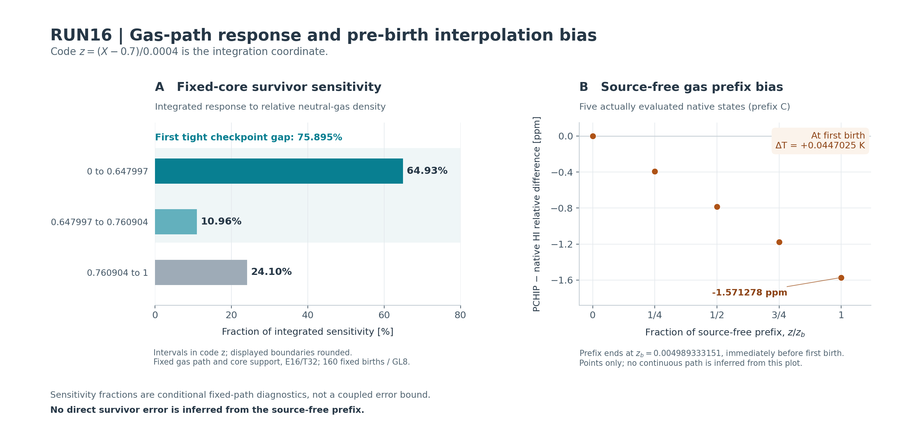

# RUN16 — 기체 경로 민감도와 첫 birth 이전 native 검증

## 결과와 현재 지위

RUN15의 실제 최종 HEAD `c875005e30d9de1ce7f426898e46fe912068412c`에서 연구를 이어받았다. 완료된 RUN13 M2 standard/tight는 사용한 원본 증거이며 재실행하지 않았다. 이번 단위는 기존 `P4-S4C-SPECTRAL-EDGE-SUPPORT/SUBTHRESHOLD-SURVIVOR-RESOLUTION` 안에서, 작은 sub-H survivor에 대한 **기체 경로 오차의 영향**을 새로 정량화한다.

주요 새 결과는 다음과 같다.

- 고정된 source measure·energy support·geometry에서 neutral-H 경로에 대한 survivor의 1차 민감도와 양의 2차 나머지를 구현했다. 기준 core survivor는 `1.1803145305707004e-10 comoving m^-3`, 균일한 상대 HI 변화에 대한 민감도 크기는 `0.9972065222179413`이다.
- 이 민감도의 `75.89513805035576%`가 첫 tight checkpoint 이전의 큰 저장점 간격에 놓인다. 저장 knot에서 모두 0인 명시적 C1 perturbation도 survivor를 바꾼다는 것을 계산했다. 이 가족은 정의된 기체 경로의 진단이며, chemical ODE 해라고 주장하지 않는다.
- 원래 native gas RHS를 이용한 세 점의 Jacobian·보간 defect 검사에서 초기 PCHIP HI 기울기가 원래 RHS와 반대 부호임을 확인했다. 이를 조사하기 위해 첫 photon birth 직전까지만 다섯 gas 변수의 짧은 IVP 세 개를 새로 계산했다.
- 첫 birth 직전 PCHIP minus native의 HI 상대차는 `-1.5712776951781748e-6`, 온도차는 `+0.04470254583975475 K`다. 별도 step-halving 계산에서도 유지됐다. 이 prefix에는 photon이 없으므로 그 차이를 해당 구간의 직접 survivor 오차로 환산하지 않는다.

기존 whole-history spectral continuum bound는 여전히 **UNRESOLVED**다. 이 문서의 정량 결과는 fixed-path functional, 보존 상태에서의 점 진단, 첫 birth 이전의 새 gas-only 경로로 범위를 명시한다.

## 1. 실제 읽은 SSOT와 원본 보존

이번 inventory에서 RUN15 branch HEAD와 PR204가 위 `c875005…`를 가리킴을 확인했다. Recovery branch HEAD는 `3dcb5f7aed8d33ff64f7952e9465f4239a216c89`였다. 읽은 문서는 RUN15 `RESUME_DELIVERY.json`, `DELIVERY.json`, `SCIENTIFIC_ADMISSIONS.json`, RUN13 `contracts/DAG_PROGRESS.json`, 원래 45-node 및 26-node DAG, 회수된 경로 비교 코드와 두 enclosure 결과다. 실제 Git 파일 16개의 blob identity를 대조한 복사본이 [inventory](inventory/SOURCE_SNAPSHOT_RECEIPT.json)에 있다.

기존 RUN15에는 이미 공통 knot 분할, cubic extrema를 이용한 두 PCHIP의 상대차 envelope, 그리고 주어진 gas envelope의 survivor 전달이 있었다. 이번 코드는 그 결과를 새 발견으로 재명명하지 않는다. 새 범위는 survivor 가중 민감도의 위치, signed 변화의 선형항/비선형 나머지, 보간 경로와 native 초기 경로의 실제 차이, gas/optical-memory feedback의 점 척도다.

기존 전체 archive는 별도 baseline이다. `REI_RUN15_RECOVERY_FIXED_GAS_NATIVE_20261019_085443Z.zip`의 기록된 크기는 41,913,080 bytes이고 SHA-256은 `8729696dbb1efb7a7a76f59b12afacaa22d9481210b505c3b674b201b7b89dcb`다. 이번에는 그 Drive/Dropbox 원격 metadata와 이용한 원본 파일의 hash를 확인했으며, 과거 전체 ZIP 다운로드 검산을 이번 새 검산으로 표시하지 않는다.

원래 RUN13 ZIP SHA `6912c7f90dedaaee312d3fdc3248e4e8839409c0fb2944262de945e1b2f34e96` 역시 이전 복구 증거의 지위를 유지한다. 이번 native 진단은 이용한 원본 source/input/evidence 112개를 각 실행 전후 대조했다. 원본 core Python, atomic owner, geometry, gas 초기조건 및 완료된 endpoint는 변경하지 않았다.

## 2. 좌표·물리 설정·관측량

아래에서

\[
\xi=\frac{X-0.7}{0.0004}\in[0,1]
\]

를 쓴다. 코드와 JSON은 이 적분 좌표를 `z`라고 부른다. **여기서 `z`는 cosmological redshift가 아니다.** 원래 \(X=\ln(a/a_{\rm ref})\), \(a_{\rm ref}=1/21\), prescribed BASS121 `SIGNED_MINUS`, \((- ,+,+,+)\) convention을 유지한다.

Source의 birth samples 160, GL8 angular rule, 정확한 scalar reflection quotient 640 rays를 사용한다. 첫 spectral cell의 원래 source count `3.907682604850519e-6 comoving m^-3`와 50,000 K blackbody energy measure를 유지했다. 이 source temperature는 원래 manufactured **gas 초기온도 10,000 K**와 구별한다. 다른 47개 spectral cells와 native atomic provider를 바꾸지 않았다.

H binding energy `13.598434599702 eV`, H fitting edge `13.6 eV`, D gate `13.602134599702 eV`를 구별한다. D는 기존 threshold-gated H-equality approximation이며 isotope-specific experimental cross section이 아니다. 현재 tight core의 상단 `13.600487882177362 eV`는 D gate보다 낮아 그 core response에는 H opacity만 기여한다. Native gas 및 전체 photon feedback의 점 진단에는 원래 채널을 사용했다.

각 ray의 실제 native geometry와 monotone crossing을 이용한다. \(\eta=e^{-0.0004}\) 같은 manufactured endpoint ratio로 경로를 바꾸지 않았다. 양의 source measure \(d\mu\)와 고정 core support에서

\[
S[n]=\int e^{-\tau_\gamma[n]}\,d\mu(\gamma),\qquad
\tau_\gamma[n]=c\,\Delta X\int_{\xi_b}^{\xi_{\rm cross}}
\frac{\sigma_H(E_\gamma(\xi))n_{\rm HI}(\xi)}{H(\xi)}\,d\xi
\]

이다. \(c\)는 명시적으로 유지했고 gas temperature 변환은 원래 \(k_B\), eV-to-J 상수를 사용한다. 이 계산에 \(\hbar=1\) 같은 자연단위 치환을 도입하지 않았다.

## 3. 새 이론과 구현

### 고정 support의 민감도와 convex remainder

광학깊이를 양의 선형 작용소 \(A\)로 쓰면

\[
DS[n]h=-\int e^{-A[n]}A[h]\,d\mu,
\qquad D^2S[n](h,h)=\int e^{-A[n]}(A[h])^2\,d\mu\ge0.
\]

\(\tau=A[n]\), \(x=A[h]\), \(x_+=\max(x,0)\)에 대해

\[
S[n+h]-S[n]=DS[n]h+\mathcal R,
\]

\[
\frac12\int e^{-\tau-x_+}x^2\,d\mu
\le\mathcal R
\le\frac12\int e^{-\tau+(-x)_+}x^2\,d\mu,
\qquad \mathcal R\ge0.
\]

이는 명시한 가정 아래의 **DERIVED** 결과다. 실제 코드 [gas_path_response.py](gas_path_response.py)는 작은 signed \(x\)에서 cancellation을 피하는 `exp(-x)-1+x` 계산, 공통 시간 구간별 민감도 적분, 전체 밀도 scale envelope와 C1 perturbation을 구현한다. Core cutoff를 모든 경로에 동일하게 고정했으므로 움직이는 적분 경계의 미분항을 생략한 것이 아니다. 생략한 energy tail은 별도 상한으로 남긴다.

실제 \(|h|\le\epsilon n\)이 주어진다면

\[
S[(1+\epsilon)n]\le S[n+h]\le S[(1-\epsilon)n]
\]

로 전달할 수 있다. 두 정의된 PCHIP의 차이에 대한 envelope와 **정확한 IVP 경로를 포함하는 envelope**는 다르다. 후자는 아직 없다. 부동소수점 quadrature로 평가한 식을 directed-rounding certificate로 표시하지 않는다.

### 감쇠를 유지하는 coupled comparison

원래 H/D/He 총량과 초기 thermal energy로 정규화한 다섯 gas 좌표 \(q\), photon optical depths \(\tau\)의 Jacobian은

\[
J=\begin{pmatrix}A&B\\C&0\end{pmatrix}
\]

형태다. \(A\)는 native gas와 fixed-depth direct photo derivative, \(B\)는 depth가 gas absorption/heating에 미치는 항, \(C\)는 gas가 optical depth에 미치는 항이다. Admissible tube 전체에서 \(\mu_\infty(A)\le a\), \(\|B\|_\infty\le b\), \(\|C\|_\infty\le c\)와 residual bounds가 있으면

\[
D^+\binom{u}{v}\le
\begin{pmatrix}a&b\\c&0\end{pmatrix}\binom{u}{v}
+\binom{\rho_q}{\rho_\tau}
\]

라는 cooperative comparison을 이용할 수 있다. 여기서 \(u,v\)는 각각 gas/depth 오차 norm이다. 유한 시간 propagator 또는 Volterra resolvent를 쓰며, global contraction이 1보다 작아야 한다는 전제를 추가하지 않는다.

Residual convention은 \(r=\hat g'-F(\hat g)\), \(e=g-\hat g\)다. 따라서 \(e'=F(g)-F(\hat g)-r\), terminal adjoint residual 항의 부호는 \(-\int\lambda^Tr\,d\xi\)다. 비선형 나머지와 필요한 event/jump 항을 별도로 둔다. 이 방식의 문헌 근거는 Cao–Petzold (2004), DOI [10.1137/S1064827503420969](https://doi.org/10.1137/S1064827503420969), 그리고 Ranocha–Giesselmann [arXiv:2307.12677v3](https://arxiv.org/abs/2307.12677)다. 원문의 residual 정의에 맞춰 부호를 직접 유도했다.

[이론 본문](theory/FIXED_GAS_SENSITIVITY_AND_FEEDBACK.md)과 [logarithmic-norm 추가 유도](theory/LOG_NORM_FEEDBACK_ADDENDUM.md)에 가정과 한계를 명시했다. 실제 SciSpace·Exa 검색과 primary PDF 확인은 [문헌 기록](theory/LITERATURE_RETRIEVAL_RECEIPT.json), 실제 Wolfram symbolic outputs는 [CAS 기록](external/WOLFRAM_CHECKS.json)에 있다.

## 4. 새 fixed-path 계산 결과

[원자료와 전체 결과](results/GAS_PATH_RESPONSE.json)는 원본 dependency hash, checkpoint gas array identity, finite ray 수, crossing receipt, 모든 설정의 signed response를 포함한다.

| Energy/time GL order | Core survivor [comoving m^-3] | 상대 밀도 민감도 크기 \(\kappa\) |
|---|---:|---:|
| E12 / T24 | 1.1803145305811728e-10 | 0.9972065222140184 |
| E16 / T24 | 1.1803145305707004e-10 | 0.9972065222179413 |
| E16 / T32 | 1.1803145305707004e-10 | 0.9972065222179413 |

E12→E16의 상대차는 `-8.872520652439314e-12`, T24→T32 survivor는 평가된 binary64에서 동일하다. 이 유한 비교는 continuum asymptotic order나 절대 error bound가 아니다. 상속한 scalar/vector optical-depth evaluation 차이 `1.6150603077136338e-10`도 별도 구현 제한으로 유지한다.

최고 order에서 \(\kappa=\int e^{-\tau}\tau\,d\mu/S\), \(\kappa_2=\int e^{-\tau}\tau^2\,d\mu/S=1.9888260703339402\)다. Binding 아래 성분은 `8.400293020463191e-11`, binding→fit 성분은 `3.402852285243813e-11 comoving m^-3`로 별도 보존했다.

### Standard PCHIP minus tight PCHIP

같은 tight core에서 두 정의된 경로를 비교한 값이다. 분모는 tight baseline survivor다.

| 양 | 새 결과 |
|---|---:|
| \(\Delta S\) [comoving m^-3] | +5.984464359826729e-17 |
| \(\Delta S/S_{\rm tight}\) | +5.070228489801907e-7 |
| 선형 예측 \(DS[n]h\) [comoving m^-3] | +5.984460428843599e-17 |
| Convex remainder \(\mathcal R\) [comoving m^-3] | +3.930983127824387e-23 |
| Remainder lower / upper | 3.930980390830417e-23 / 3.9309886018126446e-23 |

RUN15의 `5.070225921291e-7`은 반대쪽 survivor를 분모로 기록한 비교다. 위 값은 분모와 고정 support/order를 명시한 새 민감도 분해이며 원래 endpoint를 수정한 값이 아니다. 두 saved histories는 tolerance뿐 아니라 checkpoint 배치도 다르므로 이 비교를 순수 ODE tolerance error로 분류하지 않는다.

두 PCHIP의 구간 전체 비교에서 \(\epsilon=8.131995956538217e-7\)이면 quadrature-evaluated relative response envelope는 약 `[-8.109272830525581e-7,+8.10928598250475e-7]`다. 실제 두 경로의 차이는 이 범위 안이다. 예시로 gas 기여만 relative core budget `1e-8`에 맞추려면 이 functional에서 \(\epsilon\approx1.0028012931322735e-8\)이 필요하다. 이 budget은 설명용이며 사용자 수용 기준 또는 이미 달성한 gas accuracy가 아니다.

### 민감도가 놓이는 시간 구간

| Code-z 구간 | 전체 밀도 민감도 중 비율 |
|---|---:|
| 0 → 첫 standard checkpoint 0.6479966231660246 | 64.93343375825928% |
| 첫 standard → 첫 tight checkpoint 0.7609039888237062 | 10.961704292096475% |
| 첫 tight checkpoint 이후 | 나머지 약 24.10486194964424% |

따라서 첫 tight gap에는 약 75.90%가 놓인다. 표는 각 구간을 적분한 가중치이며, 구간 내부 kernel이 일정하다는 뜻은 아니다.

모든 29개 공통 저장 knot에서 0이며 도함수도 0인 \(b(u)=16u^2(1-u)^2\)를 각 panel에 붙였다. \(n_\epsilon=n(1+\epsilon b)\)의 민감도 크기는 `0.5326230149588281`다. \(\epsilon=+1e-6\)이면 \(\Delta S/S=-5.326226173500612e-7\), \(\epsilon=-1e-6\)이면 `+5.32623412568247e-7`다. Knot 일치만으로 해당 functional의 경로 의존성을 통제하지 못하는 **명시적 진단 가족**이다. 실제 ODE 해의 비유일성이나 rigorous interpolation error bound를 주장하지 않는다.

## 5. 새 native gas 진단과 짧은 prefix 계산

### 보존 상태 세 개의 점 진단

원래 binary SHA `3454e9e401560df188c7410de29d0712c4afe235e9899021e5314766ab778c8b`를 사용했다. 초기점과 첫 tight checkpoint의 outgoing side, endpoint의 incoming side를 평가했다. 총 native RHS 85회다.

Ordinary gas Jacobian infinity norm은 약 33.6이지만 logarithmic infinity norm은 약 0.14다. 빠른 gas 고유값 약 `-16.74 / code-z`는 원래 charge exchange의 감쇠에 연결된다. Ordinary norm을 곧바로 instability 지표로 읽을 수 없다. Full gas/direct-photo matrix measure는 세 점에서 `0.1408114398541187`, `0.13819500415022645`, `0.1379124372124565`다. 점의 \(B,C\)를 함께 쓰는 frozen comparison eigenvalue는 각각 `0.1408114398541187`, `0.572898186359734`, `0.7638392285772304`다. 세 점을 trajectory 전체의 tube bound로 승격하지 않는다.

두 finite-difference step의 gas Jacobian 상대차 최대 `1.83e-10`, analytic photo block 대 별도 finite difference 상대차 최대 `6.72e-9`, 원래 RHS 대 독립 assembly 절대차 최대 `6.35e-18`를 확인했다. 전체 값과 실제 parsed native 응답은 [point result](feedback/execution01/RECORDED_STATE_FEEDBACK.json)에 연결되어 있다.

초기 normalized HI의 PCHIP derivative는 `-0.00030297124257765243 / code-z`, native RHS는 `+0.000011919346288534569 / code-z`였다. 이는 보간 경로의 defect이며 원래 저장 endpoint의 오류를 뜻하지 않는다. Componentwise PCHIP의 helium-total derivative drift도 기록되어 있어, 다음 연속 residual 계산에는 invariant reconstruction 또는 constraint defect가 필요하다.

### 첫 birth 직전까지의 세 새 5D IVP

구간은 \(0\le\xi\le0.004989333151072248\)이며 우측 endpoint는 첫 birth의 **pre-activation left limit**이다. 원래 gas initial state, native mask7, prescribed geometry와 단위를 유지했다. Photon/depth ODE 좌표와 별도 escape/CMB/event ledger는 적분하지 않는다.

| Control | Nominal rtol | Maximum step | 실제 accepted steps | Native RHS |
|---|---:|---:|---:|---:|
| A | 3e-11 | prefix / 4 | 4 | 62 |
| B | 6e-12 | prefix / 4 | 4 | 62 |
| C | 6e-12 | prefix / 8 | 8 | 122 |

다섯 invariant 좌표에 `DOP853`, effective rtol = nominal / sqrt(5), 각 atol = `1e-15/sqrt(5)`를 적용했다. A/B는 max-step 제한 때문에 같은 grid와 sampled state를 주었다. 그 사실을 보존하고 C의 독립적인 step-size contrast를 추가했다. C/B의 다섯 공통 sample에서 HI 상대차는 평가된 float64에서 0, 온도 절대차 최대는 `3.637978807091713e-12 K`, 좌표 차이 최대는 `2.220446049250313e-16`다. 정확해와의 rigorous bound라는 주장은 하지 않는다.

| 첫 birth 직전 | Native C | Archived-knot PCHIP |
|---|---:|---:|
| \(Vn_{\rm HI}/n_{H,0}\) | 0.9000000534472483 | 0.8999986392972387 |
| 온도 [K] | 9999.925747777985 | 9999.970450323824 |

PCHIP minus native의 HI 상대차는 **-1.5712776951781748e-6**이고 온도차는 **+0.04470254583975475 K**다. 소수의 checkpoint로 만든 경로가 실제 초기 gas dynamics를 충분히 나타낸다고 가정할 수 없음을 구체적인 짧은 계산으로 확인했다. 아직 source가 없는 구간이므로 survivor에 대한 직접적인 기여를 계산하지 않았으며, 첫 birth의 기체 reference 오차로 다음 feedback 분석에 전달한다.

[Prefix 코드·설명·결과](feedback/SOURCE_FREE_PREFIX_ADDENDUM_KO.md)에 전체 sample, grid와 각 exact command가 있다. 이 prefix 결과는 누락된 ledger 좌표가 있으므로 full transport restart checkpoint로 사용할 수 없다.

## 6. 실제 검증과 실행 비용

새 response 코드에 대해 실제 실행한 **서로 다른 다섯 focused tests가 PASS**했다. Decimal 고정밀 cancellation 검사, signed convex remainder, positive-kernel order, knot bump, 해석해가 있는 manufactured optical integral을 검사한다. 동결 source에서 실행한 로그와 command는 [TEST_RECEIPT.json](execution/TEST_RECEIPT.json)에 있다. 초기 실행 뒤 Taylor 나머지의 주석 숫자만 고친 이력과 원본 producer hash는 [history](history/SOURCE_IDENTITY.json)에 보존했다.

세 order의 최종 response 계산 내부 wall time은 `3.049527314993611 s`, subprocess wall time은 `3.7692680190011743 s`, child peak RSS는 `180380 KiB`다. 이 부분의 native RHS와 IVP는 0이다. Initial source 실행은 별도 history이며 그 결과를 다른 물리 실험으로 세지 않는다.

Native point 85 + prefix 62 + 62 + 122 = **총 331 native RHS 호출**, **새 5D gas-only IVP 3회**다. Prefix native-call 합계 wall time은 `0.02232714199635666 s`다. Full transport IVP, 완료된 M2 standard/tight 재실행, 과거 전체 Rust/Python/guard suite 재실행은 모두 **0회**다. 과거 160/11/10 test 기록을 이번 PASS로 올리지 않는다.

환경은 Python 3.12.14, NumPy 2.3.5, SciPy 1.17.0, Linux x86_64/glibc2.39다. Response, point blocks, 두 prefix script를 각각 필요한 한 차례의 별도 읽기 검토로 확인했고 추가 native audit를 반복하지 않았다. [검토 기록](theory/INDEPENDENT_PREFIX_REVIEW.json)과 producer logs가 검증 범위를 구분한다.

### Git에 게시한 원자료의 별도 복원

첫 checkpoint `2cc5e0862dbe9770ef83c0b2437e27627ec26524`를 별도 Git checkout으로 실제 복원했다. Manifest45 payload와 manifest 자체를 포함한46 Git files의 bytes/modes가 일치했다. Raw NPZ1,824,562bytes와12개 member를 읽고, 생산자 함수를 import하지 않은 scalar `math.exp`/`math.expm1`/`math.fsum`으로35,088개 저장 node를 독립 집계했다. Survivor는 bit-identical,14개 비교량의 최대 차이는3ULP(최대 상대6.264754258299169e-16)였다. 저장된28 interval sensitivity와 결과의 값도 일치한다. 개별 interval의 per-node tau matrix는 저장되지 않았으므로 각 구간 적분을 독립 재구성했다고 주장하지 않는다. 이 확인에서 새 quadrature, native RHS, IVP와 기존 tests는 모두0회였다. [Git readback receipt](delivery_readback/DELIVERY_READBACK_CHECK.json)가 정확한 명령과 scope를 보존한다.

그림의 왼쪽은 시간 구간별 적분된 민감도 비율이고, 오른쪽은 실제 평가한 다섯 prefix sample이다. 서로 다른 범위의 두 진단이며 prefix 편향을 직접 survivor 오차로 환산한 그림이 아니다.

## 7. 원래 저장 결과와의 관계

RUN13 M2 standard/tight는 각각 6,241 segments, 40,357-dimensional native transport의 완료된 보존 결과다. Original M2 standard total survivor `5.10785985793165e-7`, 온도 `9994.35124339563 K`는 바뀌지 않았다. Original sub-H-fit component는 M1 `3.963580101474543e-12`, M2 `8.255385244169650e-12 comoving m^-3`이며 M2 분모 차이 약 51.99%라는 미수렴 증거도 그대로다.

RUN16의 `1.1803145305707004e-10`은 고정 gas PCHIP와 연속 first-cell energy measure에 대한 **조건부 response**다. Original M2 full native endpoint와 같은 계산이라고 취급하지 않는다. 전체 survivor의 tolerance agreement, photon conservation residual 또는 이번의 작은 fixed-gas quadrature 차이를 sub-H component의 full nonlinear convergence bound로 승격하지 않는다. Uniform m4 native sample은 이번에도 실행하지 않았다.

## 8. 다음 미완료 노드와 durable 자료

다음 기존 노드는 여전히 **P4-S4C-SPECTRAL-EDGE-SUPPORT / SUBTHRESHOLD-SURVIVOR-RESOLUTION**이다. 구체적인 다음 work unit은 **첫 birth 이후 source가 작동하는 구간에서 invariant gas reconstruction, full photo forcing residual, admissible gas/depth tube의 comparison bounds를 구성하는 것**이다. 이번 prefix 편향을 초기 reference 오차로 포함해야 한다. 같은 reconstructed path에서 continuous-source quadrature forcing defect도 별도로 통제해야 한다.

원래 DAG를 축소하지 않았다. Continuous spectral refinement, angular convergence, birth-time continuum, whole donor domain, full EoR, Einstein feedback, FLRW-CONV, BI-SIGNED, ISO-COUPLE full, Li/Be 및 nuclear T1–T8은 유지된다. 관련 PR199의 최신 실제 파일에서는 q0 age64 block-max가 이미 완료되어 NO_REPEAT였다. 그 별도 lane의 성공을 여기의 gas bound로 혼합하지 않는다.

재개할 때는 [RESUME_KO.md](RESUME_KO.md)를 먼저 읽고, 최종 전달 정보가 있으면 `DELIVERY.json`과 `RESUME_DELIVERY.json`을 함께 읽는다. [REPRODUCE_KO.md](REPRODUCE_KO.md)는 정확한 의존성과 선택적 재현 명령을 제공한다. 이미 완료된 결과를 이용하는 기본 경로는 JSON/NPZ/manifest를 읽는 것이다. 계산 재현은 목적이 있을 때 새 output directory에서만 시행한다.

이번 새 archive는 RUN16 source/results/raw evidence와 사용한 원래 gas binary의 **추가분**이다. Original RUN13와 RUN15의 전체 archive를 덮어쓰거나 전체 역사적 toolchain/checkouts를 새로 복원했다고 선언하지 않는다. 원격 upload ACK, metadata 존재, 다운로드 byte identity, 과학 계산 재현을 각각 다른 단계로 기록한다.
