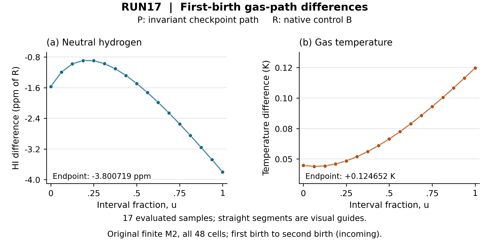

# RUN17 — 첫 출생 구간의 native gas·depth 잔차 분해

작성일: 2026-10-19 UTC / KST. 기준 저장소는 `cosmosapjw-quantum/rei_bianchi`, 부모는 RUN16의 실제 원격 HEAD `45ee7192b9d405214ec2650185aeaaa635e0fa13`이다. 이 디렉터리는 기존 원본을 수정하지 않는 추가 연구 산출물이다. 게시된 science commit, 이후 delivery commit, ZIP SHA와 백업 위치는 이 디렉터리의 후속 `DELIVERY.json` 및 `RESUME_DELIVERY_KO.md`에서 선택한다. 이 문서는 과학 payload 동결 시점의 결과이며 자기 자신의 미래 commit이나 archive hash를 주장하지 않는다.

## 1. 이번에 확인한 과학적 사실

RUN16에서 문제로 남은 gas 경로 재구성 오차를 첫 번째 smooth birth-to-birth 구간에서 실제 native RHS와 비교했다. 원래 유한 M2 source를 그대로 사용하는 두 coupled 제어 계산은 서로 매우 가까웠다. 반면, 저장된 tight gas 값에서 만든 새 invariant-coordinate PCHIP 경로와 native 제어 경로 사이에는 두 번째 출생 직전 HI 약 **−3.80072 ppm**, 온도 **+0.1246523 K** 차이가 남았다. 이 HI 차이는 초기 경로 차이와 PCHIP 경로의 적분 잔차로 대부분 설명된다.

또한 저장된 계수를 정확한 유리수로 해석해 **gas 다항식 24개 구간**과 **depth 다항식 5,796개**의 연속 구간 부호를 인증했다. 이는 정의된 재구성 경로가 물리적 상태 영역에 있음을 확립한다. 실제 coupled IVP의 해가 그 주변의 검증된 오차 tube 안에 있다는 결과는 아직 없다. spectral continuum bound도 확립하지 않았다.

원본 수치는 [native 결과 및 실행 기록](native/NATIVE_UNIT_RECEIPT.json), [잔차 결과 JSON](residual/analysis_execution01/FIRST_BIRTH_RESIDUAL.json), [정확 다항식 인증](residual/domain_execution01/RECONSTRUCTION_DOMAIN_CERTIFICATE.json)에 있다. 분석 소스, 실제 호출 trace, lossless dense 계수, 배열, 테스트 및 한 차례의 [독립 검토](theory/INDEPENDENT_IMPLEMENTATION_REVIEW.md)를 함께 보존했다.

## 2. SSOT, 물리 설정과 비교 범위

실제로 읽은 RUN13 복원 원본, RUN10 derivation, RUN15·RUN16 handoff 및 관련 DAG의 경로·SHA는 [inventory](inventory/RUN17_INVENTORY_FINDINGS.json)와 [SOURCE_IDENTITY.json](SOURCE_IDENTITY.json)에 기록한다. 원래 45-node 및 26-node DAG를 이 실험의 단계로 대체하지 않는다. 작업은 기존 `P4-S4C-SPECTRAL-EDGE-SUPPORT / SUBTHRESHOLD-SURVIVOR-RESOLUTION` 안의 bounded 후속 작업이다.

기존 물리를 유지한다.

- prescribed BASS121 `SIGNED_MINUS`, native H/D/He atomic 및 thermal owners.
- \(X=\ln(a/a_{\rm ref})\), \(a_{\rm ref}=1/21\), \(X\in[0.7,0.7004]\).
- 160 birth samples, GL8 angular rule, 48 spectral cells, 원래 M2 first-cell packet.
- 초기 gas 10,000 K, 원래 source measure와 geometry 및 단위.
- \(E_{H,\mathrm{binding}}=13.598434599702\,\mathrm{eV}\), \(E_{H,\mathrm{fit}}=13.6\,\mathrm{eV}\), \(E_D=13.602134599702\,\mathrm{eV}\). D는 기존 threshold-gated H-equality approximation이며 isotope-specific 실험 단면적으로 해석하지 않는다.
- metric \((- ,+,+,+)\)와 명시적 상수 관례를 유지한다. 새로운 자연단위 가정을 도입하지 않았다.

코드의 `z`는 cosmological redshift가 아니라

\[
z=\frac{X-0.7}{0.7004-0.7}
\]

인 적분 좌표다. 새 제어 계산의 구간은

\[
z_a=0.004989333151072248,
\qquad z_b=0.02371416180174271.
\]

왼쪽은 첫 출생의 outgoing 상태, 오른쪽은 두 번째 출생의 incoming 상태다. 이 안에는 새 birth 또는 threshold root가 없으며 첫 threshold root는 이보다 뒤에 있다. 활성 첫 출생의 **504 physical rows**를 정확한 reflection pair로 묶어 **252 cohorts**로 계산한다. 여기에는 모든 48 cells가 들어간다. 다음 출생의 cohort는 아직 활성화하지 않았다.

초기 gas는 이미 계산된 RUN16 prefix-C endpoint에서 가져왔다. prefix-C를 다시 적분하지 않았다. 이 초기값 자체의 exact-IVP error enclosure는 없다. 로컬 흡수·열 ledger는 0에서 시작한다. 이 상태는 이전 전체 transport ledger를 포함하는 restart checkpoint가 아니다.

## 3. 구현: 265 상태 native control과 저장된 dense reconstruction

gas는 \(q=(x_{HII},x_{DII},x_{HeII},x_{HeIII},U/U_*)\) 다섯 불변 좌표로 표현하고 \(Y=Y_0+L(q-q_0)\)로 14-state owner에 올린다. 252 optical depths, 4종 local absorption, 4종 local photoheat를 더해 265 상태가 된다. `native_context.py`가 원래 proper density, geometry clock, threshold branch와 atomic RHS를 연결한다.

원래 full `section_rhs`와 새 reduced assembly는 A/B 각 양 끝에서 저장된 실제 native payload를 replay하여, packed 265 좌표 RHS가 부동소수점으로 정확히 일치함을 확인했다. 원본 source/input **112개**의 byte identity를 각 실행 전후 확인했다. 이 결과는 해당 branch와 endpoint의 구현 호환성 확인이며 전체 연속 tube에서의 오차 상계가 아니다.

두 DOP853 제어 계산은 새 265-state error norm을 사용했다. nominal `rtol=6e-12`; q 절대 tolerance `1e-15`, depth `1e-11`, local ledger `1e-19`에 모두 \(1/\sqrt{265}\) scaling을 적용했다. 이는 역사적 40,357-state 적분기의 동일한 effective norm이라고 주장하지 않는다.

| 항목 | Control A | Control B |
|---|---:|---:|
| 설정 max step | \((z_b-z_a)/4\) | \((z_b-z_a)/20\) |
| accepted steps | 15 | 23 |
| 실제 native RHS 호출 | 229 | 349 |
| 전체 process 시간 | 1.035998 s | 1.060348 s |
| local photon residual / 첫 birth 최대 절대값 | \(1.25626\times10^{-13}\) | \(4.96887\times10^{-15}\) |

B의 max-step 설정은 A보다 5배 작다. A의 실제 최대 accepted step을 확인한 뒤 B를 선택했다. 저장 JSON의 `step_halving_comparison`이라는 역사적 필드명은 유지하되, 이를 일정한 2배 mesh refinement 또는 asymptotic order 관측으로 해석하지 않는다.

17개 공통 sample에서 B−A의 최대 절대차는 q \(4.44089\times10^{-16}\), depth \(6.57252\times10^{-14}\), 온도 \(7.27596\times10^{-12}\) K였다. 이 유한 제어 비교는 아래 P/R 차이보다 훨씬 작다. 단 두 제어 계산의 일치만으로 exact-IVP error bound를 선언하지 않는다.

각 accepted step의 lossless DOP853 `F`, `y_old`, `h`, 양 끝 좌표를 NPZ로 저장했다. `dense_reconstruction.py`는 그 7항 recurrence를 해석적으로 미분한다. 큰 상태값을 유한차분해서 작은 미분을 계산하지 않는다. 원래 실행에 쓰인 SciPy는 **1.17.0**이며 pinned source identity를 별도 보존했다.

## 4. P/R 차이를 부호 있는 잔차로 분해

\(R\)은 Control B의 저장된 dense polynomial이다. \(P\)는 원래 tight gas의 선택된 다섯 invariant coordinates에 PCHIP를 적용하고 같은 affine lift로 올린 **새 reconstruction**이다. 원래 14개 성분을 각각 PCHIP한 RUN16 경로와 byte·semantic identity가 동일하지 않다. 원래 knot에서의 projection difference를 결과 JSON에 모두 기록했으며, 해당 endpoint의 14-state 최대 차이는 약 \(3.20216\times10^{-13}\)이다. P의 optical depth는 P 자신의 gas 경로와 원래 geometry를 적분해 정의했다.

\(F=G+\Phi\)를 native gas forcing와 photo forcing으로 나누고,

\[
\delta=P-R,\qquad r_P=P'-F(P),\qquad r_R=R'-F(R)
\]

로 두면

\[
\delta_b=\delta_a+\int(G_P-G_R)\,dz
+\int(\Phi_P-\Phi_R)\,dz
+\int r_P\,dz-\int r_R\,dz.
\]

두 경로 모두에서 photoionization과 photoheating을 포함했으며 native 경로의 잔차도 0이라고 버리지 않았다. 각 dense piece에서 GL6/GL10을 별도로 계산했다. 온도는 owner EOS의 입자수 항까지 미분한 chain rule을 사용했다.

| \(\delta q_{HII}\)의 항, GL10 | 값 |
|---|---:|
| 초기 \(P-R\) | \(+1.4141500097458737\times10^{-6}\) |
| native forcing 차이 적분 | \(-1.231282605522407\times10^{-9}\) |
| photo forcing 차이 적분 | \(-1.0565857009456857\times10^{-12}\) |
| P 잔차 적분 | \(+2.007717655822495\times10^{-6}\) |
| R 잔차 적분의 음수 | \(+1.9927256078590084\times10^{-18}\) |
| endpoint \(P-R\) | \(+3.420635326378818\times10^{-6}\) |

HI는 \(\delta Y_{HI}=-h_*\delta q_{HII}\)이므로 부호가 반대다. 실제 endpoint 비교는 다음과 같다.

| Observable | R: native B | P: invariant PCHIP | P−R 비교 |
|---|---:|---:|---:|
| HI / initial H | 0.899996948987685 | 0.8999935283523587 | R 분모 상대차 \(-3.800718802625755\times10^{-6}\) |
| 온도 K | 9999.735053555296 | 9999.85970587211 | \(+0.12465231681380828\) K |
| 첫 birth survivor / initial H | \(4.3727855891600966\times10^{-7}\) | \(4.372799125094803\times10^{-7}\) | R 분모 상대차 \(+3.095494720825061\times10^{-6}\) |

comoving 변환 인자 \(0.1912928504595463\,\mathrm{m}^{-3}\)를 곱하면 survivor는 R \(8.364826197988615\times10^{-8}\), P \(8.364852091263952\times10^{-8}\,\mathrm{comoving\ m}^{-3}\)이다. 이는 **첫 birth의 두 번째 birth 직전 survivor**다. RUN13 전체 이력의 survivor나 최종 sub-H-fit-edge observable과 다른 양이다.

HI 상대차의 주요 항은 같은 R endpoint 분모에서 초기 차이 −1.5712831 ppm, P 적분 잔차 −2.2308050 ppm이다. native forcing 차이는 +0.0013681 ppm, photo forcing 차이는 +0.000001174 ppm이다. P의 HII residual은 구간 안에서 부호를 바꾸므로 편향이 단조롭게 쌓인다고 해석하지 않는다. 온도 차이에서도 초기 +0.04470255 K와 P 적분 잔차 +0.07995928 K가 주요 항이다.

5좌표 balance closure의 최대 절대값은 \(2.30791\times10^{-17}\), 온도 closure는 \(-3.29646\times10^{-12}\) K였다. GL10−GL6 차이와 같은 P 경로의 optical GL20−GL12 차이 \(2.84217\times10^{-14}\)는 유한 quadrature checks이다. 작은 closure는 부호·회계 일관성을 확인하며 quadrature remainder나 spectral error를 증명하지 않는다. Local ledger는 원래 \(\Delta P+\sum_a\Delta A_a-\Delta B=\Delta R\) convention을 유지하며, 이 birth-free open panel의 \(\Delta B=0\)이다.

그림은 실제 17개 sample을 표시한다. 연결선은 시각적 안내이며 sample 사이의 sup norm을 뜻하지 않는다. [Figure caption 및 provenance](figures/FIGURE_CAPTION_AND_README.md)에 90/180 mm 파일, source hash, 초기 layout 수정 이력을 보존했다.

## 5. 연속 다항식 admissibility와 comparison 이론

`bernstein_domain.py`는 저장 binary64 계수와 상수를 `Fraction.from_float`로 정확히 바꾼다. \(p(u)=\sum_{k=0}^n a_ku^k\)의 Bernstein 계수

\[
b_j=\sum_{k=0}^j a_k\frac{\binom jk}{\binom nk}
\]

를 계산한다. Bernstein basis가 비음이고 합이 1이므로 \(\min_j b_j\)는 \([0,1]\)에서의 정확한 하한이다. 음의 coefficient lower bound만으로 경로가 실제 음수라고 판정하지 않는다.

P cubic 1개와 R degree-seven 23개에서 H/D/He nuclei totals, 활성 종의 양성, thermal energy와 particle count 양성 및 \(2.7<T<200000\) K를 확인했다. R의 252×23 depth polynomials도 비음이다. 실제 저장 endpoint 차이와 saved `h`의 비율을 정확한 유리수로 계산해 clock rounding을 누락하지 않았다.

**ESTABLISHED 범위는 저장 계수로 정의한 이상적 실수 다항식 각각의 전 구간 admissibility**다. 부동소수점 함수 평가 전체의 rounding enclosure, exact IVP error, 인접 piece 간의 정확 연속성 또는 depth monotonicity 인증은 아니다. 후속 rigorous residual measure에서는 representation jumps를 따로 포함하거나 필요한 연속성을 증명해야 한다.

gas/depth block의 조건부 비교식은

\[
\binom{u}{v}'\le
M\binom{u}{v}+\binom{\rho_g}{\rho_\tau},
\qquad M=\begin{pmatrix}a&b\\c&0\end{pmatrix},\quad b,c\ge0
\]

이다. 상수 forcing을 3×3 augmented exponential로 적분하면 \(M^{-1}\) 없이 singular/zero matrix를 처리한다. \(a<0\)도 유지할 수 있고, 유한 구간 추정에 strict contraction을 가정할 필요가 없다. 상수 gas defect에서 optical feedback의 첫 gas 항은 \(bc\rho_g h^3/6\), 0이 아닌 초기 gas error에서는 \(bc u_0h^2/2\)부터 등장한다. 이것은 짧은 구간 block 구조에 관한 유도이며 spectral convergence order가 아니다.

실제 3개 지점에서 얻은 값은 \(a=0.1401898953\), \(b=0.001580417344\), \(c=399.0023305\)다. \(a\)는 ordinary norm 약 33.6 대신 gas logarithmic norm을 사용한다. GL10 230개 지점의 gas defect 최대값과 결합한 comparison candidate의 endpoint는 \((3.0186723\times10^{-4},1.3482001\times10^{-3})\)이다. 이 값의 지위는 `SAMPLED_COEFFICIENT_DIAGNOSTIC_ONLY`다. separately sampled 왼쪽 endpoint의 defect는 GL10 최대값보다 조금 크며 GL10 scalar를 전 구간 supremum으로 사용하지 않는다.

실제 tube 전체의 Jacobian bounds, continuous residual bound 또는 검증된 가중 적분, prefix 초기 오차, P optical quadrature remainder 및 floating exponential enclosure가 아직 없다. 문헌의 augmented exponential 정리와 Wolfram의 실제 symbolic checks는 이 algebra를 뒷받침하지만 그 누락된 native bounds를 공급하지 않는다.

## 6. 실제 실행·검토 기록과 과거 증거

| 이번 작업 | 실제 결과 |
|---|---|
| 새 native coupled IVP | 첫 birth panel A/B 2회, 578 native calls |
| 잔차·Jacobian point evaluation | 800 native calls, 새 native IVP 0회 |
| 총 새 native RHS | 1,378회 |
| 새 집중 테스트 | dense/sign 5, comparison 4, Bernstein 3 — 합계 12 PASS |
| 정확 유리수 인증 | 24 gas pieces + 5,796 depth polynomials PASS, native call 0 |
| 독립 검토 | complementary read-only 1회, 추가 native call·IVP·test rerun 0 |
| 완료된 RUN13 M2 또는 RUN16 prefix 재실행 | 0회 |
| 이번 RUN17 Rust build / 옛 Rust·Python·guard suite 재실행 | 0회 |

Dense 테스트 중 하나는 작은 2변수 manufactured linear-decay IVP를 실제 SciPy로 풀었다. 이는 위 두 native coupled IVP와 구별하며 native 호출은 없다. Dense 5개 실행은 실제 tool 출력에서 전사한 [checkpoint receipt](PRE_NATIVE_CHECKPOINT.json), 나머지는 실제 stdout/stderr를 포함한 [comparison](residual/COMPARISON_TEST_RECEIPT.json)·[Bernstein receipt](residual/BERNSTEIN_TEST_RECEIPT.json)에 기록했다. 환경은 Python 3.12.14, NumPy 2.3.5, SciPy 1.17.0, Linux x86_64/glibc 2.39다. 원래 `gas_rhs_server`의 크기·SHA를 다시 확인해 사용했다.

실행 후 comparison module docstring에서 hypothetical certified-input 해석에 floating rounding 조건이 빠진 점을 보완했다. 실행된 원본은 `residual/history/comparison_propagator_executed.py`에 그대로 남긴다. [binding receipt](residual/DOCUMENTATION_REPAIR_AND_SOURCE_BINDING.json)가 실행 SHA와 게시 SHA 및 docstring을 제외한 AST 동일성을 연결한다. 실행 결과 JSON의 옛 source SHA를 새 게시 파일의 SHA라고 표시하지 않는다. 수치 연산은 바꾸거나 재실행하지 않았다.

원래 RUN13 standard/tight의 완료 기록과 이전 Rust 160/Python 11/guard 10 PASS는 보존된 과거 증거다. 이번 RUN17의 새 PASS에 합산하지 않는다. 제공되지 않은 Rust installer attachment도 이번 런타임 재구축에 사용했다고 주장하지 않는다.

## 7. 남은 오차와 다음 원래 DAG 노드

다음 미완료 작업은 **이 첫 birth 구간에서 검증된 연속 residual/feedback error estimate를 구성하는 것**이다. 이번 exact polynomial 결과를 center admissibility로 재사용하되, native rate derivatives와 residual variation을 admissible gas/depth tube에서 제한해야 한다. prefix-C 초기 오차와 piece representation jumps를 함께 처리하고, 그 뒤 두 번째 birth 및 실제 threshold 사건으로 전파한다.

연속 source에 대한 결론을 내려면 finite packet과 continuous source 사이의 **gas 및 photo forcing quadrature defect**도 별도로 포함해야 한다. 최종 sub-H tail의 적분 오차만으로 비선형 opacity feedback의 source forcing 차이를 대신할 수 없다.

RUN13의 M2 tight−standard 차이가 작고 전체 survivor가 M1/M2에서 안정적이어도, 기존 최종 sub-H component의 M1 \(3.963580101474543\times10^{-12}\), M2 \(8.255385244169650\times10^{-12}\,\mathrm{comoving\ m}^{-3}\) 차이 약 51.99%는 이번 결과로 해소되지 않는다. uniform native M4는 이번에도 실행하지 않았다. Richardson 분모 15, continuum asymptotic order 및 rigorous spectral bound는 확립하지 않았다.

Continuous spectral refinement, angular convergence, birth-time continuum, whole donor domain, full EoR, Einstein feedback, FLRW-CONV, BI-SIGNED, ISO-COUPLE full, Li/Be 및 nuclear T1–T8은 그대로 남긴다. 관련 PR198·199는 inventory에 source identity와 적용 범위를 기록해 읽었으며 별도 owner의 완료 상태나 NCP 연산을 이 연구의 성과로 합산하지 않았다.

## 8. 문헌과 재현

- SciPy 1.17.0 DOP853 공식 문서: <https://docs.scipy.org/doc/scipy-1.17.0/reference/generated/scipy.integrate.DOP853.html>. 실제 설치 source hash는 `residual/SCIPY_DENSE_SOURCE_IDENTITY.json`.
- Ranocha & Giesselmann, residual-based ODE step control, <https://arxiv.org/abs/2307.12677>. 기존 full-text 근거를 재사용하고 이번 abstract를 조회했다. 본 실험의 continuum bound를 이 논문에 귀속하지 않는다.
- Al-Mohy & Higham, *Computing the Action of the Matrix Exponential, with an Application to Exponential Integrators*, SIAM J. Sci. Comput. 33 (2011), 488–511, DOI <https://doi.org/10.1137/100788860>. Theorem 2.1의 constant-forcing block 구조를 사용했다. 주 에이전트는 [저자 preprint](https://eprints.maths.manchester.ac.uk/1536/1/paper16.pdf), 이론 에이전트는 [2011 PDF](https://eprints.maths.manchester.ac.uk/1591/1/alhi11.pdf)의 해당 정리를 읽었다. 일부 full-text URL timeout과 Wolfram precheck warning도 retrieval receipt에 구분해 보존한다.

정확한 원래 명령, relocatable 재현 명령, 저장 상태와 새 output 경로의 구분은 [REPRODUCE_KO.md](REPRODUCE_KO.md)를 따른다. [SCIENCE_MANIFEST.json](SCIENCE_MANIFEST.json)은 자기 자신을 제외한 byte size, SHA-256, Git blob/mode를 나열한다. ZIP은 그 frozen science와 원래 gas binary를 포함하는 delta이며, 이전 전체 archive를 덮어쓰지 않는다.
