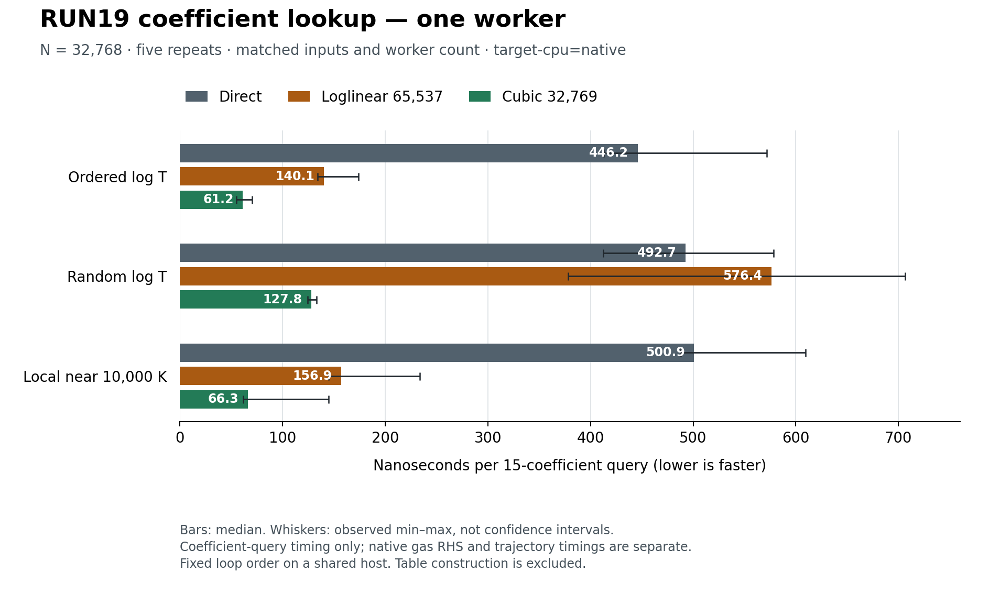

# RUN19 Unit B 최종 통합 — T-only 계수 재사용, cubic 보간, 수치 근거와 복원

## 실제로 완성한 기능

32,769-node cubic T-table을 기존 H/He/D prepared-rate 경로에 opt-in으로 연결했다. 기존 Direct 기본값과 STEP owner를 유지하면서, 밀도·source·opacity를 저장하지 않는 계수 table과 exact-EOS-temperature workspace를 재사용한다. 완성한 코드에는 source-bound cache 저장/로딩, typed batch workers1/2/4, 실제 gas RHS 비교 및 benchmark 도구가 포함된다. 원래 RUN13 native91개 파일과 완료 이력은 보존했다.

이 문서는 root의 계수 benchmark·정확도·compiler 증거, native 구현 단위의 실제 RHS 결과, 독립 이론·rounding 결과를 모았다. 과거 기록을 재실행한 것으로 세지 않는다. 이번 최종 packaging에서 추가한 계산은 새 source/backup 복원의 compile 및 META-only cache load뿐이며, RHS0·IVP0·기존 test suite 재실행0이다. Git/Drive/Dropbox 최종 B 게시 단계는 이 고정 시점에 root 담당 PENDING이다.

## 같은 조건의 계수 조회 비용

원시 명령·135개 행·5회 요약은 [root 실행 증거](execution/unit_b_root/coeff_measure01/SUMMARY.json)에 있다. N=32,768, 동일 입력·동일 worker 수·같은 실행 파일이며 `-C target-cpu=native`와 fast-math 미사용 조건이다. Table 생성은 timed query에서 제외하고 thread 시작/join은 포함했다. 사전 probe0.145120초 후 본 측정1.115374초를 수행했으며 추가 반복은 하지 않았다.

아래는 one-worker ns/query 중앙값 [실제 최소–최대]다. 각 query는 15개의 동일 계수를 반환한다.

| 온도 배치 | Direct | Loglinear65,537 | Cubic32,769 |
|---|---:|---:|---:|
| 순서대로 log T | 446.191 [413.027–571.937] | 140.070 [134.334–173.803] | 61.221 [54.936–70.191] |
| 무작위 log T | 492.677 [412.307–578.340] | 576.355 [378.120–706.765] | 127.835 [124.263–132.846] |
| 10,000 K 부근 | 500.894 [487.936–609.454] | 156.933 [144.672–233.620] | 66.284 [61.371–144.772] |

[SVG](figures_unit_b_final/COEFFICIENT_QUERY_ONE_WORKER.svg)와 [PDF](figures_unit_b_final/COEFFICIENT_QUERY_ONE_WORKER.pdf), plotting source 및 [정확한 plot 입력/해시](figures_unit_b_final/PLOT_DATA_AND_IDENTITY.json)를 제공한다. 초기 그림의 footer 겹침은 margin만 바꾸어 수정했고, 초기 그림·소스도 보존했다. Whisker는 관측 범위이며 confidence interval이 아니다. 공유 호스트·고정 반복 순서의 영향과 random-logT loglinear의 불리한 결과도 유지했다.

Root가 실제 LLVM/assembly에서 확인한 것은 monomorphized `weighted_channels<16>` callee의 **8-wide double vector, fmul8/fadd6, vmulpd8/vaddpd6, FMA없음**이다. 처음 확인한 외부 witness 자체는 vector 연산0개였고 그 기록도 남겼다. 실제 callee를 찾아 범위를 좁혀 확인한 결과다. 이는 `target-cpu=native`에서의 해당 safe Rust kernel 증거이며, 전체 gas RHS 또는 기본 배포 바이너리 전체의 SIMD 인증이 아니다. Native RHS 측정은 별도로 empty RUSTFLAGS에서 수행했다. 두 실험의 speedup을 서로 곱하지 않는다.

## 메모리와 실제 계수 정확도

| 구성 | Heap payload bytes | Cache bytes | 실제 query 수 | 실제 최대 상대차 |
|---|---:|---:|---:|---:|
| Cubic 16385 | 2,179,201 | 2,179,321 | 131,100 | 2.442535023195e-07 |
| Cubic 32769 | 4,358,273 | 4,358,393 | 196,636 | 1.532909445522e-08 |

기존 loglinear heap payload는 **9,109,624 bytes**, 선택한 cubic은 **4,358,273 bytes**다. 실제32,769 scan의 query196,636개 중196,453개가 보간,183개가 Direct fallback이었다. Scope는 원래 15계수 source에 대한 유한 node/이웃/midpoint/branch 진단이다. 원시 build/save/load 시간과 최대 오차의 channel·온도는 [accuracy01](execution/unit_b_root/accuracy01/stdout.txt)에 있다. 낮은 node 수의 결과도 삭제하지 않았다.

Generic5개 focused test가 실제 PASS했으며, 그 전17-byte MAGIC literal/16-byte array 불일치로 실패한 compile 로그를 함께 보존했다. 이 오류는 frozen generic source 이전에 해결됐고 새 source kernel SHA는 `7c45be5d93778d33d6c300b063b08efc4649c0106f26ac22720220328be4988f`로 유지됐다.

## 원래 gas RHS에 연결한 결과

[상세 native 보고서](execution/unit_b/UNIT_B_REPORT_KO.md)와 [전체 비교 JSON](execution/unit_b/point_compare01/GAS_COMPARISON.json)은 보존 입력9,216개의 실제 gas 결과를 담는다. Direct와 loglinear 각각258,048개 f64 출력, 합계516,096개 값이 Unit A와 비트가 같았다. Cubic native integration4개와 관련 서버2개 테스트가 PASS했다.

| 관측량 | Cubic 최대 상대차 | Cubic 최대 절대차 |
|---|---:|---:|
| H net RHS | 3.827730095361e-09 | 2.911093955492e-27 m^-3 s^-1 |
| Heat RHS | 3.769239803866e-12 | 8.031191823662e-44 J m^-3 s^-1 |
| Chemical net | 1.399808164967e-08 | 6.343710819874e-45 J m^-3 s^-1 |

H의 최대 cancellation condition은17,703.8653이며, H의 최대 `abs(error)/sum_abs_flux`는1.290675744e-12다. 각 최대값은 같은 입력에서 발생한다고 가정하지 않았다. 최대 cubic scaled signed ledger residual은3.591488474e-16이다. Net·positive flux·ledger를 나눠 평가했으며 작은 ledger를 spectral 또는 trajectory bound로 승격하지 않는다.

Native core N4,096의 실제 변하는-T shared Direct/loglinear/cubic 중앙값은669.45/440.31/396.29ns/RHS, 같은4workers에서는308.61/263.76/173.73ns/RHS였다. Table 생성과 IPC를 분리했으며 변하는-T cubic batch1·batch2의 큰 편차도 보존했다. 같은-T에서는 exact-T workspace가 이미 재평가를 제거하므로 cubic 선택의 추가 효과가 작다. 전체 이력 속도나 보편적 scaling은 아직 측정하지 않았다.

## 수학적 bound와 부동소수점 증거의 구분

이론의 긍정적인 smooth branch에서 exact decimal source, exact log nodes, exact node samples와 exact 산술을 가정한 전역 channel 최대 relative bound는 다음과 같다.

| 이상적 보간 모델 | 최대 channel bound |
|---|---:|
| Loglinear65,537 | 4.371181585181e-07 |
| Cubic16,385 | 1.500359829631e-06 |
| Cubic32,769 | 8.512614813784e-08 |

Cubic remainder는 `(3/128)*h^4*exp(2*h*M1)*(M4+4*M1*M3+3*M2^2+6*M1^2*M2+M1^4)`로 계산했다. Branch crossing, CI floors 및 non-normal/unsupported-zero 조건은 원래 guard와 별도의 applicability 조건을 가진다. [정확 유리수 이론 결과](theory/execution02/CUBIC_RATE_BOUND.json)는 **DERIVED_AND_EXACT_RATIONAL_CHECKED**이며, source fit uncertainty 또는 f64 node/ln/exp/query 변환 오차를 자동으로 포함하지 않는다.

별도의 실제 stored-node rounding 진단은32개 선택 cell×6개 binary64 theta×16channels, 합계**3,072개**를 검사했다. 각 stored binary64를 exact real로 취급했을 때 **모든 exact rational 값과 error가 outward interval에 포함**됐고 독립 nearest-kernel bits도 같았다. 최대 exact relative error는2.951544929838e-16, 최대 directed upper는8.824802554720e-16였다. VigilODE `directed.rs` 원문SHA `2adadb6a5d77073e0a7d3d60aedfbf37e124d15a586a880d7d5a8c8d5307a814`와 MIT license를 함께 보존했다.

이 rounding 결과는 **선택된 stored four-node polynomial의 산술**에 한정된다. 정확 source-node 평가, log-grid 구축, ln(T)/cell선택/theta 반올림, 모든 query의 supremum은 별도다. 이상적 interpolation bound와 이 유한 rounding 최대값을 단순 합쳐 full f64 source-function bound라고 주장하지 않는다.

Packaging에서 발견한 metadata 오류도 별도 보존했다. 원래 rounding JSON의 domain `[1,0]`은 runner가 `upper` 변수를 per-case relative upper에 재사용한 결과였다. Cache header의 실제 domain은 `[1,1000000]`이고 원래 runner도 시작 시 이를 assert했다. Fixture node offsets·exact case 검증·maxima는 영향받지 않는다. [수정 addendum](execution/unit_b_final/ROUNDING_DOMAIN_METADATA_ADDENDUM.json)에 실제 header bytes/해시와 원인을 기록했으며, 원래 결과·소스를 덮어쓰거나 계산을 반복하지 않았다.

## 의존성 재사용·복원·검토

`sha2=0.10.9`와 Cargo.lock의10개 registry package를 원래 license 원문과 함께 vendored backup으로 보존했다. 총614개 파일6,354,402bytes이며,10개 package checksum과 각 file checksum을 실제 bytes와 대조했다. [패키지·license 목록](runtime/RUST_PACKAGE_REUSE.json)과 [전체 vendor manifest](runtime/VENDOR_PACKAGE_MANIFEST.json)는 Git용 작은 기록이고, vendor 원문은 별도 archive payload다. 프로젝트 MIT LICENSE도 [run19/LICENSE](LICENSE)에 보존했다.

새 source copy, 빈 Cargo home과 target, 보존한 vendor 원문만 사용한 `--offline --locked` build는 **6.044760154초**에 성공했다. META-only cache load는0.024710229초였으며 source ID `53f101a30c0d6fdae246eb6ca545660e8bab5aaf22e34787c6ba15fd1ec8fcc4`, cache SHA `dcfa521f60165632e6fa1c0d10473b194c8aab73844ee0a44ed2454e18f7a23b`를 유지했다. [실제 복원 영수증](runtime/clean_offline_restore01/CLEAN_OFFLINE_RESTORE_RECEIPT.json)과 [재현 script](runtime/clean_offline_restore.py)가 있다.

이는 새 local source/backup 복원이다. 이번 단계에서 원격 Git을 다시 fetch하지 않았으므로 full Git-only restore라고 표시하지 않는다. 새 바이너리는746,712bytes/SHA `05e5f35397dbde4714bbd5af267fc18bde56b0486ea432347162af8f1b6ee4ca`로, 원래 검증 바이너리746,680bytes/SHA `bf3f6d73a50ae56dff789ab803a025367ff3a0888b457cdc7f3cdb6667a760d2`와 다르다. Source/cache 호환성은 확인했지만 binary byte 재현은 확인되지 않았다. 새 binary로 RHS·IVP·test를 반복하지 않았고 원래 실행 binary를 덮어쓰지 않았다.

독립 C9 검토는 실제 source/guards/physical-owner/단위·에너지 조립에서 현재 blocking finding0개를 기록했다. [CUBIC_NATIVE_REVIEW.json](theory/reviews/CUBIC_NATIVE_REVIEW.json)을 보존하며 추가 review cycle은 실행하지 않는다.

## DAG와 게시 상태

[Unit B DAG overlay](DAG_PROGRESS_UNIT_B.json)는 기존45-node/26-node DAG와19개 target reaction을 유지한다. Unit A와 Unit C의 별도 delivery 기록을 그대로 참조하며 원래 node의 의무를 줄이지 않는다. 이번 요청의 선택된 optimization/coding 단위는 구현·측정·범위를 명시한 오차검사·한 번의 review·복원 준비까지 정리됐다. C10의 실제 Git/Drive/Dropbox archive 완료 여부는 root의 최종 delivery receipt로 추가한다.

다음 원래 과학 노드는 **동일 first-birth panel의 original-owner continuous interval RHS와 admissible gas/depth feedback tube**다. Source-node/log-grid/query f64 enclosure, interval Jacobian, 전구간 residual, exact-prefix uncertainty가 남아 있다. Continuous spectral refinement, angular convergence, birth-time continuum, whole donor/full EoR/Einstein feedback, FLRW-CONV, BI-SIGNED, ISO-COUPLE full, Li/Be와 nuclear T1–T8 및19개 target coupling 의무는 유지한다. 이번 가속 unit의 성공은 그 과학 노드들의 완료를 의미하지 않는다.

