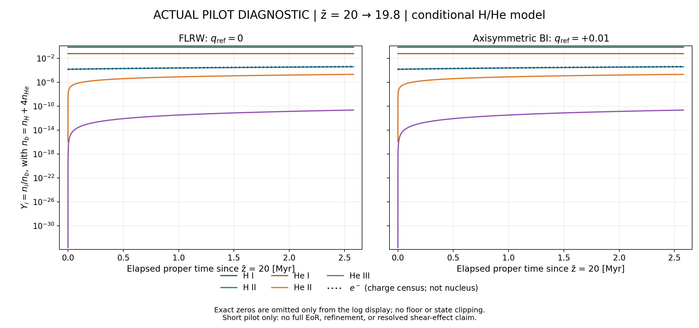
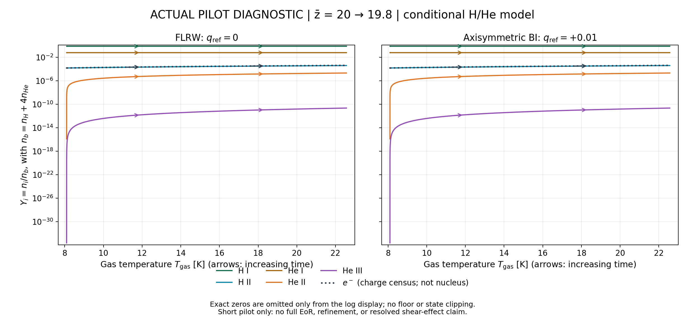
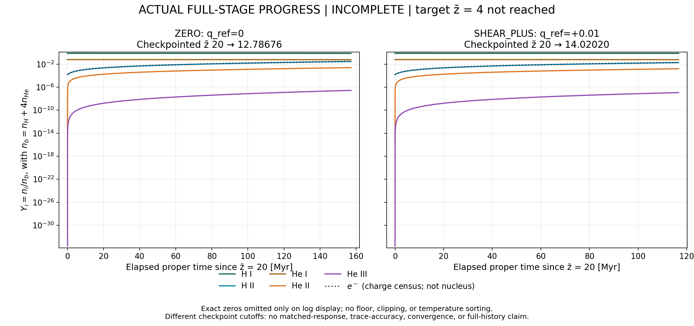
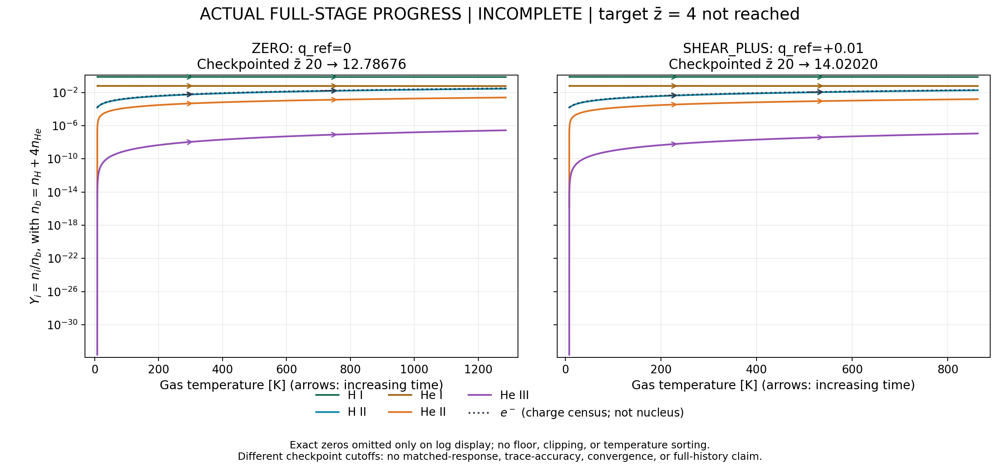
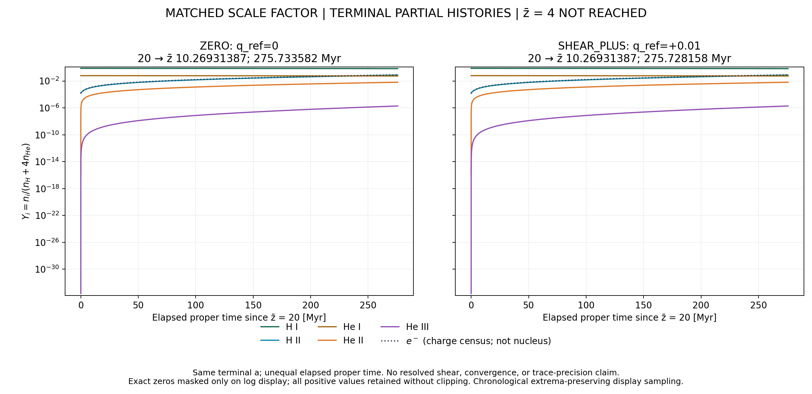
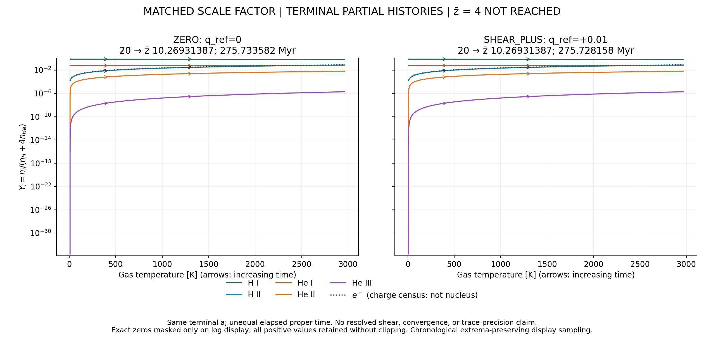
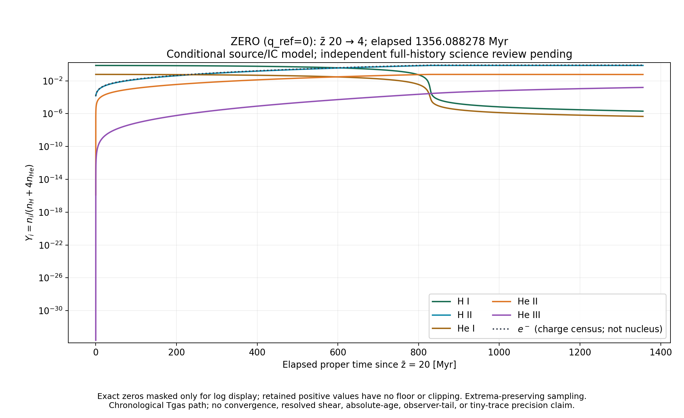
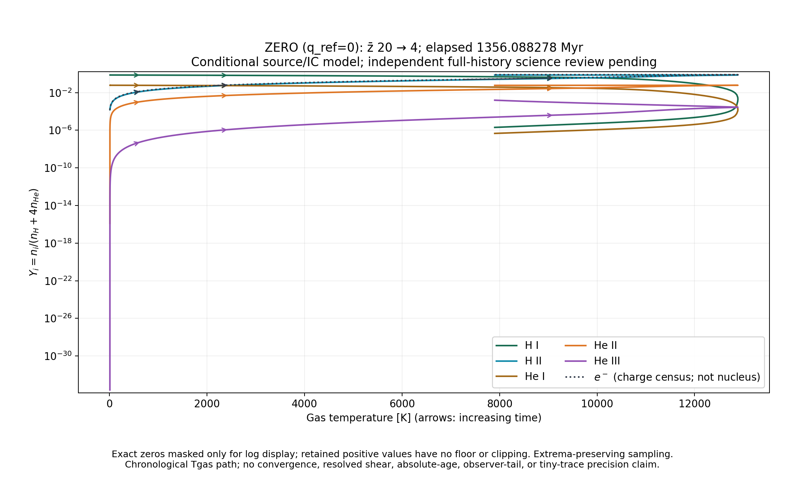
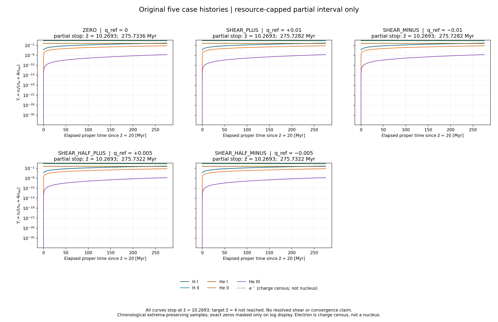
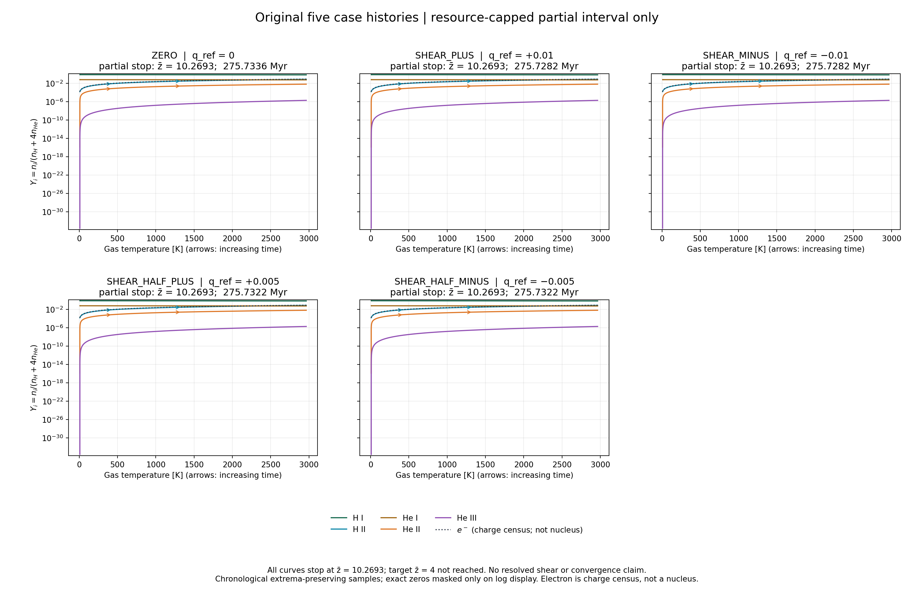

# 비경사 축대칭 Bianchi I 재이온화 abundance 작업 원고

목표 산출물은 지원되는 전체 구간의 H/He 이온 이력과 BBN 방식 시간·기체 온도 abundance 그림이다. 현재 원고는 물리 관례와 구현된 provider 연결을 담은 작업본이며 pilot·historical partial 기록과 conditional ZERO full-interval 결과를 포함한다.

`manuscript.tex`는 metric, proper clock, q_ref/Sigma 구별, H/He EOS·electron census, Case A escape, 단일 사건 energy owner, photon characteristic, baryon/element normalization을 기술한다. Grackle provider의 1–10⁶ K는 operational domain이며 empirical 정확도나 continuum certificate를 뜻하지 않는다. 기존 F08 15행은 synthetic prescribed endpoint 범위로만 보존하며 전체 시간 이력으로 재해석하지 않는다.

다음 입력은 AX07/AX08의 실제 `history.csv`와 `abundances.csv`, AX11의 baseline+2 refinement 응답, AX12 source/IC 민감도다. 저장 이력이 도착하면 시간순서 abundance_vs_Tgas와 proper-time 그림, FLRW/BI·signed 차이, hydrogen .1/.5/.9 milestone의 reached/censored 상태를 삽입한다. 온도를 정렬하여 비단조 경로를 지우지 않는다. D/T/He3/Li는 구현되지 않은 선택 확장으로 명시한다.

원고/PDF 생성은 science PASS가 아니다. unknown observer tail은 0이 아니며 abundance 목표의 비차단 secondary 항목이다. scoped 독립 결정과 실제 publication 검증은 별도 단계다. 빌드·명령 raw stream은 `raw/`와 `IMPLEMENTATION_RECEIPT.json`에 기록한다.

## 고정 시나리오·연속 source 갱신

AX01은 Planck-like rounded cosmology, zbar20→4, q_amp=.01, 명시적 approximate residual H 및 post-decoupling 냉각 IC를 선택했다. 시간축은 **zbar20 이후 경과 proper time**이며 absolute cosmic age나 matching REC donor를 주장하지 않는다. MD14 SFR/yield, fesc=.2, Zstar=.002와 50,000 K blackbody 13.6–100 eV 연속 photon source를 구현했다. z>8 source law는 phenomenological continuation이다. source spectral cell 평균 에너지의 첫 Simpson8 검증 실패를 보존했고 승인된 Simpson32 수치 수정 후 targeted2 tests가 통과했다. 구현 검증은 full evolution/science admission이 아니다.

## 실제 FLRW 부분 pilot

첫 실제 실행은 zbar20→19.8 목표 중 zbar19.86586760536834에서 `AXBI_OUTPUT_CAP`으로 checkpoint를 남기고 종료했다. accepted2870, actual tentative8667, RHS60693, reject18, wall64.233055s/CPU64.128211s/peak RSS3724KiB다. 수치 실패가 아닌 output 자원 제한이 보고된 종료 이유다. 양전단 pilot은 시작하지 않았고 자동 재시도는 없었다. 전체 pilot/이력 완료나 과학 admission을 주장하지 않는다.

66개 생성 파일 원본234862901bytes를26,097,828byte tar.gz에 lossless 보관했으며 전체 파일의 membership·크기·SHA를 독립 archive stream으로 확인했다. 원본은 남겨두었다. authority는 accepted scalar rows를 모두 보존하고 전체 spectra만 initial/checkpoint/terminal로 저장하는 한 번의 수정을 승인했다. 새 binary/changed-output review/수정 allocation에 따른 후속 실행은 별도다.

## 완료된 두 pilot과 실제 abundance 그림

새 fc9dac5d0af1 실행에서 FLRW와 q_ref=+.01 모두 zbar20→19.8을 완료했다. 각3882accepted/11700tentative/81924RHS, saved3883states다. 시간은 각각2.580698929/2.580571740Myr(초기 slice 이후 elapsed), 종료T는22.565863657/22.565143160K다. 독립 `PILOT_SCIENTIFIC_DECISION.json`은 conditional short-pilot execution만 scoped PASS로 판단했다. 전체20→4, empirical refinement, resolved shear response는 아직 아니다.

Y=n_species/(nH+4nHe)이며 electron은 ne/nb charge census로 따로 표시하고 핵 baryon 합에서 제외한다. 실제0은 log표시에서만 mask하고 positive값은 모두 범위 안에 남긴다. floor/clipping/온도정렬은 없다. 원본과 plotting script/manifest를 보존했다. 두 endpoint의 분율/T 차이는1e-7/.01K floor 아래이므로 detection, resolved null 또는 upper bound를 주장하지 않는다.

매우 작은 trace abundance는 저장값을 보여줄 뿐 component/pilot residual 통과로 정확성이 입증된 것이 아니다. 10^-34 부근 표시가34자리 precision을 뜻하지 않으며 global time/energy/angular convergence도 아직 측정하지 않았다.

## 진행 중 full-stage의 단일 고정 snapshot (2026-10-14 08:33:57 UTC)

- ZERO: zbar20→12.78675633, Tgas=1285.873388K, xHII=0.037996897, xHeII=0.0399903547, xHeIII=4.47551775e-06.
- SHEAR_PLUS: zbar20→14.02019975, Tgas=862.424607K, xHII=0.0242490861, xHeII=0.0254391198, xHeIII=1.83323659e-06.

두 종료 epoch/clock은 다르며 이를 전단 response로 비교하지 않는다. targetzbar4 미완료, global convergence/trace precision/전체 과학 admission 미발급 상태다. accepted complete-prefix를 captured checkpoint에 맞춘 불변 snapshot과 source/CSV/checkpoint SHA를 보존했다. 기존 pilot 내용과 이전 PDF/원고는 새 snapshot previous_report에 보존했다.

## Historical 08:33 checkpoint snapshot (서로 다른 endpoint)

아래의 08:33 snapshot은 이후 terminal stop 결과가 나오기 전의 역사적 진행 기록이다. 두 case endpoint가 서로 달라 paired shear response로 해석하지 않는다. 최신 same-a terminal 비교는 아래 절에 따로 기록한다.

## Independent review된 terminal ZERO partial history와 SHEAR_PLUS 진행 snapshot

2026-10-14 09:03 UTC에 ZERO $q_{ref}=0$ 실행은 accepted-step resource cap에서 정지했다. 독립 read-only 검토는 실제 표현 구간 $\bar z=20\to10.269313869154184$에 한해 `PASS_SCOPED_CONDITIONAL_PARTIAL_FLRW_HISTORY`를 기록했다. 종료 상태는 200000 accepted, 600054 attempts, 18 rejections, 4200402 RHS evaluations, wall 4945.1269 s, CPU 4940.75 s, peak RSS 55612 KiB이며 실행 exit 101 / `AXBI_RUNTIME_CAP`다. 이는 full $20\to4$ 완료가 아니다.

| 표현된 case와 캡처 | $\bar z$ endpoint | elapsed Myr | $T_{gas}$ K | $x_{HII}$ | $x_{HeII}$ | $x_{HeIII}$ |
|---|---:|---:|---:|---:|---:|---:|
| ZERO terminal, 09:03 UTC | 10.2693138692 | 275.733582 | 2964.865324 | 0.09914260554 | 0.10470182097 | 3.07503797e-5 |
| SHEAR_PLUS checkpoint snapshot, 08:33 UTC | 14.0201997477 | 116.631 | 862.424607 | 0.0242490861 | 0.0254391198 | 1.83323659e-6 |

이는 시간과 endpoint가 다른 캡처이므로 matched shear response가 아니다. PLUS는 기록된 snapshot 시점에 진행 중이었고 여기에 표시한 값은 그 checkpoint 한정이다. ZERO 구간에서 xHII=.1/.5/.9 upward crossings는 모두 `NOT_REACHED`; stop 밖의 crossing은 추정하지 않는다. Independent review는 이 qref=0 표현구간의 state domain, normalization, nuclei/charge, photon 및 augmented-energy ledger, 저장된 local controls와 sampled omitted-feedback diagnostics를 검토했다. Global convergence, signed shear response, full zbar20→4, continuum/interval certificate, empirical cold atomic fit accuracy와 observer tail은 여전히 미측정/미완료다.

이 업데이트 직전 manuscript.tex, 9-page manuscript.pdf와 이 Markdown의 byte-identical 복사본은 `progress_updates/FLRW_RESOURCE_STOP_001/previous_report/`에 보존했다.

## 독립 검토된 matched-a ZERO / SHEAR_PLUS terminal partial 비교

두 원래 실행 모두 200000 accepted step에서 frozen resource cap으로 종료했으며 exact native endpoint는 동일한 $a=0.08873654701704167$, $\bar z=10.269313869154184$다. 두 terminal record는 `AXBI_RUNTIME_CAP`, exit 101, attempts 600054, rejections 18, RHS evaluations 4200402를 기록했다. 독립 검토 상태는 `CONDITIONAL_PARTIAL_EVIDENCE_PASS`이며, 이는 두 partial interval의 한정된 evidence decision이다.

| terminal 값 | ZERO ($q_{ref}=0$) | SHEAR_PLUS ($q_{ref}=+0.01$) | PLUS − ZERO |
|---|---:|---:|---:|
| proper time (s) | 8.701490096946133e15 | 8.701318923319379e15 | −1.71173626754e11 s = −5424.1649 Julian years |
| $T_{gas}$ (K) | 2964.86532393337 | 2964.83878191092 | −0.02654202245 K |
| $x_{HII}$ | 0.09914260553714 | 0.09914134877928 | −1.2567578673e−6 |
| $x_{HeII}$ | 0.10470182097350 | 0.10470050519871 | −1.3157747880e−6 |
| $x_{HeIII}$ | 3.07503797e−5 | 3.07496898e−5 | −6.89832122e−10 |

같은 expansion slice 비교이며 proper time와 $T_{gas}$는 일치하지 않는다. $|\Delta x_{HII}|$와 $|\Delta T|$는 response floors보다 크지만 해당 paired refinement uncertainty는 `UNKNOWN`; 독립 reviewer 판단은 `HOLD_UNRESOLVED`다. 따라서 resolved shear effect/sign 또는 relative-percent accuracy는 주장하지 않는다. Full $\bar z=20\to4$ history는 미완료다. 앞 절의 08:33 unequal-endpoint snapshot은 오직 역사적 progress이며 이 terminal matched-a 결과와 혼동하지 않는다.

### Review된 matched-a abundance figures

아래 그림은 각 case의 원본 200001 accepted rows에서 선택한 4003 display samples를 사용한다. ZERO/PLUS 모두 resource cap에서 멈췄으며 partial $\bar z=20\to10.269313869154184$ 자료다. 같은 terminal $a$에서 accumulated proper time는 5424.16 Julian years 차이가 있으므로 elapsed-time 곡선은 same-proper-time 비교가 아니다. Gas-temperature 그림은 원래 chronological 순서를 유지하고 온도를 정렬하지 않는다. Plot independent review는 publication-scoped PASS; solver 및 plot rerun은 하지 않았다.

두 그림은 resolved shear effect, interpolation/temporal convergence bound, trace precision 또는 full $\bar z=20\to4$ history를 주장하지 않는다. 앞의 08:33 snapshot figure들은 그 시각의 unequal-endpoint historical progress로 남아 있다.

## 실제 composed ZERO 전체 선택 구간: PASS_SCOPED_CONDITIONAL_FULL_INTERVAL_ZERO_HISTORY

`ZERO_composed_001`은 exact a=.2/zbar4에서 zbar20→4를 완료했다. 기존200001행 prefix에 continuation의 신규112237 accepted states를 연결하고 shared boundary를 한 번만 계산했다. 누적312237 accepted/936768 tentative/6563796 RHS, 저장312238 history states이며 global proper clock·state·counter를 재설정하지 않았다. 원래 binary32d11e733155와 resource-only wrappera7e3f1d98bd8 및 동일한 library/source/config identity를 구별하여 보존한다.

종료 elapsed proper time는1356.088277991926Myr(zbar20 이후 경과), Tgas7900.621365666492K, xHII=.9999973170987931, xHeII=.9742081012374538, xHeIII=.025784317574366333이다. 저장된 conditional discrete 값이며 표시 자릿수의 정확도나 absolute cosmic age를 뜻하지 않는다. 독립 full-history science decision은 `PASS_SCOPED_CONDITIONAL_FULL_INTERVAL_ZERO_HISTORY`이며, 실제 표현된 conditional numerical ZERO 구간만 scoped PASS다. Global/refinement uncertainty는 `UNKNOWN`, represented tau는 `PENDING`이다.

모든312238 joined states를 기존 completed reader로 endpoint/order/domain/species/normalization 및 nuclei/charge/history alignment 검사했다. 그림은 각100행 block의 endpoint·종별 및 T extrema, 전체endpoint·first positive·positive minimum를 보존한6250 chronological samples다. true zero만 log display에서 mask하며 retained positive값에 floor/clipping이 없다. 온도를 정렬하지 않아 heating/cooling branch가 보존된다. tiny trace 정확도 및 temporal/energy/angular/interpolation convergence는 미입증이다. 이 H/He ionic network는 BBN nuclear reaction network가 아니다.

기존 matched-a partial pair 분석과 `HOLD_UNRESOLVED`를 보존한다. ZERO 하나의 full interval 완료는 signed family/global convergence/resolved shear/absolute IVP/matching nuclear donor/observer tail claim이 아니다. composition receipt의 whole-history feedback·tau는 명시적으로 `PENDING`이며 segment-only 진단을 full-history로 변경하지 않는다. 원고 update 직전 TEX/PDF/Markdown은 `progress_updates/ZERO_FULL_001/previous_report/`에 보존했다.

### Fresh ZERO full-history independent decision

`reviews/ZERO_FULL_HISTORY_SCIENCE_REVIEW.json`의 exact SHA는 `c58a2b4ad10f3900e0b42a1b9607a4ff4718a46fc6ef9e654b9a1bd42ee0e485`이며 결정은 `PASS_SCOPED_CONDITIONAL_FULL_INTERVAL_ZERO_HISTORY`다. 실제 표현된 conditional numerical ZERO zbar20→4만 scoped admission했다. 전312238행의 whole-history sampled feedback를 재구성하여 max|Delta s/H|=3.776565807803823e-23, max extra-energy ratio=5.809377678641879e-9가1e-4 diagnostic ceiling 이내임을 확인했다. 이는 rigorous coupled-background error bound 또는 refinement uncertainty가 아니다. 역사적 composition/PNG의 PENDING annotation은 생성 시점 기록이며 fresh review가 feedback의 missing check를 제공했다. represented tau는 여전히 미계산, observer tail UNKNOWN, temporal/energy/angular refinement UNKNOWN이다. signed family·resolved shear·C11·AX15·전체 goal PASS로 확대하지 않는다.

## 온도 전용 반응률 표의 짧은 이력 검증

Case A 점 모델의 15개 반응률·냉각 계수를 온도만으로 조회하는 65,537-node 표를 독립 실행 드라이버에 선택형으로 연결했다. NCP에서 동일한 새 실행 파일로 $q_{ref}=0,+0.01$ 각각 DIRECT/TABLE 네 실행을 정해진 순서대로 한 번씩 수행했다. 범위는 $\bar z=20\to19.8$이며 각 실행에서 17개 공통 expansion surface를 저장했다. 독립 검토는 이 두 DIRECT/TABLE 쌍의 유한 binary64 짧은 이력 수치 비교에만 `PASS_SCOPED_PAIRWISE_SHORT_HISTORY_NUMERICS`를 부여했다.

| 경우 | DIRECT 전체 wall (초) | TABLE 전체 wall (초) | TABLE/DIRECT |
|---|---:|---:|---:|
| ZERO ($q_{ref}=0$) | 89.55 | 90.05 | 1.00558 |
| PLUS ($q_{ref}=+0.01$) | 118.35 | 119.71 | 1.01149 |

TABLE은 이 한 번씩의 측정에서 각각 약 0.56%, 1.15% 느렸다. 측정된 상각 이득은 없으며 DIRECT를 기본값으로 유지한다. TABLE은 검증한 설정과 $\bar z=20\to19.8$ 구간에서만 선택형이다. PLUS−ZERO signed response의 독립 resolution error/floor가 없어 그 응답 주장은 `HOLD`다. 더 긴 이력, 전체 목표, 과학 admission은 이 결과로 발급되지 않았다. 원자료와 결론은 `../performance/temperature_rate_integration_001/`의 독립 pilot review, comparison 및 performance receipt에 묶여 있다.

## SHEAR_HALF_MINUS 원래 구간 종료와 PLUS 인계 보류 (2026-10-14)

`SHEAR_HALF_MINUS` 원래 실행은 $a=0.08873654701704167$ ($\bar z=10.269313869154184$)에서 200000 accepted-step 한도에 도달해 `AXBI_RUNTIME_CAP`, external exit 1로 자연 종료했다. 독립 검토는 200001개 저장 이력과 5400027개 ledger 행에 대해 domain·순서·유한성·핵수/전하·photon/energy 보존 및 저장된 local control을 확인하고 `PASS_SCOPED_TYPED_ACCEPTED_STEP_RESOURCE_STOP_CONDITIONAL_PARTIAL`로 분류했다. 최대 H 정규화 오차는 0, He는 $2.22\times10^{-16}$, 전하는 $1.39\times10^{-17}$이고 최대 energy residual은 $7.78\times10^{-12}$ eV/H였다. 이 판정은 실제 저장된 부분 구간에만 적용되며 $\bar z=4$ 완료나 signed response·수렴을 뜻하지 않는다.

복구 영수증은 원래 다섯 case와 ZERO continuation의 종료를 기록하고, 기존 직렬 후속 단계인 `SHEAR_PLUS` continuation handoff를 허용했다. 실제 `post_plus_epoch_dispatch.py --start-detached`는 observer 생성 후 solver `Popen` 직전의 `LIVE_WORKERS_OR_CHILDREN_HOLD`에서 멈췄다. 과학 실행 PID 확인 영수증과 continuation 출력은 없고, 예약된 첫 시도와 raw traceback은 그대로 보존했다. 실패 시점에 차단된 프로세스의 PID/argv는 남지 않아 transient 오검출을 단정할 수 없다. 독립 검토는 광범위한 argv-operand 판별식의 결함을 지적했지만 이를 이번 실패의 실제 원인으로 확정하지 않았다.

새 `PLUS_PRELAUNCH_RECOVERY_001` 계약은 첫 예약 시도 1회와 관측 solver 시작 0회를 구분하고, 기존 science binary·config·predecessor·물리 한도를 바꾸지 않는 한 번의 예약 복구 준비만 허용한다. 변경 부분의 별도 독립 검토 전에는 solver를 실행하지 않는다. `SHEAR_HALF_PLUS` continuation은 PLUS 결과 판정과 observer 종료 이후의 별도 예약 순서를 기다린다. 따라서 현재 full ZERO 그림 외 signed 전구간 그림, paired 전구간 response, 수렴 판정은 여전히 없다.

복구 구현은 단일 제조 fixture 8개 분기를 통과했고 변경 부분 독립 검토가 `PASS_SCOPED_PRELAUNCH_RECOVERY`를 발급했다. fresh local/NCP/pending-slot 검사를 거쳐 복구 명령을 한 번 실행했으며, 두 번째 누적 PLUS 시도에서 실제 solver launcher PID 1843269의 `PROCESS_ACKNOWLEDGED`와 새 science checkpoint 생성을 확인했다. 이는 계산 시작의 증거이며 종료나 과학 PASS가 아니다. 첫 실패 영수증은 보존했고 누적 PLUS 시도는 2회, 관측 solver 시작은 1회다. 진행 중인 실행의 자연 종료와 전구간 검토를 기다린다.

새 BASS_HE PR #55/Dropbox R10 short-clock 공급 자료도 확인했다. 해당 Simpson 진단은 기존 양의 네 단항 $H$ source에 대한 짧은 proper-time exact-real 절단오차 경계만 제공한다. binary64/native 적응 적분과의 일치·roundoff 상계·production 속도 이득이 없어 현재 abundance background/driver 입력을 교체하지 않았다. BASS/REC의 다른 R9/R8 자료도 optical·기하 clock 또는 저장 구간 진단이며 이 보고서의 선택된 chemistry 이력을 바꾸지 않는다. 자세한 source commit·ZIP SHA와 claim 경계는 `../external_suppliers/UPDATE_SCAN_20261014_R11.json`에 남겼다.

## 원래 다섯 case의 실제 부분 구간 abundance 그림

원래 ZERO, ±0.01, ±0.005 다섯 이력은 모두 200001개 저장 행을 가지며 같은 $a=0.08873654701704167$ ($\bar z=10.269313869154184$)에서 자원 한도로 종료했다. 각 경우 4003개 시간순 표시 표본을 원자료 행과 정확히 대조했고, 그림·표본·입력 source/config/CSV 해시를 `signed_terminal_partial_32d11e733155/`에 보존했다. 독립 그림 검토 판정은 `PASS_SCOPED_SIGNED_TERMINAL_PARTIAL_FIGURES`다. 공통 $a$는 공통 proper time을 뜻하지 않는다. 이 그림은 아직 $\bar z=4$에 도달하지 않은 실제 부분 이력의 표시이며 전단 응답의 해상·부호·수렴 또는 극미량 trace 정확도 판정이 아니다.

MINUS와 HALF_MINUS의 다음 구간은 기존 검토된 signed continuation binary로 각각 한 번만 실행하도록 case별 권한·비공개 starting-state binding을 준비했다. 392 photon stock, 24 ledger, 상태·counter의 checkpoint 일치를 독립 검토해 `PASS_SCOPED_EXACT_BINDINGS_CONDITIONAL_LAUNCH`를 받았다. 이는 binding 준비 판정이며 실행 release가 아니다. 현재 PLUS의 자연 종료·판정 후 HALF_PLUS를 먼저 진행하고, 그 다음 MINUS와 HALF_MINUS를 순서대로 예약한다.

## PLUS continuation observer 오검출 종료 및 새 REC BG R9 공급 자료

PLUS continuation은 두 번째 예약 시도에서 실제 Rust solver PID 1843271로 실행되어 durable checkpoint accepted 240480, $a=0.10752752205956843$ ($\bar z=8.299944617397738$)까지 진행했다. 그 뒤 observer의 프로세스 판별식이 이 작업 중 실행한 읽기 전용 `rg` 명령의 `research/axbi_goal_20261014` 경로 인자를 별도 `axbi_` 실행 파일로 오인했다. 동일 시점 `HANDOFF_REFUSAL.json`은 허용된 solver PGID 1843269와 오인된 검색 PGID 1911669를 함께 보존한다. observer가 `LIVE_WORKERS_OR_CHILDREN_HOLD` 예외 경로에서 자신의 solver 그룹에 SIGKILL을 호출한 코드 경로가 확인되었다. 원래 시도 1회와 실제 solver를 시작한 복구 시도 1회, 합계 PLUS 예약 시도 2회/관측 solver 시작 1회는 그대로 계산한다. `RETURN.txt`와 정상 종료 기록은 없고, 전체 구간이나 수치 실패로 해석하지 않는다. 독립 검토는 runtime classifier false positive로 판정했으며 추가 PLUS 실행은 새 범위 계약 전까지 `HOLD`다. 원자료와 정확한 결손은 `../driver/full/epoch_recovery_001/plus/recovery_001/INCIDENT_CLASSIFICATION.json` 및 비공개 runtime snapshot에 보존했다.

새 Dropbox `REC_BG_R9_20261014_COMPLETE.zip` (SHA256 `4db1e96828ba10a20ab0f1a8ac92f8075a0354e7b301c0fb07cf88624c673a4e`)도 확인했다. 정해진 homogeneous Bianchi I의 60개 finite interval geometry reference와 16개 시험 결과는 $dt$, $db$의 별도 기준 자료다. 현재 선택된 chemistry/native driver의 binary64 parity, roundoff bound, 전구간 abundance 재생성은 제공하지 않아 provider·background·driver를 교체하지 않았다. 정확한 외부 PR head와 입력 결손은 `../external_suppliers/UPDATE_SCAN_20261014_R12.json`에 기록했다.

## SHEAR_HALF_PLUS continuation 실제 시작 (2026-10-14)

PLUS observer 중단을 별도 runtime abort로 분류하고 해당 observer·solver 그룹 종료, 기존 예약 소진, 로컬/NCP/pending count 및 HALF_PLUS binding/원본 checkpoint/output 부재를 새로 확인했다. 독립 검토는 `PASS_SCOPED_HALF_PLUS_HANDOFF_AND_LAUNCHER_RELEASE`를 부여했다. 기존 binding과 SHA `4243c744...`인 signed continuation binary, 10799초/2 GiB/segment 4096 MiB의 한 번만 실행하는 wrapper로 HALF_PLUS 후속 구간을 시작했다. controller PID 1965217, solver launcher PID/PGID 1965222가 `PROCESS_ACKNOWLEDGED`로 기록됐고, 첫 관측 checkpoint가 accepted 200700, $a=0.08893087067765912$로 진행했다. 이는 실행 시작과 진행의 증거이며 전구간 완료 또는 과학 판정이 아니다. 예약 시 HALF_PLUS 시도 1회/관측 시작 0회, ACK 이후 관측 시작 1회, 누적 full 시작 8회/history 시작 11회를 구분한다. 재시도는 없다. 정확한 명령·source/binding·시각·ACK 해시는 `../driver/full/half_plus_continuation_001/launch_001/START_CHECKPOINT.json`에 기록했다.

## 새 REC R9 v2·BASS FA03 R10·CR R5 공급 자료의 적용 경계

REC R9 v2 ZIP (`7bdf7b9c...`)은 앞선 R9 v1의 floating local evaluator 오차 합성식 누락을 수정했다. evaluator 오차가 양의 polynomial 적분에 상대적인 정의라면 `eta_total <= alpha + (1+alpha)*eta_eval`이며, 이전 additive 식은 교차항을 빠뜨렸다. v2의 별도 17/17 unit test와 60개 수학적 비교는 standalone 기준값에 한정되고, 현재 native abundance clock을 교체하지 않는다. 향후 별도 finite-interval 방법을 도입할 때 v2를 기준으로 삼는다.

BASS FA03 R10과 xAct 복구 백업은 유한 검출기/문턱 지원의 scoped 기하·진단 자료다. BASS CR R5의 독립 native component probe는 **현재 checkout의 `axbi_driver.rs`·`axbi_sources.rs`·`atomic_provider.rs` 해시와 일치하는** frozen BB50K source에서 n16 He I/He II의 source-weighted cross-section 적분이 continuum 기준 대비 각각 +10.4085%/+38.5941%라고 보고한다. 별도 one-sided 문턱 후보의 isolated component 값은 +0.0743%/+0.1171%지만 production에는 채택되지 않았다. 이는 광원 분광 이산화의 가능한 체계오차이며 abundance·Tgas 최종 오차나 전구간 재이온화 신호의 판정이 아니다. 현재 진행 중인 이력의 binary/source는 그대로 유지하고, 선택한 source/ledger의 짧은 별도 검산과 독립 과학 판정 뒤에만 새 source lane을 고려한다. 원 ZIP·PR head·정확한 숫자·결손은 `../external_suppliers/UPDATE_SCAN_20261014_R13.json`에 기록했다.
