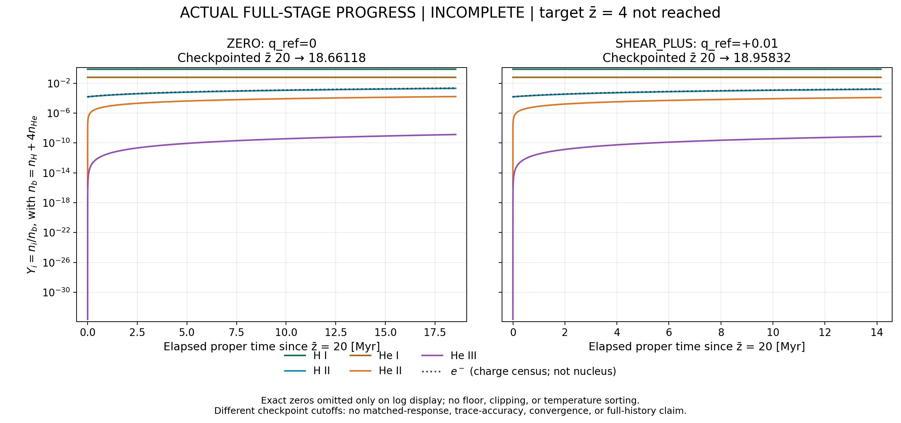
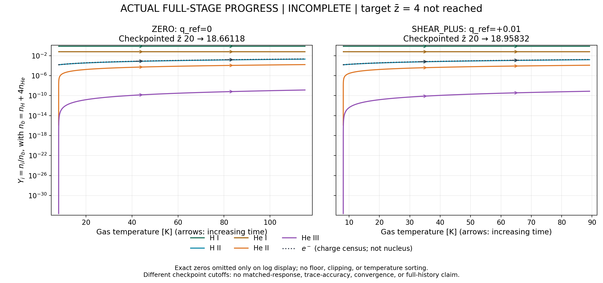

# Actual full-stage progress snapshot — incomplete

Captured UTC: 2026-10-14T07:48:02.565068+00:00

- ZERO: checkpointed z̄20 → 18.66117630; elapsed 18.54071284 Myr; 21900 accepted, 65754 tentative, 460302 RHS.
- SHEAR_PLUS: checkpointed z̄20 → 18.95831693; elapsed 14.15557085 Myr; 17100 accepted, 51354 tentative, 359502 RHS.

The target z̄4 is not reached. Snapshots are exact complete CSV prefixes bounded by the captured atomic checkpoint; source identities, capture timestamps, prefix sizes/hashes and excluded incomplete tails are in SNAPSHOT_MANIFEST.json. Different case cutoffs are not a matched comparison. No full AX14 completion, global numerical refinement, resolved shear response or validated tiny-trace precision is claimed. Electrons are labelled charge census and excluded from nuclear baryon inventory. Time/Tgas plots preserve original time order; exact zeros are masked only on the log display.

Reproduce figures with `python3 snapshot_progress.py --render snapshot_20261014T074802564930Z` from this postprocessor directory; no live source is reread. Continue the existing supervisor and checkpoint identities; do not relaunch completed or running cases.
