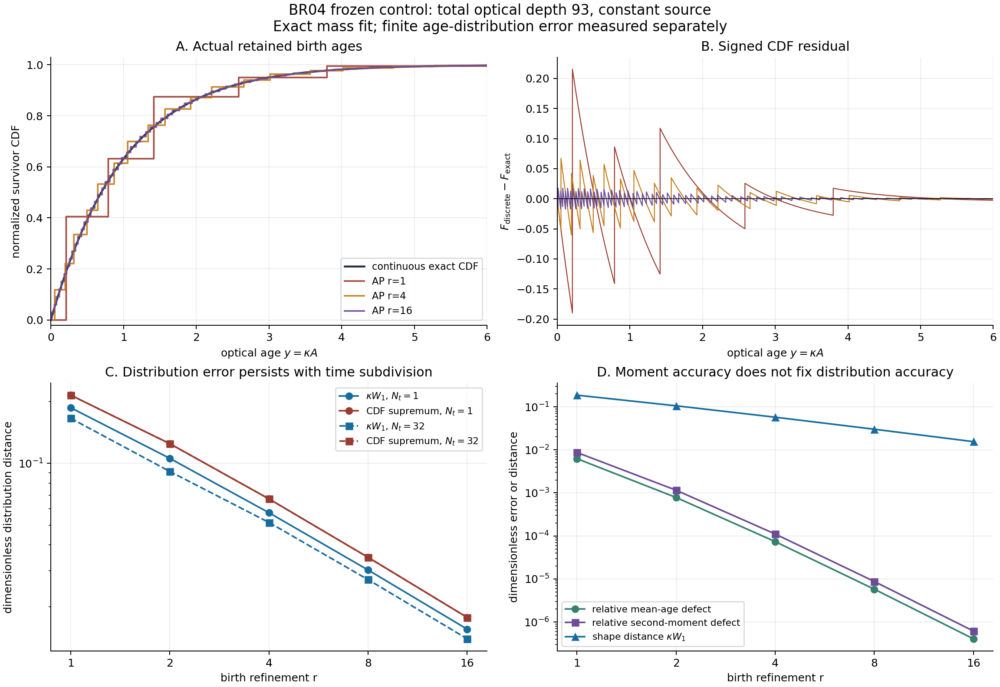
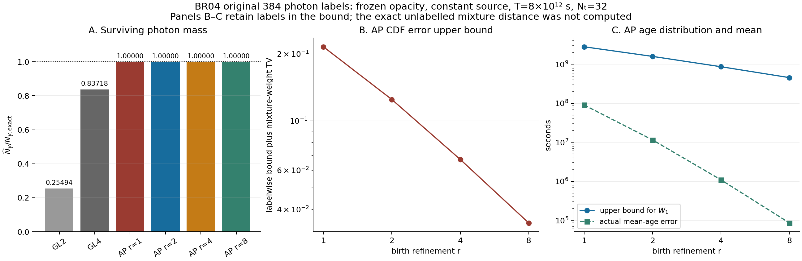
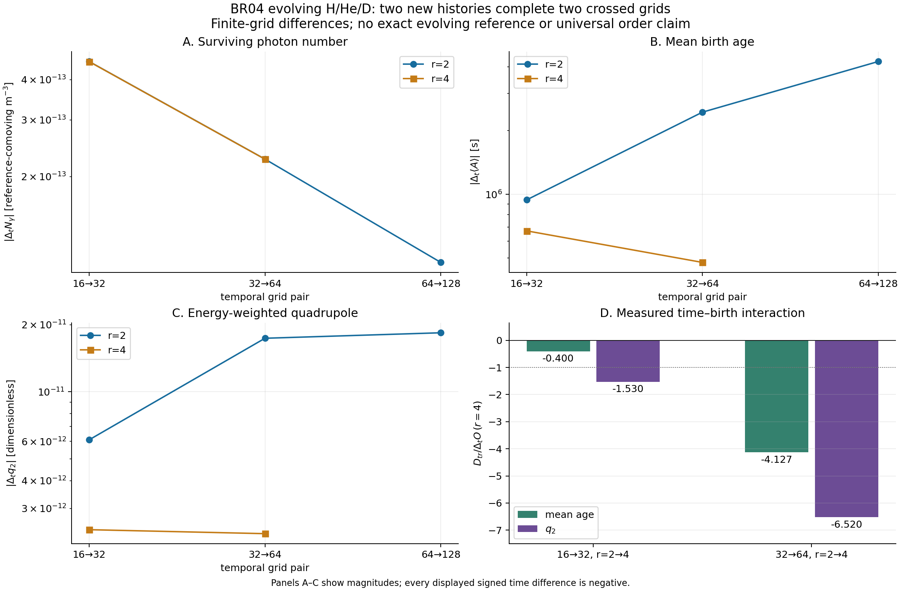

# BASS-REACTIVE-04 — 출생연령 분포 진단과 시간–출생 교차 검증

기준일: 2026-10-19 KST. 부모는 Draft PR #202, HEAD `8e60ecb627da46bb85861e2a4148a1b683d96fb0`다. 이번 단위는 `$physmath-research-loop`의 이론·코딩 루프를 이어서 실제 유도, Rust 구현, 샌드박스 수치 검산, 독립 수학·코드 감사와 그림 검토를 수행했다.

## 1. 판정

**BASS-REACTIVE-04_TIME_AGE = COMPLETE_VERIFIED_SCOPED_DIAGNOSTIC_CONTROL.**

부모의 양의 출생 적분을 바꾸지 않고, 광자 질량 오차와 정규화된 출생연령 분포 오차를 분리해서 계산하는 opt-in Rust 진단을 구현했다. 상수 source·opacity 참조에서 정확 CDF, 1차 Wasserstein 거리, 연령 moment를 계산하고, 여러 시간구간 및 원 source label의 합성 규칙을 검증했다. 새 native 계산은 두 사례, 80 macrostep, 합계 203.6714초로 제한했다.

**LONGSPAN_SOLUTION = NOT_ADMITTED_JOINT_TIME_AGE_CONVERGENCE_INCOMPLETE.** 현재 교차 격자는 시간과 출생연령 이산화의 큰 상호작용을 보여준다. 이 결과로 H/He/D 전체계의 보편적 2차 정확도나 연령·분광·각도의 완전 수렴을 인정하지 않는다. BASS 기하의 양방향 Einstein 피드백은 계속 미구현이다.

## 2. 이번에 필요한 질문

BR03은 상수-opacity 극한의 생존 광자수를 정확히 맞추는 양의 적분을 제공했다. 그러나 유한한 출생시각 node는 연속 연령 분포를 그대로 재현하지 않는다. 특히 이후 광자 에너지, 방향, age-dependent opacity를 계산할 때 이 차이가 남는다. 질량과 평균 연령이 잘 맞더라도 분포가 같은지는 별도 문제다.

이번 단위에서는 그 차이를 직접 측정했다. 이는 광자수를 보정하거나 cohort를 새로운 시각으로 옮기는 작업이 아니다. 입력 cohort의 원 birth time, birth geometry, Killing label, 방향 및 spectral label은 기존 경로에 그대로 남는다. 새 모듈은 진단용 사본을 읽어 정렬하고, 기존 업데이트 상태를 쓰지 않는다.

## 3. 이론: 질량과 분포를 분리한다

관측 시각의 광자 연령을 $A$, 구간 길이를 $T$, $x=A/T$, $\tau=\kappa T$라 쓰자. 상수 방출률 $j$와 총 흡수율 $\kappa$에 대해

$$
d\mu(A)=j e^{-\kappa A}dA,\qquad
\nu=jT\sum_iw_i e^{-\tau x_i}\delta_{Tx_i}.
$$

각 질량은 $M=jT\Phi(\tau)$와 $\widehat M=jT\sum_iw_i e^{-\tau x_i}$다. $M,\widehat M>0$일 때 각각 자기 질량으로 정규화한 분포 $P=\mu/M$, $Q=\nu/\widehat M$를 비교한다. 출력은 $\widehat M-M$과 분포 차이를 따로 보존한다. 0 source에서는 물리적 measure가 비어 있고 조건부 연령 분포는 정의되지 않는다. 양의 수가 f64에서 0으로 underflow한 경우는 이 상태와 구분한다.

정확한 정규화 CDF와 quantile은

$$
G_\tau(x)=\frac{1-e^{-\tau x}}{1-e^{-\tau}},\qquad
Q_\tau(p)=-\frac{\log[1-p(1-e^{-\tau})]}{\tau}.
$$

투명 극한에서는 둘 다 항등함수다. 이산 CDF의 각 jump 직전·직후를 평가하면 최대 CDF 차이를 구한다. 분포의 1차 Wasserstein 거리는

$$
W_1(P,Q)=\int |F_P-F_Q|\,dA
=\int_0^1|F_P^{-1}(p)-F_Q^{-1}(p)|\,dp
$$

이다. 이 항등식 자체는 기존 1차원 수송 이론이다. 이번 직접 기여는 실제 photon birth measure에 적용한 안정적인 양의 plateau 적분식, 시간구간·label 합성 계약과 조건부 Bianchi 관측량 상계다. [Vallender 원전 metadata](https://epubs.siam.org/doi/10.1137/1118101), [De Angelis–Gray 원문](https://arxiv.org/abs/2111.03570)과 구분해 기술했다.

Rust는 CDF의 각 상수 plateau에서 비음수 면적을 합산한다. 독립 Python은 Decimal 90자리로 quantile의 원시함수를 적분했다. 두 구현은 같은 식을 줄 단위로 옮긴 복사본이 아니다. Wolfram은 plateau 항등식, CDF·quantile 관계 및 작은 광학깊이 급수를 따로 검산했다.

같은 label의 서로 겹치지 않는 연령 panel에서 exact/discrete mass가 panel마다 같으면, 비정규화 W1은 panel별 비정규화 W1의 합이고 누적질량 CDF의 최대 결함은 panel별 최대값이다. 전체 조건부 분포의 W1과 CDFsup는 각각 이 값을 전체 질량으로 나누어 얻는다. 서로 겹치는 source label의 scalar mixture에서는 cancellation이 가능하므로 label별 합은 상계다. 정규화 label 질량이 달라질 때는 $\tfrac12\sum_\ell|p_\ell-q_\ell|$ 항을 더한다. 이번 source CSV는 이 상계를 내보내며 정확한 unlabelled mixture 거리를 계산했다고 주장하지 않는다.

질량 차이를 포함한 관측량의 조건부 상계도 유도했다. $f$가 연령에 관해 $L_f$-Lipschitz이고 $|f|\le B_f$이면

$$
\left|\int f\,d\nu-\int f\,d\mu\right|
\le\min(M,\widehat M)L_f W_1(P,Q)+|M-\widehat M|B_f.
$$

Bianchi-I의 고정 label Killing 경로에서는 $|E'|\le H_*E_*$, axisymmetric $P_2(n_z)$에는 $|P_2'|\le9|s|/4$를 얻는다. 그러나 실제 threshold나 evolving gas feedback까지 이 상계를 확장하려면 해당 source·opacity·기체 응답의 안정성 및 분모 하한을 별도로 확인해야 한다. [Fleury, Pitrou & Uzan](https://arxiv.org/abs/1410.8473)의 광선 전파 결과와 이번 직접 유도를 구분했다.

## 4. 구현과 소유권

별도 `br04/Cargo.toml`이 새 `br04_lib.rs`를 통해 부모 `ap_lib.rs`를 가져온다. 공개 API는 `compare_nodes(tau, born, nodes)`와 `compare_fitted(tau, born, refinement)`다. emitted와 survivor에 대해 질량, 로그 질량비, CDFsup, W1, 1·2차 normalized age moment, signed defect 및 underflow 상태를 반환한다.

부모 crate 105개를 포함한 입력 118개 파일은 모두 SHA-256 불변이다. 새 Rust·manifest 파일은 7개다. 원 physical owner 12개와 donor 계보, MD14/BB50k source, H/He/D 반응, CI/RR/CX/CE/free-free/CMB thermochemistry, CX half-flow 및 S10 four-corner controller는 변경하지 않았다. 기존 `ap` target을 선택하면 새 진단 모듈은 사용되지 않는다.

source-study CLI는 원 384개 양의 label inventory를 위한 실행기로 입력 label mass가 엄격히 양수여야 한다. zero-source 극한은 핵심 API에서 지원하며 `shape=None`을 검증한다. 이 두 입력 계약을 독립 코드 감사에서 명확히 분리했다.

H binding energy $13.598434599702\,\mathrm{eV}$, 제조된 D 문턱 $13.602134599702\,\mathrm{eV}$와 Verner fitting edge $13.60\,\mathrm{eV}$의 구분은 부모에 그대로 남는다. $10^4\,\mathrm K$ 초기온도, $20\,\mathrm K$ CMB bath 및 $0.0037\,\mathrm{eV}$ D defect를 full-EoR 초기조건으로 재분류하지 않는다.

## 5. 동결 제어 결과

Scalar 연구는 84개 사례, 168개 measure 행, 16,370개의 실제 node를 기록했다. $\tau=0,10^{-8},1,93,10^3,10^{12}$, AP refinement $r=1,2,4,8,16$와 원 GL2/GL4를 비교했고, $\tau=93$에서는 $N_t=1,2,4,8,16,32,64$를 독립 축으로 바꿨다.

### 광학깊이 93, 단일 시간구간

| $r$ | Survivor CDFsup | $W_1$ (정규화 연령) | $\kappa W_1(A)$ |
|---:|---:|---:|---:|
| 1 | 0.2152354382 | $2.00986042\times10^{-3}$ | 0.1869170193 |
| 2 | 0.1247729790 | $1.13744422\times10^{-3}$ | 0.1057823124 |
| 4 | 0.0671209749 | $6.17840490\times10^{-4}$ | 0.0574591656 |
| 8 | 0.0348024922 | $3.24736693\times10^{-4}$ | 0.0302005125 |
| 16 | 0.0177192053 | $1.66943160\times10^{-4}$ | 0.0155257139 |

광자 질량의 fit은 유지되지만 분포 오차는 유한하다. $r=2$를 고정하고 $N_t=1\to32\to64$로 바꾸면 W1은 $0.0011374442\to0.0009818916\to0.0007861858$로 줄어드는 반면 CDFsup는 약 $0.1247729790$을 유지했다. 첫 생존층의 광학적 panel 폭이 고정되면 시간 분할만으로 jump 오차가 사라지지 않는 구체적 사례다.

$\tau=10^{12}$에서 fractional-age W1이 매우 작아 보이는 경우도 optical age로 환산하면 fixed-$r$의 오차가 남는다. 연령 단위와 생존층의 물리적 척도를 분리해 표시해야 한다.

### 원 384개 source label

상수-opacity 참조의 전체 생존수는

$$
N_{\gamma,\mathrm{exact}}=1.00111686436201655\times10^{-8}
\quad[\text{reference-comoving }\mathrm{m}^{-3}]
$$

다. $N_t=32$에서 AP r1/2/4/8의 aggregate f64 mass defect는 출력상 0이고, label 정규화 차이는 약 $10^{-17}$ 규모다. 이를 정확한 실수 산술의 무오차 측정이라고 부르지는 않는다. GL2·GL4 편향은 각각 **−74.50568024%**, **−16.28240889%**로 부모 oracle와 일치했다.

| $r$ | Mixture CDF 상계 | Mixture W1 상계 ($A/T$) | W1 상계 [s] |
|---:|---:|---:|---:|
| 1 | 0.2152354382 | $3.51967494\times10^{-4}$ | $2.81573995\times10^9$ |
| 2 | 0.1247729790 | $1.99474719\times10^{-4}$ | $1.59579775\times10^9$ |
| 4 | 0.0671209749 | $1.08402215\times10^{-4}$ | $8.67217719\times10^8$ |
| 8 | 0.0348024922 | $5.69834501\times10^{-5}$ | $4.55867601\times10^8$ |

이 값들은 label을 보존한 상계다. 예를 들어 GL2의 triangle CDF 상계는 1.32297로 1보다 커서 느슨하다. CDF 거리 자체가 1보다 크다는 뜻은 아니다. 실제 mixture CDF 오차를 원한다면 겹치는 label 분포를 함께 적분해야 한다.

## 6. 진화하는 H/He/D 교차 격자

부모 이력 7개를 byte identity로 재사용하고, 원 native binary와 같은 설정으로 `ap_n16_r4`, `ap_n64_r4`만 새로 실행했다. 전자는 21.2889초, 후자는 182.3824초에 각각 16·64개 행을 완료했다. 원 source/opacity·signed-minus donor·CX tolerance를 고정했으며 새 physics 경로는 없다.

| $N_t$, $r=4$ | 최종 생존 광자수 | 평균 연령 [s] | $q_2$ |
|---:|---:|---:|---:|
| 16 | $1.00386973571903\times10^{-8}$ | $1.51124109179346\times10^{10}$ | $5.20380252395434\times10^{-8}$ |
| 32 | $1.00382424580765\times10^{-8}$ | $1.51117391609544\times10^{10}$ | $5.20356160352428\times10^{-8}$ |
| 64 | $1.00380158627599\times10^{-8}$ | $1.51112627098907\times10^{10}$ | $5.20333037212396\times10^{-8}$ |

같은 부호의 두 차분 비율로 계산한 형식적 차수는 다음과 같다. 이는 점근 오차 모델의 확립이 아니다.

| 관측량 | $r=4$, $N_t=16,32,64$의 형식적 차수 |
|---|---:|
| 생존 광자수 | 1.00543 |
| 평균 연령 | 0.49561 |
| 연령의 raw 2차 moment | 0.13498 |
| 에너지 가중 사중극 $q_2$ | 0.05922 |
| DI 광흡수 사건수 | 0.65651 |
| 기체 온도 | 1.81874 |

시간–출생 혼합 차분을

$$
D_{tr}=[O_{2N,2r}-O_{N,2r}]-[O_{2N,r}-O_{N,r}]
$$

로 정의했다. $N=16\to32$, $32\to64$의 두 rectangle에서 평균 연령의 $D_{tr}$는 각각 $+2.68839\times10^5$, $+1.96621\times10^6\,\mathrm s$다. 두 번째 값은 $r=4$ 시간 차분의 절댓값보다 **4.1268배** 크다. 같은 비율은 $q_2$에서 **6.5203배**다.

raw age numerator와 $E_\gamma q_2$도 같은 증가를 보여, 이 현상을 단순히 분자/분모 정규화 효과만으로 설명할 수 없다. 현재 데이터는 안정적인 단일 mixed-power 오차 항을 확정하기에 부족하다. native 전체 CDF와 age–energy–direction 상관은 export하지 않았으므로 그 수렴을 판정하지 않는다.

## 7. 원장과 검증의 실제 범위

새 80개 native 행의 독립 원장 최대 상대 잔차는 photon number $1.49895\times10^{-14}$, HI/HeI/HeII/DI 사건 합 $3.52317\times10^{-16}$, total energy $1.02342\times10^{-15}$다. Number/species는 누적 방출 광자수로, energy는 actual/expected/initial 전체 에너지의 최대 절댓값으로 정규화했다. thermal·chemical·geometry-work·source·escaping/CMB-reservoir 항을 해당 owner 식으로 합쳤다. 이 잔차는 시간·분포 정확도를 대신하지 않는다.

| 검증 | 실제 결과 |
|---|---|
| 최종 Rust 1.94.1 전체 tests | 224/224 PASS; 신규 15개 포함 |
| Strict Clippy / scoped rustfmt | PASS |
| 부모 입력 | 118/118 hash 불변; crate 105개 포함 |
| Scalar 독립 Decimal90 | 84 사례, 168 행, 16,370 node, 2,016 field 비교 PASS |
| 원 source 독립 node 적분 | 288 rule 중 가족별 opacity 최솟값·최댓값 12개, 5,888 node, 264 field 비교 PASS |
| Source label/mixture | 4,608 label identity 전수 확인, 12 mixture 행·168 field 합성 검산 PASS |
| Edge / representation limit | edge 10개, 예상된 rule limit 5개 분류 확인 |
| 독립 native 분석 | 새 80개 행 원장·exported positivity·support; 재사용 7개 이력 hash 확인 |
| Fresh restore | 별도 ZIP에서 281개 입력 확인, 신규15 test 및 study 실행, 수치 CSV7·독립 CSV3 byte parity |
| Fresh native analysis | 9개 이력의 최종값·시간/출생 slice·rectangle 물리 값 동일; native campaign 추가 실행 없음 |
| 수학 → 코드 → 그림 감사 | 독립 audit 기록 보존; 그림은 디지털 보고 범위, 90/182mm 인쇄 최종 적합성은 별도 보류 |

Scalar Rust–Decimal의 최대 절댓값 차이는 W1 $4.477\times10^{-17}$, CDFsup $2.151\times10^{-16}$, 상대 mass defect $2.068\times10^{-16}$다. Source subset의 W1 차이는 $6.588\times10^{-18}$ 이하였고, 모든 label의 고정밀 노드 적분을 전수 실행했다고 주장하지 않는다. Native CSV는 모든 13개 population을 내보내지 않으므로 새로운 독립 positivity 확인은 export된 DII와 경쟁 사건수 등의 범위다.

## 8. 발견·보존한 실패

1. **Subnormal quantile conditioning:** 최소 양의 f64 광학깊이에서 $p(1-e^{-\tau})$가 underflow해 최초 W1이 0.29로 계산됐다. 정확한 투명 극한은 0.15다. 작은 광학깊이의 인수분해식으로 수정하고 전체 tests를 통과했다. 기존 birth rule/native physics 변경은 없다.
2. **Source-study 입력 계약:** 초기 example은 양의 inventory 속 zero-born label에도 unit-source cache의 shape를 출력했다. 원 384 source에는 0 label이 없었다. 이 CLI가 엄격히 양의 label inventory를 받도록 명시적으로 거부하고, 원 수치 CSV3개의 byte parity를 확인했다. 핵심 API의 zero source 지원은 그대로다.
3. **Fresh-restore 경로 결함:** Python source verifier가 결과 폴더에서 입력 위치를 추정해 외부 출력 폴더에서 FileNotFoundError가 났다. `--source-inputs`를 추가해 실제 복원 실행을 완료했다. 첫 traceback와 수정 후 로그를 모두 보존했다.
4. **극단 광학깊이의 표현 한계:** $\tau=10^{300}$의 fitted rule 다섯 사례는 부모의 `NoForwardProgress`를 그대로 반환했다. `NUMERICAL_REPRESENTATION_LIMIT`로 분류하며 물리적 해 부재나 CX 실패로 부르지 않는다.
5. **선행 CX work limit:** BR03의 `Cx(WorkLimit)`, 0행 사례는 기존 resource/solver work-budget 분류를 유지한다. 이번 두 새 native 사례에는 CX work limit가 없었다.
6. **도구·표시 기록:** Wolfram context 서비스 오류와 직접 limit 평가 경고는 보존했다. 실제 evaluator의 항등식 검산과 경고 없는 무차원 급수 검산은 성공했다. Matplotlib cache 경고와 초기 범례/주석 겹침은 과학적 실패와 분리해 수정했다.

## 9. 다음 DAG

`BR04_JOINT_TIME_AGE_CONVERGENCE`는 PARTIAL이다. 이번 kernel과 crossed control은 완료했지만, 전체 native joint convergence는 입증하지 않았다. 다음에는 고정된 물리적·광학적 age 허용오차와 실제 birth panel 폭을 연결하는 read-only monitor가 필요하다. 가벼운 추가 비교를 택한다면 기존 $N_t=32,r=8$ 이력을 사용하고 $N_t=16,r=8$ 한 사례를 보충해 두 번째 r-pair rectangle을 만들 수 있다. 더 긴 $N_t=128,r=4$는 비용을 재평가한 별도 단위로 남긴다.

변하는 opacity 및 blueshift threshold entry, spectral/angle 독립 수렴, full retained correlation export, nonlinear gas response bound와 two-way Einstein coupling은 별도 의무다. `ISO-COUPLE-P4=PARTIAL`; `SA-01/02`, `FLRW-CONV`, `BI-SIGNED`, `FULL_EOR`는 HOLD다.

## 10. 재현과 게시 identity

`RUN_STAGE.sh light`는 새 진단 tests, 두 scalar/source example, Decimal 독립 검산과 기존 native 자료의 교차 분석을 실행한다. `test`는 전체 Rust tests와 strict Clippy, `native`는 명시한 두 기존 driver 설정만 실행한다. 기본 결과 경로는 패키지 밖의 새 폴더다. `REI_RUN_OUTPUT` 또는 `REI_CARGO_TARGET`을 재지정할 때도 패키지 밖 경로를 사용하여 원 source와 evidence의 byte identity를 보존한다.

전체 ZIP에는 전체 crate, 원 donor/source 입력, 모든 실제 node 및 label CSV, 초기 실패, 실행 로그, 독립 검산과 SHA-256 manifest가 들어간다. GitHub에는 별도 add-only Draft PR과 정확한 source/복원 계약을 게시한다. 전체 데이터는 동일 ZIP으로 Drive와 Dropbox에 보존하며 ACK, provider hash, raw restore는 게시 receipt에서 분리한다. 최종 commit·ZIP·cloud identity는 `PUBLICATION_RECEIPT.json` 및 별도 publication 기록을 따른다.
