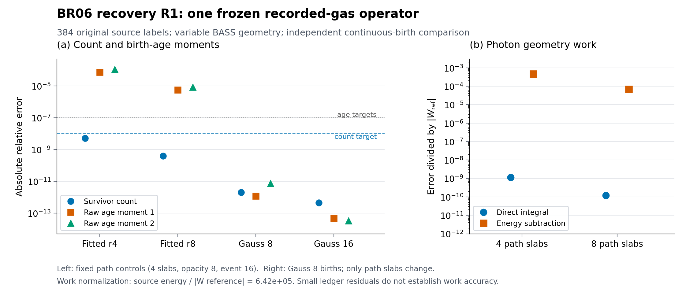

# BR06 복구 R1 — 실제 기록 기체를 고정한 양의 광자 출생 적분

**판정: BR06 복구 R1의 동결 기체 기준해 연구 단위는 검증을 마쳤다. 새 Rust 9사례, 169,616 cohort 평가와 독립 기준해 대조가 완료됐다. 진화하는 장구간 해는 승인하지 않는다.**

이 문서는 2026-10-19 약 17:12 UTC 작업 공간 정리로 사라진 BR06 산출물을 복구하는 과정에서 작성했다. 삭제 전 대화에 남은 PASS, 해시, 실행 수를 새 결과로 계승하지 않는다. 독립 Python 코드는 `BR06_THEORY_RECOVERY_R1`로 재구성했으며, 아래 수치는 복원된 BR05 원본 입력으로 실제 다시 계산했다. 삭제 전 문서의 바이트 복원이나 새 비선형 H/He/D 이력 실행을 주장하지 않는다. 전체 복구·게시 판정은 상위 `VERIFICATION`과 `DAG`가 소유한다.

## 1. 이번 계산의 물리적 범위

BR05의 실제 `monitor_n16_r8/MONITOR_STEPS.csv` 첫 단계, $t\in[0,5\times10^{11}]\,\mathrm{s}$의 corrector 기체를 사용한다. 종별 **comoving inventory**를 고정한다.

$$n_s(t)=n_s(t_{\rm mid,recorded})\frac{V(t_{\rm mid,recorded})}{V_{\rm case}(t)}.$$

기준 부피는 $1.07989285138556943\times10^{-4}$이며, ± 전단 사례에도 같은 기록 기체와 기준 부피를 사용한다. 원 MD14/BB50k 광원, 48개 에너지와 8개 방향의 384개 원 label, 원 Verner HI/HeI/HeII와 H-equality DI 단면적을 유지한다. 광원은 실제 출생시각의 기하에서 평가한다. 이 계산은 기체를 진화시키지 않으며 CX half-flow, CI/RR/CX/CE/free-free/CMB 열화학이나 S10 four-corner 제어기를 대체하지 않는다.

독립 구현은 원 BASS donor의 log-H 및 b Hermite 다항식을 읽고, $q=t/\Delta t$에 대해 $dx/dq=\Delta t H(x)$를 SciPy DOP853로 적분한다. 실제 기록의 19,664개 출생에서 축척의 최대 상대 차이는 $4.44\times10^{-16}$, 방향 팽창률은 $1.44\times10^{-14}$, 광원 비율은 $1.22\times10^{-15}$였다. 48개 opacity rule과 재구성 단면적의 최대 상대 차이는 $4.44\times10^{-16}$였다. 이것은 입력 및 원 owner와의 유한 정밀도 대조 결과다. [기하 대조](../evidence/theory_r1/independent_minus_r1/GEOMETRY_INDEPENDENT.json)

## 2. 양의 출생·경쟁 흡수 측도와 에너지 소유권

각 실제 출생 $\beta$에 대해 $K_i=a_i(\beta)E_b n_{b,i}$를 보존하고,

$$E(t)=\sqrt{\sum_i[K_i/a_i(t)]^2},\qquad E'=-E\sum_i H_i n_i^2$$

를 따른다. $\kappa_s=c n_s\sigma_s$, $D(t)=\int_\beta^t\sum_s\kappa_s(v)\,dv$, $P=e^{-D}$로 두면

$$A_s=\int P\kappa_s\,dt,\quad Q_s=\int P\kappa_s(E-\chi_s)\,dt\;\mathrm{eV_J},\quad B_s=\chi_s A_s\;\mathrm{eV_J},\quad W=\int PE'\,dt\;\mathrm{eV_J}.$$

양의 출생 weight와 비음수 opacity는 종별 사건·열·결합에너지의 비음수 측도를 준다. 연속 방정식은

$$P(t_1)+\sum_s A_s=1,\qquad E(t_1)P(t_1)\,\mathrm{eV_J}+\sum_s(Q_s+B_s)=E_b\,\mathrm{eV_J}+W$$

를 만족한다. $W$는 광자의 geometry work다. 원 monitor의 gas+photon 총 geometry work를 이 양의 기준해로 사용하지 않는다. H 결합에너지 $13.598434599702$ eV, Verner H gate $13.60$ eV, 제조된 D gate $13.602134599702$ eV도 서로 구분한다.

상수 광원·opacity의 생존 광자수는 $j\Delta t\Phi(\tau)$이며 $\Phi(\tau)=-\mathrm{expm1}(-\tau)/\tau$, $\Phi(0)=1$이다. 이것을 맞추는 것만으로 이후 광자의 age·에너지·방향 분포가 정해지지 않는다. fitted 노드 $x_i(\tau)$와 가중치 $w_i(\tau)$를 미분하면

$$-\Phi'=\sum_i w_i x_i e^{-\tau x_i}+\sum_i[\tau w_i x_i'-w_i']e^{-\tau x_i}.$$

따라서 표현된 age moment는 두 번째 항이 없다고 가정할 수 없다. 이 이유로 survivor count, raw age 1·2차 moment, 평균 age, 에너지, 에너지로 가중한 각도 $P_2$를 별도로 대조한다.

## 3. 새로 실행한 연속 출생 기준해

독립 경로는 실제 시간에 대한 양의 Gaussian event 적분과 별도 opacity 적분을 사용한다. birth/event/opacity 차수 $(64,64,8)$과 $(128,128,16)$을 비교했다. 일반 원 384-label grid에는 이 단계에서 흡수 gate crossing이 없으므로 전역 birth 적분을 적용했다. 이 유한 범위의 경험적 수렴 결과를 임의의 광학두께에서 성립하는 AP 증명이나 whole-operator 구간 인증으로 확대하지 않는다.

| 항목 | SIGNED_MINUS, $(128,128,16)$ |
|---|---:|
| 생존수, reference-comoving $\mathrm{m}^{-3}$ | $1.0013572745743383\times10^{-8}$ |
| 평균 출생 age, s | $1.5108925518352440\times10^{10}$ |
| 생존 광자 에너지, J per reference-comoving $\mathrm{m}^3$ | $3.6102804767532946\times10^{-26}$ |
| thermal heat, J per reference-comoving $\mathrm{m}^3$ | $3.2947222095085296\times10^{-25}$ |
| chemical binding, J per reference-comoving $\mathrm{m}^3$ | $9.597539605582823\times10^{-25}$ |
| 독립 photon geometry work, J per reference-comoving $\mathrm{m}^3$ | $-2.0639605312130255\times10^{-30}$ |
| 에너지 가중 $P_2$ | $+5.213367136302012\times10^{-8}$ |

64→128 비교에서 생존수의 상대 차이는 약 $4.07\times10^{-13}$이다. ± 사례의 $P_2$ 차수 변화는 절대 $3.71\times10^{-17}$ 이내다. 고차 결과의 number/energy ledger 상대 잔차는 각각 약 $2.67\times10^{-13}$, $2.39\times10^{-13}$이며, 저차 결과보다 작지 않다. 이 부동소수점 수준 잔차의 단조 감소를 수렴 조건으로 삼지 않았다. 두 차수의 물리량 대조가 정확도 근거이고, ledger는 별도 회계 검사다.

SIGNED_PLUS에서는 동일 정밀도의 생존수가 같고, 에너지 가중 $P_2=-5.213374225944984\times10^{-8}$이었다. 각 label의 기하·Killing 경로를 유지한 ± 대조다. [minus 실행·해시](../evidence/theory_r1/independent_minus_r1/INDEPENDENT_REFERENCE.json), [plus 실행·해시](../evidence/theory_r1/independent_plus_r1/INDEPENDENT_REFERENCE.json)

## 4. 경로 오차·광원 변화·시계 변환을 분리한 결과

원 BR05 첫 단계의 **실제 19,664개 출생시각·Killing 상수·birth weight를 고정**한 독립 경로 계산은 $N=1.0013572749697978\times10^{-8}$을 주었다. 원 native accepted sum과의 상대 차이는 $3.733788590942682\times10^{-14}$이다. 연속 출생 기준해와 비교하면 이 r8 출생 표현의 생존수 상대 차이는 $3.94923\times10^{-10}$이지만, raw age 1·2차 moment 차이는 각각 $5.76651\times10^{-6}$, $8.59054\times10^{-6}$이다. 평균 age 차이는 $5.76612$ ppm이다. 이들은 새로 계산한 원 parent 출생표의 성질이며, 아래 복구판 Rust matrix와 구별해 기록한다. 출생 표현을 고정한 이 결과로 약 80 ppm의 물리적 변화를 경로 적분 실패로 재분류할 수 없다. [matched 경로](../evidence/theory_r1/parent_r8_matched_r1/MATCHED_PATH_REFERENCE.json)

서로 다른 물리적 문제인 C0/C1/C2를 별도로 계산했다. C0는 상수 midpoint 광원·opacity, C1은 실제 시간 의존 광원과 상수 opacity, C2는 실제 광원과 가변 BASS/고정 comoving 기체이다. 표의 세 생존수 단위는 reference-comoving $\mathrm{m}^{-3}$이다.

| 비교 | 새 계산 |
|---|---:|
| C0, Decimal90 | $1.0011977025685111607\times10^{-8}$ |
| C1, 연속 birth GL128 | $1.001278417878988\times10^{-8}$ |
| C2, 독립 가변 경로 | $1.0013572745743383\times10^{-8}$ |
| C1/C0−1 | $+80.6187531891$ ppm |
| C2/C1−1 | $+78.7560122561$ ppm |
| 같은 birth weight에서 실제 시계와 목표 age 교체 효과 | $-4.30911227916\times10^{-17}$, 상대 |

C1의 GL64→GL128 상대 차이는 $4.07\times10^{-13}$이다. 마지막 행은 정확한 binary64 입력점을 Decimal90으로 올려 실제 birth time에서 age를 계산한 국소 개입이다. 기록된 rounded age 필드를 대신 사용하지 않았다. 단계 끝 부피는 기록 midpoint보다 약 $88.7657190$ ppm 크다. 기하·밀도·적색편이의 물리적 효과와 birth/path discretization을 구분해야 한다. [재현 가능한 C0/C1/C2와 시계 비교](../evidence/theory_r1/source_comparators_r1/SOURCE_COMPARATORS_RECOVERY_R1.json)

같은 **BR06 midpoint fixture**에서 고정 birth GL2/4/8/16의 상수-opacity 생존수 편향은 각각 −95.7067432%, −50.0461660%, −3.18656329%, −5.86089028 ppm이다. 이것은 BR02의 다른 frozen table을 다시 계산한 것이 아니다. 실제 현재 광학두께 범위 $2.66276\le\tau\le92.76932$에서도 종료점 생존층을 놓치는 문제가 재현된다는 대조다.

## 5. VigilODE 적용의 독립 수학 검토

원 VigilODE kernel을 작은 인수에 사용하고 전체 age 구간을 양의 dyadic 합성으로 복구하는 adapter를 검토했다.

$$J_{jk}(z)=\int_0^1e^{-zx}x^j(1-x)^kdx,$$

$$J_{jk}(2z)=2^{-j-k-1}\left[\sum_{\ell=0}^{k}\binom{k}{\ell}J_{j\ell}(z)+e^{-z}\sum_{r=0}^{j}\binom{j}{r}J_{rk}(z)\right].$$

$x=y/2$와 $x=(1+y)/2$로 나누면 이 식이 직접 도출된다. 계수는 모두 비음수이고 큰 age 구간을 버리지 않는다. chronological birth fraction $u=1-x$에서 선형 광원은 $\Delta t[j_LJ_{10}+j_RJ_{01}]$이다. adapter는 그 mapping을 사용하며 폭의 상계를 위로, 허용 폭을 아래로 rounding하여 admission을 보수적으로 검사한다. interval과 $[0,\infty)$의 교집합은 원 적분의 비음수 성질을 사용한다.

복구 R1 adapter `b333bbaa…`의 **새 출력 252행**을 정확한 binary64 입력점에서 Decimal110으로 검산했다. dyadic 126/126과 성공한 direct 117/117이 독립 값을 포함했다. dyadic 최대 상대 구간 폭은 $1.65377316437947\times10^{-14}$였다. direct $\tau=10^{12}$의 9개 `NonFinite`는 보존한 typed refusal이며 통과 수에 포함하지 않는다. 또한 포함된 direct 구간도 매우 넓을 수 있다. 구간 포함과 허용 정확도 충족은 다른 조건이다. [독립 Decimal 검산과 code-boundary 검토](../evidence/theory_r1/vigilode_scalar_r1/VIGILODE_DECIMAL_RECOVERY_R1.json)

원 native 48개 에너지에 실제 적용한 복구 R1 출력도 별도로 검산했다. 각 label의 $J_{00},J_{10},J_{20}$, 상수 광원 생존수·raw age 1·2차 moment, 선형 광원 생존수의 **336/336** interval이 Decimal110 값을 포함했고, 실제 원본 source·opacity·시계 입력 결합도 통과했다. 최대 상대 폭은 $1.37024582538387\times10^{-14}$였다. 원 광원 GL16과 독립 GL128의 생존수 차이는 상대 $-4.53377\times10^{-13}$이었다. 선형 endpoint 광원과 실제 MD14 시간 의존성의 차이는 상대 $+1.97912\times10^{-10}$으로, interval 폭 밖의 별도 광원 근사오차다. [native scalar 적용과 독립 대조](../evidence/theory_r1/native_moments_r1/NATIVE_MOMENTS_DECIMAL_RECOVERY_R1.json)

이 결과는 상수-opacity scalar moment 검증이다. 가변 BASS/원자 opacity 전체 연산자의 interval enclosure를 주장하지 않는다. 복구판 Rust의 아래9사례는 동일한 최종 source manifest에 묶어 별도로 검증했다. Rust의 양의 Gaussian 출생·경로 적분에는 `gauss-quad = 0.3.2`를 실제 연결했으며, weight 합과 양수성·노드 범위를 검사하는 복구 R1 wrapper를 사용한다. VigilODE의 scalar interval 합성과 유한 Gauss의 가변 물리 기준해는 역할과 admission 범위가 다르다.

## 6. 극한·문턱·실패 분류

새 Decimal400 계산은 opacity 기준값 $0,10^{-320},10^{-300},10^{-100},10^{-20},10^{-8},1$의 네 경쟁 종과 지수적 photon redshift에 대한 7개 닫힌 해를 실제 계산했다. number/energy identity와 비음수 사건을 검산했다. 새 Python 7개 검사는 상수-opacity 경쟁 흡수, transparent geometry work, dyadic identity, 원본 입력 결합, H/D gate 구분, 잘못된 기하·K 입력 거부를 포함한다. 새로 선언한 R1 Rust thin-hazard22사례도 Decimal400과 대조해22/22통과했다.20개 thin-route의 HI absorption은 올바르게 반올림됐고, normal-route $\tau=10^{-7}$ 두 경우는 최대2ULP차이였다. 직접 geometry work의 최대 상대오차는 $3.91659\times10^{-16}$이다. 정확한 binary64 $h=.05$와 $E_0=100$ eV, $T=1$의 닫힌형 통제 결과다. 원 probe의 삭제된 바이트를 복원한 격자라는 주장은 하지 않는다. [새 thin probe 독립 검산](../evidence/theory_r1/thin_probe_r1/THIN_PROBE_DECIMAL_RECOVERY_R1.json) [Decimal400](../evidence/theory_r1/scalar_fresh_r1/SCALAR_ORACLES_RECOVERY_R1.json), [Python 로그](../evidence/theory_r1/PYTHON_TESTS_RECOVERY_R1.log)

실제 BASS ± rays에서 4개 흡수 gate × 3개 방향 × 2개 부호의 24개 제조된 redshift-exit witness를 별도로 계산했다. event 차수 32→64에서 종별 사건의 최대 절대 변화는 $3.33\times10^{-15}$, number/energy 잔차는 $5.89\times10^{-14}$ 이하였다. 원 384-label grid의 threshold dominance나 BASS blueshift 진입을 주장하지 않는다. 원 admitted donor는 모든 방향의 팽창이 양수인 영역이다. [gate witness](../evidence/theory_r1/edge_r1/EDGE_REFERENCE.json)

삭제 전 near-zero opacity 산술 결함의 원 실행 파일·출력은 historical record로만 남았다. 복구판의 새22사례는 최소 양의 subnormal을 포함하여 같은 결함 메커니즘을 실제 다시 검사했다. 복구 중 발견한 중복 source-label admission 결함은 추가 guard와 실제 malformed CSV 테스트로 수정했고, 유효 입력의 수치 parity를 별도로 확인했다. `Cx(WorkLimit)`는 계산 예산 종료로 보존하며 해 부재나 물리 수렴 실패로 바꾸지 않는다. 이 frozen operator는 새 CX 이력을 실행하지 않았다.

## 7. 복구판 Rust의 정량 결과와 한계

실제9사례,169,616 cohort 평가를 완료했다. 원 분광의8사례는 독립384-label 연속 birth 기준해와 비교했고,1176-label split사례는 같은 underlying source owner의 원 분광 control에 대한 표현 변화로만 비교했다. 모든 실행의 source manifest·binary·출력 hash를 묶었다. 최종 source manifest SHA-256은 `f70901363e1901e71b6d2933dfa6080c9de9af8daa4e35178be77d1fcfab9402`, binary SHA-256은 `495cefac0f5bb5412f44d9ae15880856ff27cd3e92d7b594132cf8fb7b84e853`이다. path core와 `tests/reference_tests.rs`는 이전V2의 정확한 바이트이고, fixture·quadrature·CLI·scalar adapter/export·manifest는 명시적으로 재구성한R1이다. 새전체 BR0616tests, strict Clippy, scoped rustfmt와 별도 fresh-restore gate는 실제 실행 기록에 따른다. [최종 실행 결합](../evidence/theory_r1/FINAL_UPSTREAM_VERIFICATION_BINDINGS.json)

현재 bounded 진단 목표는 생존수 상대 $10^{-8}$, raw age1·2 상대 $10^{-7}$, 주요 에너지 상대 $10^{-8}$, 에너지 가중 $P_2$ 절대 $10^{-11}$이다. 사용자 전체 우주론 해의 허용오차를 새로 정의한 수치가 아니다. 아래 표는 path slabs4, opacity degree8, event degree16을 고정했다.

| 출생 규칙 | 생존수 상대오차 | raw age1 상대오차 | raw age2 상대오차 | 선언 목표 |
|---|---:|---:|---:|---|
| Fitted r4 | +5.05724764e-09 | +7.36449995e-05 | +1.08800239e-04 | age 미충족 |
| Fitted r8 | +3.94932071e-10 | +5.76651457e-06 | +8.59054271e-06 | age 미충족 |
| Gauss8 | -2.02615855e-12 | +1.16621673e-12 | -7.43525546e-12 | 충족 |
| Gauss16 | -4.54828318e-13 | +4.60249836e-14 | +3.33756473e-14 | 충족 |

fitted count의 정확도만으로 birth-age 분포를 승인할 수 없다. 반면 이 유한 opacity·기체 구간의 Gauss8/16은 선언한 count·rawage·주요에너지·각도 목표를 함께 충족했다. Gauss16의 $10^{-13}$ 부근 일치는 독립 기준해의 부동소수점·차수변경 규모에서 해석해야 한다. 다른 규칙을 단순 나열한 이 비교로 보편적 수렴차수를 계산하지 않는다.

최종R1 fittedr4 출생표10,560행을 그대로 고정한 독립 matched-path 계산에서 생존수 경로 상대차이는 -9.582289e-15, rawage1은 +9.392162e-16였다. 같은 행의 heat 경로 차이는 +2.845673e-09다. 출생 표현과 event/path 오차를 분리한 직접 대조이다. [최종r4 matched-path](../evidence/theory_r1/rust_r4_matched_final_r1/MATCHED_PATH_REFERENCE.json)

opacity degree4→8만 바꾼 r4사례에서 생존수와 heat는 기록된 정밀도에서 같았다. event degree8→16은 r4 heat 상대오차를 $1.55020\times10^{-8}$에서 $2.70383\times10^{-9}$로 줄였다. Gauss8 출생을 고정하고 path slabs4→8로 바꾸면 heat 상대오차는 +2.847982e-09에서 +4.261041e-10로, binding은 +2.624910e-11에서 +5.697174e-13로 줄었다.

| Gauss8 경로 | 직접 적분 $W$ 상대오차 | energy subtraction $W$ 상대오차 | 후자의 오차/source energy |
|---|---:|---:|---:|
| 4 slabs | +1.16328667e-09 | -4.66956146e-04 | +7.27198729e-10 |
| 8 slabs | +1.22630218e-10 | -6.84061266e-05 | +1.06530022e-10 |

source energy가 $|W_{\rm ref}|$보다 약 $6.4213\times10^5$배 크다. 따라서8slabs에서 source-energy-normalized 차이가 약 $10^{-10}$이어도 ledger $W$의 자체 상대오차 약 $6.84\times10^{-5}$를 숨길 수 없다. 정확도와 보존은 별도 판정이며 이 한계는 남는다.

split분광은 총 방출수 상대변화 +1.375521e-14에서 생존수 +0.029014058%, DI사건수 -0.031946996%의 변화를 보였다. 이것은 절대오차 추정이나 분광 수렴 증명이 아니다. 원384-label grid의 crossing은0이지만, split1176-label grid에는 실제144개 threshold crossing이 기록됐다. 원 grid의 관찰을 split grid에 확대하지 않는다. [경로 flags·root 진단](../evidence/theory_r1/PHYSICAL_DIAGNOSTICS_FINAL_R1.json)



왼쪽 그림은 count·rawage moment와 각각의 목표를, 오른쪽은 동일 Gauss8 birth에서 path slab만 바꾼 직접 $W$와 차감 $W$의 자체 상대오차를 보여 준다. source-energy-normalized 잔차는 위 표에 별도로 적었다. [벡터 SVG](../figures/BR06_BIRTH_AGE_AND_WORK_R1.svg), [그림 데이터·해시](../figures/FIGURE_RECEIPT_R1.json), [전체 수치 비교](../evidence/theory_r1/rust_comparison_r1_final/RUST_INDEPENDENT_COMPARISONS.json)

이 단위는 원 H/He/D 입력을 사용하는 동결 기체의 복사 연산자 기준해를 완성했다. 새 비선형 H/He/D 이력, full-EoR 초기조건, 보편적2차 정확도, 완전한 birth/time/spectral/angular 수렴, 양방향 Einstein feedback은 입증하지 않았다. LONGSPAN_SOLUTION의 미승인 상태도 유지한다. 다음 연구에서는 실제 진화 기체와 결합하기 전에, birth-age moment오차를 제어하는 출생 표현과 work의 수치 소유권을 별도로 다뤄야 한다.

## 8. 재현과 문헌 근거


별도 fresh restore는 빈 Cargo home·새 target에서 parent233tests와 BR0616tests, 양쪽 strict Clippy를 실제 통과했다. 원 source와 donor, 정확한 step1 CSV 부분집합으로 독립64/128 계산을 다시 실행했고 모든 result field가 기존R1계산과 binary64로 같았다. 복원한8-template Rust 출력의 BIRTHS/TEMPLATES_RESULT/PATH_FLAGS는 전체 matrix의 정확한 prefix였다. 이는 전체9사례를 fresh restore에서 다시 실행했다는 뜻이 아니다. 부분집합CSV는 원전체 BR05 CSV와 파일 hash가 다르며, 같은 step1행을 쓴다는 계약과 결과 재생을 별도로 확인했다. [fresh restore와 원본 입력의 결합](../evidence/theory_r1/FINAL_UPSTREAM_VERIFICATION_BINDINGS.json)

Python 3.12.14, NumPy 2.3.5, SciPy 1.17.0의 실제 환경·source hash·입력 hash·실행 시간은 각 JSON에 들어 있다. 전달된 연구 단위의 루트에서 아래명령을 사용할 수 있다. `verify`가 준비하는 `reference_parent`는 정확한 첫단계 부분집합이다. 출력 workspace는 기존 evidence를 덮어쓰지 않는 새 절대경로로 지정한다. 아래경로는 사용자가 선택할 새 경로를 나타낸다; 이번 검증을 사용자 계산으로 위탁한 것이 아니다.

```bash
bash RUN_STAGE.sh verify /absolute/new/br06_verify
bash RUN_STAGE.sh matrix /absolute/new/br06_matrix
python3 scripts/independent_birth_reference.py --parent /absolute/new/br06_verify/reference_parent --orders 64:64:8,128:128:16 --output /absolute/new/independent_minus
python3 scripts/independent_birth_reference.py --parent /absolute/new/br06_verify/reference_parent --case SIGNED_PLUS --orders 64:64:8,128:128:16 --output /absolute/new/independent_plus
python3 scripts/matched_paths_r1.py --parent /absolute/new/br06_verify/reference_parent --output /absolute/new/parent_matched
python3 scripts/decimal_oracles_r1.py --output /absolute/new/scalar_controls
BR06_PARENT=/absolute/new/br06_verify/reference_parent python3 scripts/test_independent_reference.py
```

Fleury, Pitrou & Uzan, *Light propagation in a homogeneous and anisotropic universe*, PRD 91, 043511 (2015), [arXiv:1410.8473](https://arxiv.org/abs/1410.8473)는 Bianchi-I 광학의 원전이다. Mackey, *Accuracy and Efficiency of Raytracing Photoionisation Algorithms*, A&A 539, A147 (2012), [arXiv:1201.5651](https://arxiv.org/abs/1201.5651)는 raytracing photoionisation 정확도 비교의 원전이다. 원 논문의 결과와 이번 코드의 직접 검증을 구분한다. 이번 복구에서 사용한 Wolfram 출력에는 `Power::infy` 경고가 남아 있어 깨끗한 무경고 PASS로 표시하지 않는다. dyadic identity 및 안정한 scalar 식은 위 독립 Decimal 계산과 대조했다. [경고를 포함한 Wolfram 원 응답](../evidence/theory_r1/WOLFRAM_RECOVERY_R1.json)
