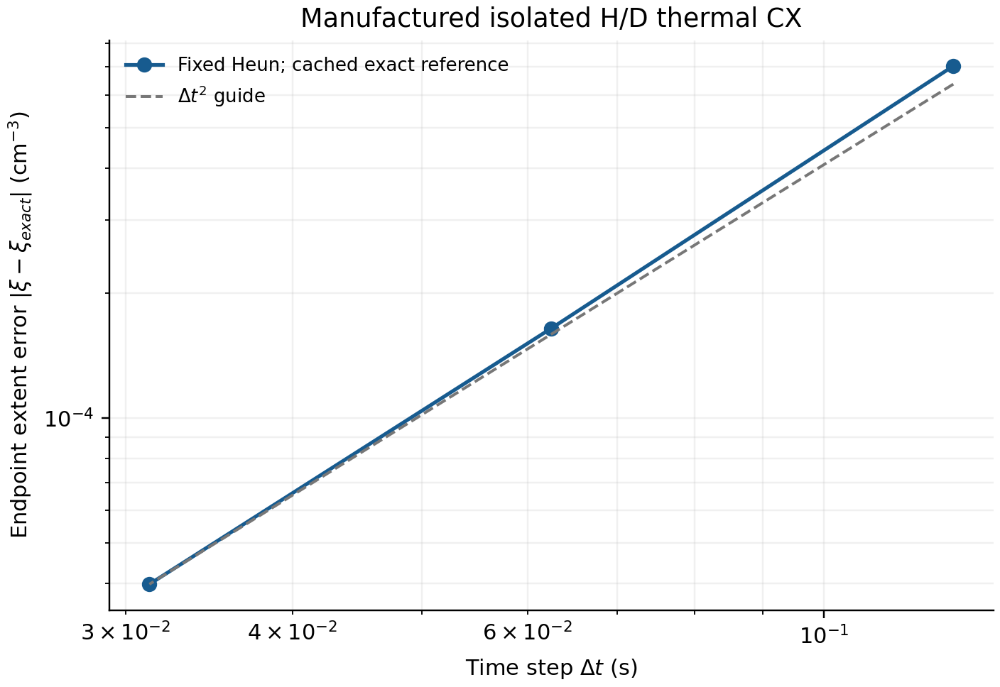

# 고정 체적 H/D 열적 전하교환 결과

고립된 H/D 전하교환에서 반응 진행량과 열에너지를 함께 갱신하는 순수 Python 구현을 완성했다. 독립 C9 검토는 `PASS_SCOPED`이며 수정 요구가 없었다. 기존 Rust의 고정 계수 exact Riccati 해는 선행 결과로 재사용했다. 새 계산은 매 RHS 평가에서 현재 열에너지로 온도를 재구성하고 Savin 반응률을 평가한다.

초기 밀도를 `(a,b,c,d)=(H0,H+,D0,D+)`, 정방향 진행량을 ξ라 하면 밀도는 `(a+ξ,b−ξ,c−ξ,d+ξ)`이다. 순수 H/D 닫힘에서 `ne=b+d`, `Nth=a+b+c+d+ne`는 일정하다. `C=3 kB Nth/2`, `u=u0−Δχξ`, `T=u/C`를 사용하므로 화학·열에너지가 같은 진행량에 연결된다. 밀도 단위는 cm⁻³, 열에너지는 eV cm⁻³, 결함은 eV, 시간은 s다. 결함은 유한한 부호 있는 독립 입력이며 반응률 지수의 온도로 대체하지 않는다.

| 실제 검증 | 관측 결과 |
|---|---|
| 제조 해 7개, 변경 경계 조건 17개 | 모두 통과 |
| 완결 제조 해 최대 정규화 endpoint 오차 | 5.943663490641052×10⁻⁷; 기준 5×10⁻⁶ |
| 고정 Heun N=16,32,64 오차 감소 비 | 4.2812567273, 4.1325576312; 기준 [3,5] |
| 실제 Savin fit의 합성 초기 상태 3개, 기본/강화 허용오차 쌍 | 밀도·도메인·보존량·진폭 검증 통과 |
| C6+C7 실제 wall / CPU | 0.06456055299349828 / 0.06455672099999998 s |
| 새 native 실행 / build / 기존 suite / 외부 reference | 모두 0 |

Savin 실험은 문헌의 실제 fit을 사용한 합성 고립 성분 초기 상태다. 조건부 primordial 비율 예제는 `T0=100 K`에서 `Tfinal=100.00001061103245 K`, 주어진 상태의 온도 진폭 상한은 `0.0006505385769741932 K`였다. 이 상한은 `|ΔT|≤|Δχ| nD/C`에서 계산하며 고정 체적·일정 입자수·외부 가열 없는 성분의 조건부 결과다. 기존 PL 이력의 Tgas 차이에 대한 원인 귀속으로 사용하지 않는다. 열적 stress 예제의 최종 온도는 `9.965446072526845 K`였다.

하한에 가까운 Savin 예제는 요청 `10^8 s` 중 `15843557.872494066 s`까지만 진행한 `DOMAIN_BOUNDARY_APPROACH`를 반환했다. 온도는 `2.7000000000047466 K`이며 전체 구간 완료가 아니다. 제조 경계 예제의 수치 접근 시각은 해석적 crossing보다 약 `10⁻⁶ s` 늦었다. 저장된 경계 거리와 부분 완료 조건은 통과했지만, 이 시각은 인증된 crossing 시각이나 그 하한이 아니다. 기본/강화 허용오차 쌍의 차이와 local step-doubling 추정도 전역 오차 인증값이 아니다.

이 그림은 이미 저장된 C7 고정 Heun 배열만 사용했다. 축은 시간 간격(s)과 진행량 endpoint 절대 오차(cm⁻³)다. 점선은 2차 기울기 안내선이다. 그림 생성에 새 solver 실행은 없었다.

독립 stdlib probe는 정확한 다항식 항등식 11개와 Decimal 제조 해 7개를 계산했다. 이 단계는 wall `0.006348454000544734 s`, CPU `0.005405469999999999 s`이며 C6+C7 시간과 구별한다. 이전 timing wrapper 실패는 Python 실행 전 exit127이고 그 wall/CPU는 측정되지 않았다. Wolfram 호출은 환경 오류로 검증되지 않았으며, 실제 실행한 독립 stdlib fallback 결과를 재사용했다. 요청된 실행자는 lower-tier coding agent이고 관측 모델 identity는 telemetry가 없어 unknown이다.

기존 native/SOURCE011 관측은 재사용했다. 추가 수신한 bounded observer `fec99a1c20215c27082e39d035289cb751380c25`는 기본 OFF, 실행 전체 6 packet/추가 RHS 48회 한도, 합성 검사 5개 통과다. 새 실제 packet은 0개다. O5는 소진된 실행 자원, O6는 실제 stage 자료 부재로 HOLD를 유지한다. PR166의 source-matched positive reference와 source-age 수렴 작업도 별도 공급자 노드다.

다음 독립 실행 단위는 Rust port 및 성분 결합 계약이다. R1–R10 계약 PASS 후에는 그 유한 자원 계약 아래 실제 local Rust port와 C1–C10 성분 검사를 이어간다. 사용자 승인된 production 변경·local 개발은 다시 확인을 요청하지 않고 진행하며, 새 native/reference campaign 예산은 별도로 유지한다. O6는 자체 실제 자료 gate를 가진 선택적 진단이며 FLRW production 이력 전체의 필수 선행 조건으로 두지 않는다. 기존 isotope atomic RHS가 이미 CX를 포함하므로, 결합 전에 CX 소유권을 정확히 한 번으로 정해야 한다. 기존 frozen CX substep을 대체하면서 같은 구간의 CX RHS를 동시에 적분하면 안 된다. 현재 단위는 production 활성화·native 예산을 변경하지 않았다. 장기 목표는 FLRW production 이후 Bianchi I로 확장하고 isotope fraction을 시간과 실제 Tgas에 대해 얻는 것이다. 재개 자료와 분리된 실행 DAG는 `HANDOFF.json`, `NEXT_DAG.json`, 자동 취득 절차는 `CODEX_HANDOFF_PROMPT.md`에 있다. 게시와 이중 백업의 실제 식별자는 publisher의 `FINAL_PUBLICATION.json`에서 확인한다.
