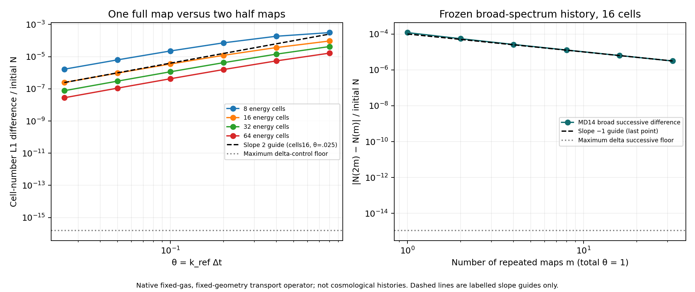

# REI-LRS V14: 실제 NCP 결과에서 확인한 스펙트럼 재구성의 시간 오차

작성일: 2026-10-19 UTC. 독립 LRS photon–chemistry–thermal 연구이며 production v3/rux DAG와 별개다.

## 1. 이번 연구 단위의 결과

인계 뒤에 V14의 실제 NCP 실행이 이미 완료되어 있었다. Google Drive와 Dropbox에서 전체 archive를 각각 회수하고 source hash, stdout, 종료코드, 실제 CSV를 대조했다. 원래의 컴파일·36개 표적시험·smoke·84개 full 이력을 재실행하지 않았다.

그 실제 결과의 GL2 온도 self-difference는 약 1차였다. 원시 사건과 열항을 분해하니 photoheat와 종별 광흡수 배분이 leading 온도 차이를 운반했다. 이어 native source를 읽고, 고정 기체·기하에서 photon spectrum을 두 모멘트로 재구성하는 map에 일반적으로 O(h²) 국소 결함이 남음을 직접 유도했다. 실제 MD14 spectrum과 Verner opacity를 사용하는 native transport 진단에서 국소 차수 약 2, 반복 적분의 관측 차수 약 1을 확인했다. 60 eV 단색광 대조군은 반올림 수준에서 합성법칙을 만족했다.

이는 현재 transport map에 존재하는 구체적인 1차 오차 기작의 증거다. 원래 coupled 우주론 이력에서 이 기작의 기여율을 분리한 실험은 아니며, full source-on 2차가 복구되었다는 결과도 아니다. 이번 native 변경은 진단용 example 추가뿐이다. 기존 네 V14 출력 파일과 rates, source, EOS, default/adaptive/checkpoint 코드는 바뀌지 않았다.

## 2. 재개 때 확인한 실제 실행과 source identity

Repository: [cosmosapjw-quantum/rei_bianchi](https://github.com/cosmosapjw-quantum/rei_bianchi), [draft PR #198](https://github.com/cosmosapjw-quantum/rei_bianchi/pull/198), branch `research/rei-lrs-v14-physical-birth-20261018`.

| 식별자 | 확인된 의미 |
|---|---|
| `7fb18cec3d6d6eebad5fe418ec83b36d82cfff1e` | V13 복원 parent |
| `f6046418d15e2f44418dfbc04ca67999f389a7df` | 기존 V14 실행 source의 frozen code anchor |
| `2676c31df1bf18ec0c7d60108846f1e9c8ca853c` | 인계 HEAD 및 NCP DAG의 source-intake 문맥 |
| `ef94f08df149b57959b868646b397a2bff2b268b` | 2026-10-18 12:45:53 UTC에 생성된 실제 실행 증거 게시 commit |
| `55d267d00e8dd9b04005af5d8551e948251c0777` | 이번 재개 때의 최신 HEAD; 기존 실행의 독립 판독 게시 |

Full run은 12:41:16 UTC에 끝났으므로, 이후 생성된 `ef94f08…`를 실행 순간의 checkout SHA라고 부를 수 없다. 기존 receipt의 `run_commit` 또는 `source_head` 명칭은 원본 보존 차원에서 유지하되 현재 JSON에 역할을 명시했다. Native byte identity는 code anchor와 복원된 네 파일의 SHA256으로 확인했다. 정확한 runtime checkout 상태가 별도로 기록되지 않은 부분은 추정하지 않았다.

| 기존 NCP 실행 | 실제 증거 |
|---|---|
| Host / 자원 | `s1a0e5abed09`, 64 CPUs, RAM 125 GiB |
| 도구 | Rust 1.99.0, Cargo 1.99.0, Python 3.12.3 |
| Build | offline, locked, release, Cargo jobs 2 |
| 표적시험 | 서로 다른 36개가 smoke와 full에서 각각 PASS; 72회 성공 실행 |
| Smoke | exit 0, 28 histories / 336 macro rows, 8 cells, max N=16 |
| Full | exit 0, 84 histories / 7,056 macro rows, 16 cells, tolerance 1e-13 |
| Full 행렬 | 7 modes × N=8,16,32,64,128,256 × Xend=1e-5,1e-4 |
| 첫 실패 | exit 1, `v12/native_owner` 형제 입력 누락; 로그 보존 후 입력 복구 |
| 호환 수정 | 기존 native source 수정 없이 성공 |

원본 full archive는 2,713,000 bytes, SHA256 `049686b0dbe28f59ca0c8c3d7365e35fb2bef7f99799976f029501948899ad22`다. Drive `1BgKZPcl0bhtNKf_ylvA3-eD57IEwlPA1`, Dropbox `id:BSpOijBcT10AAAAAAD_MvA`를 각각 전체 readback했다. Smoke 137,553 bytes의 SHA256은 `72efc6c6a8d048d1f460f3d738c899eb7ab21aa172c8aa36d9188cd5a1e58bf1`이며 양쪽 실제 파일과 일치했다. 상세 원본은 상위 `executions/REI_LRS_V14_20261018T124115Z/`에 있다.

## 3. 사건·열 회계를 통한 실제 온도 차이의 분해

모든 사건수와 에너지는 total-H nucleus 기준이다. 기존 정의를 유지한다.

\[
Y=\frac{0.2454}{4(1-0.2454)},\qquad
e=x+Y(y+2z),\qquad d=1+Y+e,
\]

\[
w=a_TTd,\qquad
a_T=\frac{3k_B}{2\,\mathrm{eV}_{\rm erg}}
=1.2925999893217765\times10^{-4}\ \mathrm{eV/K}.
\]

Coarse c와 fine f에 대해 Δq=q_c−q_f라 두면 다음은 선형화가 없는 정확한 유한차분 항등식이다.

\[
\boxed{\Delta T=\frac{\Delta w}{a_Td_c}-\frac{T_f\Delta e}{d_c}.}
\]

원시 누적 P/C/R/D 사건과 signed CMB를 이용한다. C_i와 R_i는 각각 충돌이온화와 RR 사건이며 D는 HeII DR 사건이다.

\[
w-w_0=Q_{\rm ph}-\sum_i\chi_iC_i
-Q_{\rm CE}-Q_{\rm RR}-Q_{\rm DR}-Q_{\rm FF}
+E_{\rm CMB}-W_{\rm gas}+r_w,
\]

\[
e-e_0=\sum_i(P_i+C_i-R_i)-D+r_e.
\]

이 두 회계를 위 EOS 차분에 넣어 K 단위 기여를 분리했다. CSV의 17자리 문자열을 60자리 Decimal로 읽어 분석 과정의 subtraction noise를 줄였다. `energy_residual=0`에 의존하지 않았다. Escape와 photo-binding 차분도 보존하되 이미 포함된 cooling·photoheat에 다시 더하지 않았다. 한 이력의 시작–끝 변화량을 δ_t로 따로 쓰면 기존 결합 회계

\[
\delta_t(w+B)+E_{\rm escape}+W_{\rm gas}-E_{\rm CMB}
=Q_{\rm ph}+P_{\rm binding}
\]

와 일치하는 구성이다. 여기서 δ_t는 앞의 해상도 간 Δ와 다르며, 오른쪽 사건·열항은 해당 한 이력의 누적량이다. 이 회계 항등식 자체는 시간 정확도를 증명하지 않는다.

### 실제 finest 차분

다음 p는 N=64,128,256의 signed self-difference로 계산한 유한 구간 관측값이다.

| 항목 | Xend=1e-5 | Xend=1e-4 |
|---|---:|---:|
| GL2 T 관측 p | 1.05910 | 0.94695 |
| GL2 photoheat 관측 p | 0.9895 | 0.9581 |
| GL2에서 matched source-off GL2를 뺀 T 관측 p | 0.9850 | 0.9506 |
| ΔT, N=128→256 [K] | +1.425051e-7 | +1.786888e-5 |
| Photoheat+photoelectron 기여 [K] | +1.458544e-7 | +1.792286e-5 |

Xend=1e-4의 N=128→256에서 종별 사건 차이는 다음과 같다.

| 원시 누적량의 coarse−fine 차이 | 값 |
|---|---:|
| ΔP_HI | +2.54080458167e-10 /H |
| ΔP_HeI | −2.50078163889e-10 /H |
| ΔP_HeII | −8.6147521764e-15 /H |
| ΔP_total | +3.9936795260e-12 /H |
| ΔQ_photoheat | +2.72044139897e-9 eV/H |
| ΔP_binding | −2.69414140077e-9 eV/H |
| Δ(Q_photoheat+P_binding) | +2.62999982036e-11 eV/H |

HI와 HeI 배분이 반대 방향으로 움직여 total absorption count 차이는 작다. HeI 대신 HI에 배분되는 사건은 binding 소모를 줄이고 열을 늘리는 방향이다. 이 pair에서는 binding 차이가 photoheat 차이의 99.03%를 상쇄한다. 다만 짧은 Xend=1e-5 구간에는 absorbed photon energy 차이도 남으므로 모든 오차를 순수한 종간 교환 하나로 환원하지 않는다.

GL2의 source_N과 source_U는 모든 adjacent refinement에서 상대차 약 1.6e-14 이하다. 이 두 총량의 차이가 관측된 온도 추세를 운반하지 않는다. 총량의 일치만으로 spectrum의 모든 bin 분포가 정확하다고 결론낼 수는 없다.

### Source-off 대조군이 실제로 시험한 범위

기존 source-off 계열은 초기 photon arrays가 비어 있고, 두 Xend 각각 1,512행 모두 photon number와 세 photo-event 수가 0이다. 따라서 gas-only 진화를 시험했으며, 양의 photon population이 있는 source-free absorption을 직접 시험하지 않았다.

짧은 구간의 source-off 차이를 전부 T의 ulp floor로 부르는 것도 부정확하다. Source-off GL2의 N=128→256 endpoint ΔX=3.3306352e-15에 마지막 native step의 secant dT/dX≈−1.120854e6 K를 곱하면 약 −3.7332e-9 K다. 실제 ΔT=−4.3492e-9 K의 상당 부분과 같은 크기다. Xend=1e-4 finer pairs에는 independently reconstructed gas/electron ledger residual의 온도 기여가 +1.0286e-7 K와 −6.2301e-8 K로 나타난다. 이는 정확한 endpoint resampling이 아니라 원자료에 근거한 오염 규모의 진단이다.

`common_combined`의 finest differences는 두 구간에서 부호가 바뀐다. 절댓값 비율 하나를 안정된 수렴 차수로 승격하지 않았다. 전체 채널 표와 모든 grid 원자료 차분은 [native channel 분석](native_channel_analysis/NATIVE_CHANNEL_ANALYSIS_KO.md) 및 해당 분석 JSON에 있다.

## 4. Native source에서 읽은 재구성 map

기존 `axbi_driver.rs::chemical_stage`는 old photon moments로 `PreparedAbsorption`을 한 번 만든 뒤 Newton solve에 사용한다. Residual 평가에서 기체 opacity는 midpoint 상태에 따라 달라져도, 준비된 spectral reconstruction은 그 solve 안에서 old moments에 고정된다. Native transport는 해당 node들을 지수 감쇠시키며, 흡수 사건·binding·heat를 같은 node들에서 적분해 새 photon N/U를 반환한다. 다음 tentative segment에서 그 두 모멘트로 spectrum을 다시 만든다.

여기서 문제로 특정한 연산은 fixed-reference cell의 spectrum reconstruction/projection이다. 조사한 geometry update가 저장된 photon cell을 다른 grid로 remap한다고 주장하지 않는다. V14 GL2의 실제 두 birth와 세 source-free segment는 기존 native transport 연산을 반복해서 호출한다.

### 고정 기체·기하에서의 직접 전개

한 cell과 ray에 대해 M=(N,U_q), 선형 moment 연산자 A, reconstruction R를 두고 AR(M)=M이라 하자. q는 reference photon energy다. 흡수자 밀도와 ray scale을 고정하면

\[
Lf(q)=-\kappa(q)f(q),\qquad
\kappa(q)=c\sum_j n_j\sigma_j(E(q))\quad[\mathrm{s}^{-1}].
\]

Native 연산의 이상화된 smooth-branch map과 그 h→0 closed-moment ODE는

\[
\Phi_h(M)=Ae^{hL}R(M),\qquad
\dot M=F(M)=ALR(M).
\]

G(M)=AL²R(M)라고 쓰면

\[
\Phi_h=M+hF+\tfrac12h^2G+O(h^3),
\]

\[
\Phi_{h/2}(\Phi_{h/2}(M))
=M+hF+\tfrac14h^2(G+F'F)+O(h^3).
\]

따라서

\[
\boxed{
\Phi_h-\Phi_{h/2}\circ\Phi_{h/2}
=\frac{h^2}{4}AL\{I-R'(M)A\}LR(M)+O(h^3).
}
\]

반면 closed-moment ODE의 exact step은 M+hF+h²F'F/2+O(h³)다. 즉 한 번의 지수 감쇠가 frozen microscopic spectrum에는 정확해도, 매 단계 재구성하는 closed-moment ODE에 대해 필요한 2차 tangent term을 일반적으로 갖추지 못한다. 같은 결함이 매 step 누적되면 고정 시간의 leading 오차는 일반적으로 O(h)가 된다. 2차 이상 source quadrature만으로 이 결함이 사라지지는 않는다.

이는 smooth reconstruction과 고정 support·흡수자·기하를 가정한 국소 전개다. 기체 feedback, source injection, 움직이는 geometry, reconstruction branch 전환을 포함하는 전체 V14 차수 증명은 아니다.

### Exponential family의 광자수 결함과 부호

고정된 quadrature node/weight 또는 고정 연속 support에서 R=Np_β(q), μ=⟨q⟩, V=Var(q)>0라 하자. 지수족의 미분은

\[
R'\delta M=R\left[
\frac{\delta N}{N}
+\frac{(q-\mu)(\delta U_q-\mu\delta N)}{NV}
\right].
\]

\[
\kappa_\perp=
\kappa-\langle\kappa\rangle
-\frac{\operatorname{Cov}(q,\kappa)}{V}(q-\mu)
\]

를 정의하면 ⟨κ_perp⟩=⟨qκ_perp⟩=0이고

\[
\boxed{[AL(I-R'A)LR]_N=N\langle\kappa_\perp^2\rangle\ge0.}
\]

따라서 full-minus-halves 생존 광자수는 양의 h² leading term을 갖는다. CSV는 **result−base=halves−full** convention이므로 broad spectrum의 signed 차이는 반대 부호다. 단색광은 이 V>0 식의 적용 대상은 아니지만, 직접 지수 감쇠의 합성법칙으로 정확한 semigroup 대조가 된다. κ가 q의 affine 함수라서 지수족이 불변인 경우에도 이상적인 map의 결함은 사라진다.

실제 native quadrature에서는 선택한 branch의 smoothness와 finite quadrature 오차를 구별해야 한다. 이번 결과는 일정한 총 node count와 zero tail bound를 기록했으나 cell별 node fingerprint를 수집하지 않았다. 따라서 위 covariance 계수의 정량적 수치 일치까지 검증했다고 주장하지 않는다. 검증한 것은 비영 결함, 예측된 부호, local asymptotic scaling, 단색광 대조, 반복 적분의 약 1차 self-difference다.

### 문헌과의 관계

이 일반 projection 전개를 새로운 일반 정리라고 주장하지 않는다. Gorban, Karlin, Öttinger, Tatarinova, *Ehrenfest’s argument extended to a formalism of nonequilibrium thermodynamics*, Physical Review E 63, 066124 (2001), [DOI](https://doi.org/10.1103/PhysRevE.63.066124), [읽은 원문](https://icm.krasn.ru/ftp/articles/2001/2088gorban_PREEhr101.pdf)의 Eq. (8)은 microscopic trajectory projection과 closed macroscopic vector field의 2차 전개 차이를 준다. 표기 대응 시 그 첫 보정항은 위 B=AL(I−R'A)LR의 B/2다. 이번 연구의 기여는 이 알려진 구조를 실제 V14 native 코드 경로와 보존된 우주론 결과에 연결하고 native 진단으로 분리한 것이다. 해당 논문의 entropy 보존 가정이나 H theorem을 이 흡수계에 자동 적용하지 않았다.

## 5. 새로 실제 실행한 native 진단

`native_files/examples/v14_projection_diagnostic.rs`는 기존 public native API를 직접 사용한다. 기존 76개 제조 문제나 Python 57개를 다시 실행하지 않았다.

| 항목 | 설정 |
|---|---|
| 기하 | a=1/21 고정, 기존 fixed-reference cells |
| 기체 | (.075,.12,.03) 고정; 기존 native density와 Verner opacity |
| Source | native MD14를 dt_emit=1e10 s 동안 최초 1회 적분해 초기화 |
| 16-cell 초기 broad N / U | 4.29803611476419631e-8 /H; 8.71495392920919474e-7 eV/H |
| 단색 대조 | 60 eV, broad와 같은 전체 초기 photon number |
| 물리 시간 | κ_ref(20 eV)=1.07788121977394781e-10 s^-1, θ=κ_ref h; 실제 c 유지 |
| Pair 행렬 | cells=8,16,32,64; θ=.8,.4,.2,.1,.05,.025; 두 spectrum |
| 고정 매질 적분 | cells=16, total θ=1, m=1,2,4,8,16,32,64; 두 spectrum |
| 기록 | 48 pair rows + 14 frozen-history rows = 62 summary rows; 13,312 cell rows |

각 pair는 한 번의 h map과 중간에 spectrum을 재구성하는 두 h/2 map을 비교한다. 고정 매질 history는 같은 전체 시간에 m번 재구성한다. 이는 **고정 기체·기하의 native transport suboperator 실험**이며 새로운 coupled cosmological histories가 아니다.

### 실제 실행 및 독립 검토

Sandbox Rust 1.94.1에서 offline locked release build가 exit 0으로 끝났다. 첫 build의 Cargo 표시 시간은 10.09 s, 첫 native diagnostic의 실제 측정 시간은 0.094112117 s, exit 0이다. Source SHA256은 `868a4f8e28acebce0f1d78ff62f0adaf6a5d411c6896ea0b528afb8a16a0085f`다.

별도의 fresh sibling input에서 제공한 runner의 default restore 경로를 한 번 실제 검증했다. Restore/build/run/analyzer가 모두 exit 0이었다. 이 전달 경로 확인의 build는 9.2567 s, diagnostic은 0.10143 s였다. 두 CSV는 최초 결과와 byte-for-byte 같았다. 이 재현 실행은 같은 62행의 반복 확인이며 새로운 연구 사례로 더 세지 않는다.

구현은 하위 coding agent가 수행했고, 별도의 agent가 유도·native source 대응·실제 CSV와 로그를 읽어 `PASS_SCOPED`로 검토했다. 다른 agent는 기존 NCP CSV의 EOS/채널 분해를 수행했다. 독립 모델 계열 간 consensus라고 부르지 않는다. [독립 검토](INDEPENDENT_PROJECTION_REVIEW.md)에 미확인 범위를 남겼다.

### 관측 결과

| 고정 매질 native 관측량 | Finest observed slope |
|---|---:|
| 16-cell pair N의 cell-L1 국소 결함 | 1.9425978724 |
| 16-cell pair U_q의 cell-L1 국소 결함 | 1.9551579999 |
| 반복 적분 N의 signed self-difference | 1.0092408929 |
| 반복 적분 U의 signed self-difference | 1.0073594067 |
| 반복 적분 HeI 사건의 self-difference | 0.9931821766 |
| 반복 적분 heat의 self-difference | 0.9798425730 |

고정 total θ에서 m=1은 최초 spectrum을 한 번 감쇠한 기준일 뿐, closed-moment ODE의 exact solution이 아니다. 반복 적분의 차수는 m,2m,4m의 successive differences로 판정했다. Coarse HI 차분의 sign change는 그대로 기록했다.

Delta pair의 최대 상대 N/U cell-L1 차이는 각각 1.5396438568e-16, 1.6422867806e-16이었다. 두 관측량을 합친 bound로 1.65e-16을 쓸 수 있다. Analyzer는 해당 endpoint들의 최대 binary64 ulp의 64배 이하에서 slope를 null로 기록한다. 모든 delta pair/history slope가 이 기준 아래다.

전체 진단의 native N 회계 최대 절대잔차는 7.4446255130e-23 /H, U 회계는 4.7380905487e-21 eV/H였다. 모든 값이 finite이며 native photon realizability 검사를 통과했다. 빈 cell의 N=0 및 delta support slack=0은 허용 경계다. 작은 보존 잔차와 약 1차 전역 self-difference가 동시에 나타난다.

왼쪽은 full 대 two-halves의 cell photon-number L1 차이이며, 오른쪽은 fixed total time에서 반복 map 수를 늘린 successive photon-number 차이다. 점선은 각각 slope 2와 slope −1 비교선이고 exact solution이 아니다.

원시 summary CSV SHA256은 `ca4b20024bd2f8adfac5995ffeebfecd0c56f47d7cbe89d38f874a909402dc3e`, cell CSV는 `3e9af61a432d40e743901c5000611a00788b3766b90840df4806a56466737b6b`다. [실행 기록](EXECUTION_NOTES.md), [분석 결과](evidence/PROJECTION_ANALYSIS.json), [재현 runner](RUN_PROJECTION_DIAGNOSTIC.sh)를 함께 제공한다.

## 6. 실제 수정한 결함과 현재 DAG

1. 두 기존 summary JSON에서 `global_maxima.max_species_event_residual_H=0`이 실제 interval maxima를 반영하지 않았다. 원시 독립 분석의 1.1295470225255793e-14와 4.84017834763862e-14 중 최댓값으로 정정했다. 이전 값과 correction provenance를 보존했고 기존 다른 값은 바꾸지 않았다. Native solver의 사건 보존 결함을 수정한 것은 아니다.
2. 재현 analyzer가 실행 환경과 무관하게 NCP NOT_RUN을 적던 새 metadata 결함을 없앴다. 환경은 실제 execution receipt에서만 판정한다.
3. `RESEARCH_DELIVERY_KO.md`, `CODEX_NCP_EXECUTE_KO.md`, `NEXT_CHAT_HANDOFF_KO.md`의 현재 상태 안내를 완료된 실제 NCP 증거와 이번 native 진단에 맞췄다. 과거 NOT_RUN 기록은 날짜가 있는 역사로 남긴다.

| 연구 항목 | 이번 완료 상태 |
|---|---|
| 기존 NCP compile / 표적시험 / smoke / 84 histories | 기존 실제 완료를 재개 시 원본 확인; 재실행하지 않음 |
| 기존 57 Python / 76 제조 문제 | 과거 결과 재사용; 새 실행수에 포함하지 않음 |
| Native T 오차 채널 분해 | 실제 CSV에서 완료 |
| 고정 매질 projection 결함 유도 | 조건부 유도 완료; 독립 검토 PASS_SCOPED |
| 새 native 진단 | 62행 고유 행렬 실제 실행 완료; 전달 경로 재현 1회 동일 bytes |
| Full coupled 오차의 인과적 기여율 | 미분리 |
| Full source-on 2차 / uniform stiff / Case B / full EoR / signed Bianchi | HOLD |

코드·결과 게시와 provider backup receipt는 상위 `stages/PROJECTION_DIAGNOSTIC_20261019.json` 및 후속 dual-backup receipt에서 실제 ACK 이후 확정한다. Archive 안의 source commit과 그 archive의 backup receipt commit은 서로 다른 역할로 기록한다.

## 7. 다음 유한한 연구와 NCP 인계

다음 알고리즘 연구의 구체적 대상은 birth quadrature의 차수를 더 높이는 일이 아니라, `F(M)=ALR(M)`와 반응·열 사건을 일관된 stage에서 시간 적분하는 source-free photon–gas update다. 지금까지 gas midpoint opacity만으로는 old-moment spectrum의 missing tangent term을 제거하지 못한다.

다음 수정은 먼저 현재 closure와 rates를 유지한 opt-in 경로에서 그 tangent term을 맞추도록 수식을 고정해야 한다. 음의 Richardson 가중치로 양수성·realizability를 잃게 하거나, shape closure·광속·반응률을 바꿔 p를 올리는 것으로 대체하지 않는다. 일반적인 midpoint 식 역시 stiff positivity를 자동 보장하지 않으므로 uniform stiff 정확도는 별도 조건이다. 이 선택은 과학적 알고리즘 변경이며 NCP의 작은 호환 수정으로 넘기지 않는다.

수정 후 최소 비교 대상은 이미 확인된 positive broad-spectrum frozen matrix와 단색 대조, 이어 양의 기존 photon을 가진 source-free coupled history, 마지막으로 source-on paired refinement다. 지금의 complete 84-history baseline을 반복 생성하는 일이 다음 목표는 아니다. 이번 전달에는 미래 방법의 수렴 결과를 미리 넣지 않았다.

현재 controller의 Desktop Commander 실제 probe는 월 사용량 한도 SERVICE_ERROR로 차단되었고 재시도하지 말라는 응답이었다. 이번 새 진단은 sandbox에서 실제 실행했으며 NCP에서 새로 실행했다고 주장하지 않는다. 기존 NCP 실행 성공과 이번 외부 서비스 실패를 혼동하지 않는다. NCP 재현이 필요하면 Codex가 기존 승인 경로와 소스를 직접 사용해 제공된 runner만 실행하고, 사용자가 파일을 내려받거나 수동 SSH/SCP를 할 필요는 없다. 구체적인 복사 가능한 인계는 상위 [CODEX_NCP_EXECUTE_KO.md](../CODEX_NCP_EXECUTE_KO.md)에 있다.
