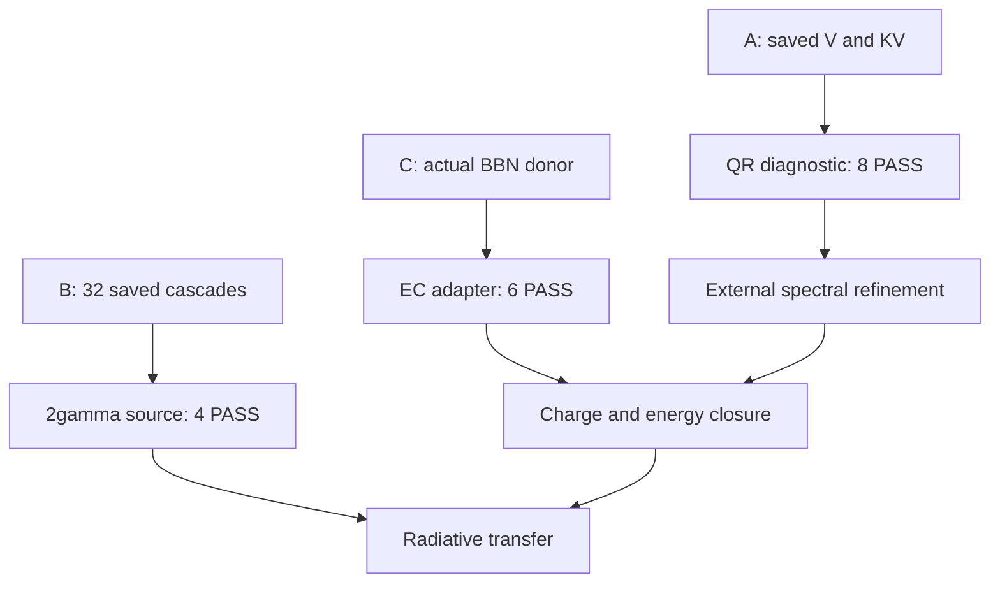

# R9 Unit6 DAG — 2026-10-16

Read basis: PR151 edead5026fdcc4217a9caec5106f7839c6aec5a5; PR150 eb2abcac4f44b7bc4ff532286953fcb4e353c7bb. External process state NOT_INSPECTED. This unit used zero physical H actions and zero NCP actions.

| Programme | Existing evidence | Unit6 progress | Next dependency / whole-program status |
|---|---|---|---|
| T1 Li bound states | Accepted finite-model FCI and basis studies | Reused; no new solve | OPEN: basis accuracy, finite mass and relativistic contributions |
| T2 atomic continuum | Projected response and TRK diagnostics | Reused | OPEN: energy-normalized outgoing channels and exclusive cross sections |
| T3 molecular low-T rates | BO potential curves and dipoles | Reused | OPEN: coupled radial scattering and reaction-rate calculation |
| T4 daughter distributions | Actual16/32/64 partial spectrum; Unit5 resume implementation | A: QR residual postprocessor, 8 PASS; scoped local implementation | HOLD: actual64→128/refinement; T2 continuum and EC transition operators |
| T5 nuclear precision | Quadrature and sensitivity calculations | Reused | OPEN: reaction-data likelihood, covariance and truncation uncertainty |
| T6 cascades and radiation | Actual E1 mixtures and terminal2s probabilities | B: 32 completed isolated E1+2gamma sources; 4 PASS | OPEN: source injection, collisions, escape/reabsorption, coupled transport; LiI response above64.39eV |
| T7 BBN→17 ions | Actual bareBe7 BBN donor and conditional map | C: 8 EC channels,22-state auxiliary adapter; 6 PASS | OPEN: charge/recombination histories, physical bound/continuum rates, daughter/energy partition, native integration |
| T8 cosmological transport | PR150 SOURCE010/011 scoped outputs | Latest source reuse only; independent owner | OPEN: source-age reference/refinement and fully coupled cosmological trajectory |

Dependency graph:

The three local units are complete within their frozen assumptions after independent review. The external/refinement/closure nodes remain open. No local PASS closes a complete physical programme. Scope admission is recorded in review/IMPLEMENTATION_REVIEW.json; execution receipts retain their original pre-review status.

R1–R6 / C1–C4: S1 theory checkpoint, published d48372c98ee1fc0c7710561ed5b7392844e62707, dual backup confirmed. R7–R10 / C5–C10: S2 execution checkpoint; final delivery IDs and verification levels in progress/DELIVERY_FINAL.json. Individual step-to-evidence links are in progress/STAGES_FINAL.json.
