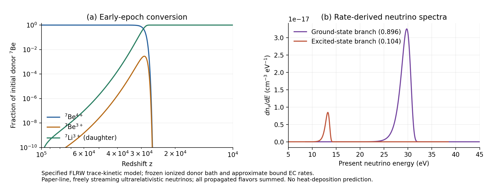

# R9 Unit7 — 광흡수와 Be7 초기우주 반응의 물리적 연결

2026-10-16. Unit6의 저장 자료를 이용해 Li I의 내부껍질 흡수, Be7의 재결합·광이온화·전자포획 이력, 그 붕괴에서 방출된 중성미자의 현재 스펙트럼을 계산했다. 그림의 좌표를 읽어 수치를 복원하지 않았다. 공개 논문의 식과 원 저자의 Fortran 분기를 구현하고 실제 BBN donor를 입력했다. 최종 채택 범위와 검토는 `review/IMPLEMENTATION_REVIEW.json`에 기록한다.

## 무엇이 실제로 계산되었나

| 단위 | 입력과 계산 | 새 결과 |
|---|---|---|
| A1 | 기존 32개 혼합물의 2광자 분포와 원 저자 phfit2 | 64.39 eV 위의 1s·2s 흡수를 추가하고 에너지 분배를 분리 |
| A2 | 실제 E1 선 6,608개와 저장된 A1 결과 | E1+2광자 전체 source의 shell별 흡수 응답 |
| B | 실제 BBN donor, 논문의 3상태 반응식, donor 우주론 | Be7 변환 적색편이 이력과 경량화 근사 검증 |
| C | B의 누적 붕괴량과 명시된 두 방출선 | 보존적인 현재 중성미자 분포와 에너지 모멘트 |

이번 수치 결과는 명시된 미량원소 FLRW 모형과 매끄러운 원자 단면적 fit 안의 결과다. 원자모형의 불확실성과 수치 오차를 분리한다. 실제 Hamiltonian 작용 및 NCP 실행은 각각 0회다.

## A. Li I 내부껍질 응답과 완성된 source

원 저자의 `phfit2.f` Version 2는 Li I의 점유된 1s와 2s shell을 각각 한 번 더한다. 64.39 eV 아래에서는 2s에 1996년 외각 fit을 적용한다. 그 경계 이상에서는 2s도 1995년 partial fit으로 전환하고, 1s 채널을 연다. 이는 원 코드가 정한 분기이며, 단순히 기존 외각 fit을 외삽한 결과가 아니다.

경계의 단면적은 왼쪽 2s가 0.05189110135 Mb, 오른쪽 2s가 0.05099580194 Mb, 오른쪽 1s가 3.46001303714 Mb다. 총 단면적의 오른쪽/왼쪽 비는 67.66109694이다. 적분 구간을 이 경계에서 나누고 실제 source의 에너지 범위를 보존했다. 좁은 공명 구조는 이 매끄러운 fit의 계산 범위에 포함되지 않는다.

주입 precursor당 스펙트럼 $S(E)$와 선언된 입사 flux $J=1\;\mathrm{m}^{-2}\mathrm{s}^{-1}$에 대해 shell $s$별 응답은

$$\Gamma_s/J=\int S(E)\sigma_s(E)\,dE,$$
$$W_s/J=\int E S(E)\sigma_s(E)\,dE,\quad K_s/J=\int(E-I_s)S(E)\sigma_s(E)\,dE.$$

$W_s=K_s+I_s\Gamma_s$이며, eV를 J로 변환한 에너지 응답도 저장했다. $I_{2s}=5.392$ eV, $I_{1s}=64.39$ eV를 사용한다. 총 단면적에 일괄적으로 $E-5.392$를 곱하면 1차 광전자 에너지를 $58.998\,\mathrm{eV}\times\Gamma_{1s}$만큼 과대계상한다. 이 차이를 별도 열로 출력했다. 여기서 $K_s$는 1차 광전자 운동에너지다. Auger 분기, 최종 이온 전하, 2차 이온화 및 열화에 대한 입력은 별도 물리 의존성이다.

LiIII∞의 2광자 성분에서는 기존 경계 위의 방출이 전체 흡수 사건 응답의 **73.7938%**, 흡수 에너지 응답의 **90.6024%**를 차지했다. 기존 covered band 대비 새 전체 사건 응답은 **3.815889배**, 흡수 에너지 응답은 **10.640974배**다. 방출 광자수의 약 24.58%가 차지하던 고에너지 부분이 단면적 가중 후 훨씬 큰 기여를 하는 것이다. 이 비율은 특정 LiIII source와 Li I absorber, 해당 fit 안의 값이다.

A1의 64/128/256절점 결과를 모두 보존했다. 128→256 상대 차이의 최대값은 $1.71\times10^{-12}$, 기존 band와의 차이는 $1.87\times10^{-14}$, 독립 adaptive quadrature와의 차이는 $3.64\times10^{-14}$였다. 원 Fortran 컴파일러는 없어서 native oracle은 실행하지 못했다. 대신 원 source 분기·계수를 직접 복원하고 별도의 Decimal 식 평가를 대조했다.

A2는 델타선 성분에 대해 적분을 정확한 유한 합 $\sum_\ell N_\ell\sigma_s(E_\ell)$로 바꾸었다. 선 가중치는 이미 혼합물당 광자수이므로 다시 통계 가중하지 않는다. 실제 최대 선 에너지는 **121.6008823 eV**로, 2광자 연속 성분의 끝점보다 높다. E1 선을 연속 성분의 끝점으로 자르지 않았다. A1의 최종 256절점 연속 응답을 그대로 읽어 성분·shell·band별로 합했다.

6,608개 선에서 **1,440개 전체 source 응답 행**을 만드는 유한 합과 8개 검증은 **0.0602초**에 끝났다. 복사한 연속 성분의 응답 셀은 하나도 바뀌지 않았고 A1 적분을 반복하지 않았다. LiIII의 초기 $n=3,5,10,12$ 혼합물에서 E1 선이 전체 흡수 사건 응답에 기여하는 비율은 각각 **96.6468%, 98.3793%, 99.4688%, 99.6095%**다. 따라서 연속 성분의 내부껍질 보정이 크다는 사실과, 실제 전체 source에서는 E1 흡수가 우세하다는 사실을 함께 반영해야 한다. 상세 수치와 검증은 `results/laneA2/`에 있다.

## B. 실제 donor에서 초기우주 Be7 이력으로

$x_4,x_3,F$를 초기 Be7 중 각각 Be4+, Be3+, Li3+로 붕괴한 비율로 정의한다. 초기값은 $(1,0,0)$이며, 직접 BBN에서 만들어진 Li7은 별도로 보존한다. Proper time에 대해

$$\dot x_4=-r x_4+\beta x_3,\qquad
\dot x_3=r x_4-(\beta+\lambda)x_3,\qquad
\dot F=\lambda x_3.$$

$r=n_e\alpha$, $\lambda=\ln2/(106.4\,\mathrm{day})$이다. 논문의 total recombination fit은 바닥상태로의 직접 재결합도 포함한다. 광이온화는 같은 온도의 blackbody와 상세평형으로 연결한다.

$$\alpha=10^{-13}Z\frac{5.596\,t^{-0.6038}}{1+0.3436\,t^{0.4479}}\;\mathrm{cm^3\,s^{-1}},\quad t=\frac{T}{10^4\mathrm{K}\,Z^2},\quad Z=4,$$
$$\beta=\alpha\left(\frac{2\pi m_e k_BT}{h_{\rm P}^2}\right)^{3/2}e^{-\chi/(k_BT)}.$$

두 번째 식의 수밀도는 SI에서 cm⁻³로 변환했다. $h_{\rm P}=2\pi\hbar$이며, 추가 degeneracy factor 2를 곱하지 않는다. $\chi=217.7$ eV와 통계적 hyperfine 점유를 사용한다. 반감기와 rate fit의 물리적 근사는 계산 계약에 명시했다.

배경은 실제 donor의 $h=0.7$, $\Omega_bh^2=0.02205$, $\Omega_ch^2=0.12495$, $T_0=2.7255$ K, $N_{\rm eff}=3.0439773$을 사용한다. 광자와 상대론적 neutrino의 복사를 포함한 평탄한 FLRW에서

$$H(z)=H_0\sqrt{\Omega_r(1+z)^4+\Omega_m(1+z)^3+\Omega_\Lambda}.$$

계산된 $\Omega_r=8.53585044\times10^{-5}$, $\Omega_m=0.3$이다. 모든 59개 donor 핵종의 전하를 합해 $Y_e=0.8765521884$를 얻었고, $n_e=Y_e n_{b0}(1+z)^3$, $n_{b0}=2.47920955\times10^{-7}$ cm⁻³를 사용했다. 이 고정된 전자 배경에 대한 Be7 자체의 변화는 최대 $4.32\times10^{-10}$의 상대 크기다. 다른 미량 핵종의 후속 변환은 이 배경 근사의 일부로 고정했다.

계산 구간은 $10^5\ge z\ge10^4$이다. 실제 donor 끝점에서 시작점까지 빠진 Be3 및 누적 붕괴량의 합을 $1.21253\times10^{-9}$ 이하로 제한하는 해석적 bound를 유도했다. 별도의 $z=2\times10^5$ 시작 적분과의 $F$ 차이는 $2.70\times10^{-10}$였다. 이 연결은 고온 BBN 구간에 재결합 fit을 외삽하지 않고 상세평형과 복사 지배 시간 상한을 사용한다.

| 초기 Be7의 변환율 | 적색편이 |
|---|---:|
| 10% | 31203.45894 |
| 50% | 29307.17654 |
| 90% | 28211.33004 |

중간 Be3 점유율이 작아도 재결합·재이온화를 반복하는 동안 붕괴가 누적된다. 중앙 변환 시점에 $\beta/\lambda\simeq3.62\times10^4$이다. 따라서 재결합한 모든 원자가 즉시 붕괴한다고 가정하면 실제 경쟁을 잃는다.

### 경량화와 검증

$u=\ln[(1+z_{\rm start})/(1+z)]$에서 중간점의 계수를 고정하고 2×2 행렬 지수와 양의 붕괴 적분을 사용했다. $L=r+\beta+\lambda$, $D=\sqrt{(r-\beta-\lambda)^2+4r\beta}$에 대해 느린 감쇠율을

$$k_s=\frac{2r\lambda}{L+D}$$

로 계산하여 큰 수의 뺄셈을 피한다. 빠른 이온화 시간을 하나씩 분해할 필요가 없다. 32768구간의 실제 production 적분은 **0.0642초**, 16384구간 비교와 독립 Radau 두 번을 포함한 수치 계산 전체는 **0.8405초**였다.

Radau 대비 $F$ 최대 차이는 $7.64\times10^{-8}$, Be3 최대 차이는 $3.02\times10^{-6}$이었다. $x_4+x_3+F$의 최대 회계 잔차는 $2.16\times10^{-13}$이다. 최종 생존량 $x_4+x_3$은 underflow로 0이 되었고, $1-F_{\rm end}\simeq2.15\times10^{-13}$는 별도의 부동소수점 회계 잔차로 보존했다.

준정상 축약 $F_{\rm QSS}=1-\exp[-\int(k_s/H)du]$도 비교했다. 전체 해와의 최대 차이는 **$2.93\times10^{-7}$**이었다. 이 수치는 해당 입력에서 검증한 경량화 결과이며, 다른 복사장이나 전하망까지의 보장은 아니다.

## C. 붕괴 이력에서 현재 스펙트럼으로

논문의 반올림된 방출선 $E_j=(861800,384200)$ eV와 분기 $(0.896,0.104)$를 일관되게 사용했다. 자유 전파하는 초상대론적 중성미자의 관측 에너지는 $E=E_j/(1+z)$이다. $N_0=n_{b0}Y_{\rm Be7}$를 쓰면

$$\frac{dn_j}{dE}=N_0b_j[-F'(z)]\frac{E_j}{E^2},\qquad z=E_j/E-1.$$

절대 수밀도에는 유한 구간에서 정규화한 $p_z$를 사용하지 않았다. 실제 누적 $F$를 적색편이 구간에서 선형 보간한 후 각 에너지 bin의 입자수와 1·2차 에너지 모멘트를 해석적으로 적분했다. 이로써 독립적인 rate 기반 미분 스펙트럼과 보존적인 bin 수밀도를 구별할 수 있다.

| 성분 | $dn/dE$ peak [eV] | FWHM [eV] | 평균 [eV] |
|---|---:|---:|---:|
| 핵 바닥상태 분기 | 29.74984 | 2.32446 | 29.20587 |
| 핵 들뜬상태 분기 | 13.26281 | 1.03627 | 13.02030 |

현재 총 수밀도는 **$9.383793856\times10^{-17}$ cm⁻³**, 에너지 밀도는 **$2.582660973\times10^{-15}$ eV cm⁻³**다. 이는 이 모형에서 계산한 Be7 기원 성분의 모든 전파 flavor 합이다. 직접 BBN에서 생긴 Li7은 이 붕괴 사건 수에 포함하지 않았다.

보존적 bin의 수·모멘트 회계 잔차는 상대값 $8\times10^{-16}$ 이하였다. 별도의 rate/Jacobian 적분과는 약 **0.1043%** 차이가 남았다. 이는 저장된 중간점 propagator의 endpoint population으로 만든 미분량의 격자 오차이며, 미리 정한 0.3% 비교 기준 안이다. 작은 보존 잔차를 스펙트럼 전체의 같은 크기 정확도로 해석하지 않는다.

초기 cosmic baryon당 방출된 nuclear gamma source 에너지는 $1.88002\times10^{-5}$ eV, 별도 초기 recoil 추정은 $1.96020\times10^{-8}$ eV다. 반올림된 선과 recoil 추정을 합쳐 exact Q closure를 주장하지 않았다. 이 값들은 방출원 항이며 가스 열침적에는 수송·열화 계산이 필요하다.

## 근거·실패·완료 범위

최종 독립 판정은 **PASS_SCOPED_LOCAL_IMPLEMENTATION_ALL_THREE_LANES_AND_A2**다. A1의 focused check 9개, A2의 8개, B의 수치 gate 13개와 unit test 2개, C의 수치 gate 8개와 unit test 3개가 각 범주에서 통과했다. 이 수들을 모두 독립적인 물리 검증으로 합산하지 않는다. 실행 시점에 쓰인 과거의 review-pending 문구는 원 기록으로 보존하며 최종 채택 판정은 `review/IMPLEMENTATION_REVIEW.json`을 따른다.

이론과 계산 계약은 독립 연구 agent가 고정했고, 구현과 실행은 별도 agent가 수행했다. 독립 검토자는 source, 코드, 원자료 및 이미 실행한 검증을 읽었다. 요청한 모델 이름과 실제로 관측 가능한 runtime identity는 구별해 기록했다.

A1의 첫 검증은 `__main__`과 재import된 module의 상태가 달라 실패했다. 독립 검토가 허용한 한 번의 test-plumbing 수정 후 저장 결과만 검증했으며 quadrature를 반복하지 않았다. B의 첫 fixture는 원 donor의 59개 핵종에 근거 없이 64를 기대해 실패했고 실제 입력 수로 교정했다. 이 수정이 사전 authority 통지보다 먼저 이루어진 사실도 기록했다. C의 빈 에너지 bin 경고와 그림 header 처리 실패는 각각 정의된 극한과 원 header 보존으로 교정했으며 원 기록을 남겼다. 물리 모형이나 수용 오차를 바꾸지 않았다.

Wolfram evaluator와 context는 모두 MCP 내부 오류를 반환했다. 따라서 이번 symbolic 성공 근거는 없으며, 직접 유도·독립 검토·로컬 수치 대조만 채택했다. 원 Fortran compiler도 미설치 상태였다. 원 자료와 대체 검증의 정확한 범위는 각 실행 기록에 있다.

전체 T1–T8의 상태와 다음 계산 의존성은 `progress/DAG.md`, R1–R10·C1–C10의 개별 근거는 `progress/STAGES_FINAL.json`에 있다. 외부 T4의 실제 128차·spectrum/CDF refinement는 이번 연구의 입력으로 추가되지 않았으며 HOLD가 유지된다. 이번에 완성한 초기 Be7 이력은 이후 Li 재결합, 전체 17이온 망 및 Bianchi reionization 이력의 초기조건으로 연결할 수 있는 별도 물리 성분이다.

## 원전과 재현 파일

- Verner et al. 및 Verner–Yakovlev의 원 저자 자료: https://www.pa.uky.edu/~verner/photo.html ; 정확한 source bytes와 URL은 `inputs/verner/SOURCE_MANIFEST.json`.
- Khatri & Sunyaev, arXiv:1009.3932v2, Eq5–10: https://wwwmpa.mpa-garching.mpg.de/mpa/publications/preprints/pp2011/MPA3083.pdf . 식과 가정을 사용했으며 논문의 그림은 수치 입력·수용 기준으로 사용하지 않았다.
- Rate fit·threshold의 범위와 추가 원전은 `evidence/BE_KINETICS_SOURCES.md`, 단면적과 source 유도는 `spec/`.
- 재현 명령은 `README.md`; 원자료와 기존 실패는 `evidence/`, `results/`, `code/laneB/raw/`, `code/laneC/raw/`에 보존했다.
