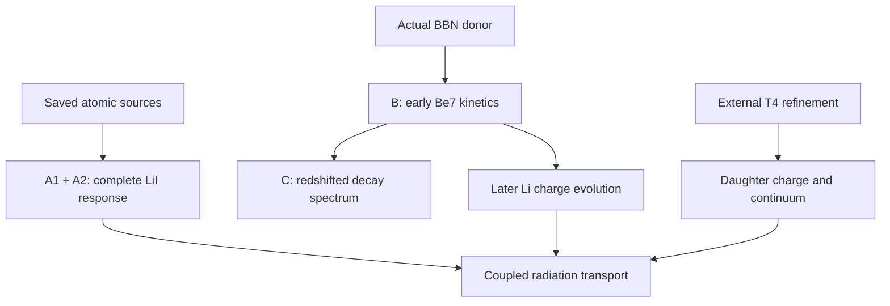

# R9 Unit7 DAG — 2026-10-16

Intake: PR151 `232df074d97cd699238db891ca015caef12a82ea`; PR150 `6bfb2690b3568a6b97a5bab4b881537d98847614`. Original theory checkpoint: `6a1617e599768c9493626f417526314eca035a98`. External process state **NOT_INSPECTED**. This unit used zero physical Hamiltonian actions and zero NCP actions. Hubble expansion was calculated from the declared donor cosmology.

| Programme | Retained evidence | Unit7 progress | Next dependency / whole-program status |
|---|---|---|---|
| T1 Li bound states | Finite-model FCI and basis studies | Reused; no new solve | OPEN: basis accuracy, finite mass and relativistic contributions |
| T2 atomic continuum | Projected response and TRK diagnostics | Reused; provider smooth photoabsorption in T6 is a separate approximation | OPEN: energy-normalized outgoing channels and exclusive cross sections |
| T3 molecular low-T rates | BO potential curves and dipoles | Reused | OPEN: coupled radial scattering and reaction-rate calculation |
| T4 daughter distributions | Actual16/32/64 partial spectrum; Unit5 resume and Unit6 QR code | No new external execution or acceptance | HOLD: actual64→128/refinement; physical continuum and EC transition operators |
| T5 nuclear precision | Quadrature and sensitivity calculations | Reused | OPEN: reaction-data likelihood, covariance and truncation uncertainty |
| T6 cascades and radiation | Actual32 E1+2gamma sources | A1: LiI1s/2s provider response above64.39eV; A2: all6608 E1 lines,1440 completed response rows; scoped PASS | Provider coverage gap closed for these sources. OPEN: resonances, relaxation/final charge, source injection, collisions, reabsorption and transport |
| T7 BBN→17 ions | Actual bareBe7 donor and Unit6 EC adapter | B: donor-specific early Be7 trajectory, z50=29307.17654; C: conservative decay-neutrino spectrum and separate source energy; scoped PASS | OPEN: continuum EC/second electron, post-z10000 Li recombination and charge history, energy deposition, native17 integration |
| T8 cosmological transport | PR150 SOURCE012 partial intake and refresh005 REC99 q0z20 candidate | Read source-qualified metadata; candidate not adopted into this donor trajectory | OPEN: cosmology/census/density/thermal/clock compatibility; source-age reference/refinement; coupled cosmological history |

A1/A2 and B are independent. C theory was parallel; physical C execution consumed B. The local calculated nodes are complete within frozen models. Their downstream physical programmes remain open. No result from the external128 calculation was supplied at intake; process state is distinct from posted-result status.

R1–R6/C1–C4 have individual evidence links covered by shared S1 theory/design backup and publication. R7–R10/C5–C10 and the separately frozen A2 addendum are covered by shared S2 final backup/publication. `STAGES_FINAL.json` maps all20 steps; `DELIVERY_S1.json` and `DELIVERY_FINAL.json` record actual delivery and verification levels. Separate uploads for every row are not claimed. The latter receipt is written after upload and is published separately, avoiding recursive archive hashes.

Final scientific admission: `review/IMPLEMENTATION_REVIEW.json`, **PASS_SCOPED_LOCAL_IMPLEMENTATION_ALL_THREE_LANES_AND_A2**. Historical pending labels in execution evidence remain unchanged.
