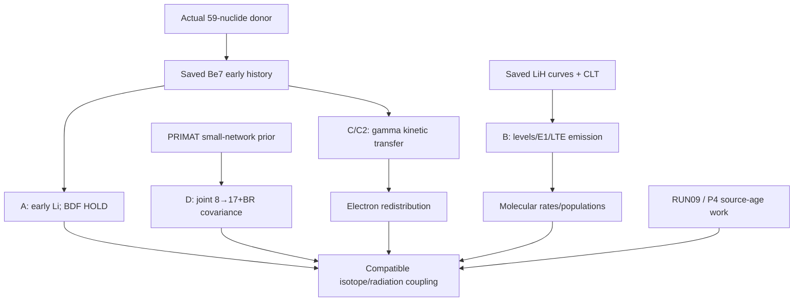

# R9 Unit8 programme DAG — recovered 2026-10-18 KST

This additive view preserves historical T1–T8 identities, the separate 26-node dossier SSOT and RUN09 original 45/26 DAGs. Source-owner tests are not counted as Unit8 runs. Initial S1 remains in STAGES_S1.json and DELIVERY_S1.json. Final independent decisions are under review/.

| Programme | Completed/reused calculation | Unit8 and newer intake | Remaining calculation/readiness |
|---|---|---|---|
| T1 Li bound structure | Existing finite-model FCI/basis studies | Exact saved donor/curve reuse; no new electronic solve | OPEN: basis/CV, finite-mass and relativistic corrections; needs accuracy target and larger electronic basis |
| T2 atomic continuum | Projected response/TRK; public photo fits | Six-channel thermal kernels; HH108 finite-ell Born Abel limit informs methods | OPEN: energy-normalized outgoing many-electron channels, exclusive cross sections and resonances |
| T3 molecular low-T rates | Actual 20 LiH BO/dipole records | B: 99 finite-curve levels/132 E1 rows; CLT 1086 states/18982 transitions; scoped PASS with v2 domain qualification | OPEN: coupled radial scattering, formation/collider rates and justified potential tails |
| T4 daughter distributions | Actual Li→Be+ projection and NCP16/32/64/128 | 64→128 internal gates PASS; all three eta refinement HOLD; NumPy failure/repair read | HOLD: terminal zero-H diagnostic receipt missing; physical continuum/EC operators/basis closure open. Collect old evidence before new work |
| T5 nuclear precision | Capture quadrature/sensitivity | D: native C64-sample prior covariance and joint8→17+BR projection PASS | OPEN: likelihood/EFT calibration and truncation; converged large-network uncertainty; small native propagator ready |
| T6 cascades/radiation | Unit7 actual E1+2gamma and LiI response | C first KN event and C2 through16 collisions PASS | OPEN: nonthermal electron redistribution, full time-dependent transport, relaxation/final charge; kinetic input kernel ready |
| T7 BBN→17 ions | Actual59 donor and early Be charge/EC history | Dossier exact17/all59 census; A early Li partial with BDF reference HOLD; D conditional covariance lift | OPEN: independent early Li validation, continuum/second-electron EC, late H/D/T/He/Li histories and native17 coupling |
| T8 cosmological transport | Actual FLRW/signed owner histories | RUN09 retarded HHeD birth scan; PR192 native inner/outer budget; PR193 whole-cell guard CAS | OPEN: spectrum/angle/global time accuracy, actual donor compatibility, Einstein reaction feedback, calibrated source history; full EoR HOLD |

The arrow from D requires a network-compatible donor and a supplied charge law. RUN09's manufactured gas and prescribed BASS geometry remain distinct from the early BBN donor. Source support r4 is that lane's bounded working choice, not a rigorous continuous-source bound. T4 W=0.4243608179922081 is a finite-space complement, not an ionization probability.

External processes NOT_INSPECTED. Unit8 performs zero physical Hamiltonian/NCP actions. Unit4 terminal H-action count remains UNKNOWN [86,160]; observed Unit5 +70 gives campaign [156,230], not a falsely exact total. Original Unit5 deadline 2026-10-16T04:48:54.971486Z is not reset.

R1–R10/C1–C10 map to shared S1/S2 checkpoints in STAGES_FINAL.json. Delivery completion is recorded separately in DELIVERY_FINAL.json after upload and publication.
