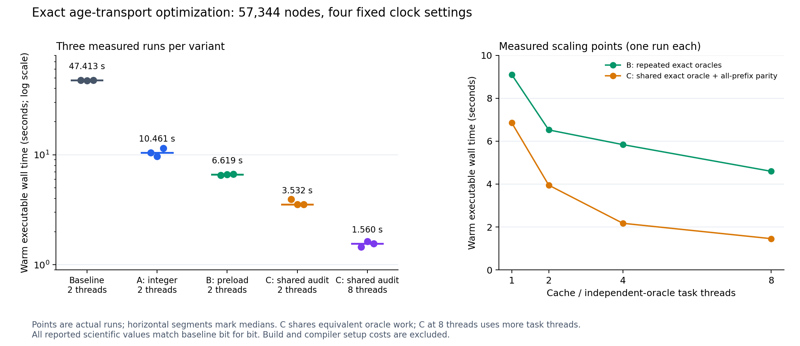

# Exact fixed-input age-transport optimization, 2026-10-20

The optimized executable reduces the median warm calculation time from **47.413 s
to 3.532 s with two task threads**, a **13.424×** speedup. With eight task threads
the median is **1.560 s**. The latter comparison is **30.383×** relative to the
two-thread baseline and includes the larger task-thread allocation. All reported
scientific binary64 values, interval endpoints, prefix outputs and model counters
match the unchanged baseline bit for bit.

These measurements use the original 57,344 nodes and four birth-clock settings
8/16/32/64, fixed source labels, fixed opacity, endpoint geometry, gas and weights.
They introduce no new native cosmological-history calculation or age32 campaign.
`PRODUCTION_SCIENTIFIC_ADMISSION=NOT_ISSUED`.

## Observed measurements

| Variant | Task threads | Three wall times, seconds | Median, seconds | Speedup versus baseline | Validation work |
|---|---:|---|---:|---:|---|
| Unchanged baseline | 2 | 47.731, 47.185, 47.413 | 47.413 | 1.000× | Original repeated exact oracles |
| A: integer Taylor recurrence | 2 | 10.461, 9.685, 11.438 | 10.461 | 4.532× | Original repeated exact oracles |
| B: parallel cache preload and common ages | 2 | 6.524, 6.619, 6.676 | 6.619 | 7.164× | Original repeated exact oracles |
| C: shared oracle and all-prefix parity | 2 | 3.949, 3.530, 3.532 | 3.532 | 13.424× | One exact oracle per group plus all-prefix thread equality |
| C: shared oracle and all-prefix parity | 8 | 1.456, 1.639, 1.560 | 1.560 | 30.383× | Same C validation, more task threads |

The baseline/A/B replications were interleaved; C at two/eight threads was also
interleaved after its initial scaling pass. Every measured command ran
sequentially, without a concurrent build. The host exposed nine logical CPUs in
the affinity mask, an eight-CPU cgroup quota, and an 8 GiB memory limit. The
original affine-prefix checks still execute at thread counts 1/2/4 independently
of the task-thread setting in this table.

`results/BENCHMARK.json` contains the consolidated measurements, raw command
receipts, observed mode checks, source identities and interpretation limits.
`results/BENCHMARK.csv` provides one row per run. `results/SUMMARY.json` preserves
the same consolidated content for the existing review reference.



The left panel shows all three points and their median for each comparison. Its
vertical axis is logarithmic. The right panel shows the actual one-run scaling
points at 1/2/4/8 task threads. “C, 8 threads” denotes variant C with eight task
threads, rather than a delivery-package version. The SVG is available alongside
the PNG. `plot_results.py` regenerates both from the recorded measurements.

## What changed

**A preserves the exact exponential polynomial.** For the reduced rational
optical depth `p/q`, it starts with `D=N=P=1` and computes
`D_j=j*q*D_(j-1)`, `P_j=(-p)*P_(j-1)`, and
`N_j=j*q*N_(j-1)+P_j`. Consequently `N_j/D_j` is exactly the original Taylor
partial sum. Only the degree-18 and degree-19 results are normalized as
`BigRational`. The public nonnegative-rational API, zero/752 guards, halving to at
most one half, rational-to-binary64 proof comparisons and directed squaring are
unchanged. The original implementation remains in `baseline_source` and in the
test/reference-check path.

**B evaluates independent cache misses in parallel.** It preserves the original
`(rate_id, later_bits, earlier_bits)` keys, removes duplicate missing requests,
uses an indexed Rayon map over immutable rates, and inserts results serially.
The original node order, directed reductions, source labels, group ordering and
affine tree remain intact. Exact age intervals shared by a cohort clock are
computed once. The original repeated exact-oracle passes remain available.

**C shares an identical validation calculation.** Each group's canonical prefix
is computed at one thread and every leaf inequality is checked against its exact
rational recurrence. Independent groups are validated in parallel. The other
two/four-thread executions compare every prefix endpoint bit against the
canonical prefix, transferring the same checked inequalities. The group order
and final directed sum stay fixed. Across the four settings this performs 4,448
exact group recurrences, 27,552 exact leaf inequalities and 64,000 all-prefix bit
comparisons. The original B validation path remains selectable.

## Verification and bounded execution

Four focused certified-arithmetic tests passed, including 142 deterministic
fixtures covering general non-dyadic rationals, zero, subnormals, one-half and
halving boundaries, and the 752 boundary. They compare the exact degree-18/19
partial sums and final endpoint bits with the original implementation. The full
input reference run checked **53,628** exponential endpoint pairs: 53,408 cached
evaluations plus 220 direct global-prefix evaluations. All agreed exactly.

All B and C scaling/replication outputs agree with the unchanged baseline after
excluding wall-time and explicit optimization metadata. The standard optimized
wrapper completed an actual feature-free execution in 1.681 s and produced the
same scientific outputs.

The C9-directed repair checks **observed mode activation** separately from
numeric agreement. Preloading must report all cached evaluations; shared oracle
mode must report the expected per-group recurrence, inequality and all-prefix
comparison counts; reference mode must actually check every exponential. Four
regressions using preserved actual outputs passed. An actual feature-free binary
requested in reference mode produced numeric parity, zero reference checks and
the expected `MODE_NOT_ACTIVATED` failure with command exit 1. That preserved
negative control is an expected validation failure, rather than a scientific
result failure. The initial extra-borrow compile error in the extracted
reference helper was corrected mechanically and retained in
`results/A_INITIAL_COMPILE_FAILURE.txt`.

The cumulative measured executable wall time, including the reference run,
wrapper check and expected negative control, is **253.924 s** of the 600 s
measurement allowance. Every run stayed below the 240 s command limit. Compiler
setup, source builds and lightweight fixture tests are reported separately.

Independent C9 returned **PASS** for the scoped A/B/C optimization and launch path.
Finding C9-01 is closed. See `reviews/c9/C9_RECEIPT.json` and `C9_REVIEW.md`.
The global task-pool setting is 2/8 in the median comparisons; the explicit
affine-prefix validation pools always run at 1/2/4 threads.

## Runtime and memory interpretation

The installed runtime is actual Rust **1.94.1**, commit
`e408947bfd200af42db322daf0fadfe7e26d3bd1`, with Cargo **1.94.1**
`29ea6fb6a5db279426f4cc4e17aa385f05a0cfbc`. Official rustc/cargo/std component
downloads totaled 119,463,700 bytes, took 2.967 s, and matched their published
SHA256 values. Installation took 8.345 s. The unchanged offline release build
took 13.556 s. The fresh frozen-B reconstruction through `build_variant.py`
took 13.127 s using the same 22 locked packages and no registry access. This is
warm-executable speed evidence; compiler download and cold build costs are not
included in the speedup ratios.

Wall/CPU/RSS records use a fresh Python launcher containing one executable child.
`/usr/bin/time` was absent. Standard-harness baseline peak RSS was 27,648 KiB and
C was 27,776 KiB. The first direct-launch baseline reported 20,616 KiB with a
different launch floor. These process high-water marks include the launch path
and do not establish a reduction in kernel memory allocation. Median CPU time
fell from 47.496 s for baseline to 6.581 s for C at two task threads; C at eight
threads used 9.132 s median CPU time for its lower wall time.
In these samples eight threads used about 38.8% more CPU time than two threads.
Use `--threads 2` for the measured CPU-economy choice and `--threads 8` for the
measured lower-latency choice. The default is a convenience allocation, rather
than a claim that one thread count is universally best.

## Run the optimized path

From this directory, build in a fresh scratch directory and run the verified
optimized modes with the bundled inputs and dependencies:

```bash
python3 run_optimized.py \
  --runtime /tmp/rei_age_optimized_fresh \
  --rust-prefix /path/to/rust-1.94.1-prefix \
  --label MY_OPTIMIZED_RUN
```

The wrapper defaults to the minimum of eight, the CPU affinity count and the
integer cgroup quota. `--threads 2` selects a fixed explicit allocation. It sets
`REI_PRELOAD=1` and `REI_REUSE_ORACLE=1`, verifies the fixed input identities, and
checks the resulting observed modes and numeric parity. To reuse a previously
built optimized executable:

```bash
python3 run_optimized.py \
  --binary /tmp/rei_age_optimized_fresh/target_C/release/rei-vigilode-age-transport \
  --threads 8 --label MY_SECOND_RUN
```

Labels preserve existing receipts: use a new label for another run. The runner
retains the task's cumulative 600 s measurement ceiling; it does not silently
grant another measurement allowance. The existing `run_study.py` remains the
historical full workflow and does not automatically activate B/C. The standard
optimized entry point is `run_optimized.py`.

## Reconstruct baseline, A, B or C from source

`results/BUILD_MANIFEST.json` binds the variant-specific source files, common
vendored modules, lockfile, compiler and commands. `baseline_source/src` holds
the original main/certified implementation; `baseline_source/A_certified.rs`
holds the exact measured A source; `baseline_source/B` holds the measured B
source. C uses the current research source. The helper copies only the small
crate source into scratch and references the unchanged bundled vendor tree. It
creates no Git clone or worktree and leaves research source files untouched.

```bash
python3 build_variant.py --variant baseline \
  --runtime /tmp/rei_age_baseline_fresh --rust-prefix /path/to/rust-1.94.1-prefix
python3 build_variant.py --variant A \
  --runtime /tmp/rei_age_A_fresh --rust-prefix /path/to/rust-1.94.1-prefix
python3 build_variant.py --variant B --reference-check \
  --runtime /tmp/rei_age_B_fresh --rust-prefix /path/to/rust-1.94.1-prefix
```

`bench.py --source baseline|A|B|current` records the appropriate frozen source
identities. For B use `--preload`; for C also use `--reuse-oracle`. A reference
comparison requires building with `--reference-check` and running with
`--reference-parity`. Passing that flag to a feature-free executable fails the
observed-activation check. Cold source builds are recorded independently from
calculation timings.

## Profile and vectorization decision

Before C, the eight-thread B run spent 0.931 s in cache preloading within a
4.597 s run; pair processing occupied 4.077 s, including overlap with those
preloads. That profile motivated exact-oracle sharing and independent-group
parallelism. The initial eight-thread C run spent 0.855 s in preloading within
1.456 s, with 0.443 s across case phases, 0.893 s across pair phases and 0.114 s
input parsing. Preload time is included in the case/pair phases and must not be
added to them again.

The hot transcendental path is arbitrary-precision integer polynomial evaluation,
proof-directed conversion and directed interval squaring. Approximate SIMD
exponential packages would change this arithmetic contract. No approximate
exponential or fast-math package was introduced. Indexed batch evaluation and
independent-group parallelism provide the measured gain. A later bounded SIMD
kernel would need a concrete profile target and the same enclosure proof; this
work makes no general impossibility claim about such a kernel.

## Reused evidence and scope

`intake` contains 25 selected fresh metadata/source/receipt files (331,424 bytes)
from the parent intake work, including VigilODE's banded/JVP/residual-first work
and fresh REI backup results. Large archives are referenced rather than
duplicated. These independent lanes did not supply a new age32 result. Their
solver techniques do not replace this fixed-opacity exponential model.

Skill context used: PhysMath Research Loop **1.3.0**, actual `SKILL.md`,
`POLICY_INTEGRATION.md`, `SUBAGENT_MODE.md` and `CODING_LOOP.md`; selected child
scope C1 inventory and C5–C8 implementation/validation/measurement. The parent
owns the frozen theory, independent C9 decision and publication/admission.
Original inputs, historical results, dependency vendor files and both original
VigilODE modules retain their bytes. Owner checkout, PR150/R9, LRS, BASS and the
original native B1 executable were not modified.
