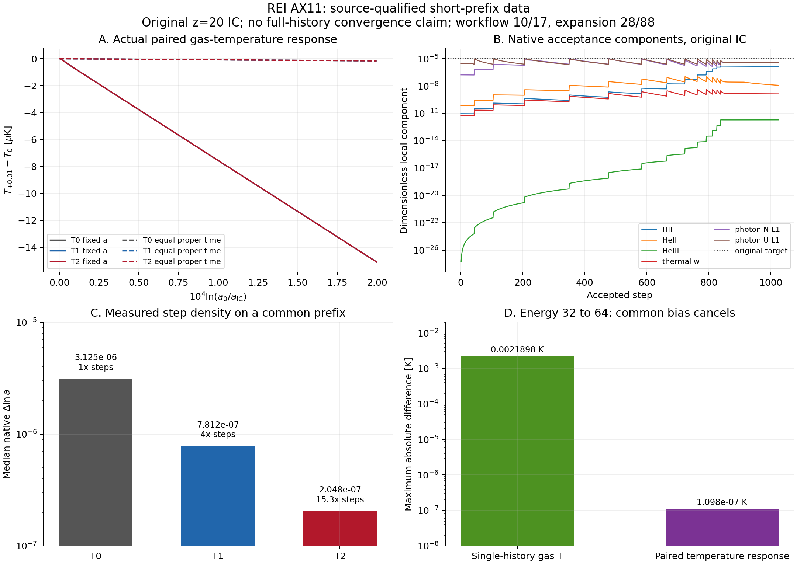

# REI AX11: 실제 source 계측과 분리 refinement 초기 구간

**판정: `ACCEPT_SCOPED_NATIVE_PROFILE_AND_PREFIX_DATA`. AX11 전체는 미완료다.** 원 AX08 다섯 baseline의 승인은 그대로 재사용한다. 원 workflow **10/17**, expansion **28/88**이며 이번 bounded unit의 완료 노드 증분은 **0**이다. 실제 진전은 27개 native window에서 얻은 source별 오차 성분, 별도의 시간·에너지·각도 refinement history, 두 좌표에서의 paired response, 실측 비용이다. 코드 속도·그림·게시 수는 진전으로 세지 않는다.

중앙 정본은 `research/rei-igm-goal-sync-20261116`의 `56dc609ea9b801c88d3364aed3eee140b3a20d46`이다. 최종 게시 전 remote HEAD도 이 값으로 확인했다. 새 결과는 [REI PR377](https://github.com/cosmosapjw-quantum/rei_bianchi/pull/377)에 누적한다. 승인받은 과거 28파일 archive는 [PR376](https://github.com/cosmosapjw-quantum/rei_bianchi/pull/376), HEAD `23996d35dc4feb0a2bf0ae58df51a58fd56739f8`로 정확히 게시했다. 그 archive의 과거 네-case 표기는 중앙 five-case 승인으로 대체되며 새 과학 성과로 세지 않는다.

## 1. 소비하는 목표와 고정한 물리 계약

소비자는 **REI owner / AX11 paired-response evolution-error and cost ledger**다. 원 목표 `REI-AXBI-GOAL-20261014`의 AX11에만 연결한다. 기존 census를 재사용했고 244개 draft를 다시 전수 심사하지 않았다. 기존 다섯 history, stress 진단, fixed-a/equal-elapsed-proper-time 결과, 원 photon field에 적용된 induced-Compton 진단을 재사용했다.

모형은 `PLANCKLIKE_MD14_BB50K_CONDITIONAL_HHE_V1`, homogeneous non-tilted axisymmetric Bianchi I, signature (-,+,+,+), mean redshift zbar20→4, primary-only H/He Case-A escape다. CR, HH, RCT, secondary electrons, molecules는 OFF다. F05 OTS와 F08 constant-H의 source·IC·clock·state를 섞지 않았다. 원 H/He rate provider, source spectrum, 에너지 event owner, 배경 quadrature, 물리 초기조건은 보존했다.

중앙 owner가 이미 수용한 donor 결과의 범위도 유지한다. BASS의 원 geometry/clock과 PR335 induced-Compton 방법은 source가 일치하는 범위에서 소비한다. REC PR200 tetrad 교정과 HE PR155 escaped-energy 단위 교정은 각자의 source 범위에서 유지한다. 원 IGM state로 복사하지 않는다. WU088_HH의 선택된 H/He provider를 재사용하며 CR OFF 결정을 실제 활성 채널에 반영한다. VigilODE의 일반 정리나 전역 Volterra 증명을 새 선행조건으로 추가하지 않는다. 이 범위는 [중앙 owner 보고서](../rei_igm_sync_20261116/REPORT_KO.md) 및 [REPO_ROLES](../rei_igm_sync_20261116/REPO_ROLES.json)를 따른다.

## 2. 실제 실행과 source identity

cloud의 native Rust 실행 능력을 추정하지 않고 실행 probe로 확인했다. 이 환경에는 Rust/cargo가 없으므로 native 실행은 사용자 장비의 분리된 owned directory에서 했다. 실제 compiler는 `rustc1.99.0 (b940084d7 2026-09-28)`다. 다른 dirty checkout과 진행 중인 VigilODE worker는 수정하거나 정지하지 않았다.

원 compiled corpus 17파일의 SHA256은 `d7676b9309ac9b084499bbf599e803baecd661c80765489be45839ef5a7cf185`다. 중앙 HEAD의 파일이라고 곧 원 실행 파일로 간주하지 않았다. 원 60,056-byte driver와 원 lib를 복구한 뒤 전체 corpus hash를 확인하고, 그로부터 원본/계측 candidate를 각각 생성했다. 원본 bounded binary와 candidate의 hash는 서로 다르며 [누적 실행 영수증](prefix_results/CUMULATIVE_NATIVE_RECEIPT.json)에 있다. candidate를 원본 byte identity라고 부르지 않는다.

전체 실행은 다음과 같다.

| 실행 묶음 | native window | 실측 결과 |
|---|---:|---|
| 원본·계측·cache·지연 spectrum 비교 | 12 | IC1024 accepted 및 정확한 accepted199980 checkpoint 이후128 accepted; ZERO/+0.01 |
| 시간 refinement | 6 | T1 두 case 완료, 원 initial-step T2 두 case 실패 보존, floor-start T2 두 case 완료 |
| 에너지·각도 refinement | 9 | E32/E64 ZERO/PLUS, MINUS mu8 및 PLUS/MINUS mu16/mu32 완료 |
| 합계 | **27** | **25 bounded completion +2 보존된 startup failure** |

benchmark 반복과 실패를 포함한 새 작업량은 **28,416 accepted, 86,292 tentative trials, 604,188 RHS calls**다. build/test/window를 포함한 native job wall은 **139.172821577 s**, child CPU는 **135.489285 s**다. 이는 파일 전송·백업·대화 시간을 포함한 전체 경과시간이 아니다. 과거 campaign 누적 비용은 여전히 **UNKNOWN**이며 0으로 초기화하지 않았다. native child33회와 controller/extract/export8회를 포함해 배정된 top-level41회를 사용했고 이 allocation은 닫았다. 직접 child RSS 계측은 descendant peak memory의 독립 증명으로 해석하지 않는다. [PREFIX_OUTCOME](prefix_results/PREFIX_OUTCOME.json), [누적 영수증](prefix_results/CUMULATIVE_NATIVE_RECEIPT.json).

## 3. 오차 성분과 정확한 재사용

원 acceptance metric은 한 full-step 결과 F와 두 half-step 결과 H 사이의 여섯 성분의 ordered maximum이다. HII, HeII, HeIII fraction은 원 denominator floor1e−5, thermal energy는1e−6eV/H, photon number와 energy binwise L1은 각각1e−8photons/H 및1e−8eV/H를 사용한다. 이 local floors와 paired-response fraction floor1e−7 및 temperature floor0.01K는 다른 양이다. 실패한 trial의 미계산 성분은 0으로 채우지 않았다.

원 IC의 처음1024 accepted에서 photon-number L1이445회, photon-energy L1이579회 controller를 결정했다. gas fraction·thermal 성분이 maximum인 accepted step은 없었다. +0.01의 원 plateau checkpoint 이후128 accepted에서는 모두 photon-number L1이 maximum이었다. 그 구간의 median photon-number 성분은2.64418e−6, photon-energy 성분은2.35602e−6이고 HII 성분은8.58548e−8이다. 이 결과는 좁은 window의 직접 계측이며 전체 history의 모든 단계를 일반화하지 않는다. [성분 데이터](profile_results/ERROR_COMPONENT_PROFILE.json).

exact background cache는 immutable model 안에서 binary64 `a.to_bits()`를 key로 사용한다. miss는 원 4,097-node Simpson 계산을 원 순서로 수행한다. interpolation과 quadrature 감소를 사용하지 않았다. spectrum은 원 Rust Display byte를 부분별로 factorize하여 저장하지 않는 full row의 조립을 늦췄다. 원 정확한 byte length·terminal reserve·output guard·저장 cadence는 보존했다. 동적 stock formatting과 geometry/validity 평가는 남아 있다.

**일곱 matched 비교 모두에서 매 accepted state의 binary trace와 history/abundances/ledgers/feedback/spectra 다섯 CSV가 byte-identical**했다. 이는 실제로 비교한 IC/plateau window의 구현 검증이다. 전체 history의 wall-time 기반 snapshot 시각까지 같다는 일반 보장은 아니다. 같은 compiler/flags로 두 binary를 build했고 새 테스트3개와 재사용 regression2개가 통과했다. [동일 정확도 비교](profile_results/SAME_ACCURACY_BENCHMARK.json).

+0.01 IC1024steps에서 fresh evolution wall은 원본25.327574958s, 계측만22.224526974s, cache1.540538540s, cache+지연 spectrum1.393669981s였다. cache+지연 구현의 background hit는207,748/212,017회이며 miss4,269회는 원 계산을 했다. cache-only에서 지연 spectrum으로 갈 때 spectrum inclusive timing은0.295901134→0.110317055s였다. 각 timing scope는 서로 겹치므로 합해서100% 점유율을 만들지 않는다. 단일 순차 sample의 원본/계측 차이를 음의 instrumentation overhead라고 해석하지 않는다. 비용 개선은 다음 물리 계산을 가능하게 하는 근거이며 AX11 완료 근거는 아니다. [kernel timing](profile_results/KERNEL_COST_PROFILE.json).

## 4. 이론 진단과 실제 시간 refinement

**Derived; symbolic check 완료.** 고정 source·opacity의 축약 문제

\[
\frac{dN}{dt}=S-\kappa N
\]

에서 backward Euler full-step과 두 half-step의 차이는

\[
F-H=\frac{h^2\kappa(\kappa N_0-S)}{(1+\kappa h)(2+\kappa h)^2}.
\]

여기서 h는 proper-time 간격[s], S는 photons/H/s, κ는 s⁻¹이다. N₀=0일 때 절대 defect는 −Sκh²/4+O(h³)이지만 inventory floor가 비활성인 상대 defect는

\[
\frac{|F-H|}{H}=\frac{x}{(1+x)(4+x)},\qquad x=\kappa h.
\]

작은 x에서는 x/4이고, x=2에서1/9의 maximum을 가진다. 따라서 절대 defect가 O(h²)라는 사실만으로 normalized controller의 step 수가 target의 제곱근에 반비례한다고 말할 수 없다. N₀=0인 경우 S=0이면 defect는0이다. 일반 N₀에서는 κ=0 또는 평형 S=κN₀일 때0이며, S=0이어도 N₀≠0인 순수 감쇠의 defect는 보통0이 아니다. [직접 검산](SCALAR_DEFECT_CHECK.json). 이 축약식은 coupled AXBI의 mechanism fit이나 진화 오차 정리가 아니다.

원 시간 target은 T0=1e−5, T1=2.5e−6, T2=6.25e−7로 유지했다. T1은 ZERO/PLUS 각각2048 accepted를 완료했다. T2는 원 initial_dln_a=1e−4에서 각각20회 연속 reject 뒤 **AXBI_REJECT_CAP**, accepted0으로 종료했다. 마지막 비교 h=1.9073486328125e−10에서 photon U 성분7.42225319835e−7가 target보다 컸다. 다음 dyadic h=9.5367431640625e−11은 원 minimum1e−10보다 작다. 두 실패의60trial/432RHS씩과 checkpoint를 보존했다.

동일 물리 IC에서 initial_dln_a만 **1e−10**으로 별도 binding한 T2는 ZERO/PLUS 각각 **4096 accepted, 12288trials, 85890RHS, reject0**으로 완료했다. minimum과 target을 완화하지 않았다. 실패한 end checkpoint는 다음 h가 minimum 아래인 실패 기록이므로 정상 continuation 시작점으로 사용하지 않는다. [time bindings](prefix_results/TIME_PREFLIGHT_BINDINGS.json), [native receipts](prefix_results/native_receipts).

공통 초기 구간 후반 a∈[0.04762618250708746,0.04762856104065708]의 실제 median Δln a는 다음과 같다.

| level | median Δln a | T0 대비 step 밀도 | 해당 구간의 native steps |
|---|---:|---:|---:|
| T0 | 3.125e−6 | 1 | 15 |
| T1 | 7.8125e−7 | 4.0000 | 63 |
| T2 | 2.048e−7 | 15.258789 | 243 |

이 측정은 이전의2배/4배 비용 가정을 대체한다. 전 구간의 step 밀도를 보장하지는 않는다. [실측 step/cost](prefix_results/STEP_DENSITY_AND_COST.json).

## 5. 새 물리 history와 paired-error 결과

+0.01 T2의 native endpoint는 a=0.04762856104065708, zbar=19.9958054191, IC 이후 proper time1.688045442794e12s다. 이때 xHII=2.064614688100925e−4, xHeII=6.93302695609067e−6, xHeIII=1.516806306829823e−13, Tgas=8.39418958657967K다. 원 초기온도8.098143045064857K에서 실제 coupled source가 생성한 초기 가열·이온화 history다. zbar4 endpoint나 재이온화 milestone을 달성한 새 history는 아니다.

각 level에서 Rℓ=Xq,ℓ−X0,ℓ를 만들고 D01=max|R0−R1|, D12=max|R1−R2|를 구했다. 고정a 비교와 동일 경과 proper-time 비교를 분리했다. 각각 공통 구간의 원 reference ln(a₀)1001점을 사용하고, X를 ln(a)에 대해 선형 보간했다. proper-time 비교에서는 원 ZERO clock에서 reference grid를 얻어 각 native bracket 안에서 역변환했다. candidate/reference 각각의 a,t,z와 세 level을 [32,032행 CSV](prefix_results/PAIRED_PREFIX_RESPONSES.csv.gz)에 보존했다. PCHIP 차이는 보간 민감도 진단이며 엄밀한 보간 오차 한계는 아니다. 외삽은 하지 않았다.

| 비교 | 관측량 | D01 | D12 | owner 해석 |
|---|---|---:|---:|---|
| dt, fixed-a | xHII | 2.11752e−12 | **3.92062e−12** | 비단조; 수렴차수 부여 불가 |
| dt, fixed-a | Tgas[K] | 2.57927e−11 | 1.91918e−11 | 짧은 구간의 작은 paired 차이 |
| dt, equal proper time | xHII | 1.34238e−12 | 3.85429e−13 | 보간·cancellation 고려 필요 |
| dt, equal proper time | Tgas[K] | 2.39552e−10 | 1.08026e−10 | linear/PCHIP spread1.81556e−10K와 비슷함 |
| dE, fixed-a | xHeII | 3.50060e−11 | 1.71946e−11 | E16/32/64 초기 구간 결과 |
| dE, fixed-a | Tgas[K] | 2.23647e−7 | 1.09796e−7 | 아래 absolute-state 비교 필요 |

가장 중요한 제한은 **공통 오차 상쇄**다. 같은 dE fixed-a 구간의 E32→64 **개별 history 온도 차이**는 **0.0021897523684621945K**, xHeII 차이는3.43582753414e−7이다. 비등방−등방의 **paired 온도 차이 변화**는1.09795573522e−7K에 불과하다. 따라서 paired response의 작은 수치 차이를 개별 기체 온도나 abundance의 전체 정확도 인증으로 전이할 수 없다.

dt 공통 구간의 최대 |ΔTgas|는 fixed-a에서 약15.09μK, 동일 elapsed proper time에서 약0.1604μK다. 두 비교는 서로 다른 질문이다. 전자는 같은 scale factor, 후자는 같은 IC 이후 proper-time을 비교한다. 같은 값으로 섞어 보고하지 않는다.

각도8/16/32의 PLUS/MINUS 데이터도 실제 생성했지만 reference는 공통 ZERO mu8이다. PLUS fixed-a Tgas의 mu16→32 차이는4.42313e−13K로 매우 작고 보간 민감도보다 작다. ZERO의 higher-mu 구현 roundoff는 이번에 측정하지 않았다. 분석적 등방성을 근거로 그 미측정 오차를0이라고 선언하거나 완전한 angular paired gate를 발급하지 않는다.

모든 위 short-prefix response는 원 선언된 response floors 아래다. `0.1*max(|response|,floor)`와의 비교는 규모 진단으로 보존했지만 이것만으로 full convergence, 양의 물리 검출 또는 global gas error bound를 승인하지 않았다. 원 stress/shear gate 및 photon TCshift도 그런 bound가 아니다. [전체 error summary](prefix_results/PAIRED_PREFIX_ERROR_SUMMARY.json).

## 6. 적대적 검증과 실패 분류

최종 검증은 same-author adversarial consumer 검증이다. 최초 원 source 검토는 독립 agent가 수행했으나 이후 wrapper 작성에 참여했다. 이 사실을 숨기고 최종 결과 전체를 blind independent referee PASS라고 부르지 않는다.

원 native data를 다른 표현으로 읽어27window,28,443history행을 검사했다. charge 재구성의 최대 정규화 차이는1.38778e−17, binary trace의 thermal energy에서 재구성한 Tgas와 CSV 사이의 최대 차이는9.09495e−13K다. scale factor는 정확히 같다. 모든 실제 photon/augmented-energy/J1 gate row가 원 tolerance를 만족했다. `VALUE` ledger row는 단위가 있는 물리량으로서 PASS/FAIL row가 아니므로 별도로 처리했다. [실행된 consumer 검증](CONSUMER_VALIDATION.json).

실패는 삭제하지 않았다. 224MiB sparse fixture를 사용하는 기존 regression이 test harness64MiB 파일 상한에 걸린 SIGXFSZ는 **실행환경/자원 제한 오류**로 분류했다. test-only256MiB로 명시적 수정 후 통과했고 과학 window64MiB 제한은 유지했다. 파일 전송 timeout 후 누락 controller bootstrap 실패는 **전송 오류**이며 과학 실행 전에 발생했다. 원 T2의 reject-cap은 **수치 startup/controller 정책 문제**이며 물리 no-go나 Newton 실패로 분류하지 않는다. 세부 반론과 claim 거절 근거는 [ADVERSARIAL_REVIEW](ADVERSARIAL_REVIEW.md)에 있다.

## 7. full-IC 예산 재설정과 다음 실행 단위

폐기된12-run·7.8million-trial 계획을 재사용하지 않는다. **12 baseline-equivalent=11,241,216trials**는 원 cost 비교값으로 보존한다. 새 T1/T2의 실측 초기 step 밀도4/15.2588을4/16으로 놓고 per-step 시간과 출력 크기를 조건부 외삽하면 다음과 같다.

| 조건부 12-refinement 외삽 | 값 |
|---|---:|
| accepted work | 14,987,376 |
| tentative trials | **44,964,864** |
| 순차 wall의 실측 속도 외삽 | **7.51695시간** |
| 다섯 과학 테이블 출력 | **88.73334GiB** |

이는 **상한도 실행 영수증도 아니다**. refined late-ionization/thermal 구간의 비용, grid에 따른 실제 전체 step 수, 커진 directory/checkpoint I/O는 미측정이다. 출력 외삽은 추가 checkpoint/log/backup을 포함하지 않는다. 모든12개를 한 번에 시작하는 근거로 사용하지 않는다.

첫 full-IC wave는 **ZERO_T1와 SHEAR_PLUS_T1**, 원 physical IC→zbar4로 한정한다. 초기 실측 속도의 조건부 예상은 둘을 합쳐 약1.10시간이다. 더 여유 있는 유한 상한은 다음과 같이 명시했다.

| 항목 | case당 상한 | 두 case 누적 상한 |
|---|---:|---:|
| accepted | 1,800,000 | 3,600,000 |
| tentative trials | 5,400,000 | 10,800,000 |
| RHS | 43,200,000 | 86,400,000 |
| CPU / 순차 wall | 각각9000s | 각각18000s |
| memory | 2GiB | 최대 동시2case |
| 과학 출력 | 16GiB | 32GiB + backup reserve32GiB |
| segment starts | 최대8 | 최대16; 자동 retry0 |

segment당250,000 accepted 및2048MiB를 제안한다. case·전체 cumulative cap은 segment마다 reset하지 않는다. 자세한 config, stop condition, prior debit은 [FULL_IC_REBIND](FULL_IC_REBIND.json)에 있다.

중앙 `full_history_rebinding.automatic_start=false`를 유지했다. 이번에 실행한 것은 위 유한 profile/refinement-prefix allocation이며 **full-IC refinement는 아직 시작하지 않았다**. 다음 단계는 production executable/source/config의 정확한 identity와 lineage-safe segmented launcher 및 cumulative output/cost enforcement를 binding하는 것이다. 이번 short-window wrapper는 cap에 비례해 full-state trace를 미리 할당하므로 full-history에 그대로 사용하면 안 된다. T2 및 grid full wave는 실제 T1 history 비용과 오차를 얻은 뒤 다시 배정한다. 이것은 원래 AX11 실행을 구체화하는 작업이며 새로운 수학 정리나 별도 science node를 추가하는 일이 아니다.

## 8. 백업, 게시, 다음 스레드

두 원자료 bundle을 native durable 위치와 Dropbox에 보존하고 provider metadata, 다운로드된 전체 SHA256, 내부 manifest를 확인했다.

| bundle | bytes | SHA256 |
|---|---:|---|
| AX11_NATIVE_PROFILE_BUNDLE_v2.tar.gz | 21,468,145 | `973ac67a0e1d156d153d8b40185837ada74812aa285d72db48a613ba5c7a2005` |
| AX11_REFINEMENT_PREFIX_BUNDLE_v1.tar.gz | 90,411,606 | `8932932107e928fcdc479577fb5482755569b286e7fac205f6974a8095db72be` |

[BACKUP_VERIFIED](BACKUP_VERIFIED.json)와 [PREFIX_BACKUP_VERIFIED](PREFIX_BACKUP_VERIFIED.json)에 복구 가능한 file identity가 있다. 실패 포함 raw states/spectra/checkpoints/config/log는 bundle에 있고, compressed history/component CSV·paired data·start/end checkpoint·receipts·analysis code는 PR377에도 보존한다. Provider의 개인 account metadata는 게시하지 않는다.

이론 R1–R10 및 coding C1–C10의 bounded-unit 산출물과 단계별 백업/게시 근거는 [STAGE_LEDGER](STAGE_LEDGER.json)에 연결했다. 이20개 작업 단계는 original DAG의20개 노드라는 뜻이 아니다. [OWNER_ADMISSION](OWNER_ADMISSION.json), [CURRENT_OUTCOME](CURRENT_OUTCOME.json), [DRIFT_WATCHDOG](DRIFT_WATCHDOG.json), [복사용 HANDOFF](HANDOFF.md)가 다음 소비 계약이다. 남은 일은 같은 자료의 재감사가 아니라 첫 full-IC T1 paired history의 실제 생성과 원 AX11 판정이다.
