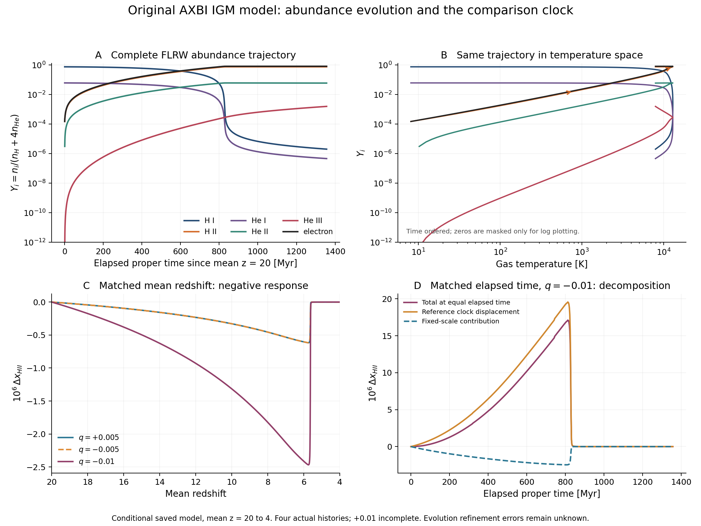
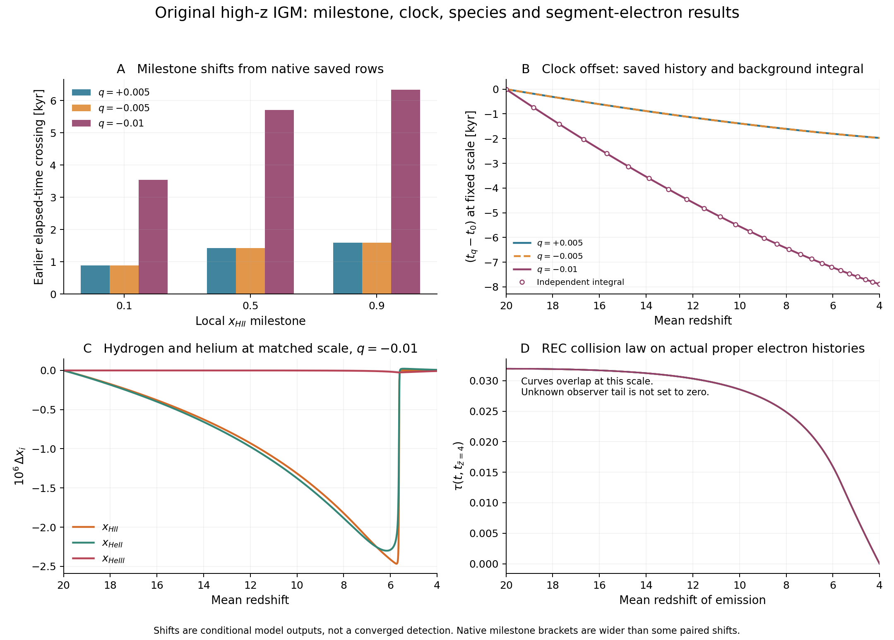

# REI 원 IGM 목표: 고유시간·abundance·milestone 연구 결과

2026-11-15. 이 결과는 `REI-AXBI-GOAL-20261014`의 원래 균질 H/He
재이온화 목표를 따른다. **실제 저장된 네 전체 이력 1,248,952행을
복원하고 소비하여 새 결과 14,130행을 생성했다.** 새 결합 ODE 이력을
계산한 것은 아니다. 중앙 DAG는 **28/88**이며, 이번 진전은 AX11의
좌표 구분·milestone 소과업, AX13의 abundance 결과 제시, 부차적 AX09
전자 이력 소비에 해당한다. AX08 전체 5-case family와 AX11/AX12의
전체 완료를 선언하지 않는다.

## 1. 원래 물리 모델과 복원 범위

선택 모델은 `PLANCKLIKE_MD14_BB50K_CONDITIONAL_HHE_V1`이다. 비기울어진
축대칭 Bianchi I, 고정된 물리 밀도, 평균 적색편이 20→4, MD14 방출률,
50,000 K 흑체, escape fraction 0.2, 초기 기체 온도 8.098143045 K,
primary-only Case-A escape를 유지했다. q_ref는 초기 s/H_F이며,
시간은 각 모델의 zbar=20 초기면부터 잰 경과 고유시간이다. 우주 나이나
관측자의 적색편이와 자동으로 동일시하지 않는다.

ZERO, SHEAR_HALF_PLUS(+0.005), SHEAR_HALF_MINUS(-0.005),
SHEAR_MINUS(-0.01)는 각각 312,238행, zbar=20→4의 완료된 저장 이력이다.
네 history.csv의 전체 SHA-256이 과거 완료 기록과 일치한다.
SHEAR_PLUS(+0.01)는 미완료이며 대칭성으로 만들어 넣지 않았다.
출처는 `INPUT_MANIFEST.json`, 원 모델은 `ORIGINAL_SCENARIO_LOCK.json`에
고정했다. 이 모델의 고적색편이 방출률 외삽, 균질 closure와 원래
정확도 한계는 그대로 남는다.

## 2. 같은 zbar와 같은 경과 고유시간은 다른 비교다

현재 배경에서는 H_q²=H_F²+s_q²이므로 비영 q의 배경은 같은 a에 더
짧은 경과시간으로 도달한다. 저장된 scalar X의 비교는 정확히

    Delta_t X(t) = [X_q(a_q(t))-X_0(a_q(t))]
                + [X_0(a_q(t))-X_0(a_0(t))]

로 분해된다. 첫 항은 같은 부피 척도에서의 차이이고 둘째 항은 기준
이력의 시계 이동이다. 이 분해는 결합 SAME_H 반사실 계산을 대신하지
않으며, 원래 진화 오차를 제거하지도 않는다.

다음 값은 1001개 표본에서 절댓값이 가장 큰 지점의 부호 있는 차이다.
연속 구간 전체의 엄밀한 supremum은 아니다.

| q_ref | 같은 a에서 Delta x_HII | 같은 경과시간에서 Delta x_HII |
| --- | ---: | ---: |
| +0.005 | -6.1679714e-7 | +4.2758266e-6 |
| -0.005 | -6.1679714e-7 | +4.2758266e-6 |
| -0.01 | -2.4671757e-6 | +1.7102717e-5 |

같은 a의 최대 차이는 zbar≈5.73916에 있다. 같은 시간의 최대 차이는
경과시간 약 811.99034 Myr에 있다. q=-0.01의 그 지점에서는

    +1.7102716992e-5 = -2.4563355517e-6 + 1.9559052544e-5.

따라서 부호가 바뀌는 이유는 이 저장 모델에서 기준 이력의 시계 이동
항이 더 크기 때문이다. 이를 곧바로 관측 가능한 비등방 신호나
수렴된 물리적 검출로 해석할 수는 없다. AX11의 진화 refinement
불확실성은 여전히 UNKNOWN이다.

## 3. 실제 이력의 수소 재이온화 milestone

아래 t는 zbar=20부터 잰 경과 고유시간이다. Delta t<0은 그 경과시간
좌표에서 더 일찍 도달한다는 뜻이다. 같은 두 초기면을 기준으로 한
조건부 비교이며 절대 우주 나이의 차이라고 주장하지 않는다.

| x_HII | FLRW zbar | FLRW t [Myr] | Delta t, q=±0.005 [yr] | Delta t, q=-0.01 [yr] |
| --- | ---: | ---: | ---: | ---: |
| 0.1 | 10.24806840 | 277.02164237 | -886.10 | -3544.28 |
| 0.5 | 6.81699117 | 607.75946747 | -1427.69 | -5710.62 |
| 0.9 | 5.80453719 | 789.41727011 | -1584.78 | -6338.96 |

±0.005는 각각 실제 이력에서 계산했고 이 표의 표시 정밀도에서 같다.
각 crossing은 처음 상향 통과하는 원래 인접 행 두 개에 고정했다.
native bracket 폭은 대략 2,136 / 7,367 / 18,123년이다. 일부 paired
shift보다 이 폭이 더 크다. 선형-ln(a) 보간과 국소 PCHIP의 paired
shift 차이는 최대 약 0.00143년이지만, 이것은 보간 방법 민감도이며
전체 진화 오차의 상한이 아니다. 12개 crossing의 원래 행 번호,
양끝 상태, 시각, 적색편이는 `results/milestones.csv`에 보존했다.

FLRW의 zbar=4 끝점은 x_HII=0.9999973171,
x_HeII=0.9742081012, x_HeIII=0.0257843176,
x_e=n_e/n_H=1.0833943523, Tgas=7900.6214 K이다.
그림과 표는 H I/H II/He I/He II/He III/electron을 모두 포함한다.
Y_i=n_i/(n_H+4n_He)와 원소별 fraction, x_e=n_e/n_H를 구별했다.
온도 그림은 시간 순서의 매개곡선이며 온도순으로 정렬하지 않았다.

## 4. 다른 repo의 결과를 어떻게 승인하고 소비했는가

`OWNER_INTAKE.md`에 다섯 producer의 PR와 commit을 고정했다.

| Producer | 승인한 범위 | 이 REI 루프의 실제 소비 |
| --- | --- | --- |
| BASS PR331 | characteristic 에너지·방향 관계, 원 S0 support 실패의 범위 | 복원한 AXBI 배경 104점에서 별도 보존운동량 계산과 대조; S0 H나 gas state는 원 IGM에 대입하지 않음 |
| REC PR199 | proper-electron Thomson law, 양의 확률 합, 해당 각도 격자의 보정 | 네 실제 전자 이력 전체에 충돌률을 적용; 원 GL8의 등방 moment 검증 후 기존 격자 유지 |
| BASS_HE PR154 | 원 F05 local-OTS/escape event ownership | Case-A 원 모델에 F05 OTS 이온화·열을 중복 추가하지 않는 closure 결정을 적용 |
| WU088_HH PR199 | 출처·시계 적합성, H/He 전자 수 보존 | 공유 가능한 원 고적색편이 family 복원, 좌표와 proper density를 실제 consumer에 고정 |
| bass_cr PR167 | 원 F05 CR 활성화 frontier와 열용량 항 | 원 baseline의 CR OFF 유지; 가정한 CR 강도를 물리 데이터로 채워 넣지 않음 |

BASS geodesic 공식과 보존운동량의 상대 차이는 최대 5.56e-16이었다.
원 GL8의 <mu²>는 1/3에 5.6e-16 이내로 맞는다. REC의 midpoint 격자
보정을 다른 격자에 그대로 적용할 필요가 없음을 실제 계산으로
확인했다. 이 test photon 검사는 원 source photon population을 새로
진화시킨 계산이라고 표시하지 않았다.

REC 소비로 얻은 zbar20→4 구간의 Thomson depth는 다음과 같다.

| 경우 | tau_20_to_4 |
| --- | ---: |
| FLRW | 0.03196818270887343 |
| +0.005 | 0.031968117883946684 |
| -0.005 | 0.03196811788394662 |
| -0.01 | 0.03196792341429953 |

이는 비기울어진 균질 전자와 고정 시간 경계에서의 구간 값이다.
zbar=4를 조건부 receiver로 삼은 확률 질량은 1-exp(-tau)와
6.94e-18 이내에서 일치했다. 실제 관측자까지의 tail은 null이며
Planck 총 tau나 편광 sky로 승격하지 않았다.

## 5. 검증, 실패 보존과 승인 한계

별도 표준라이브러리 CSV 판독기와 scalar bisect 보간으로 전체 원본
행과 3,003개의 같은 시간 비교를 대조했다. 분율/전자 최대 차이는
2.0e-15, 온도는 1.46e-11 K였다. 첫 상향 crossing의 bracket과 시간은
일치했고, 60자리 계산의 독립 reciprocal 적분은 안정형 double
clock 적분과 최대 7.63e-6초 차이를 보였다. 저장된 시계의 offset은
독립 배경 적분과 최대 약 103.1초 다르다. 이 역시 후처리 검증이며
원래 coupled evolution 오차와 구별한다.

소스 변조, 좌표 외삽, 비단조 축, comoving n_e를 proper로 위장,
반복 시각, 음의 온도 등 6개 부정 입력을 모두 거부했다. 성공한
전체 실행과 method checks는 Python -O에서도 동작했다. 첫 실행의
pandas 음수 인덱싱 오류와 결과가 없던 종속 검사 실패는
`execution/FAILURE_REPAIR.json`과 raw 로그로 보존했다. 입력을
NumPy 배열로 정규화해 수정했고, 두 번째 실행만 성공했다. 정상
실행과 -O 실행의 성공 결과를 두 번 얻었다거나 byte 재현을 확인했다는
주장은 하지 않는다.

검사는 동일 작성자의 별도 수식·구현을 이용한 자가 적대적 감사다.
독립 저자의 blind referee 심사로 표시하지 않는다. 검증이 통과한
범위는 저장된 조건부 모델의 consumer이며, 다음은 계속 열려 있다:
전체 +0.01 이력, AX11의 시간·에너지·각도 refinement, AX12 source/IC
robustness, 물리적 source/closure 오차, 전체 관측자 tail.

## 6. 재현과 다음 실질 작업

실행 명령·버전·실패 로그·출력 hash는 `REPRODUCIBILITY.md`와
`results/SUMMARY.json`에 있다. 원본을 포함한 복구 archive와 각
R1–R10/C1–C10 checkpoint의 게시·백업 기록은 PR #374 및 단계 기록을
따른다. 게시 성공을 과학적 node 완료로 세지 않는다.

다음 원 목표의 직접적인 작업은 미완료 SHEAR_PLUS의 실제 durable
checkpoint에서 예산과 source identity를 보존하는 복구 실행이다.
찾아낸 checkpoint는 accepted=240480, a=0.10752752205956843이며
그 뒤 CSV tail이 더 진행돼 있다. 따라서 tail의 마지막 행을 재시작
상태로 취급하면 안 된다. 구체적인 상태·hash·기동 한도는
`SHEAR_PLUS_RECOVERY_CANDIDATE.json`을 따른다. 기존 1회 기동과 자동
재시도 0 한도를 보존하고, 새 복구 segment의 실행 계약을 먼저 고정해야
한다. 본 루프는 새 장시간 solver를 실행하지 않았다.

원 수식·문헌: [Fleury–Pitrou–Uzan 2015](https://arxiv.org/abs/1410.8473),
[Madau–Dickinson 2014](https://arxiv.org/abs/1403.0007),
[Planck 2018 VI](https://arxiv.org/abs/1807.06209).
재현 가능한 수치 근거는 이 디렉터리의 결과 파일과 exact source
manifest이며, 문헌이 여기의 새 수치를 입증하는 것으로 인용하지 않았다.
