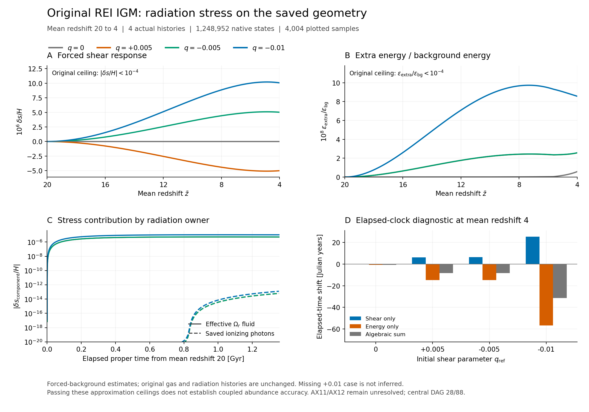

# REI 원 IGM: 네 실제 이력의 복사 응력과 기하 되먹임

연구 단위 `REI-AXBI-STRESS-OWNER-20261116`. 원 목표 `REI-AXBI-GOAL-20261014`.

## 결론과 owner 판정

원래의 네 완료 이력에서 총 **1,248,952개 상태**를 실제로 읽어 복사 압력
비등방성, 유효 배경복사와 이온화 광자의 전단 기여, 열에너지, 경과시간
변화를 계산했다. 저장 산출물은 **4,004행**이고 극값은 표본만이 아니라
모든 원본 행에서 구했다. 전단 진단의 기존 사례 범위는 2/4에서 **4/4**로
늘었다. 이는 새로운 coupled ODE 궤적 생성이 아니라 원 모델의 실제 저장
상태를 소비한 새로운 물리량 산출이다.

네 사례 모두 원 계약의 `max |delta_s/H| < 1e-4`와
`max epsilon_extra/epsilon_background < 1e-4`를 충족했다. 가장 큰
q=-0.01 사례에서 각각 **1.02104978e-5**, **9.72886130e-8**이다.
원래 전단 대비 응답은 최대 **0.871412%**이며, 전단의 크기를 감소시키는
방향이다. owner 판정은 **가용 네 사례의 고정 배경 근사 유효성 진단 수용**이다.
이 자료를 원 AX03·AX08의 누락 복사 되먹임 항목에 직접 소비한다.

중앙 DAG는 **28/88 → 28/88**, delta 0이다. 원 다섯 사례는 여전히 **4/5**,
AX11 시간·에너지·각도 refinement와 AX12 source·초기조건 변형은 미완료다.
working 33/88은 별도 관점이며 가산하지 않는다. 원 17개 노드의 과거
STATE에서 9/17이 완료 표기되어 있으나, 준비·보고 노드도 포함한 이력적
집계다. 이번 진단을 새 독립 노드로 만들어 완료 수를 부풀리지 않는다.

## 조사와 선행 결과의 수용

선행 전수 목록의 REI PR 372개와 브랜치 426개를 재사용하고, 연결된 일곱
저장소의 **2,062개 remote head SHA**를 새로 확인했다. 저장소별 수는
rei_bianchi 427, bass 421, BASS_HE 174, WU088_HH 210, bass_cr 246,
rec_bianchi 219, vigilode 365다. 회수 가능한 대화 문맥, 백업 검색 및
실제 로컬 체크아웃의 읽기 전용 조사도 사용했다. 모든 과거 대화의 의미나
모든 백업의 전체 바이트를 읽었다는 주장은 하지 않는다. 범위와 한계는
`SURVEY_COVERAGE.json`에 있다. 전체 head 목록은 별도 보존본에 있다.

[PR374](https://github.com/cosmosapjw-quantum/rei_bianchi/pull/374)는 조사 중
진행하여 최종 head `4554fc34765422f1c67e91c99ecac1bc9559fcce`, tree
`4a1e43a2f1339821c01585cbd093e16c58680180`에서 10단계를 완료했다.
그 owner 판정, 원본 포함 백업 receipt, +0.01 복구 후보는 공개된 해당
commit의 Git blob과 로컬 파일 바이트가 같은 것을 확인하고 수용했다.
선행 abundance 14,130행은 이번 새 4,004행으로 다시 세지 않는다.

| 생산자 | 이번에 실제로 수용·소비한 내용 | 원 모델에서의 범위 |
|---|---|---|
| BASS #331 | 보존 covariant photon momentum으로 현재 방향과 초기 방향의 복사 모멘트를 계산 | 원 AXBI의 시간에 따라 변하는 H와 b에 적용; S0 이력은 대입하지 않음 |
| REC #199 | proper electron과 angular measure의 구분; PR374의 실제 전자 이력 소비를 선행 결과로 수용 | 원 GL8 및 조건부 수신자 유지; donor midpoint 실패는 별도 범위 |
| BASS_HE #154 | 재결합 사건·에너지의 단일 소유권 | 원 Case-A 이력에 OTS 광자·열원을 중복 추가하지 않음 |
| WU088_HH #199 | source·시계 호환성과 H/He 전하 inventory | 원 고적색편이 source와 proper ne 소비; D/HD 채널 생성 없음 |
| bass_cr #167 | 열입자 수와 binding energy의 구분 | 실제 T, nH, nHe, ne로 열에너지 계산; CR OFF 유지 |
| BASS Type-II #334 | 반응 proper clock·부피 팽창·복사 변환의 구분 | 비기울어진 Bianchi I에 tilt/Type-II 인자를 이식하지 않음 |

정확한 commit pin과 승인 범위는 `OWNER_INTAKE.md`에 있다. 광자 경로의
문헌 근거는 [Fleury, Pitrou & Uzan, PRD 91, 043511 (2015)](https://arxiv.org/abs/1410.8473)이다.
SciSpace·Exa로 원 논문과 공식 출처를 확인했고, Parallel의 Planck 재이온화
식 확인은 선행 Thomson 결과의 관측량 범위를 고정하는 데 사용했다.
수치값의 직접 근거는 외부 문헌이 아니라 이 단위의 원본 SHA, 계산 코드,
`results/STRESS_SUMMARY.json`이다.

## 정의, 가정과 직접 유도

원 조건부 모델 `PLANCKLIKE_MD14_BB50K_CONDITIONAL_HHE_V1`을 유지한다.
평균 적색편이 20→4, 비기울어진 균질 축대칭 Bianchi I, 초기 b=0,
MD14 source, Tstar=50,000 K, fesc=0.2, primary H/He, Case-A escape다.
H0=67.4 km s^-1 Mpc^-1, Omega_m=0.315, Omega_r=0.000092,
YHe=0.2454이며, 실제 광자 전달은 원 angular GL8 이력이다.

계량과 전단 컨벤션은

\[
ds^2=-c^2dt^2+a^2e^{-2b}(dx^2+dy^2)+a^2e^{4b}dz^2,\qquad
s=\dot b,\quad H^2=H_F^2+s^2.
\]

직교 기저 전단은 diag(-s,-s,2s), sigma²=3s²이다. 저장된 이온화 광자의
U2는 이미 각도 적분한 eV/H 단위의 이차 모멘트이므로

\[
\Delta P_{\rm ion}=P_\parallel-P_\perp
=n_{\rm H}^{\rm proper}\,U_2\,(1.602176634\times10^{-19}\,\mathrm{J/eV}).
\]

nH는 cm^-3에서 m^-3로 10^6배 변환한다. 4pi나 a^-3를 다시 곱하지 않는다.
열에너지는 `(3/2) k_B T (nH+nHe+ne)`이고, 전자는 열입자 수에는 포함되나
핵 수에는 포함되지 않는다. 전하 census를 원 ionic fractions와 대조했다.

초기에 등방적이었던 유효 질량 없는 collisionless Omega_r 복사에 대해
현재 국소 방향 mu에서

\[
D^2=e^{-2b}(1-\mu^2)+e^{4b}\mu^2,\qquad
J_\ell(b)=\frac12\int_{-1}^1P_\ell(\mu)D^{-4}\,d\mu,
\]

\[
\epsilon_r=\epsilon_{r0}a^{-4}J_0,\qquad
\Delta P_r=\epsilon_{r0}a^{-4}J_2,\qquad
\epsilon_{r0}=\frac{3H_0^2c^2\Omega_r}{8\pi G}.
\]

초기 방향 mu_i를 쓰면
`R²=e^(2b)(1-mu_i²)+e^(-4b)mu_i²`,
`mu_local=mu_i e^(-2b)/R`이고 `J_l=(1/2) integral R P_l(mu_local) dmu_i`다.
이 두 표현을 별도로 적분해 각도 Jacobian 누락·중복을 검사했다.
Wolfram으로 확인한 작은 b 전개는

\[
J_0=1+\frac85b^2-\frac{16}{21}b^3+\frac8{35}b^4+O(b^5),
\qquad
J_2=-\frac85b+\frac87b^2-\frac{16}{35}b^3-\frac{40}{231}b^4+O(b^5).
\]

원 H와 광자 궤적을 고정한 강제 응답은

\[
\dot{\delta s}+3H\delta s=\frac{8\pi G}{3c^2}(\Delta P_r+\Delta P_{\rm ion}),
\qquad\delta s(t_i)=0,
\]

\[
\delta s(t)=\frac{8\pi G}{3c^2a^3(t)}
\int_{t_i}^t a^3(t')\,[\Delta P_r+\Delta P_{\rm ion}]\,dt'.
\]

G/c²의 차원은 m/kg, 압력과 곱하면 s^-2이므로 전단 방정식의 차원과
맞는다. 초기 경계와 b=0 극한을 명시적으로 사용한다. 전체 coupled
선형응답을 풀면 `3s delta_H` 및 delta_b에 따른 복사 모멘트 변화도 필요하다.
여기서는 그 시스템을 풀지 않았으며, 위 결과는 원 배경 위의 강제 응답이다.

고정 밀도에서 전단의 팽창 기여와 경과시간 효과를 분리하면

\[
\frac{\delta H_{\rm shear}}H=\frac{s}{H}\frac{\delta s}{H},\qquad
\delta t_{\rm shear}=-\int_{t_i}^t\frac{\delta H_{\rm shear}}H\,dt'.
\]

유효 복사의 monopole 증가, 저장 이온화 광자 및 가스 열에너지의 합은
별도의 `epsilon_extra`로 계산했다. 이를 기존 Friedmann 식에 대수적으로
넣은 energy-only 시계 항도 별도 보고한다. stellar source와 baryon
rest energy의 전체 보존을 다시 닫지 않았으므로 두 시계 항의 합도
self-consistent한 새 진화해로 해석하지 않는다. 모든 시간은 각 사례의
평균 적색편이 20 이후 경과 proper time이고 cosmic age가 아니다.

## 새 물리 데이터

| q_ref | max abs(delta_s/H) | max epsilon_extra/epsilon_background | max abs(delta_s/s) |
|---:|---:|---:|---:|
| 0 | 3.77656581e-23 | 5.80937768e-9 | 정의하지 않음 |
| +0.005 | 5.08053550e-6 | 2.56913088e-8 | 0.866953% |
| -0.005 | 5.09707434e-6 | 2.57471796e-8 | 0.869935% |
| -0.01 | 1.02104978e-5 | 9.72886130e-8 | 0.871412% |

표의 전단 크기는 절댓값이다. +0.005의 실제 응답은 음수, 두 음의 q 사례의
응답은 양수다. q=-0.01 전단 응답의 최대는 평균 적색편이
4.87464683496, 경과시간 1027.55348176 Myr에서 나타난다. 에너지 비율의
최대는 별도로 평균 적색편이 7.33188478278에서 나타난다. 두 극값을
같은 시각에서 발생한 것으로 취급하지 않는다.

q=-0.01에서 실제 이온화 광자만의 `max |delta_s/H|`는
**1.25906452e-13**이다. 지배적인 항은 원 Omega_r 유효 배경복사의 비등방
압력이며, 두 항의 최대 크기를 비교하면 약 8 orders 차이가 난다.
q=0의 3.78e-23은 저장 quadrupole의 극히 작은 잔여량이며 물리적 검출로
해석하지 않는다.

| q_ref | delta_t_shear [yr] | delta_t_energy [yr] | 대수적 합 [yr] |
|---:|---:|---:|---:|
| 0 | 0 | -0.819751 | -0.819751 |
| +0.005 | +6.292327 | -14.735132 | -8.442804 |
| -0.005 | +6.309029 | -14.768645 | -8.459617 |
| -0.01 | +25.268561 | -56.680197 | -31.411636 |

이 표는 평균 적색편이 4의 endpoint다. 전단의 감소는 팽창을 늦추므로
shear-only 경과시간을 증가시키고, extra energy는 반대로 작용한다.
원래 고정된 전단이 FLRW 대비 만든 시간 변화와 이 작은 복사 응력 보정은
서로 다른 양이다.

## 원 abundance 목표와의 연결

선행 PR374의 저장 모델에서 q=-0.01 HII 차이는 fixed mean scale 표본
최대점에서 -2.4671757e-6, fixed elapsed time 표본 최대점에서
+1.7102717e-5다. 같은 시점의 동일한 비교가 아니라 서로 다른 비교량이다.
equal-time peak의 분해는 -2.4563356e-6의 fixed-scale 항과
+1.9559053e-5의 기준 시계 이동 항이다. 따라서 실제 abundance 해석에는
시계의 정의와 geometry 오차를 함께 소비해야 한다.
이 값의 근거는 [고정 commit의 선행 보고서](https://github.com/cosmosapjw-quantum/rei_bianchi/blob/4554fc34765422f1c67e91c99ecac1bc9559fcce/research/rei_axbi_owner_loop_20261115/REPORT_KO.md)다.

이번 결과는 그 해석에 필요한 누락 복사 응력의 크기와 시계 효과를
정량화했다. 그렇다고 계산된 약 31년을 abundance 오차로 환산하거나,
선행 xHII=0.5 crossing의 약 5711년 이동을 검출이라고 승인하지 않는다.
그 판단에는 원 AX11의 paired evolution error와 AX12가 여전히 필요하다.

반전된 half-shear 두 이력의 scalar odd part는 HII 2.55e-15,
HeII 1.59e-14, HeIII 6.42e-16, Tgas 1.63e-9 K였다. 각각 원 floor
1e-7 및 0.01 K 아래다. 이는 저장 추정치의 분해능 이하라는 뜻이다.
Tr(sigma³)=6s³이므로 axisymmetry만으로 정확한 +/- scalar 대칭을
주장할 수 없다. 누락된 +0.01 이력을 -0.01에서 만들어 넣지 않았다.

## 구현과 자기 적대적 검증

| 항목 | 실제 증거 | 판정 범위 |
|---|---|---|
| 원본 identity | 네 원본의 전체 SHA-256·크기·행 수 일치 | implementation-verified |
| 소스 소비 | 1,248,952 native rows, 출력 4,004 rows | 실제 저장 물리 상태 |
| 전하·핵 수·기하·photon moment | 각 원본 행에 contract check | 조건부 입력 일관성 |
| 별도 scalar CSV 판독 | 전체 원본 행 순회, 출력 4,004개 좌표 join | consumer 독립 판독 |
| cgs→SI 압력/열에너지 | 상대 차이 각각 4.31e-16, 1.42e-15 이하 | 단위·normalization |
| 초기 방향 adaptive integral | 84개 각도 검산; J2 차이 1.85e-16 이하 | 각도 표현 일치 |
| native-time와 ln(a) 적분 | endpoint delta_s/H 차이 4.34e-17 이하 | 후처리 적분 일치 |
| 과거 두 사례 reconstruction | ZERO, +0.005의 원 재구성과 일치 | 중복 계산 재사용 |
| 부정 입력 | nonfinite b, domain 밖 b 거절 | 잘못된 입력 거부 |

주 consumer는 1회 성공, outer wall 11.4708 s, inner wall 10.5632 s,
CPU 10.4968 s, max RSS 331,324 KiB였다. 감사는 1회 성공,
outer wall 10.4416 s다. Python 3.12.14, NumPy 2.3.5,
pandas 2.2.3, SciPy 1.17.0에서 실행했다. 그림은 Matplotlib 3.10.8로
출력하고 실제 PNG를 검사했다. 새 coupled ODE 실행은 0회다.

동일 작성자가 별도 공식·단위계·판독기로 적대적 검증했다. subagent와
독립 작성자 blind referee는 없었다. 문서의 G/c² 단위 표기를 m/kg로
고쳤고, 전체 선형응답으로 과장될 수 있는 표현을 고정 배경 진단으로
명확히 했다. 수치 코드·출력·원 허용오차는 이 문서 교정으로 변경되지 않았다.
정량 검증은 후처리 정확도에 대한 것이고 원 ODE의 수렴 증명이 아니다.

## 보존, 게시 경계와 다음 작업

각 단계는 Rn/Cn의 paired checkpoint, 자체 commit, local tag,
member hash/CRC가 확인된 ZIP과 비공개 원격 저장 receipt를 남긴다.
이번 새 GitHub push는 자동 승인 검토가 정확한 payload·공개 목적지에 대한
승인이 부족하다고 판단하여 차단했다. 원 과학 작업은 계속 완료했고,
공개 후보 파일은 별도의 명시적 manifest로 검토할 수 있게 준비한다.
GitHub 게시 성공이나 새 PR 생성은 주장하지 않는다.

원본 네 이력은 PR374의 279,069,631-byte source-full archive에 이미
있다. 그 전체 원격 readback 검증 receipt를 고정 commit에서 수용했으며,
이번 단계 백업과 함께 복구할 수 있다. 원본이 있는 척하는 결과-only
백업으로 대체하지 않는다. `REPRODUCIBILITY.md`와 handoff를 따른다.

다음 원 목표 작업은 실제 +0.01 full-state checkpoint를 새 bounded
recovery segment로 이어받는 것이다. 현재 확인된 durable accepted는
240480, a=0.10752752205956843이다. CSV tail은 더 앞서 있으므로 restart
state가 아니다. 원 source/config/binary identity, 누적 예산 잔여량,
중복 기동 방지와 abandoned tail 보존을 고정하고 단일 복구 실행을 한다.
이후 실제 zbar4 이력을 소비하고 이미 정의된 AX11·AX12로 진행한다.
새 진단 목록이나 감사 gate를 더 만드는 작업은 이번 stop condition 밖이다.
