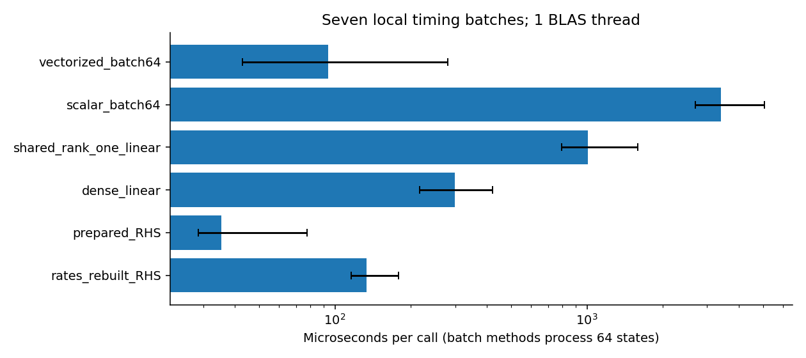
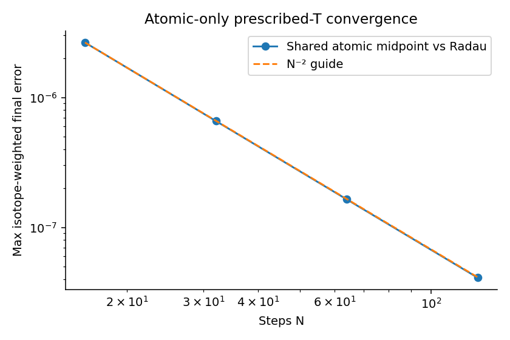
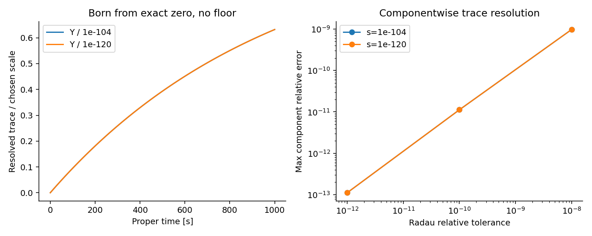

# REI: sandbox에서 실행한 이론·코딩 연구 루프

작성일: 2026-10-22. 대상: `rei_bianchi`의 C2 다음 작업 단위.

## 결과와 채택 범위

21개 동위원소·전하 상태를 유지하는 국소 계산 모듈을 구현하고, **기본 진단
156개 PASS와 별도 추가 검사 2개 PASS**를 확보했다. 두 실행은 구분해 기록했다.
독립 검토 판정은 `PASS_SCOPED_CONDITIONAL_LOCAL_SANDBOX`이며 상세 근거는
[REVIEW.md](REVIEW.md)와 [INDEPENDENT_REVIEW.json](evidence/INDEPENDENT_REVIEW.json)에 있다.

이번에 완성한 구성은 고정된 온도·외부 스펙트럼에서의 원자 반응 RHS/Jacobian,
전자 피드백을 포함한 선형계, 원자계의 양성성을 보존하는 2차 적분기, 명시적으로
주어진 핵반응·붕괴 사건의 source/Jacobian, 에너지 장부와 공통 온도식이다.
물리적 계수·채널·에너지 분배가 주어지는 부분만 계산한다. 완전한 핵·원자·열·복사
결합 궤적은 후속 물리 입력과 별도 유한 적분 계약에 연결된다.

진단 본체의 측정 시간은 wall **10.3994초**, CPU **10.2784초**이며 이 타이머는
모듈 import 이후 시작한다. 프로세스 최대 RSS는 **111128 KiB, 약 108.52 MiB**였다.
한 CPU 프로세스, BLAS 1 thread로 실행했으며 기존 C1/C2 검사와 우주론 IVP는
이번에 다시 실행하지 않았다. 원자료는 [RESULTS.json](evidence/RESULTS.json),
[EXECUTION.json](evidence/EXECUTION.json), [TIMING.json](evidence/TIMING.json)에 있다.

## 1. 물리 구조에서 얻은 계산 단순화

### 1.1 상태를 보존하면서 전하 블록 공유

상태는 절대 abundance \(Y_i=n_i/n_B\)이며 순서는
\(n\), H1 I/II, D I/II, T I/II, He3 I/II/III, He4 I/II/III,
Li6 I/II/III/IV, Li7 I/II/III/IV의 21개다. 정규화된 예제에서는
\(A^TY=1\)이다. donor 모델의 동위원소별 전자 계수 동일성 아래 원자 생성자는

\[
B=\operatorname{diag}(0,B_H,B_H,B_H,B_{He},B_{He},B_{Li},B_{Li})
\]

로 분해된다. 서로 다른 동위원소의 abundance와 전하 분율을 그대로 두고
\(2\times2\), \(3\times3\), \(4\times4\) 블록의 계산을 공유할 수 있다.
중성자 블록은 RHS에서 0이고 resolvent와 exponential에서는 항등 작용이다.
13개 인접 전하 전이의 paired flux는 각 동위원소 총량을 보존한다.

이 단순화는 원자 전자 계수에 관한 정확한 재사용이다. 핵종을 바꾸는 사건은
별도의 stoichiometric source로 유지한다. 따라서 처음에 중성자나 삼중수소가
없더라도 나중에 생성되는 방향이 상태 공간에 남는다.

### 1.2 전자 피드백 Jacobian과 분모의 하한

\(P=G_0\), \(R=G_{rr}+G_{dr}\), 전하 벡터 \(q\), 독립적으로 주어진
fast-electron abundance \(f\)를 쓰면

\[
n_e=n_B(q^TY-f),\quad B=P+n_eR,\quad u=n_BRY,
\]
\[
F=BY,\qquad J_{YY}=B+uq^T,\qquad J_{Yf}=-u.
\]

전자 밀도가 조성에 의존하는 효과는 정확한 rank-one 항이다. 이를 생략한 음성
대조군의 상대 오차는 0.594 수준이어서 실제 검사에서 구분되었다.

\(M=I-hB\), \(z=M^{-1}b\), \(w=M^{-1}u\)라 하면

\[
(I-hJ)^{-1}b=z+\frac{hw(q^Tz)}{d},\qquad d=1-hq^Tw.
\]

추가로 물리 영역에서 **\(d\ge1\)**임을 유도했다. Adjoint resolvent의
인접 전하 차이 \(\delta_{Zj}\)가 양의 우변을 가진 삼대각 M-matrix
방정식을 만족하므로 \(\delta_{Zj}>0\)이다. 하향 재결합의 부호와 결합하면

\[
q^TM^{-1}u=-n_B\sum_{a,j}\alpha_{Z,j+1}Y_{a,j+1}\delta_{Zj}\le0
\]

가 된다. 이 결론의 조건은 \(Y\ge0\), \(h\ge0\), \(n_B\ge0\),
비음수 원자 계수와 \(n_e\ge0\)이다. 전체 행렬의 condition number까지
제한하는 정리는 아니다. Signed trial과 핵·열 변수를 붙인 Jacobian에는 별도
분석이 필요하다. 완전한 전개와 경계식은
[THEORY_DERIVATION.md](THEORY_DERIVATION.md)에 있다.

코드는 공유 삼대각 해법과 rank-one 보정을 구현했고, pivot·분모·원래 선형식의
잔차를 검사한다. 수치적으로 부적절한 경우 같은 식의 dense 해법으로 전환한다.
관측된 27개 물리 영역 사례에서는 fallback이 0회였다.

## 2. 실제 측정에 따라 선택한 최적화

같은 입력과 방정식, BLAS 1 thread에서 7개 반복 batch를 측정했다. 아래 범위는
반복별 호출 시간의 최솟값–최댓값이며 신뢰구간은 아니다.

| 비교 대상 | 중앙값, µs/호출 | 관측 범위, µs/호출 | 선택 |
|---|---:|---:|---|
| 호출마다 원자 계수를 재계산하는 RHS | 133.591 | 115.711–178.715 | 기준 비교 |
| 계수를 준비해 재사용하는 RHS | 35.338 | 28.673–77.634 | **3.78배**, 채택 |
| dense 21차원 선형계 | 298.308 | 216.629–421.634 | **기본값** |
| 공유 블록 + rank-one 선형계 | 1010.487 | 793.551–1593.313 | 정확한 대안으로 유지 |
| 상태 64개 scalar loop RHS | 3405.580 | 2697.690–5054.817 | batch 기준 비교 |
| 상태 64개 vectorized RHS | 93.943 | 42.912–281.006 | **36.25배**, 채택 |

21차원에서는 dense가 현재 Python 공유 블록 구현보다 약 **3.39배** 빨랐다.
공유 블록 구현의 원래 식 잔차 검사 비용도 이 측정에 포함된다. 연산 수를 줄이는
정확한 대수 구조와 이 환경의 실제 실행 속도를 분리해 판단했다.

PreparedAtomic의 온도·스펙트럼은 생성 시 고정된다. 이 입력이 바뀌면 객체를
다시 준비한다. 9개 객체에서 관측한 준비 시간 중앙값은 5.231 ms, 범위는
3.166–17.339 ms였다. 위 속도비는 같은 계수를 반복해서 쓰는 국소 계산에 대한
측정이며, 전체 결합 궤적의 가속비로 해석하지 않는다. Batch 비교를 상태당
비용으로 환산하면 53.212 µs에서 1.468 µs로 감소했다.



그림의 각 비교쌍 안에서 속도를 비교한다. 단일 RHS, 단일 선형계, 64개 상태
batch는 서로 다른 작업량이다. 오차 막대는 측정 최솟값–최댓값이다.

## 3. 양성성과 보존을 유지하는 원자 적분

채택한 exponential midpoint는

\[
Y_{1/2}=\exp[\tfrac h2 B(Y)]Y,\qquad
Y_{new}=\exp[hB(Y_{1/2})]Y
\]

이다. 전개하면 \(Y_{new}=Y+hF+\tfrac12h^2JF+O(h^3)\)가 되므로
고정된 \(T,UV,n_B\), \(f=0\)의 매끄러운 원자계에서 2차 정확도를 갖는다.
각 exponential은 정확한 산술에서 비음수 column-stochastic map이므로
동위원소별 총량과 baryon 수를 보존한다. 코드는 결과를 clipping하거나
renormalization하지 않는다.

이는 Blanes–Iserles–Macnamara의 알려진 방법인 §3.3 식 (3.8)을 현재 상태에
적용한 것이다. 방법 자체의 신규성을 주장하지 않는다.
원전: [Positivity-preserving methods for ordinary differential equations](https://arxiv.org/html/2102.08242v2).

\(T=1000\) K, UV=1, \(n_B=10^6\,\mathrm{m}^{-3}\)에서
\(t_f=1/\max[-\operatorname{diag}B(Y_0)]\)로 정한 한 국소 사례를
고정밀 Radau 기준해와 비교했다. \(t_f\)는 약 \(1.6458\times10^{11}\) s이며,
이 시간 동안 계수와 배경을 고정한 수치 시험이다.

| step 수 N | 동위원소 가중 최종 오차 | 직전 해상도 대비 관측 차수 |
|---:|---:|---:|
| 16 | 2.64824e-6 | — |
| 32 | 6.58842e-7 | 2.00703 |
| 64 | 1.64306e-7 | 2.00354 |
| 128 | 4.10260e-8 | 2.00178 |

최대 동위원소 상대 보존 오차는 \(1.073\times10^{-15}\)였고 관측한 최소
동위원소 내 분율은 0.106048로 양수였다. 이것은 선택한 유한 사례의 수렴
근거이며 모든 강성 영역의 균일 오차 한계를 대신하지 않는다.



## 4. 정확한 0에서 생성되는 핵종과 극미량의 수치 표현

### 4.1 채널이 명시된 사건 계산

한 사건의 reactant multiplicity를 \(a_{ij}\), 차수를 \(m_j\)라 두면

\[
R_j=k_jn_B^{m_j-1}\frac{\prod_iY_i^{a_{ij}}}{\prod_i a_{ij}!},
\quad S=\sum_j\nu_jR_j,
\quad J_S=\sum_j\nu_j(\nabla R_j)^T.
\]

동일한 두 reactant에는 \(1/2!\)가 들어간다. 도함수는 지수를 줄인 다항식으로
계산하므로 reactant가 0이어도 정의된다. \(R_j a_i/Y_i\)처럼 0으로 나누는
표현을 사용하지 않는다. 모든 사건은 정수 stoichiometry로 \(A^T\nu_j=0\)를
검사한다. 이 인터페이스는 이미 채널별로 분해된 계수를 받으며 parent/probability
metadata는 명시적으로 거절한다. 분기 확률을 추정하지 않는다.

기본 156개 검사 뒤에 확인한 coverage 공백을 채우기 위해 **두 개만** 추가 실행했다.
두 사건은 D II의 abundance 0.5, \(n_B=1\), \(\ln k=-25\)를 사용한다.

| 제조된 검사 사건 | 초기 target | target source, baryon당 s⁻¹ | 정수 baryon·bare-charge 잔차 |
|---|---:|---:|---:|
| D II + D II → He3 III + n | \(Y_n=0\) | 1.73599e-12 | 모두 0 |
| D II + D II → H II + T II | \(Y_{TII}=0\) | 1.73599e-12 | 모두 0 |

두 flux의 다항식 기준값 대비 상대 오차는 \(1.5123\times10^{-15}\)였다.
이는 **제조된 계수와 명시적으로 0을 준 제조 에너지 장부**의 source-onset 검사다.
실제 DD 반응률이나 Q 값을 측정한 결과가 아니다. 원자료:
[TARGETED_SOURCE_ONSET.json](evidence/TARGETED_SOURCE_ONSET.json).

### 4.2 미량 성분은 성분별 오차로 확인

정확한 0에서 시작하는 abundance를 보존하기 위해 절대 \(Y\)를 저장하고 필요할
때 고정 양의 scale \(s\)를 사용해 \(z=Y/s\)를 계산한다. 단순한 log-only
좌표는 생성 시작점에서 특이해진다. Scale은 주어진 시험 inventory/source의
크기로 정하며 abundance floor로 쓰지 않는다.

해가 \(Y(t)=-s\operatorname{expm1}(-0.001t)\)인 scalar source-loss
문제를 \(0\le t\le1000\) s에서 검사했다. 아래는 최대 성분 상대 오차다.

| scale s | rtol=1e-8 | rtol=1e-10 | rtol=1e-12 |
|---:|---:|---:|---:|
| 1e-104 | 9.72540e-10 | 1.12333e-11 | 1.11557e-13 |
| 1e-120 | 9.72540e-10 | 1.12334e-11 | 1.11675e-13 |

총 6개 scalar 기준 시험이며 위의 두 핵 source-onset 검사와 구분된다. 이 결과가
증명하는 것은 scaled 표현의 성분별 해상도다. 작은 성분을 큰 성분의 전역 norm
뒤에 숨기지 않았다. SciPy의 오차 제어가 \(atol+rtol|y|\)를 사용한다는 점은
[사용 버전의 solve_ivp 문서](https://docs.scipy.org/doc/scipy-1.17.0/reference/generated/scipy.integrate.solve_ivp.html)에서 확인했다.



두 scale을 나누어 표시한 곡선이 겹치는 것은 같은 무차원 ODE를 선택한 결과다.
독립적인 두 물리 반응이 같은 궤적을 보였다는 의미는 아니다.

작은 계수는 곱하기 전에 0으로 만들지 않도록 log flux를 먼저 합친다. 예를 들어
\(\ln k=-800\)은 binary64에서 k만 지수화하면 0이지만, 주어진 밀도·reactant와
결합한 \(\ln R=-720.9881\)은 \(R=7.56556\times10^{-314}\)로 표현되었다.
더 작은 값은 유한한 log와 underflow 상태를 보존한다. 계수 부재, 구조적 0,
reactant 0, density 0, 표현 범위 underflow를 구분한다.

## 5. 에너지 장부·열식·보간의 연결

사건별 에너지는 기존 C1의 neutral-atom reference에서

\[
Q_0+W=\Delta I+\Delta E_{th}+\Delta E_{fast}+\Delta E_{exc}
+\Delta E_{\gamma,ret}+E_{\gamma,esc}+E_\nu
\]

를 검사하고 각 저장고의 source를 별도로 반환한다. 원자 donor의 beta 행렬은
제외하고 평가된 decay 계수를 사건층에서 한 번 적용한다. Beta의 수치 계수
검사는 재사용한 평가 입력에 의존하며, 이번 beta 에너지 장부는 제조된 장부다.

공통 온도의 입자수는 \(C=(1+q)^TY-f\)이고

\[
\dot T=-2HT+
\frac{2Q_{per\,baryon}/(3k_B)-T\dot C}{C},\qquad
\dot C=(1+q)^TF-\dot f.
\]

핵의 수가 바뀌는 2→1 capture에서는 전자 수가 그대로여도 \(C\)가 바뀐다.
따라서 전자 수 변화만 넣던 식의 누락을 실제 음성 대조로 확인했다.
\(Q_{per\,baryon}\), \(f\), \(\dot f\)는 공급된 입력이며 빠진 재결합 열이나
fast-electron stopping을 자동으로 0이라 가정하지 않는다. 외부 독립변수로
옮길 때 \(F/(sH)\), \(S^{-1}JS/H\)를 한 번 적용한다.

저장된 핵반응 세 knot는 기본적으로 `KNOT_ONLY`다. \(x=\ln T\),
\(g=\ln k\)에서 실제 구간 곡률 한계 \(|g''|\le M\)가 공급되어야만

\[
|g-L|\le M(\Delta x)^2/8,\qquad
\left|k_{interp}/k-1\right|\le\operatorname{expm1}[M(\Delta x)^2/8]
\]

를 사용해 보간을 허용한다. 세 점만으로 M을 추정해 물리 정확도를 선언하지 않는다.

## 6. 검증 근거와 재현

| 항목 | 관측 | 적용 기준 |
|---|---:|---:|
| 원자 grid 상태 | 54 | 고정 T/UV/nB와 3종 상태 |
| RHS 최대 정규화 잔차 | 1.852e-16 | ≤512 epsilon |
| 직접 Jacobian 대수 잔차 | 0 | ≤512 epsilon |
| complex-step Jacobian 최대 상대 잔차 | 1.427e-16 | ≤1e-10 |
| 선형계 최대 backward 잔차 | 2.447e-16 | ≤1e-12 |
| dense 기준 최대 forward 차이 | 1.407e-15 | ≤1e-10, cond≤1e8 |
| 최대 측정 condition number, infinity norm | 1068.35 | 조건과 함께 보고 |
| rank-one 분모 범위 | 1.0000000277–1.71675305 | 물리 영역 d≥1 |

물리·수치 계약은 실행 전에 [EXECUTION_CONTRACT.md](EXECUTION_CONTRACT.md)에
고정했다. 최초 기본 진단의 세 코드 파일과 계약 SHA는 추가 검사 뒤에도 유지된다.
별도 두 검사의 source identity, 명령, 종료 상태는 별도 receipt에 있다.
Matplotlib은 기본 config 디렉터리를 만들 수 없어 임시 cache를 사용했으며
경고 원문을 [RUN_STDERR.log](evidence/RUN_STDERR.log)에 보존했다.

필수 작은 입력을 모두 포함하므로 복원한 프로젝트 또는 제공한 묶음에서 다음
명령으로 새 임시 디렉터리에 재실행할 수 있다.

```bash
bash research/rei_coupled_isotope_sandbox_20261022/run_fresh.sh
```

이 명령은 전달된 결과를 `recorded_evidence/`, 그림을 `recorded_figures/`에
보존한 작은 복사본에서 기본 진단과 두 추가 검사를 차례로 실행한다. 이번 작업에서
helper 자체는 syntax/help/prepare-only로 확인했고 과학 진단을 추가 반복하지
않았다. 설치된 Python 3.12.14, NumPy 2.3.5, SciPy 1.17.0, Matplotlib 3.10.8을
사용했으며 offline 실행에 donor checkout이나 전체 과거 nuclear history가 필요 없다.

이론 R1–R10과 코드 C3–C10의 대응은 [DAG.json](DAG.json)에, 다음 연구에 필요한
입력과 실행 지점은 [RESUME.md](RESUME.md)에 기록했다. C1/C2는 동일한 전제와
입력 identity 아래 재사용했다. 새 strong no-go나 새로운 적분법의 우선권은
주장하지 않는다. 다음 단위는 실제 채널별 핵반응·에너지 공급자를 이 계산 구성에
연결하고, 유한한 결합 국소 궤적에서 보존과 수렴을 확인하는 작업이다.
