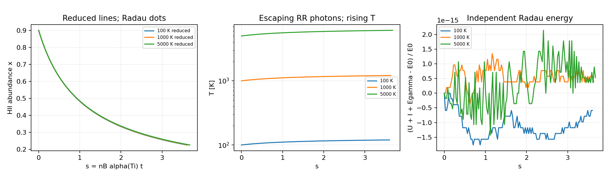
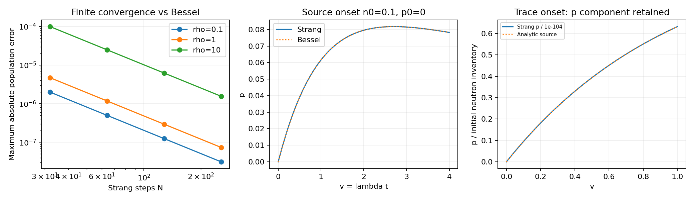
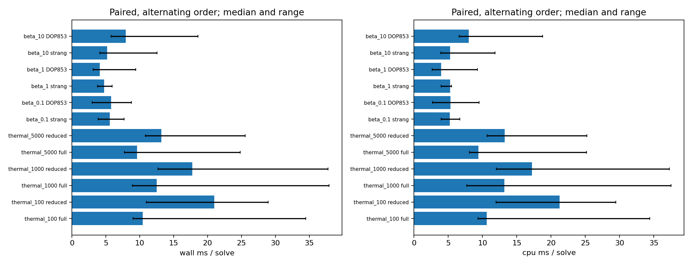

# REI 결합 국소 연구 루프: 열역학 축약과 붕괴–재결합 계산

작업 단위: `rei_coupled_local_flow_20261022`.

## 결과

기존 동위원소–전하상태 코드를 이어, 실제 공급된 계수로 정의되는 두
국소 반응 모형의 유도·구현·수치 검증을 완료했다. 첫째는 온도까지 변하는
순수 수소의 Case-A 복사 재결합이고, 둘째는 온도를 지정한 중성자 beta
붕괴–수소 재결합이다. 첫 모형의 두 상태변수는 정확한 첫 적분으로 하나로
줄였고, 둘째 모형에는 정확한 부분해를 조합하는 양성 보존 알고리즘과
독립적인 Bessel 함수 기준해를 구현했다.

첫 과학 진단은 **103/103 PASS, exit 0**이었다. 이후 전달 경로만 교정한
prepare-only 검사와, 시간 측정의 큰 편차를 해소하기 위한 한 번의 짝지은
성능 검사를 수행했다. 후자는 저장된 기준해를 사용한 96회의 출력 정확도
검사를 통과했다. 이 96회는 새로운 96개 물리 사례가 아니며 첫 103개 검사와
합산하지 않는다. 이전 C1/C2 및 atomic sandbox 진단은 재실행하지 않았다.

완전한 식과 증명은 [THEORY.md](THEORY.md), 입력의 계보는
[SOURCE_INTAKE.md](SOURCE_INTAKE.md), 독립 판정은
[INDEPENDENT_REVIEW.md](INDEPENDENT_REVIEW.md)에 있다.

최종 독립 권고는 **PASS_SCOPED_LOCAL_THERMAL_AND_BETA_FLOWS**이며,
controller는 제시한 두 국소 모형과 유한 검증 범위로 이를 채택했다.
현재 작업 단위에서 열린 정확성 지적은 없다.

## 1. 사용할 물리와 수치 오차의 의미

두 모형은 밀도가 고정된 국소 계산이며 팽창률과 외부 광장은 0이다.
수소 재결합에는 Verner–Ferland의 동일한 수소 계수와 그 계수의 온도
미분으로 정의한 운동에너지 모멘트를 함께 사용한다. 수소 입력은
`A=7.982e-11 cm^3/s`, `b=0.748`, `T0=3.148 K`, `T1=703600 K`이다.
이 값은 기존 입력 복사본과 [저자 원표](https://www.pa.uky.edu/~verner/dima/rec//table1.dat)가
일치한다. 원 논문의 식은 [Verner & Ferland (1996)](https://arxiv.org/pdf/astro-ph/9509083)
Eq. (4)에 있다. 이 작업의 온도 구간은 공급자의 공개 구간 100–10000 K이다.

운동에너지 모멘트는 Maxwell 분포, 고정 표적 및 무시 가능한 반동을
가정한 동일 적합식의 조건부 모멘트다. 아래의 작은 수치 오차는 이 정의된
모형의 방정식을 얼마나 정확히 계산했는지를 나타낸다. 독립적인 실험
열계수의 오차를 이 수치로 정한 것은 아니다.

재결합 뒤 완전한 복사 cascade를 거쳐 나온 에너지는 Case-A 조건으로
탈출한다. 계산량은 누적 bolometric 에너지이며 광자 개수나 스펙트럼은
별도 입력이다. beta 사례는 전자가 지정된 열전자 풀에 즉시 들어간다는
입자 수 모형을 사용한다. 그 사례의 온도는 외부에서 고정한다.

## 2. 온도–이온화 결합식을 하나의 상태변수로 줄였다

수소 이온화율을 `x=Y_HII`, `Y_HI=1-x`로 두고

\[
\kappa(T)=n_B\alpha(T),\qquad
D(T)=\frac{d\ln\alpha}{d\ln T}
\]

를 정의한다. 같은 계수에서 얻는 운동에너지 모멘트는

\[
\Lambda_{\rm RR}=k_BT\alpha(T)\left(\frac32+D\right)
\]

이다. 병진운동에 참여하는 입자 수는 baryon당 `1+x`이므로

\[
U=\frac32 k_B(1+x)T,\quad I=\chi_Hx,\quad \chi_H=13.6\ {
m eV}.
\]

입자 수와 에너지 방정식을 함께 적용하면

\[
\dot x=-\kappa x^2,\qquad
\frac{d\ln T}{dt}=-\frac23\frac{\kappa x^2D}{1+x},
\]
\[
\dot E_\gamma=\kappa x^2\left[\chi_H+k_BT\left(\frac32+D\right)\right],
\qquad \frac{d}{dt}(U+I+E_\gamma)=0.
\]

두 미분방정식에서 공통 반응률을 소거하면

\[
\boxed{\ln\frac{1+x(T)}{1+x_i}
=\frac32\int_{T_i}^{T}\frac{d\ln\theta}{D(\theta)}}.
\]

이것이 이번 계산에 사용한 정확한 첫 적분이다. `w=ln(T/T_i)`만 적분하고
`x(w)`를 복원한다. VF 수소 계수에 대해서는 우변을 세 개의 로그의 합으로
직접 계산할 수 있다. 양의 제곱근 차이를 피한 작은 근 계산,
`log1p`, `expm1`을 사용해 초기 상태 근처의 상쇄를 줄였다. 세부 부분분수
분해와 전체·축약 Jacobian은 THEORY.md의 식 (9)–(20)에 있다.

또한 `T(x)`와 `s=n_B alpha(T_i)t`로 쓴 무차원 궤적은 밀도 및 계수의
전체 진폭에 독립이다. 같은 적합식의 모양과 초기조건이면 한 번 계산한
궤적에 시간 단위 `1/[n_B alpha(T_i)]`만 다시 붙일 수 있다. 이 성질은
식에서 직접 얻으므로 밀도별 반복 적분을 추가하지 않았다.

### 실제 계산

`n_B=1e12 m^-3`, `x_i=0.9`에서 `x_f=0.225`까지 계산했다. 목표 온도는
첫 적분의 단조성을 이용해 bracket한 뒤 구했고, 최종 무차원 시간은
독립 quadrature로 정했다. 각 궤적에는 129개 출력 시점을 사용했다.

| 초기 T | 최종 T | 최종 s | 물리 시간 | 최종 U / 초기 U |
|---:|---:|---:|---:|---:|
| 100 K | 119.838858083 K | 3.600620024 | 4.84010 일 | 0.77264527 |
| 1000 K | 1210.497547970 K | 3.632557975 | 20.98384 일 | 0.78045237 |
| 5000 K | 6126.300286880 K | 3.673633776 | 62.28860 일 | 0.78997030 |

위 시간은 지정한 국소 밀도에서의 결과다. 천체의 관측 역사나 우주론적
재결합 시간을 나타내지 않는다.

수소 적합식에서 `-3/2 < D < -1/2`이므로 온도는 상승한다. 재결합하는
전자는 평균적으로 남은 기체 입자당 평균 운동에너지보다 작은 에너지를
가지고 빠져나간다. 병진운동에너지는 약 21–23% 줄지만 입자 수도 줄어들어
온도는 약 20–23% 오른다. `T * d(1+x)/dt` 항을 누락한 대조식에서는
세 초기 온도 모두 온도 변화의 부호가 반대로 나왔다. 이는 단순 보존량
검사와 별개로 열방정식의 구현을 판별한다.

### 독립 기준해와 잔차

전체 `[x,w,Egamma/E0]`를 Radau, `rtol=2e-12`, `atol=1e-14`로
적분했다. 기준해의 탈출 에너지는 자체 RHS로 독립 적분했다. 전체 2변수와
축약 1변수의 실행 경로는 같은 DOP853, `rtol=1e-9`, `atol=1e-12`를
사용했다. 양쪽 실행 경로의 에너지 출력 복원 작업도 같게 두었다.

| 검증량 | 관측된 최대값 | 사전 기준 |
|---|---:|---:|
| D, D의 미분, 전체 Jacobian의 complex-step 상대 차이 | 5.281e-16 | 1e-7 |
| 로그 primitive와 직접 quadrature의 절대 차이 | 1.111e-16 | 2e-11 |
| 목표 x의 root 잔차 | 5.357e-15 | 2e-11 |
| 전체 경로의 `abs(dx)/0.225` | 3.580e-10 | 5e-8 |
| 축약 경로의 `abs(dx)/0.225` | 3.124e-10 | 5e-8 |
| 전체·축약 경로를 통틀어 T의 상대 오차 | 2.578e-11 | 5e-8 |
| 전체 경로와 축약 경로의 최대 정규화 차이 | 4.376e-10 | 5e-8 |
| 독립 적분의 `abs(U+I+Egamma-E0)/E0` | 2.142e-15 | 2e-10 |

## 3. 중성자 붕괴와 재결합을 정확한 부분해로 연결했다

`n=Y_n`, `p=Y_HII`, `h=Y_HI`라 쓰면 선택한 두 반응의 식은

\[
\dot n=-\lambda n,\qquad
\dot p=\lambda n-\kappa p^2,\qquad
\dot h=\kappa p^2,\qquad n+p+h=1.
\]

공급된 중성자 평균수명 878.4 s를 사용해 `lambda=1/878.4 s^-1`로
두었다. 평가된 전체 수명을 선택한 continuum 채널에 적용하는 기존
분기 근사를 유지한다. `T=1000 K`, `v=lambda*t`, `rho=kappa/lambda`를
쓰고 초기조건 `(n,p,h)=(0.1,0.2,0.7)`에서 `v=4`까지 계산했다.

| rho | 지정된 n_B [m^-3] |
|---:|---:|
| 0.1 | 5.6819038143e13 |
| 1 | 5.6819038143e14 |
| 10 | 5.6819038143e15 |

붕괴만 풀 때 `n`은 지수적으로 감소하고 같은 양이 `p`로 간다. 재결합만
풀 때 `p`는 `p/(1+rho*p*d)`가 되고 감소량이 `h`로 간다. 두 연산을
붕괴 반 단계–재결합 한 단계–붕괴 반 단계 순서로 조합했다. 각 부분해는
정확 산술에서 임의의 비음수 단계 크기에 대해 양성성과 baryon 합을
보존한다. 전체 조합의 전개는 `y+dF+(d^2/2)JF+O(d^3)`와 일치한다.
관련 원전은 [Strang (1968)](https://epubs.siam.org/doi/10.1137/0705041)이며,
이 비선형 두 반응의 2차 전개는 별도로 직접 유도하고 Wolfram으로 확인했다.

### Bessel 함수 기준해

`n=n_i exp(-lambda*t)`를 먼저 대입하고 `p=u'/(kappa*u)`로 바꾸면

\[
u''=\kappa\lambda n_i e^{-\lambda t}u.
\]

`z=2 sqrt(rho*n_i) exp(-v/2)`를 쓰면 수정 Bessel 방정식이 되며
`u=c I0(z)+d K0(z)`로 표현된다. 초기조건을 맞춘 `c,d`를 직접 계산해
불필요한 계수 비의 특이점을 피했다. 자세한 유도와 경계조건은 THEORY.md,
특수함수 항등식의 원전은 [NIST DLMF](https://dlmf.nist.gov/10.25)이다.
이 특수함수 해와 독립 Radau 해의 최대 절대 차이는 `4.219e-14`였다.

| rho | Strang N=32 오차 | N=256 오차 | 마지막 두 수렴차수 |
|---:|---:|---:|---:|
| 0.1 | 1.996529e-6 | 3.118897e-8 | 2.000057, 2.000016 |
| 1 | 4.721337e-6 | 7.372063e-8 | 2.000188, 2.000047 |
| 10 | 9.978818e-5 | 1.560862e-6 | 1.999814, 1.999381 |

오차는 각 출력 격자에서 Bessel 기준해와 비교한 모든 성분의 최대 절대
오차다. 단계 수는 32,64,128,256이며 세 경우 모두 오차가 감소했다.
최대 baryon 합 오차는 `1.333e-15`, 음수 abundance는 없었다.
`n_i=0`과 `rho=0`의 초등함수 극한도 검사했다.

`p_i=0`의 생성 시작점을 별도로 확인했다. 특히 `n_i=1e-104`인 검사는
`v=1`에서 `p=6.321205588285657e-105`를 얻었고, 그 성분 자체의 최대
상대 오차는 `1.288e-14`였다. 기준은 `n_i*(-expm1(-v))`이며 이 검사에서
생략한 이차 재결합 손실의 상대 상한은 `rho*n_i*v=1e-104`다.
작은 값을 abundance floor로 올리거나 상태를 재정규화하지 않았다.

## 4. 실행 시간에 따른 경로 선택

공통 상수와 초기 온도 정규화는 적분 전에 계산하고 재사용한다. 출력
격자, 허용오차, 출력 복원 작업을 맞추고 준비 비용과 기준해 비용은
시간 측정에서 분리했다. 첫 순차 측정에서는 같은 방법의 반복 시간에
큰 편차가 있었다. 원자료를 보존하고 같은 여섯 쌍을 번갈아 실행하는
추가 측정을 한 번 수행했다. 각 방법은 warmup 뒤 7개 batch, batch당
3회 실행했으며 CPU와 wall 시간을 모두 기록했다.

| 열역학 초기 T | 전체 2변수 중앙값 [ms] | 축약 1변수 중앙값 [ms] | RHS 호출 수 전체 / 축약 |
|---:|---:|---:|---:|
| 100 K | 10.443 | 20.984 | 212 / 221 |
| 1000 K | 12.505 | 17.747 | 212 / 221 |
| 5000 K | 9.602 | 13.168 | 212 / 221 |

세 경우에서 전체 경로의 중앙값이 작았다. 반복 범위는 상당히 겹치므로
보편적인 속도 배수를 채택하지 않는다. 이번 범위의 후속 계산 기준 경로는
직접 2변수 DOP853으로 정한다. 정확한 scalar 축약은 독립 검산, 물리적
궤적 해석, 밀도/진폭에 따른 해 재사용에 남긴다. 상태 수 감소만으로
Python 실행 시간이 줄어드는 것은 아니며, 여기서는 로그 복원 작업과
적응적 단계 선택까지 포함한 측정이 판단 근거다.

| rho | Strang N=256 [ms] | DOP853 [ms] | Strang 오차 | DOP853 오차 |
|---:|---:|---:|---:|---:|
| 0.1 | 5.598 | 5.772 | 3.119e-8 | 1.665e-10 |
| 1 | 4.722 | 4.111 | 7.372e-8 | 1.542e-10 |
| 10 | 5.181 | 7.935 | 1.561e-6 | 8.849e-11 |

이는 동일 출력 격자의 측정이며 달성된 오차는 표와 같이 다르다. 이
규모의 정밀 궤적에는 적응적 DOP853을 기준 경로로 사용한다. 정확한
부분해 조합은 양성성과 보존량을 유지하는 단계 연산으로 확보했다.
Bessel 해는 이 유한 구간의 독립 기준해로 유지한다. 추가 속도 측정은
종료했고, 원자료의 변동 원인을 확인 없이 특정하지 않았다.

## 5. 실행, 전달 경로 교정 및 검토

| 실행 | 결과 | 라이브러리 import 뒤 wall / CPU | 프로세스 최대 RSS |
|---|---|---:|---:|
| 첫 과학 진단 | 103/103 PASS, exit 0 | 40.260782 / 38.323069 s | 113576 KiB |
| 독립 복사 prepare-only | 입력 3개 및 import PASS | 적분 실행 없음 | 별도 수치 주장 없음 |
| 짝지은 시간 측정 | 출력 검사 96/96 PASS, exit 0 | 4.362195 / 4.358365 s | 97632 KiB |

두 계산 본문의 CPU 합은 42.681434 s다. 첫 프로세스의 한도는 CPU120s,
wall180s, 주소공간1GiB였고 추가 측정은 CPU30s, wall45s, 주소공간1GiB였다.
BLAS 관련 thread 설정은 모두 1이었다. 실행 환경은 Python3.12.14,
NumPy2.3.5, SciPy1.17.0, Matplotlib3.10.8이었다. 이는 관측된 실행환경이며
추론 모델의 내부 실행 identity를 대신하지 않는다.

첫 실행 뒤 발견한 전달 결함은 입력 검사가 이전 작업 폴더를 요구하고,
재실행 helper가 배포된 결과 폴더를 사용한다는 점이었다. 실제로 일치가
확인된 세 입력의 SHA manifest를 이용하도록 바꾸고, helper가 새로운
`/tmp` 폴더에 필요한 코드와 입력을 복사하게 교정했다. 준비 검사로 그
경로를 확인했다. 첫 실행의 코드 snapshot과 정확한 변경 diff를 보존했고,
과학식 구현 `local_flows.py`는 byte 단위로 그대로다.

독립 검토자는 유도, 전체 새 코드, 103개 검사, 원시 NPZ, 실제 그림을
읽고 저장 배열에서 주요 잔차와 차수를 따로 계산했다. 기존 프로젝트
적분이나 새 기준해를 검토 명목으로 재실행하지 않았다. 관련 결론은
INDEPENDENT_REVIEW.md에 있으며, 현재 보고서의 해석은 그 범위를 따른다.

## 6. R1–R10 / C1–C10의 연결

| 단계 | 이번 작업의 실제 근거 |
|---|---|
| R1 연구 위치·계약 | 완료된 atomic sandbox와 새 EXECUTION_CONTRACT |
| R2 근거·재사용 | 고정된 VF 입력, 평가 수명, PR219 provider 및 SOURCES |
| R3 주장·전제 정렬 | Case-A 열역학 / 지정 온도 beta 입자 수 모형의 분리 |
| R4 가설·표현 탐색 | 반응률 소거, w 변수, 정확한 부분해 및 Riccati 변환 |
| R5 구성적 유도 | 첫 적분, 안정한 primitive, 보존량, Jacobian, Bessel 해 |
| R6 독립 검증 | 별도 유도, Wolfram 세 잔차 0, 독립 검토 |
| R7 판별 검증 | 부호 대조, quadrature/Radau/Bessel, trace 및 수렴 |
| R8 결과 판정 | 정의된 모형의 정확한 축약과 유한 수치 결과; 속도 배수 미채택 |
| R9 정식 결과·코딩 연결 | THEORY → local_flows.py → raw arrays 대응 |
| R10 종료·재개 | 본 보고서, RESUME 및 실제 보존 receipt |
| C1 목표·baseline | 이전 unit/source identity 유지, 새 두 국소 사례 |
| C2 식–데이터–코드 | VF/수명/에너지 기준과 21-state embedding |
| C3 수치 설계 | scalar 복원, DOP853/Radau, Strang/Bessel, 성분별 trace 기준 |
| C4 실행 DAG·자원 | 이론/구현/독립 검토 분담과 고정 CPU·메모리 한도 |
| C5 구현 | offline 과학 모듈, 진단, 입력 복사, 실행 helper |
| C6 구현 검증 | 103개 검사, 초등 극한, 입력 identity, prepare-only |
| C7 과학 검증 | 에너지·입자 수·전하·양성·beta Q reference의 직접 검사 |
| C8 수치·재현성 | 차수, 잔차, 원시 배열, 짝지은 성능과 실행환경 |
| C9 독립 검토 | INDEPENDENT_REVIEW의 원자료 기반 판정과 지적 종결 |
| C10 판정·인계 | 실행 가능한 묶음, 보고서, 재개점 및 publication receipt |

이 작업은 구성적 축약과 계산 결과를 채택하며 새 불가능성 정리를
제안하지 않는다. 문헌 검색을 새로운 수학적 결과의 우선권 주장으로
사용하지 않았다.

## 7. 다음 결합 단계에 전달하는 것

다음 단계는 이번 두 모형에서 검증한 에너지식과 입자 수 연산을 더 큰
국소 source에 연결하는 것이다. beta까지 온도를 함께 진화시키려면
전자·중성미자·반동으로 나뉘는 에너지와 전자의 열화 모형을 먼저 동일
입력 규약에 연결해야 한다. 저장된 bare-mass Q와 neutral-reference
Q0 사이에는 `Q0=Q_bare+dI`가 성립한다. 중성자에서는 `dI=chi_H`이며,
그 보정은 열화 분배를 대신하지 않는다.

현재 확보된 산출물은 정확한 수소 열역학 궤적, 정밀한 국소 실행 경로,
보존되는 정확한 부분해와 유한 구간 기준해다. 재개 시에는 이 증거를
재사용하고, 새로운 물리 입력이 실제로 바꾸는 에너지/상태 의존성부터
R2–R3 및 C2–C3에서 이어간다.
