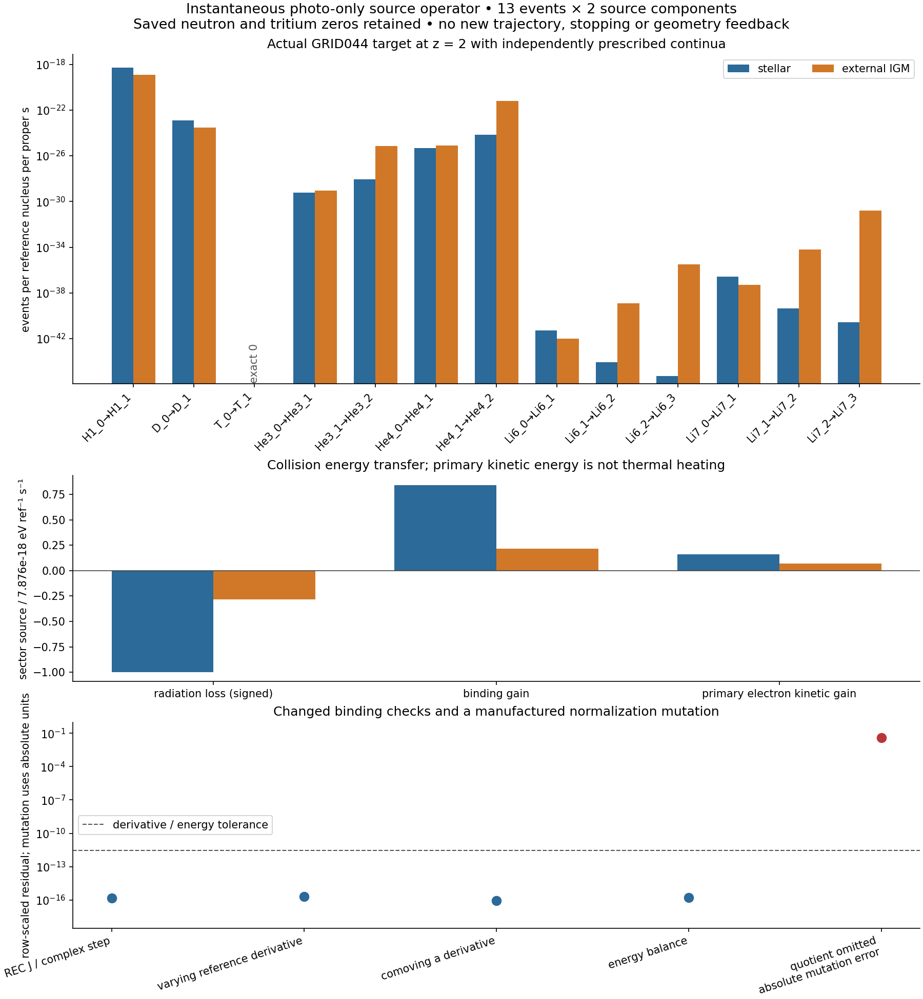

# GRID044 실제 endpoint의 사건·정규화·opacity·client 결합

## 판정과 연구 위치

`REI-GRID044-ENDPOINT-BINDING-01`을 **PASS_SCOPED_ENDPOINT_BINDING**으로 채택한다. 실제 저장된 GRID044 마지막 물질 상태에, 같은 endpoint에서 이미 계산된 stellar·external_IGM 연속광원 모멘트를 연결했다. WU 사건 incidence, REC opacity response, CR 일반 event-energy ledger, HE로 보낼 일차전자 모멘트, BASS의 처방된 기하·signed stress, VigilODE의 실제 21성분 callback을 한 단위로 묶었다. 두 독립 reviewer가 소스·원자료·정규화·그림을 검토했고 과학적 수정이나 재실행을 요구하지 않았다. 최종 판정은 [SCIENTIFIC_DECISION.json](SCIENTIFIC_DECISION.json)에 기록했다.

이 결과의 물리적 범위는 **저장된 실제 상태와 별도로 처방한 광원 사이의 순간적 photo-only counterfactual**이다. 기존 donor가 새 광원 아래 진화했다는 뜻은 아니다. HE의 실제 열화·열화율과 BASS의 새로운 흡수 four-force·stress·Einstein feedback은 제공되지 않았다. 그 입력이 필요한 완전한 여섯 공급자 결합 진화는 열려 있다. `L4_ready=false`, `global_physical_completion=null`을 유지한다.

고정 인계는 [`78f7ac58`의 HANDOFF_KO.md](https://github.com/cosmosapjw-quantum/rei_bianchi/blob/78f7ac5864d5817ceb79b48cb5e298cc30006510/research/program_expansion_20261025/HANDOFF_KO.md)이다. 현재 중앙 branch는 `research/orchestration-sandbox-20261022`, 기존 draft PR은 [#222](https://github.com/cosmosapjw-quantum/rei_bianchi/pull/222)이다. 새 과학 코드와 입력은 이 디렉터리 안에만 추가한다. 중앙 DAG는 원계약을 보존한 상태 관측과 새 자식 노드를 추가한다.

## 1. 동결한 시나리오

[SCENARIO.json](SCENARIO.json)은 실행 전에 정한 계약을 기계 판독 형식으로 정리한 것이다. 결과를 본 뒤 물리 모형을 고른 것이 아니다. 세부 상태와 좌표·단위는 [ACTUAL_STATE_BINDING.json](ACTUAL_STATE_BINDING.json), 입력의 정확한 출처는 [SOURCE_MANIFEST.json](SOURCE_MANIFEST.json)에 있다.

| 항목 | 동결값 또는 범위 |
|---|---|
| 실제 물질 상태 | 원본 NPZ의 `atomic_abundance_per_Href[:, -1]`, 201개 저장 시점 중 마지막 200번 열 |
| 상태 크기 | 중성자 및 H1·D·T·He3·He4·Li6·Li7의 21개 charge-state abundance |
| 종 대응 | donor의 Li7→Li6 순서를 label로 읽어 consumer의 Li6→Li7 순서로 대응 |
| 실제 0 | n, T_0, T_1; 합성 양수 abundance로 채우지 않음 |
| 관측 epoch | 선택 z=2, 저장 a=0.33333333333333326, eta=ln7 |
| 시계 | normal observer의 proper second; client의 국소 t=0은 저장 epoch |
| 기준밀도 | r=5.151254745827818 m^-3; a_today=1에서 n_ref0=0.19078721280843758 m^-3 |
| 배경 온도 | 14994.847774798709 K; 문맥값으로만 보존, RR·열적 rate 평가에 쓰지 않음 |
| 광원 | 기존 stellar 및 external_IGM, 상대 amplitude 각각 1 |
| 광원 support | birth energy 5–150 eV; 적색편이된 observer energy에 인위적인 5 eV cutoff를 추가하지 않음 |
| 물질 반응 | 13개 인접 charge single-photoionization event, 두 광원의 26개 기여 |
| 기하 | donor H·b와 signed tensor를 처방된 배경으로 재사용 |

Stellar source는 40000 K photon-number blackbody, intrinsic amplitude 3e-17/ref/s와 escape fraction 0.2를 한 번 적용한다. External IGM은 pivot 13.6 eV, power index −2, cutoff 100 eV, amplitude 1.5e-18/ref/s, escape fraction 1인 기존 source이다. 두 source 모두 보정되지 않은 illustrative parameter이다. 이 숫자를 새로운 관측 추정값으로 해석하지 않는다.

`MODEL_CONFIG.json`의 과거 midpoint-impulse 문구는 parameter provenance로 보존한다. 이번에 소비한 모멘트의 시간·스펙트럼 정의는 `GRID044_IMPLEMENTATION_CONTRACT.json`의 **continuous free-streaming response**가 정한다. 두 서로 다른 수치 표현을 같은 궤도로 합치지 않았다.

## 2. 기준밀도 정규화와 미분

물리적 number density 벡터를 n, reference density를 r>0, 각 source를 S와 R, 체적팽창률을 theta=3H라 두면

\[
\dot n+\theta n=S,\qquad \dot r+\theta r=R,\qquad x=n/r.
\]

따라서 정규화된 source는

\[
\boxed{\dot x=F=\frac{S-xR}{r}}.
\]

어떤 상태·parameter·기하 방향으로 미분하더라도 곱·몫 법칙을 그대로 쓰면

\[
\boxed{dF=\frac{dS-R\,dx-x\,dR}{r}-F\frac{dr}{r}}.
\]

이 식에는 reference source에 의한 `−xR/r`, 그 source의 미분, 분모의 미분 `−F dr/r`가 모두 들어간다. [THEORY_NORMALIZATION.md](THEORY_NORMALIZATION.md)는 처방된 reference, 독립 동역학 reference, 대수적 reference, 열적 입자수 및 invertibility 조건을 따로 유도한다.

이번 시나리오는 **고정 comoving bookkeeping number**를 택한다. 즉 r=n_ref0 a^-3이며 R=0이다. 물리적 밀도 r 자체는 팽창으로 변하지만, 그것이 실제 hydrogen·isotope·baryon population을 따라 다시 정의되는 reference는 아니다. 실제 H 또는 baryon을 주입하는 future channel은 S에 들어가고 reference를 몰래 바꾸지 않는다. 좌표 부피의 현재값을 1 m^3로 잡았을 때 N_ref=0.19078721280843758은 정규화를 정하는 연속적인 bookkeeping number이며 실제 정수 입자 census라는 주장을 하지 않는다.

고정된 endpoint abundance 방향에서는 dr=0이므로 REC가 이미 준 per-reference output을 다시 r로 나누지 않는다. 물리적 number source는 S=r f_REC, SI power density는 Q=r(1.602176634e-19)q_REC로 변환한다. 반면 a를 함께 바꾸면 dr=−3r da/a를 반드시 유지해야 한다. 물리 source S(n,a)에서 n=r x일 때

\[
\left.\partial_a F\right|_x
=\frac{S_a}{r}+\frac{3}{a}(F-S_nx)
\]

이다. 변하는 실제 physical reference를 별도로 선택하는 모형에서는 R과 그 미분이 일반적으로 0이 아니므로 위의 일반 quotient 식으로 돌아가야 한다.

`normalize_source_directional`이 이 일반식을 구현한다. 실제 endpoint와 구별된 비선형 manufactured control에서 R,dR,dr를 모두 활성화했다. full directional derivative와 complex-step 차이는 2.147543150575634e-16, fixed-comoving a derivative의 차이는 8.367371580054058e-17이다. `−xR/r`를 제거하면 source의 최대 절대오차가 0.03812178499999999, `−F dr/r`만 제거하면 tangent의 row-scaled 오차가 0.2024793964639783으로 나타난다. 이 두 mutation은 서로 다른 누락을 검출한다. 이 값들은 우주론적 관측량이 아닌 대수 검증값이다.

## 3. 하나의 사건과 에너지를 한 번씩 계수하는 결합

물리적 event e마다 extent를 하나 두고, source s의 기여를

\[
\mathcal R_{e,s}=x_{\ell(e)}\lambda_s\Gamma_{c(e),s},
\qquad F_i=\sum_{e,s}\nu_{ie}\mathcal R_{e,s}
\]

로 합한다. WU의 원본 catalog·incidence·conservation·ownership·source 함수를 재사용했다. 13개 transition에 stellar와 external_IGM이 기여하며, 26개를 서로 경쟁하는 event owner로 등록하지 않는다. 실제 isotope·charge·process·frame·electron-pool이 같은 사건은 provider-domain 문구나 state-resolution 설명이 달라도 중복 소유할 수 없게 했다.

각 source/target의 독립 저장 모멘트는 Gamma, P, K이다. 단위는 각각 s^-1, eV/s, eV/s이고

\[
P=\chi\Gamma+K,
\quad(q_\gamma,q_{\rm bind},q_{e,\rm kin})
=x_\ell\lambda_s(-P,\chi\Gamma,K).
\]

K는 별도의 양의 integrand로 이미 구해 둔 값을 사용한다. 이번 consumer에서 P−chi Gamma로 K를 정의해 보존 검사를 항등적으로 만들지 않았다. 화학 사건이 만드는 electron은 `e_fast`에 한 번 들어간다. 이 fast electron kinetic energy를 즉시 thermal heat로 보내는 가정은 없다.

| 공급자 | 이번에 실제로 연결한 것 | 남아 있는 물리 입력·범위 |
|---|---|---|
| WU | 원본 incidence·catalog·source와 13개 event 소유권 | WU의 synthetic energy helper를 물리 에너지 자료로 승격하지 않음 |
| REC | 저장 GRID044 모멘트와 실제 21성분 target response, 25×23 source Jacobian | 연속 photon-state·thermal·geometry·secondary feedback derivative |
| CR | 원본 generic `reaction_event_ledger`에 실제 저장 photon/kinetic moments 입력 | 원래 C23B spectra는 z·support가 다르므로 z=2에 대입하지 않음 |
| HE | 일차전자 number와 first kinetic moment를 receiver payload로 전달 | differential spectrum, 선택 열화 모형의 physical stopping/cross section; angular law는 각도 의존 모형에 필요 |
| BASS | 실제 donor geometry·signed stress stock의 단위와 frame을 보존한 join | 새 흡수 event measure·four-force·stress-rate와 live geometry feedback |
| VigilODE | 보존된 D5 gateway로 실제 A*x 및 전체 A Jacobian을 계산하는 21성분 client | 연속 시간 physical domain, isotope-simplex, trajectory error bound, native FP certification |

REC의 25개 output은 21개 물질 RHS, fast electron number source, 세 개 signed energy source이다. 25개의 독립 dynamical state를 새로 만든 것이 아니다. J의 23개 열은 21 abundance와 동일한 두 광원 template의 상대 amplitude이다. 이 범위를 넘는 photon·temperature·geometry 미분을 계산한 것으로 세지 않는다.

13개의 transition은 H1/D/T 각각 1개, He3/He4 각각 2개, Li6/Li7 각각 3개이다. T channel의 물리 source는 실제 저장 abundance가 0이어서 0이다. LiI 64.39 eV는 fit branch 교체점이며 valence response를 자르는 cutoff가 아니다. Core/Auger는 독립된 미모형화 channel로 남는다. 기존 electronic isotope equality도 명시적으로 유지한다.

## 4. 실제 endpoint 결과

전체 primary-electron source는

\[
\dot x_{e,\rm fast}=6.113207047135675\times10^{-19}\ {\rm ref}^{-1}{\rm s}^{-1},
\]

\[
S_{e,\rm fast}=3.14906868137857\times10^{-18}\ {\rm m}^{-3}{\rm s}^{-1}.
\]

독립 재구성에서 stellar 기여는 4.876273618673197e-19/ref/s, external IGM 기여는 1.2369334284624778e-19/ref/s였다. 정확한 모든 source/absorber 값은 [SOURCE_ABSORBER_MATRIX.json](SOURCE_ABSORBER_MATRIX.json)과 [source_contributions.csv](figures/source_contributions.csv)에 있다.

복사 손실, binding 증가, primary kinetic 증가의 순서로

\[
(q_\gamma,q_{\rm bind},q_{e,\rm kin})
=(-1.0118663544892516\times10^{-17},\;8.339000234798153\times10^{-18},\;1.7796633100943634\times10^{-18})
\ {\rm eV\,ref}^{-1}{\rm s}^{-1},
\]

\[
(Q_\gamma,Q_{\rm bind},Q_{e,\rm kin})
=(-8.35115562362068,\;6.882360343067273,\;1.4687952805534072)
\times10^{-36}\ {\rm J\,m}^{-3}{\rm s}^{-1}.
\]

이 partition은 stationary target·no recoil valence approximation 안에서의 충돌 에너지 장부이다. 완전한 finite-mass momentum ledger를 뜻하지 않는다. Thermal heating은 `null / UNQUALIFIED`로 남긴다.

그림은 모든 13×2 contribution, signed energy partition, derivative 잔차와 manufactured mutation을 보여 준다. 정확한 T zero를 따로 표기하고 trace Li 값을 로그축에 보존했다. Root와 두 독립 reviewer가 저장 PNG를 직접 확인했다. 이 그림은 시간 이력이나 가열 곡선이 아니다.

## 5. 검증과 수치적 의미

새 consumer에 대한 Python 32개와 Rust 비교 9개, 총 41개 changed-contract 검사가 통과했다. 이 수를 기존 83개, GRID044의 18개, PR219 bootstrap 검사와 합쳐 새로운 전체 검증량으로 제시하지 않는다. 원자료는 [results.json](results.json), 실행별 stdout/stderr는 `execution/`, 독립 재구성은 [FINAL_REVIEW_ARITHMETIC.json](evidence/FINAL_REVIEW_ARITHMETIC.json)에 있다.

| 검사 | 기록된 row-scaled 잔차 |
|---|---:|
| WU와 REC의 21 material + electron source | 1.924856455018995e-16 |
| 실제 REC 25×23 J 대 complex-step | 1.488667807882561e-16 |
| 26개 각 energy partition | 1.582703458723587e-16 |
| 총 signed energy residual | 0 |
| CR generic ledger의 event별 partition | 1.2345432226299177e-16 |
| 변하는 reference의 full directional derivative | 2.147543150575634e-16 |
| fixed-comoving a derivative | 8.367371580054058e-17 |
| Rust 실제 21 RHS 및 J 대 REC | 각각 0 |

Source row의 scale은 개별 기여의 절댓값 합, J row는 analytic coefficient의 최대 절댓값, energy는 signed sector 절댓값 합이다. 임의의 `max(1,...)` floor를 쓰지 않았으므로 1e-42보다 작은 trace contribution도 규모에 맞게 검사된다. 0인 row는 차이가 정확히 0이어야 한다. Decimal로 표현된 입력에 대한 Fraction incidence 검사에서 isotope·baryon·material+fast-electron charge 잔차는 정확히 0이었다. 이 표현 수준의 exactness가 물리 rate의 exactness를 뜻하지 않는다.

Supplier reviewer는 consumer나 provider 함수를 import하지 않고 원본 저장 모멘트, NPZ, 종 label에서 25개 output과 25×23 J를 따로 재구성했다. 서로 다른 합산 순서에서 약 2e-16 규모로 일치했다. 10개 원본 입력·재사용 모듈도 원래 archive/pinned supplier bytes와 일치했다. 독립 review는 기존 suite나 opacity integral을 재실행하지 않았다.

VigilODE client는 frozen A에 대해 f=A*x를 계산하고 J=A의 모든 성분을 쓴다. A는 비음수 전이율과 chemical incidence로 구성되며 선택 물질계의 off-diagonal은 비음수이다. 정확한 frozen linear model에서는 각 isotope census가 보존되고 양의 cone에 대해 양성을 유지한다. 이 대수적 성질만으로 유한 precision solver의 연속 시간 오차나 온전한 물리 domain이 인증되지는 않는다.

Gateway의 시간 domain은 [0,0]이다. 실제 상태·0 경계·양의 supported 수학적 control에서 평가하고, 음수·상한 초과·endpoint 밖 시간·중앙 시간 stencil은 거절했다. n/T에는 0 폭 domain을 유지했다. Component box는 isotope simplex를 대신하지 않는다. 유한하지만 J의 한 비영 대각원소를 1.5배로 바꾼 control은 gateway가 받아들였으나 독립 정확도 검사가 **0.5** 오차를 검출했다. Callback 규약과 수학적으로 옳은 미분을 별개 근거로 다룬 결과이다. Runtime witness는 caller assertion으로 기록했고 native floating-point 환경의 독립 인증으로 부르지 않는다.

## 6. 재사용한 근거와 보존한 예산

| 근거 계보 | 재사용 범위 | 유지한 제한·비용 |
|---|---|---|
| PR219 bootstrap | orchestration 및 과거 source/runner 증거 | bootstrap scoped PASS; 역사적 runner expected/recovered SHA256 불일치는 근거와 함께 보존 |
| 기존83 | 79 nominal + 3 tight + 1 full18의 scoped atomic test-fluid baseline | T=100–10000 K, UV=5–60 eV 등의 원범위; 새83 재현 승인으로 전환하지 않음 |
| 새83 계획의 기존 한도 | 기존 frozen cap 기록만 재사용 | 90 attempts, 2400 CPU s, 900 wall s, 최대4 workers; 부분 사용량 미상은 0이 아님 |
| GRID044 main | actual donor·연속 광원 모멘트·기존18/18 result | 595.225063/600 CPU s, NO_MORE_IVPs |
| GRID044 continuation | 저장된 opacity response만 소비 | 8.001104/10 CPU s, 8.029615335/20 wall s; 남은 양을 새 소비자 예산으로 옮기지 않음 |
| PR221 ANGTHERM01 | 처방된 배경의 기존10 trajectories 및 실제 donor | 224.778756/300 CPU s, 238.352717/420 wall s |
| PR221 ANGTHERM02 | conditional Li threshold response의 기존10 small IVPs와 범위 | 105.71851917/120 CPU s, 135.995204254/180 wall s; unknown failure 60/90 포함; 추가 IVP 없음 |
| 과거 REI-L0 | 기존 overrun과 부분 누적의 진단 기록 | 10.110448/10 overrun, known partial11.449628; whole usage UNKNOWN_NOT_ZERO |

PR219 head는 `6a12f3865d9ea427c1391c41caed8bb7cb7ec00d`, PR221 head는 `8d10231b1f0f788164d5eadbe1bcee0b802cceca`에서 관측했다. PR221 ANGTHERM02의 final external backup ACK는 이번 Git 관측으로 확인되지 않았다. 조건부 결과의 과학적 사용 범위와 그 archive 전달 상태를 분리한다. 자세한 lineage·hash·백업은 [BASELINE_INTAKE_KO.md](evidence/BASELINE_INTAKE_KO.md), 공급자 범위는 [SUPPLIER_COMPATIBILITY_KO.md](evidence/SUPPLIER_COMPATIBILITY_KO.md)에 보존했다.

이번 새 단위의 science 할당은 30 CPU s /120 wall s /512 MiB /1 worker, infrastructure는 60 CPU s /180 wall s /1 GiB였다. 실제 science 누적은 **2.900492 CPU s /2.940682361 wall s**, peak105888 KiB이다. Infrastructure는 **14.682127 CPU s /14.797034617 wall s**, peak182628 KiB이다. 최초 Rust linker의 worker 생성 실패를 `EXECUTION_FAILED` 환경 실패로 남기고 비용 14.406434 CPU s도 포함했다. Codegen1·linkerthreads1의 한 번의 표적 수정 후 Rust probe와 실제 client가 성공했다. 원래 실패 script/log를 삭제하지 않았다.

실행 전 이론의 manufactured quotient·thermal cancellation control은 별도로 0.000189481 CPU s를 사용했고 wall은 계측하지 않았다. 독립 supplier reviewer의 작은 산술 재구성은 imports 이후 0.008019 CPU s /0.0080319 wall s, baseline reviewer의 saved-only 비교는 0.038698787 CPU s /0.006690244 wall s로 별도 계측했다. 이 값들을 변경계약 실행 suite의 비용이나 전체 수작업 검토 시간으로 오해하지 않는다. 수작업 소스 읽기, 이미지 확인, interpreter startup, 원격 connector와 orchestration 비용은 계측되지 않았으며 0으로 표시하지 않는다. 새 opacity integral, IVP, historical suite replay, 새83, NCP는 모두 0회이다. 기존 예산은 초기화하거나 전용하지 않았다.

## 7. 이론·코딩 연구 루프의 실제 산출물

| 이론 단계 | 이 단위에서 수행한 일 |
|---|---|
| R1 연구 위치·계약 | 고정 handoff, 현재 AGENTS·HEAD, 선택 endpoint contract 확인 |
| R2 근거·재사용 | PR219·기존83·GRID044·PR221 및 six-provider 입력을 exact source로 회수 |
| R3 주장·전제 정렬 | 순간 photo-only 결과, fixed reference, no recoil·isotope equality와 입력 부족을 구분 |
| R4 가설·표현 탐색 | fixed-comoving reference와 changing-physical reference, species source와 event incidence 표현 비교 |
| R5 구성적 유도 | quotient와 full tangent, event source·energy partition·linear A를 실제 유도 |
| R6 독립 검증 | 별도 normalization 유도와 final 독립 산술 재구성 |
| R7 판별 검증 | reference·label·frame·support·중복 owner·quotient 누락·잘못된 J control |
| R8 결과 판정 | source 검증과 전체 물리 입력 완성을 나누어 scoped PASS |
| R9 정식 결과·코딩 연결 | SCENARIO, 구현 계약, actual source/J, receiver payload, client |
| R10 종료·재개 | 새 DAG child, exact source ZIP·게시/백업 receipt, 다음 최소 선택 입력 |

| 코딩 단계 | 이 단위에서 수행한 일 |
|---|---|
| C1 목표·baseline | 실제 저장 endpoint에 대한 새 consumer만 정의 |
| C2 식–데이터–코드 | label map·reference·event incidence·REC response·CR ledger·D5 연결 |
| C3 수치 설계 | tiny-row scale, exact zeros, complex-step, mutation 및 단일점 callback domain |
| C4 실행 DAG·자원 | 독립 새 단위의 cap·전이·실패 후 한 번의 수정과 S0 checkpoint |
| C5 구현 | 원본10개를 보존하고 consumer·bounded wrapper·Rust client를 작성 |
| C6 구현 검증 | 32 Python +9 Rust 실제 변경계약 검사 |
| C7 과학 검증 | conservation·energy·actual data·full source-J·quotient 및 독립 재구성 |
| C8 수치·재현성 | raw logs·실패·누적 비용·reproduce 명령·PNG/CSV 보존 |
| C9 독립 검토 | 구현자와 다른 두 reviewer가 source/raw/그림 확인 |
| C10 판정·인계 | 별도 SCIENTIFIC_DECISION, 중앙 DAG·다음 계약·게시/백업 기록 |

이는 새로운 no-go 정리가 아닌 구성적 endpoint 연산자 결과이다. NG1–NG7의 보편적 배제 주장은 만들지 않았다. 특정 공급자 입력의 현재 미제공 상태는 그 물리 과정의 불가능성 주장이 아니다.

## 8. 다음 과학 단계와 종료 조건

[NEXT_SELECTED_BINDING.md](NEXT_SELECTED_BINDING.md)는 H1 photoelectron 한 채널을 먼저 선택하는 다음 계약을 제시한다. 기존 Gamma/P/K만으로는 primary energy spectrum의 형상이나 각도분포를 복원할 수 없다. 같은 continuum/opacity의 원래 적분 measure에서 energy-resolved source를 공급하고 선택한 HE stopping의 실제 유효범위를 결합해야 한다. 각도 의존 transport를 선택할 때만 angular source와 differential outcome을 추가 요구한다. 이 전이는 모든 미래 핵반응·분자 채널을 한꺼번에 기다리는 AND gate가 아니다.

그 다음 선택된 흡수·열화 transfer가 물질과 복사 에너지 장부에서 한 번씩만 이동하고, BASS의 같은 frame·proper-time four-force 및 signed stress-rate로 들어가며, 확장된 VigilODE Jacobian과 domain 계약에 연결되어야 한다. 실제 gas/radiation이 H와 shear를 구동하고 선택 observable의 수렴 근거가 생긴 뒤에만 L4를 재검토한다.

원격 native 작업 장치는 입구 확인 시 offline이었다. 미게시 dirty 상태와 실행은 `UNOBSERVED`로 남겼다. 따라서 이번 endpoint 재사용을 다른 owner의 최신 native completion으로 확대하지 않는다. 모델 routing은 AGENTS에 따라 lower-tier 실행을 요청했지만 thread limit으로 거절되었다. 호환되는 완료 worker를 재사용하는 최소 cost-routing 예외를 명시하고, 실제 inherited 실행자와 두 독립 reviewer를 기록했다. lower-tier에서 실행했다고 주장하지 않으며 AGENTS 자체를 수정하지 않았다.

최종 source publication과 두 공급자 백업의 실제 locator·ACK는 이 디렉터리의 `delivery/`에 별도 기록한다. Immutable source archive는 자신이 생성된 이후의 ACK를 내부에 포함할 수 없으므로 그 receipt는 후속 metadata commit으로 연결한다. 과학 판정과 전달 판정은 각 파일의 실제 상태에 따라 읽는다.

### 게시 중 도착한 HE 병렬 반환의 보존

최초 source ref 갱신 시 GitHub가 GraphQL UNKNOWN을 반환했다. 즉시 HEAD를 다시 읽자 원래 78f7ac58의 자식인 `fc2c6044b5e9eb08e0e0486c17d1987c7099df9c`가 관측되었다. 이는 BASS_HE source `965da72aa7a5e885e12956fafadfb8dc2519b81f`의 새 conditional exchange·ownership 구현을 중앙 DAG에 반영한 별도 게시이다. 준비했던 우리 commit은 branch HEAD가 되지 않았으므로 완료로 세지 않았다.

Fresh DAG 전체를 읽어 비교한 결과 기존87계약·17edge·예산·top-level gate는 같고, HE-EXCHANGE·HE-RESERVOIR·HE-CLOSURE·HE-EXP-PAIR·HE-EXP-CLOSURE의 다섯 wrapper에 current_status/status_observation만 추가되었다. 이 다섯 관측을 보존하고 우리 세 REI 관측과88번째 자식을 결합했다. 새 commit은 이 병렬 commit을 부모로 삼으며 그 밖의 HE owner 파일도 새 base tree에서 그대로 유지한다. 이 합성은 문서/DAG의 저장 자료 비교로 독립 검토하며 과학 재실행을 필요로 하지 않는다.

새 HE 반환에는 conditional finite-mass angular moments, Maxwellian heat, linear-drift drag와 ownership 구현의 진행이 있지만 `physical_provider_admitted=false`, activation=false, production NOT_APPROVED이다. 실제 isotope/state/mass, Q, calibrated uncertainty가 아직 필요하다. HE101 C8는19/20, reserve0을 유지한다. 따라서 이번 endpoint에 physical degradation/thermal heat가 추가되었다고 해석하지 않는다. 원래 failure도 포함한 해당 owner의31 distinct tests·36 method executions 및 자체 비용은 owner lineage에만 속하며 우리41개 검사나 새 예산에 합하지 않는다. 정확한 반환은 [CONCURRENT_HE_STATUS.json](evidence/CONCURRENT_HE_STATUS.json), 병합 대상은 [CONCURRENT_DAG_DELTA.json](evidence/CONCURRENT_DAG_DELTA.json)에 보존한다.
