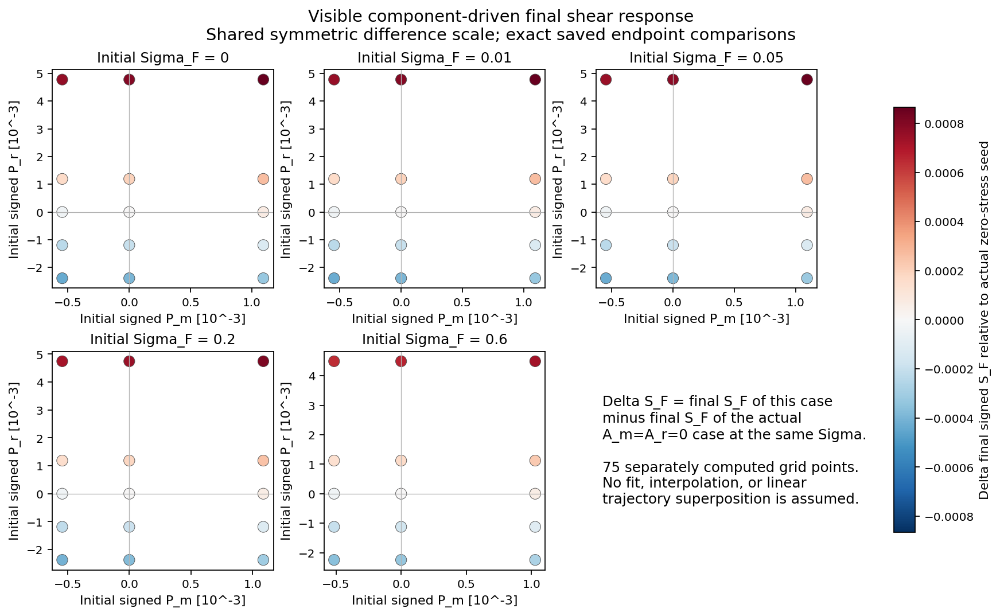
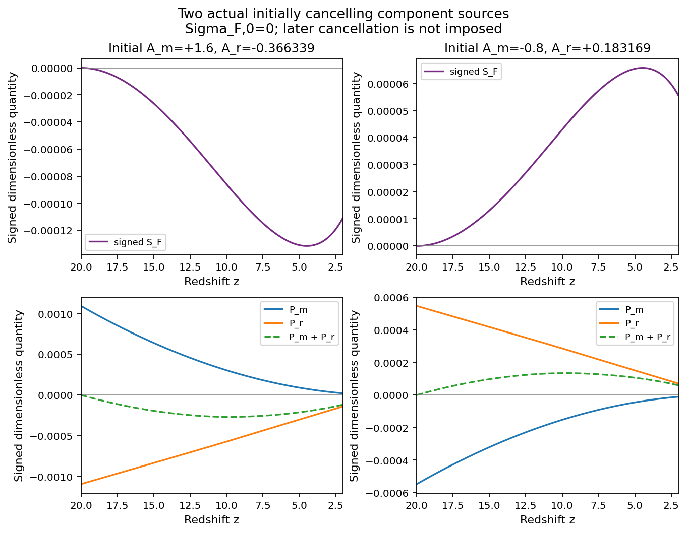
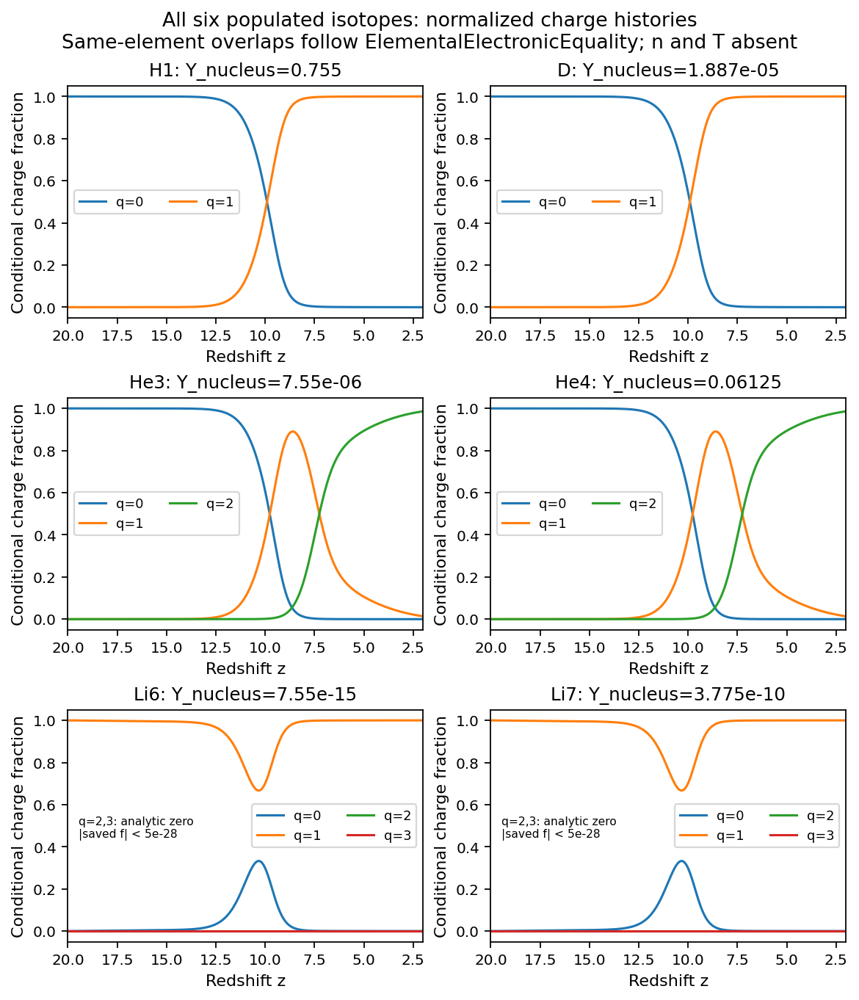

# REI H/He/Li LRS Bianchi I — 실제 샌드박스 pilot

## 1. 완료 결과와 과학적 범위

**본 계산 79개와 표적 refinement 3개, 총 82개 IVP를 샌드박스에서 완료했다. 실패는 0개**다. 각 궤적은 평균 scale-factor redshift z=20에서 2까지 257개 표본을 저장했다. 신규 저장 표본은 21,074개, 본 계산만 세면 20,303개다. 기존 PR198, B175, D9, ACCEL03 계산을 이 수에 더하지 않았다.

독립 물리·코드·원자료·실제 그림 감사의 최종 판정은 **PASS_SCOPED_PRELIMINARY_ATOMIC_TEST_FLUID**다. [FINAL_REVIEW.json](FINAL_REVIEW.json), [RAW_REVIEW.json](RAW_REVIEW.json), [FIGURE_REVIEW.json](FIGURE_REVIEW.json)이 근거다. 추가 과학 계산이나 감사가 필요한 잔여 blocker는 없다는 판정이다. Production scientific admission은 NOT_ISSUED이며 기존 AGE convergence HOLD와 Grackle response bound NOT_ESTABLISHED는 보존한다.

이 결과는 **처방한 UV·온도 아래에서 21개 원자·이온 상태를 추적하는 제한된 test-fluid 모형**이다. 계산한 전자밀도는 광자의 Thomson 산란에 실제로 연결된다. 첨부 그림의 19개 핵반응 전체, isotope-specific 전자 단면적, 분자·음이온, 닫힌 열·복사 에너지 방정식의 완료를 뜻하지 않는다. [TARGET_NETWORK_COVERAGE.md](TARGET_NETWORK_COVERAGE.md)에 반응별 구현 여부를 기록했다.

실제 controller wall time은 **66.03134817899263초**, 합산 child CPU time은 **250.578735021초**였다. 현재 유효 자원은 8 CPU/8 GiB이고, worker 4개와 worker당 BLAS thread 1개를 사용했다. 이는 실행 영수증이며 최적화 전 코드 대비 속도배수가 아니다. Python 3.12.14/NumPy 2.3.5/SciPy 1.17.0 및 g++ 13.3의 현재-turn 실제 실행 probe는 PYTHON_PASS/CPP_PASS였다. 이번 신규 pilot의 NCP 실행은 NOT_RUN이다.

## 2. 최신 자료 조사와 재사용

네 repository의 **798개 branch refs**를 끝까지 조회했고, 선택한 실제 source blob 38개를 회수해 Git blob SHA1을 대조했다. PR198은 8bd35af5…, PR199는 cce008b3…, ACCEL03/PR217은 de73c5d6…, HE32는 조사 도중 e8bb035d…로 전진했다. 접근 가능한 대화 검색과 로컬 handoff도 확인했다. 대화상의 완료 문구는 raw·receipt를 찾는 단서로 사용했다.

Drive 연구 폴더는 listing cap 100개 때문에 전체 조사를 입증할 수 없었다. 확인한 Dropbox 세 폴더는 pagination을 끝냈다. 명시한 접근 범위의 조사이며, 모든 비공개 대화와 모든 백업의 부재를 선언하지 않는다. Source·시간·조회 범위는 INTAKE_INDEX.json, intake_remote, intake_backups, runtime에 보존했다. B175의 완료 자료와 D9의 닫힌 판정도 유지했다.

직접 재사용한 핵심은 **HE32의 exact reflection-even transport와 prepared canonical moments**다. BASS_HE pin은 e8bb035d31f59e34734947b9082bdbd60128b799, compact source SHA256은 0fa826025836a0126fac580de98e3b45c9dcc750e1e243afe933c249ae8e4b6c다. L8에서 40→23, 이번 생산 L16에서 72→39개 transport 상태로 줄어든다. Photon/neutrino의 energy/number towers를 유지하면서 정확히 닫힌 짝수 부분공간과 0인 placeholder 제거를 사용한다. 새로운 angular closure가 아니다. 기존 유한 parity 검증은 해당 범위에서 재사용했고 재실행하지 않았다.

새 RHS는 massive moment를 한 번 계산하여 geometry와 chemistry가 공유한다. Worker별 immutable matrix/basis와 spectral integral을 재사용하고 독립 IVP를 process pool로 나눈다. 39개 transport 상태, 원자 census 21개, optical depth를 합쳐 생산 상태는 61개다. 진단도 저장 배열에서 묶어서 계산한다.

VigilODE의 bounded parallel pool과 lane ensemble 소스는 pin 5fd6e459a3f67cee90e002821b9b4b740c47475b에서 읽었다. Bounded workers와 deterministic case identity를 참고했지만, Rust kernel을 새 모형에 연결·검증했다는 주장은 하지 않는다. SciPy 경로로 끝까지 실행했으며 Rust bootstrap이나 장시간 benchmark는 수행하지 않았다.

## 3. 물리 계약과 초기 축

공통 comoving orthonormal frame에서 다음 convention을 사용한다.

\[
\sigma_{\hat i\hat j}=\operatorname{diag}(-s,-s,2s),\qquad
\pi^{(X)}_{\hat i\hat j}=\operatorname{diag}(-p_X,-p_X,2p_X).
\]

이번 축은 **full spatial Frobenius**다. 응력은 J/m³, H는 s⁻¹, K=8πG/c²다.

\[
S_F=\sqrt6\,s/H,\quad \Sigma_F=|S_F|,\quad P_X=\sqrt6 Kp_X/H^2,
\]
\[
\Pi_m=|P_m|,\quad \Pi_r=|P_\gamma+P_\nu|,\quad
\Pi_{\rm tot}=|P_m+P_\gamma+P_\nu|.
\]

PR198의 half-contraction 축에는 √2를 곱하면 같은 단위가 된다. 그러나 축 변환은 궤적 재사용 허가가 아니다. 이번 모형에는 새로운 원자 전자밀도와 광자 산란이 있으므로 이전 collisionless 궤적과 동일 IVP로 취급하지 않는다. [PHYSICAL_CONVENTION_ADAPTER.md](PHYSICAL_CONVENTION_ADAPTER.md)에 식·단위·source 관계가 있다.

핵심 grid는 Σ_F0=[0, 0.01, 0.05, 0.2, 0.6], A_m=[−0.8, 0, 1.6], A_r=[−0.8, −0.4, 0, 0.4, 1.6]의 75개 조합이다. W=1+A P₂의 양성을 지킨다. 실제 초기 signed stress cancellation 2개와 음의 shear 방향 2개를 더했다.

| 초기 축 | 실제 최소 | 실제 최대 |
|---|---:|---:|
| S_F | −0.6 | +0.6 |
| Σ_F | 0 | 0.6 |
| P_m | −5.468874345897007e−4 | +1.0937748691794015e−3 |
| P_r | −2.388555339655477e−3 | +4.777110679310954e−3 |
| Π_total | roundoff 수준 | 5.870885548490356e−3 |

Σ_F=0.6은 s²/H²=0.06이다. 가시적인 유한 모형 반응을 보기 위한 입력이며 관측상 허용 영역을 뜻하지 않는다. 그림은 실제 저장점을 표시하며 연속 보간 인증은 없다.

## 4. 21개 핵종·전하 상태와 원본 반응률

상태는 n; H1/D/T의 q=0,1; He3/He4의 q=0,1,2; Li6/Li7의 q=0,1,2,3이다. 전자는 전체 ionic charge에서 별도로 계산한다. Li IV와 Li6도 포함된다. T와 n은 이 atomic-only 실험에서 초기 abundance가 0이고 생성 핵반응이 없어 정확히 0이다. 불안정한 모든 H/He/Li 동위원소를 포함하는 임의의 핵망은 아니다.

미량 Li6가 총 abundance의 절대오차 아래에 숨지 않도록 populated isotope별 conditional charge fraction을 적분한 뒤 고정 nuclear abundance를 곱해 Y_Aq와 proper density를 저장했다. H1/D, He3/He4, Li6/Li7은 같은 원소의 electronic rate와 같은 초기 conditional fraction을 쓴다. 전하분율 곡선은 수치 정밀도에서 겹친다. 실제 최대 차이는 1.67e−15이며 isotope-specific spectroscopy의 검증은 아니다.

초기 abundance는 새 BBN 계산이나 관측 fit이 아닌 pilot parameter다. A·m_u convention에서 baryon sum을 정규화한 per-baryon 값은 다음과 같다.

| 핵종 | Y_A=n_A/n_B |
|---|---:|
| H1 | 0.7549543987593138 |
| D | 1.8873859968982846e−5 |
| He3 | 7.549543987593138e−6 |
| He4 | 0.06124630056159996 |
| Li6 | 7.549543987593138e−15 |
| Li7 | 3.774771993796569e−10 |
| n, T | 0 |

Nuclear mass defects는 census에 반영하지 않았다. 바리온 rest mass는 상속한 dust에 한 번 포함되어 있으므로 다시 더하지 않는다.

실제 [Verner photo table](https://www.pa.uky.edu/~verner/photo.html)과 [Verner–Ferland total RR table](https://www.pa.uky.edu/~verner/rec.html)의 원본 행을 보존하여 사용했다. He I는 [table description](https://www.pa.uky.edu/~verner/dima/rec//table.txt)의 저온 a행을 명시적으로 선택했다. RR table의 Li I는 Li II+e→Li I의 생성물 이름이다. Total RR에 ground RR를 다시 더하지 않았다.

UV는 5–60 eV의 유한 support를 갖는 등방 외부장이다. Li I fit의 64.39 eV 한계 안에 있고 Li II/III의 75.64/122.5 eV threshold보다 낮다. 따라서 초기 고전하 Li가 0인 모형에서 Li III/IV는 해석적으로 0이다. Radau 원자료에는 절댓값 5e−28 미만의 conditional-fraction 잔차가 남아 있고 clipping하지 않았다. 고전하 RR는 구현되어 있으며, 세 하향 channel의 방향을 positive-population frozen point에서 검사했다.

CI, DR, charge exchange, 분자, 음이온, multilevel trapping, stimulated RR, nuclear 19-reaction network는 포함하지 않는다. 이러한 누락은 자연에서 해당 반응이 0이거나 오차가 입증됐다는 뜻이 아니다.

## 5. z=20→2의 물리적 결과

### 초기 총 응력 상쇄는 이후 상쇄를 보장하지 않는다

아래는 실제 계산한 두 조건이다. P는 signed Frobenius 축이고 S_F0=0이다.

| case | P_m0 | P_r0 | S_F(z=2) | Π_total(z=2) |
|---|---:|---:|---:|---:|
| A_m=+1.6 | +1.0937748691794015e−3 | −1.0937748691794008e−3 | −1.109324425989436e−4 | 1.1869527165113991e−4 |
| A_m=−0.8 | −5.468874345897007e−4 | +5.468874345897004e−4 | +5.546186014299712e−5 | 5.9338936512650835e−5 |

처음 총 응력은 각각 6.5e−19와 3.3e−19 수준이다. 이후 massive matter와 radiation의 redshift/work/collision evolution이 달라져 총 source가 생긴다. 두 실제 유한 궤적의 결과이며 보편적 선형 중첩 법칙이나 모든 초기조건에 대한 정리는 아니다. Photon과 neutrino의 signed stress도 따로 저장했다.

전체 본 계산의 z=2 signed shear 범위는 −0.032033801730991567에서 +0.03248531924400723이다. 최종 Π_m 최대값은 5.67818e−5, Π_r 최대값은 6.77193e−4, Π_total 최대값은 7.03742e−4였다.

큰 초기 shear가 절대 색상 범위를 지배하므로 별도 그림은 각 Σ에서 실제 A_m=A_r=0 case의 최종 S_F를 빼서 ΔS_F를 표시한다. 원자료끼리의 차이며 fitting이나 선형 trajectory 합성이 아니다. Baseline case ID와 차이를 CSV에 기록했다.

### 광원 함수의 중점과 이온화 중점은 다르다

처방은 f(z)=[1+tanh((7.5−z)/1.25)]/2, T=100+9900f K, Γ_HI=5e−14 f s⁻¹이다. f의 중점 z=7.5가 H II의 중점일 필요는 없다. Isotropic zero-stress baseline에서 가장 가까운 저장점 z=10.00577의 H II 분율은 0.454585이고 Γ_HI/H=19.867이었다. z=8.03213에서는 H II=0.989889, Γ_HI/H=448.339였다. 작은 f에서도 Hubble 시간당 이온화율이 충분할 수 있기 때문이다. 선택한 처방의 실제 유한 history에 대한 해석이다.

z=2 baseline의 H II/D II conditional fraction은 0.9999496862, He III는 0.9862768081, Li II는 0.9999811272다. Li I는 재결합과 증가하는 UV 사이에서 중간 redshift에 일시적으로 증가했다가 감소한다. 정확한 저장 시각과 ion 배열은 SAVED_DATA_SCIENCE_SUMMARY.json 및 CSV에 있다. 관측 재이온화 history의 추정치로 해석하지 않는다.

적분된 τ_T(20→2)는 본 계산에서 0.0726139661–0.0727684642였다. 선택한 source와 초기조건의 결과이며 관측 likelihood와 비교·fit하지 않았다.

## 6. 수치 검증과 독립 감사

| 항목 | 실제 관측 |
|---|---:|
| 완료 IVP | 82/82 |
| 최소 sampled brightness, 257 angular points | 0.057036903843689 |
| 최대 isotope conditional-sum 오차 | 1.8874e−15 |
| 최대 massive/photon/neutrino number drift | 7.7716e−16 |
| 최대 baryon residual | 1.5543e−15 |
| 최대 Friedmann algebraic residual | 3.3307e−16 |
| L16/L24+엄격한 tolerance 3 controls: 최대 shear 차이 | 8.1705e−10 |
| 같은 controls: 최대 charge-fraction 차이 | 2.5154e−9 |

고정 comparison criterion은 2e−5였다. 세 combined controls는 angular+solver sensitivity 확인이며, 각 오차원을 분리한 수렴차수나 전역 오차정리는 아니다. Friedmann 잔차는 H를 대수적으로 정의한 결과의 정밀도 확인이다. 257개 각도 표본의 양성도 연속 각도 양성 증명으로 승격하지 않는다.

독립 검토자는 82개 raw의 hash/config/grid를 확인하고 별도 Legendre 평가, 전자수·핵종수 대조, refinement 차이 계산을 수행했다. 실제 PNG 10종을 읽어 지수 표시와 legend 겹침도 수정했다. 종료되지 않은 ATTEMPT를 재시작할 때 덮어써 CPU debit를 잃을 수 있는 controller 문제도 발견해 고쳤다. 실제 실행 runner는 보존했고 수정 controller와 동일 physical core identity를 연결했다. 수정 확인과 그림 재생성에는 신규 IVP가 없었다.

Wolfram의 형식 대수 검사는 charge generator column sum, charge/binding bookkeeping, Frobenius contraction, thermal identity를 확인했다. 선택한 식의 대수 확인이며 전체 모형이나 수치 결과의 독립 증명으로 취급하지 않는다.

## 7. Matter stress와 에너지 해석

원자 바리온은 non-tilted isotropic fluid이므로 선택 closure에서 π_baryon=0이다. 그림의 π_m은 별도의 canonical massive component 응력이다. 이 성분은 Ω_m의 10%인 nonbaryonic 분포이며 H/He/Li 원자를 그 분포의 핵종으로 재명명하지 않는다. 원자 전자는 광자의 Thomson 산란을 바꾸고 neutrino는 collisionless하게 진화한다.

Thermal/positive-ionization binding/외부 UV energy의 합을 상속한 dust+massive+radiation energy로 나눈 최대값은 3.7184457664e−9였다. 작은 비율은 test-fluid 근사의 진단이며 누적 trajectory 오차 상한이 아니다. 분모는 Λ를 제외한 background energy다.

온도 처방에 필요한 Q_thermal, 반응에 따른 Q_binding, 흡수 photo power를 따로 계산했다. Q_gas_required−P_photo는 bath input과 escaped recombination radiation의 차이에 대한 요구량이다. 실제 RR cooling이나 닫힌 열해를 구한 것처럼 표시하지 않았다. Number rate만으로 재결합당 3kT/2의 방출 에너지를 가정하지 않았다.

## 8. 게시·백업과 재현

전용 branch는 research/rei-hheli-sandbox-pilot-20261021, task path는 research/rei_hheli_pilot_20261021/, [draft PR은 #218](https://github.com/cosmosapjw-quantum/rei_bianchi/pull/218)이다. Source-contract 체크포인트 commit은 0d795da7f9114f89353c72a5829e5efcb64dfa44다. 이 체크포인트의 Git 77개 파일과 Drive·Dropbox archive의 전체 GET/byte/SHA256/80 members 검증은 PASS다. 최종 scientific snapshot과 이후 publication ACK를 별도로 연결한다. 포장 시점과 원격 게시 완료 시점을 혼동하지 않는다.

실제 실행은 Git checkout 밖의 샌드박스에서 이루어졌다. 실행 identity는 file SHA256으로 기록하며 나중 publication commit을 실행 당시 commit으로 소급하지 않는다. 물리 core SHA256은 30dd7fef781a51ddfc9ea763be55679f690caa5ddc3efff34c4bd771e7f5f77b, contract SHA256은 dd3950150be8718d1bb60eed4f1ba3f4cd7447b377adc92476abf28ba8369dee다. 상세 source/config/raw/receipt 관계는 82행 CASE_PROVENANCE_LEDGER.json/.csv에 있다.

Repository root에서 기존 raw를 검사하고 그림을 다시 그리는 명령은 다음과 같다. Linux, pinned Python 환경, 쓰기 가능한 패키지 경로가 필요하다. 환경 준비 명령은 [pilot/README.md](pilot/README.md)에 있다.

~~~bash
OPENBLAS_NUM_THREADS=1 OMP_NUM_THREADS=1 python3 -B \
  research/rei_hheli_pilot_20261021/pilot/code/run_pilot.py --audit-existing
~~~

이 명령은 신규 IVP 0개다. Results가 없는 별도 새 디렉터리에서만 같은 runner가 82개 bounded plan을 계산한다. 완료된 82개를 자동 반복할 이유는 없다. 기존 Rust formatting workflow 실패는 Python pilot의 실행 증거와 분리해 CI_OBSERVATION.md에 기록한다. Repository CI가 green이라고 주장하지 않는다.

## 9. 다음 단일 연구 노드

다음은 **더 단단한 UV에 대한 Li I inner-shell/Auger 및 RR/DR energy-moment source 계약 확정**이다. 문헌·table·daughter channel·energy balance를 pin한 뒤 새 물리 계약과 최소 계산 범위를 정한다. Soft-UV 모형에서 Li III/IV가 생기지 않은 이유는 source/IC에 있으며 일반적인 생성 불가능성 주장이 아니다. Nuclear 19-reaction network 완성은 별도의 rate·daughter·보존량 검증이 필요한 독립 lane으로 남긴다.
