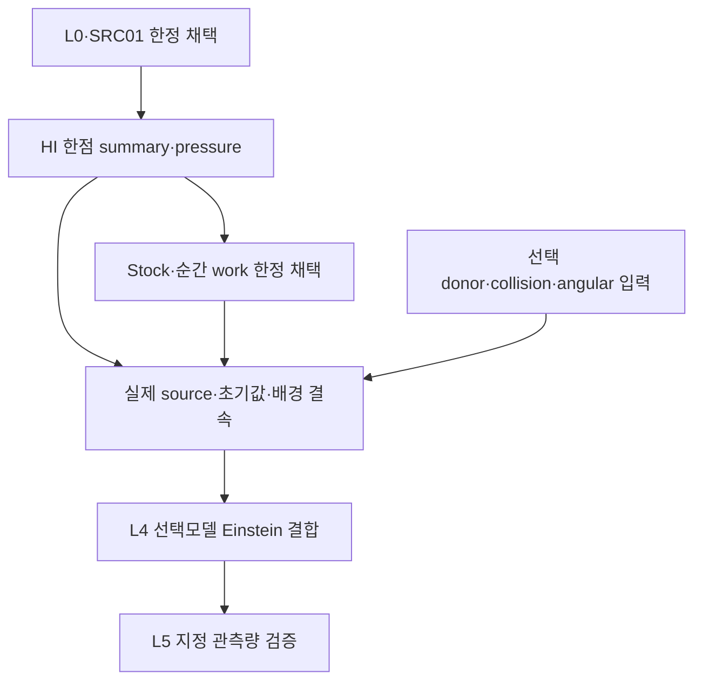

# 단계별 진행·DAG·보존

Stock과 work 각 유한 단위는 이론10+코딩10의 **20/20**을 마쳤다. 과학18단계의 완료/재사용 상태를 유지하고 실제 Final C ACK와 handoff로 R10/C10 전달2단계를 닫았다. 전체 모델 완료율은 null이다.

과학 게시: `689cf792a1f2bb706436489cbe06ddca9da0d78d` (원격 Git blob·크기75/75 일치; 로컬 복구 SHA25675/75 일치). 전달 metadata commit: `CURRENT_FILE_COMMIT`, expected parent `2650548a6d221282861c837fae5f99aa0c0fe749`. immutable C는 이전18/20 snapshot을 그대로 보존하며 이 문서가 실제 ACK 이후 상태를 기록한다.

## stock

|단계|내용|현재 상태|근거|백업|게시|
|---|---|---|---|---|---|
|R1|연구 위치·계약|reused|AUTHORIZATION_OVERLAY; prior stock decision|A|689cf792a1f2bb706436489cbe06ddca9da0d78d|
|R2|근거·재사용|reused|survey + frozen stock theory|A|689cf792a1f2bb706436489cbe06ddca9da0d78d|
|R3|주장·전제 정렬|reused|prior stock theorem assumptions|A|689cf792a1f2bb706436489cbe06ddca9da0d78d|
|R4|가설·표현 탐색|reused|prior Jensen/chord choice|A|689cf792a1f2bb706436489cbe06ddca9da0d78d|
|R5|구성적 유도|reused|prior characteristic and enclosure proof|A|689cf792a1f2bb706436489cbe06ddca9da0d78d|
|R6|독립 검증|reused|prior native theory/static reviews|A|689cf792a1f2bb706436489cbe06ddca9da0d78d|
|R7|판별 검증|complete|execution/EXECUTION_RESULT|B|689cf792a1f2bb706436489cbe06ddca9da0d78d|
|R8|결과 판정|complete|STOCK_ADMISSION|B|689cf792a1f2bb706436489cbe06ddca9da0d78d|
|R9|정식 결과·코딩 연결|reused|frozen stock implementation contract|A|689cf792a1f2bb706436489cbe06ddca9da0d78d|
|R10|종료·재개|complete|Actual final C ACK + final REPORT/HANDOFF; metadata closeout CURRENT_FILE_COMMIT|ACTUAL_FINAL_C_ACK: delivery/FINAL_C_BACKUP_ACK.json|CURRENT_FILE_COMMIT|
|C1|목표·baseline|reused|PRE_EXEC_IDENTITY|A|689cf792a1f2bb706436489cbe06ddca9da0d78d|
|C2|식–데이터–코드|reused|frozen stock source/contract|A|689cf792a1f2bb706436489cbe06ddca9da0d78d|
|C3|수치 설계|reused|rationalized sqrt enclosure reused|A|689cf792a1f2bb706436489cbe06ddca9da0d78d|
|C4|실행 DAG·자원|complete|ROOT_GO + StageA ACK|A|689cf792a1f2bb706436489cbe06ddca9da0d78d|
|C5|구현|reused|frozen stock core reused|A|689cf792a1f2bb706436489cbe06ddca9da0d78d|
|C6|구현 검증|complete|actual frozen fixture assertions|B|689cf792a1f2bb706436489cbe06ddca9da0d78d|
|C7|과학 검증|complete|squared oracle and boundaries|B|689cf792a1f2bb706436489cbe06ddca9da0d78d|
|C8|수치·재현성|complete|resource receipt + exact enclosure|B|689cf792a1f2bb706436489cbe06ddca9da0d78d|
|C9|독립 검토|complete|review/STOCK_EXECUTION_REVIEW|B|689cf792a1f2bb706436489cbe06ddca9da0d78d|
|C10|판정·인계|complete|Actual final C ACK + final REPORT/HANDOFF; metadata closeout CURRENT_FILE_COMMIT|ACTUAL_FINAL_C_ACK: delivery/FINAL_C_BACKUP_ACK.json|CURRENT_FILE_COMMIT|

## work

|단계|내용|현재 상태|근거|백업|게시|
|---|---|---|---|---|---|
|R1|연구 위치·계약|complete|ROOT_PLAN + next_work contract|B|689cf792a1f2bb706436489cbe06ddca9da0d78d|
|R2|근거·재사용|complete|PRIMARY_SOURCE_MAPPING + survey|B|689cf792a1f2bb706436489cbe06ddca9da0d78d|
|R3|주장·전제 정렬|complete|next_work/THEORY sections1-3|B|689cf792a1f2bb706436489cbe06ddca9da0d78d|
|R4|가설·표현 탐색|complete|trace-band and spectral contraction|B|689cf792a1f2bb706436489cbe06ddca9da0d78d|
|R5|구성적 유도|complete|next_work/THEORY sections2-7|B|689cf792a1f2bb706436489cbe06ddca9da0d78d|
|R6|독립 검증|complete|next_work/THEORY_REVIEW|B|689cf792a1f2bb706436489cbe06ddca9da0d78d|
|R7|판별 검증|complete|aux symbolic + one actual work fixture|ACTUAL_FINAL_C_ACK: delivery/FINAL_C_BACKUP_ACK.json|689cf792a1f2bb706436489cbe06ddca9da0d78d|
|R8|결과 판정|complete|WORK_ADMISSION|ACTUAL_FINAL_C_ACK: delivery/FINAL_C_BACKUP_ACK.json|689cf792a1f2bb706436489cbe06ddca9da0d78d|
|R9|정식 결과·코딩 연결|complete|next_work/IMPLEMENTATION_CONTRACT|B|689cf792a1f2bb706436489cbe06ddca9da0d78d|
|R10|종료·재개|complete|Actual final C ACK + final REPORT/HANDOFF; metadata closeout CURRENT_FILE_COMMIT|ACTUAL_FINAL_C_ACK: delivery/FINAL_C_BACKUP_ACK.json|CURRENT_FILE_COMMIT|
|C1|목표·baseline|complete|frozen work manifest + stock raw|B|689cf792a1f2bb706436489cbe06ddca9da0d78d|
|C2|식–데이터–코드|complete|actual mixed selector and separate Nt/L provenance|B|689cf792a1f2bb706436489cbe06ddca9da0d78d|
|C3|수치 설계|complete|exact signed Fraction interval formulas|B|689cf792a1f2bb706436489cbe06ddca9da0d78d|
|C4|실행 DAG·자원|complete|WORK_GO + StageB ACK|B|689cf792a1f2bb706436489cbe06ddca9da0d78d|
|C5|구현|complete|frozen work source9files|B|689cf792a1f2bb706436489cbe06ddca9da0d78d|
|C6|구현 검증|complete|6literal+beam+control assertions|ACTUAL_FINAL_C_ACK: delivery/FINAL_C_BACKUP_ACK.json|689cf792a1f2bb706436489cbe06ddca9da0d78d|
|C7|과학 검증|complete|stored stock witness + source-free identities|ACTUAL_FINAL_C_ACK: delivery/FINAL_C_BACKUP_ACK.json|689cf792a1f2bb706436489cbe06ddca9da0d78d|
|C8|수치·재현성|complete|exact arithmetic + actual resource|ACTUAL_FINAL_C_ACK: delivery/FINAL_C_BACKUP_ACK.json|689cf792a1f2bb706436489cbe06ddca9da0d78d|
|C9|독립 검토|complete|next_work/EXECUTION_REVIEW|ACTUAL_FINAL_C_ACK: delivery/FINAL_C_BACKUP_ACK.json|689cf792a1f2bb706436489cbe06ddca9da0d78d|
|C10|판정·인계|complete|Actual final C ACK + final REPORT/HANDOFF; metadata closeout CURRENT_FILE_COMMIT|ACTUAL_FINAL_C_ACK: delivery/FINAL_C_BACKUP_ACK.json|CURRENT_FILE_COMMIT|

## 실제 전달

A/B actual ACK는 그대로다. Final C `REI_STOCK_WORK_C_20261024_93e6794c90f6.zip`, SHA256 `93e6794c90f61cd281e0d4370e5298538277463ff6835657a79b901516f17e9c`, 10,515,765bytes/191members. Drive `11uR4dIsRTR6_9vF72OjYmlGkRecRdxeG`, Dropbox `id:BSpOijBcT10AAAAAAD_9gQ`, Library `libfile_6fcb69cc223881918e5cfb2e5986d0c9`. 각 provider의 업로드 완료와 별도 metadata 크기 readback을 확인했다. 현재 C의 remote full GET SHA256은 하지 않았으며, 복구에 쓴 A/B/ancestor C 세 archive의 actual full GET SHA256은 모두 일치했다. C를 재생성하지 않는다.

## 전체목표의의존관계

IN/L4/L5는미완료다. 모든donor의동시완료를요구하는DAG가아니며선택한채널의의존성만적용한다. C23E조건부D43K,HE94부분창,HE97 과거 C8 PARTIAL snapshot과 최신 scoped20/20, HE98 defined-unit20/20(B3 external pending at pin),PHYS85역사/PHYS86·87scope,ANGTHERM02읽기전용예약을보존한다. 전체완료율null,L4_ready=false.
