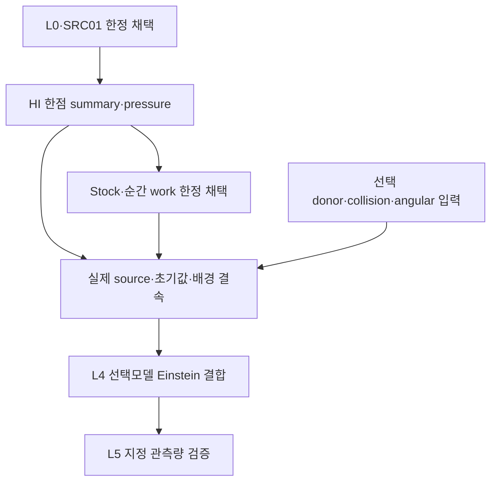

# 단계별 진행·DAG·보존

Stock과work의각유한단위는이론10+코딩10단계다. 현재각18/20의과학단계가완료/재사용되었고R10/C10의최종전달을진행중이다. 전체모델완료율은null이다. 최종externaldeliveryreceipt가CACK/게시와이두delivery단계를해소한다.

## stock

|단계|내용|현재 상태|근거|백업|게시|
|---|---|---|---|---|---|
|R1|연구 위치·계약|reused|AUTHORIZATION_OVERLAY; prior stock decision|A|PENDING_EXPECTED_SHA_NON_FORCE|
|R2|근거·재사용|reused|survey + frozen stock theory|A|PENDING_EXPECTED_SHA_NON_FORCE|
|R3|주장·전제 정렬|reused|prior stock theorem assumptions|A|PENDING_EXPECTED_SHA_NON_FORCE|
|R4|가설·표현 탐색|reused|prior Jensen/chord choice|A|PENDING_EXPECTED_SHA_NON_FORCE|
|R5|구성적 유도|reused|prior characteristic and enclosure proof|A|PENDING_EXPECTED_SHA_NON_FORCE|
|R6|독립 검증|reused|prior native theory/static reviews|A|PENDING_EXPECTED_SHA_NON_FORCE|
|R7|판별 검증|complete|execution/EXECUTION_RESULT|B|PENDING_EXPECTED_SHA_NON_FORCE|
|R8|결과 판정|complete|STOCK_ADMISSION|B|PENDING_EXPECTED_SHA_NON_FORCE|
|R9|정식 결과·코딩 연결|reused|frozen stock implementation contract|A|PENDING_EXPECTED_SHA_NON_FORCE|
|R10|종료·재개|pending|final delivery/handoff pending|FINAL_C_PENDING|PENDING_EXPECTED_SHA_NON_FORCE|
|C1|목표·baseline|reused|PRE_EXEC_IDENTITY|A|PENDING_EXPECTED_SHA_NON_FORCE|
|C2|식–데이터–코드|reused|frozen stock source/contract|A|PENDING_EXPECTED_SHA_NON_FORCE|
|C3|수치 설계|reused|rationalized sqrt enclosure reused|A|PENDING_EXPECTED_SHA_NON_FORCE|
|C4|실행 DAG·자원|complete|ROOT_GO + StageA ACK|A|PENDING_EXPECTED_SHA_NON_FORCE|
|C5|구현|reused|frozen stock core reused|A|PENDING_EXPECTED_SHA_NON_FORCE|
|C6|구현 검증|complete|actual frozen fixture assertions|B|PENDING_EXPECTED_SHA_NON_FORCE|
|C7|과학 검증|complete|squared oracle and boundaries|B|PENDING_EXPECTED_SHA_NON_FORCE|
|C8|수치·재현성|complete|resource receipt + exact enclosure|B|PENDING_EXPECTED_SHA_NON_FORCE|
|C9|독립 검토|complete|review/STOCK_EXECUTION_REVIEW|B|PENDING_EXPECTED_SHA_NON_FORCE|
|C10|판정·인계|pending|final delivery/handoff pending|FINAL_C_PENDING|PENDING_EXPECTED_SHA_NON_FORCE|

## work

|단계|내용|현재 상태|근거|백업|게시|
|---|---|---|---|---|---|
|R1|연구 위치·계약|complete|ROOT_PLAN + next_work contract|B|PENDING_EXPECTED_SHA_NON_FORCE|
|R2|근거·재사용|complete|PRIMARY_SOURCE_MAPPING + survey|B|PENDING_EXPECTED_SHA_NON_FORCE|
|R3|주장·전제 정렬|complete|next_work/THEORY sections1-3|B|PENDING_EXPECTED_SHA_NON_FORCE|
|R4|가설·표현 탐색|complete|trace-band and spectral contraction|B|PENDING_EXPECTED_SHA_NON_FORCE|
|R5|구성적 유도|complete|next_work/THEORY sections2-7|B|PENDING_EXPECTED_SHA_NON_FORCE|
|R6|독립 검증|complete|next_work/THEORY_REVIEW|B|PENDING_EXPECTED_SHA_NON_FORCE|
|R7|판별 검증|complete|aux symbolic + one actual work fixture|FINAL_C_PENDING|PENDING_EXPECTED_SHA_NON_FORCE|
|R8|결과 판정|complete|WORK_ADMISSION|FINAL_C_PENDING|PENDING_EXPECTED_SHA_NON_FORCE|
|R9|정식 결과·코딩 연결|complete|next_work/IMPLEMENTATION_CONTRACT|B|PENDING_EXPECTED_SHA_NON_FORCE|
|R10|종료·재개|pending|final delivery/handoff pending|FINAL_C_PENDING|PENDING_EXPECTED_SHA_NON_FORCE|
|C1|목표·baseline|complete|frozen work manifest + stock raw|B|PENDING_EXPECTED_SHA_NON_FORCE|
|C2|식–데이터–코드|complete|actual mixed selector and separate Nt/L provenance|B|PENDING_EXPECTED_SHA_NON_FORCE|
|C3|수치 설계|complete|exact signed Fraction interval formulas|B|PENDING_EXPECTED_SHA_NON_FORCE|
|C4|실행 DAG·자원|complete|WORK_GO + StageB ACK|B|PENDING_EXPECTED_SHA_NON_FORCE|
|C5|구현|complete|frozen work source9files|B|PENDING_EXPECTED_SHA_NON_FORCE|
|C6|구현 검증|complete|6literal+beam+control assertions|FINAL_C_PENDING|PENDING_EXPECTED_SHA_NON_FORCE|
|C7|과학 검증|complete|stored stock witness + source-free identities|FINAL_C_PENDING|PENDING_EXPECTED_SHA_NON_FORCE|
|C8|수치·재현성|complete|exact arithmetic + actual resource|FINAL_C_PENDING|PENDING_EXPECTED_SHA_NON_FORCE|
|C9|독립 검토|complete|next_work/EXECUTION_REVIEW|FINAL_C_PENDING|PENDING_EXPECTED_SHA_NON_FORCE|
|C10|판정·인계|pending|final delivery/handoff pending|FINAL_C_PENDING|PENDING_EXPECTED_SHA_NON_FORCE|

## 전체목표의의존관계

IN/L4/L5는미완료다. 모든donor의동시완료를요구하는DAG가아니며선택한채널의의존성만적용한다. C23E조건부D43K,HE94부분창,HE97C8partial,PHYS85역사/PHYS86·87scope,ANGTHERM02읽기전용예약을보존한다. 전체완료율null,L4_ready=false.

