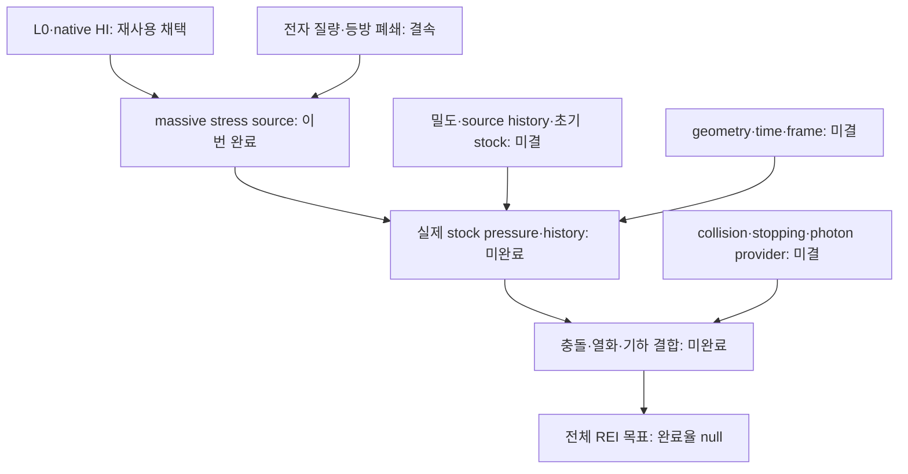

# REI HI massive stress — 최종 연구·전달 보고

**ADMITTED_SCOPED_NATIVE_HI_MASSIVE_STRESS. 이론 R1–R10 및 코딩 C1–C10, 20/20 완료.** 이 수치는 이번 유한 연구 단위의 작업 완료율 100%다. 전체 REI 모델 완료율은 null, L4_ready는 false다.

실제 저장된 HI/z=2.479 방사형 원자측도 4,368점에 전자 질량을 결속하여 massive stress와 등방 압력 주입 모멘트, 비상대론적 근사의 유한 스펙트럼 오차, 질량 민감도 및 source/JVP를 계산했다. 실제 물리적 원자 4,368개를 추적한 실험이라는 뜻은 아니다. 과거 L0와 native-HI의 채택 결과는 재사용했다.

## 1. 게시와 저장의 실제 완료

- 과학 S: 42f5984a78f123ce26950cec0e0b8505da3e7ce4. 부모 a28ba343bb85addf1a7e9e58e75816ed3b75cd3b에서 expected-SHA/non-force 게시했다.
- 허용 경로의 75개 파일만 변경했다. 원격 leaf를 다시 읽어 75/75 Git blob SHA·크기·mode 일치, truncated=false, mismatch=0을 확인했다.
- 최종 C: REI_HI_MASSIVE_STRESS_FINAL_C_20261025.zip, 857432 bytes, 81 members, SHA256 2fcee29558fc2d2791f814eea2143ed7a8a9c8f889976f80d320e7979a555434.
- 실제 저장 ACK: Library libfile_7542dc4e27708191bbf18174012a507e; Dropbox id:BSpOijBcT10AAAAAAD_9ww. 최종 C의 원격 전체 다운로드 SHA 검사는 NOT_RUN이다. 저장 ACK와 복구 검증을 구별한다.
- D는 이 최종 보고·인계·closeout·영수증 및 최신 README의 5개 문서다. 실제 D commit은 외부 FINAL_RECEIPT와 최종 답변이 결속한다. 문서가 자신의 commit hash를 포함하는 순환 구조를 만들지 않는다.

과학 S와 C 내부의 execution_20261025/ 문서는 과학 채택 직후 18/20 snapshot이다. 그 상태를 역사적으로 유지하고, 실제 S 게시와 C 저장 ACK 뒤의 최신 20/20 상태를 이 delivery_20261025/ 문서에서 제공한다.

## 2. 새로 얻은 결과

| 수량 | 명목값 | 단위·해석 |
|---|---:|---|
| W | 8.872364769167228e-12 | eV target^-1 proper_s^-1, stress trace 주입 모멘트 |
| W/3 | 2.9574549230557428e-12 | 같은 단위의 등방 압력 주입 모멘트 |
| S=dW/dM | 1.5716050524387194e-22 | target^-1 proper_s^-1 |
| D=2K−W | 8.031185484505185e-17 | 비상대론적 trace 근사의 초과량 |
| D/W | 9.05191084164476e-6 | 약 9.05191 ppm |
| W(M+u)−W(M) | 2.5145680831146385e-26 | eV target^-1 proper_s^-1 |
| W(M)−W(M−u) | 2.5145680846892634e-26 | 같은 단위 |

비상대론적 압력 근사 2K/3는 이 저장 측도의 massive W/3보다 약 9.05 ppm 크다. 질량은 NIST 2022 CODATA의 명목 M=mc²=510998.95069 eV를 exact decimal rational로 결속했고, u=0.00016 eV에 대한 세 점을 비교했다. 상대 변화는 약 2.83416e-15다. 표준불확실성 probe는 조건부 민감도이며 보장된 참값 구간이나 전체 물리 오차 한계가 아니다.

## 3. 구성적 이론과 구현

국소 관성계에서 E=k+M, p²c²=k(k+2M), v=pc²/E이므로 g(k,M)=pv=k(k+2M)/(k+M)=2k−k²/(k+M)이다. 비음 측도 μ=Σwδ_k에 대해 W=Σwg, 등방 폐쇄 아래 p_inj=W/3, S=Σw k²/(k+M)²다.

유도에는 K≤W≤2K, D=Σw k²/(k+M), support k≤L에서 D≤LK/(L+M) 및 D/W≤L/(L+2M), 질량 단조성과 joint concavity가 포함된다. 고정 μ에서 q=aXW/3, Jv=(a dX+X da)W/3+aX dM S/3이다. 일반 massive kernel은 기존 stock/work 연구와 연결되며 이번 새 결과는 실제 native μ 및 electron mass와의 결속과 수치 판정이다.

각 항을 exact rational로 만든 뒤 P128/P160 outward dyadic enclosure로 합산한다. 전체 항의 서로 다른 분모를 거대한 Fraction 합으로 만들지 않는다. 두 endpoint의 float 값과 float.hex가 모두 같을 때만 binary64를 확정한다. P160의 P128 포함, 폭 상계, 6개 Decimal100 대체식 비교 및 8개 control group이 같은 단일 child에서 통과했다. 최대 Decimal 상대차는 9.06933913049414e-17, 고정 기준은 2e-15다. 기존 L0 gate 2e-12는 그대로다.

실제 finding R6C9-01은 [-2^-1100,+2^-1100]의 -0.0/+0.0를 보통의 값 비교가 같다고 여겨 sign bit까지 확정하던 결함이다. float.hex 비교와 회귀로 한정 수리했다. tiny crossing은 ROUNDING_UNRESOLVED, 음의 비영 underflow는 -0.0/final_underflow_to_zero로 구별된다. 열린 finding은 0이다.

## 4. 독립 심사와 도구의 역할

Native 독립 심사 한 pass가 저장된 이론·코드·diff·raw를 읽고 PASS_SCOPED_INDEPENDENT_R6_C9로 완료됐다. 중단 전 source_and_review의 미완료 작업을 resume_independent_review가 이어받았다. 작성자와 검토자를 분리했으며 추가 review-of-review를 열지 않았다. Runtime model identity는 NOT_OBSERVED, cross-family는 NOT_RUN_OR_NOT_OBSERVED다.

SciSpace 검색과 Exa 원전 회수로 문헌을 연결했다. NIST 공식 수치와 Sarbach–Zannias의 pressure tensor 정의를 사용했다. Wolfram의 6개 항등식 잔차 0과 손계산 control은 보조 확인이며 undefined-symbol warning을 보존했다. CAS를 fresh model review로 세지 않았다.

## 5. 최신 저장소·대화·백업 종합

| 조사 범위 | 실제 회수량 |
|---|---|
| Owner repo metadata | 51/51 |
| Branch heads | 2252, 116 pages, 51 empty terminals, 오류 0 |
| 관련 7개 repo | 1341 heads, 최신 PR metadata 70, 선택 본문 6 |
| 선택 고정 원문 | 18개 읽기, 18/18 Git blob 일치 |
| Drive / Dropbox folder | 214 / 160 항목, 해당 목록 끝까지 |
| 최근 파일 목록 | 498개, 200+200+98 및 terminal |
| 대화·첨부 | 관련 PersonalContext 회수, 로컬 첨부 20개 inventory 및 선택 내용 intake |

전수 완료는 명시한 metadata collection 범위다. 모든 branch의 소스 전체, 모든 대화, 모든 archive member를 읽었다는 뜻은 아니다. Census cutoff는 2026-10-24 22:00:45.829 UTC이며, 이후 최신 canonical 변경과 선택 백업을 추가로 읽었다. 최근 파일 목록은 2026-10-22 이후 수정 범위다.

| 대상 | 확인한 단계·성과 | 현재 HI 결속의 남은 의무 |
|---|---|---|
| CR104 | 조건부 neutral FP, 최종 R3 20/20 | 실제 4368점 HI cohort history 아님 |
| BASS188 | photon angular cohort 준비 11/20 | electron history 미공급 |
| HH146/PHYS89 | finite child 20/20, displayed MF33 exact negative witness | full evaluator 전체 부정 아님; 실제 stopping 미공급 |
| REC135 | local thermodynamic block 20/20 | z1700→900 history는 현재 z2.479와 별개 |
| HE99/HE100 | finite-M shell/direct CBA scoped PASS | physical_provider=false |
| Vigil D4 | 실제 S1 archive 12/20 | scientific contract tests NOT_RUN |

Canonical a28ba343…에 포함된 CR final delivery와 WU89/HE100의 최신 반환을 보존한 상태에서 S를 추가했다. 다른 repo의 완료 수치를 현재 HI 물리 결속의 완료율로 합산하지 않았다.

## 6. 단계별 완료·백업·게시

| 단계 | 완료 근거 | 보존·게시 |
|---|---|---|
| R1 | 유한 HI massive-stress 질문·계약 | A2, 최종 C, S |
| R2 | primary 문헌·저장 입력 재사용 | A2/C, S |
| R3 | 질량·단위·isotropic closure·주장 범위 | A2/C, S |
| R4 | exact/Decimal/directed enclosure 선택 | A2/C, S |
| R5 | kernel·미분·concavity·support bound | A2/C, S |
| R6 | 독립 심사 및 finding closure | prepublication C/최종 C, S |
| R7 | CAS·한정 실제 계산 | A2/B/C, S |
| R8 | root scoped admission | prepublication C/최종 C, S |
| R9 | 이론–계산식–코드 연결 | C, S |
| R10 | 실제 게시·저장 ACK·다음 실행점 | C 이중 ACK, D |
| C1 | baseline/input identity 및 기존 채택 | A2/C, S |
| C2 | k,w,M 및 출력 단위 매핑 | A2/C, S |
| C3 | P128/P160 수치 설계 | A2/C, S |
| C4 | CPU6/wall8, one-child 실행 계약 | A2/B/C, S |
| C5 | 구현과 signed-zero 한정 수리 | A2/C, S |
| C6 | control 8그룹, exit0 | B/C, S |
| C7 | support·미분·근사오차·물리 대응 | B/C, S |
| C8 | Decimal6·precision nesting·실측 비용 | B/C, S |
| C9 | 실제 코드/raw 독립 PASS | prepublication C/최종 C, S |
| C10 | scope·입력·명령·자원·인계 결속 | C 이중 ACK, D |

표의 저장 묶음은 실제 checkpoint의 재사용 관계다. 단계마다 별개의 commit이나 archive 20개를 만들었다는 뜻은 아니다.

## 7. 실행 비용과 복구

새 child 1회, exit0, retry0: user CPU0.382975s + system0.012317s =0.395292s, wall0.4002169160012272s, peakRSS15948kB. 새 단위 cap CPU6s/wall8s를 통과했다. Known partial 소계는 10.765369+0.395292=11.160661s다.

과거 10.110448/10s의 초과 0.110448s는 FAIL_PRESERVED, cap reset0/relaxation0다. Whole L0 UNKNOWN_NOT_ZERO, 원 누적 cap NOT_FROZEN을 유지한다. Model/controller/retrieval/IO/packaging/recovery/remote CAS는 미측정이며 0이 아니다. Provider 대기 시간을 science CPU로 바꾸지 않는다. 기존22/66/83/ANGTHERM01·02/NCP/native-HI/stock/work/donor quadrature 재생0, 실행 후 추가science/render0이다.

로컬 작업 파일 유실을 실제로 관측했다. 저장된 B를 다시 받아 766805bytes와 SHA256을 검증했고 코드·입력·raw를 복원했다. 최종 review3개와 root admission도 기존 바이트 identity로 복구했다. 일부 전달 metadata와 private appendix는 새 recovery 버전으로 명시했다. 과학 계산이나 독립 심사는 재실행하지 않았다. 저장 ACK만 있는 A2와 실제 다운로드 복구를 수행한 B를 구별한다.

## 8. 전체 목표와 다음 단일 행동

의존성 화살표는 실제 물리 결속 순서다. 이번 단위의 20/20를 전체 모델의 수치 완성도로 환산하지 않는다.

이번 완료된 입력은 source의 방사형 측도와 massive stress 주입 모멘트다. 실제 n_HI(t), source/time history, 초기 stock/epoch, Bianchi geometry/time/frame, collision/stopping/photon 공급을 source-qualified 자료로 결속하는 것이 다음 행동이다. 이 정보가 있어야 실제 stock pressure와 시간 진화·thermal heat를 계산할 수 있다. 공급되지 않은 밀도·초기조건·열화율은 만들지 않는다.

서명(-,+,+,+), represented χ13.6eV, bath-rest target, zero recoil, no-deposition, energy owner 및 기존 공개 API를 유지했다. CSV의 각도 정보 부재에 따라 isotropic closure를 별도로 선언했다. Rest energy MA를 기존 kinetic/binding/UV ledger에 추가하지 않았다. 실제 secondary thermal heat=null이다.

C23E conditional D43K, HE94 partial window, PHYS85 historical state, ANGTHERM02 branch/head의 읽기 전용 예약을 유지한다. 다음 과학 child는 소비된 이번 GO로 실행하지 않는다. 전체 완료율을 합산하거나 새 강한 no-go를 주장하지 않는다.

## 원전과 재사용 경로

- NIST 2022 CODATA electron mass energy equivalent: https://physics.nist.gov/cuu/Constants/Table/allascii.txt
- Sarbach–Zannias, arXiv:1303.2899v1, kinetic pressure tensor: https://arxiv.org/html/1303.2899v1
- 과학 S 원문: https://github.com/cosmosapjw-quantum/rei_bianchi/tree/42f5984a78f123ce26950cec0e0b8505da3e7ce4/research/rei_source_pair_binding/hi_massive_stress_20261025/
- 상세 유도: ../THEORY_MASSIVE_STRESS_KO.md
- 과학 raw·심사·채택·조사 원문: ../raw/ 및 ../execution_20261025/
- 최종 저장·게시 ACK: FINAL_DELIVERY.json
- 각 단계 상태: LOOP_CLOSEOUT.json
