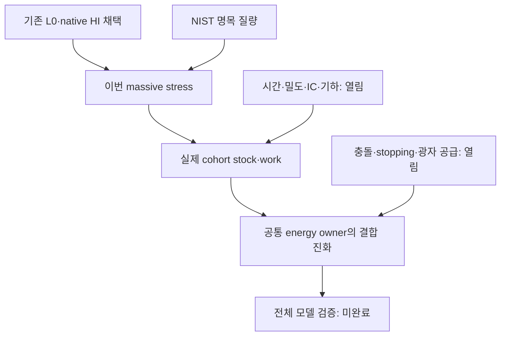

# 단계와 전체 목표 DAG

현재 과학 단계18/20(90%) 완료. R10/C10의 실제 최종 저장·게시 closeout이 남았다.
이 수치는 새 유한 연구 단위의 workflow이며 전체 모델 완료율은 null이다.

| 단계 | 완료 근거 |
|---|---|
|R1|native HI massive stress 질문/범위 고정|
|R2|NIST·kinetic theory·기존 native raw 재사용|
|R3|명목 질량·closure·source/stock/heat 구분|
|R4|전체 Fraction/Decimal/directed enclosure 비교|
|R5|kernel/미분/concavity/support bound/JVP 유도|
|R6|독립 이론·수치 검토와 finding closure|
|R7|CAS6항등식,실제4368원자 한정 계산|
|R8|root scoped admission|
|R9|이론·코드·raw·판정 연결|
|R10|최종 전달 진행 중|
|C1|baseline/수용기준/input identity 고정|
|C2|원자 k,w와 mass의 실제 코드 경로|
|C3|dynamic dyadic P128/P160 enclosure|
|C4|CPU6/wall8 단일실행 DAG와 A2 checkpoint|
|C5|consumer/JVP와 한정 부호영점 수리|
|C6|8controls/exit0|
|C7|support/근사오차/질량 민감도|
|C8|6Decimal비교/precision nesting/실측비용|
|C9|독립 code/raw PASS,openfinding0|
|C10|최종 게시·백업·handoff 진행 중|

이번 실행 순서: R1–R5/C1–C5 → 독립 사전검토·한정수리 → A2 → 단일child → B → 독립R6/C9완료 → R8/R9채택 → 채택패키지checkpoint → Git/최종backup → R10/C10전달.
로컬 유실은 과학재실행/재심사의 사유가 아니며, 실제 원자료를 복구하여 같은 판정을 유지했다.

