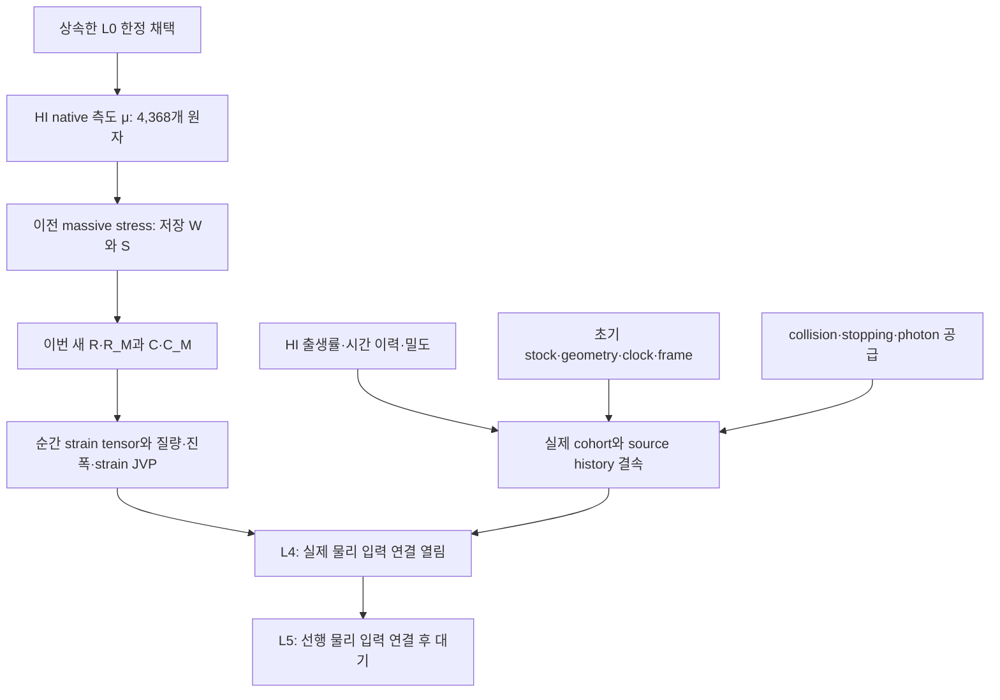

# HI 순간 변형 응답: 연구 의존성과 현재 진행

## 과학 동결 결과와 최종 전달 조건

이 연구 단위의 과학 범위는 `ADMITTED_SCOPED_NATIVE_HI_STRAIN_RESPONSE`로 채택되었고, 과학 게시 S `190e283357f49f287ab02442a3751959cc53b4bd`의 57개 파일은 실제 branch 및 전체 leaf readback에서 일치했다. 현재 동결 단계는 **R1–R9와 C1–C9 완료, 18/20**이다. 이 문서 작성 시 실제 C의 Library/Dropbox ACK는 확보했다. R10과 C10은 실제 D의 non-force 갱신·readback이 통과하는 조건에서 종료된다. S와 C 안의18/20은 그대로 보존하는 과학 동결 snapshot이다. 이 비율은 이번 한정 연구·전달 절차의 진행률이다. 전체 물리 모델 완성도는 `null`이며 `L4_ready=false`다.

## 채택 근거의 연결

L0의 상속 근거는 `ADMITTED_SCOPED_REUSED_AT_566f242b843fe4428cedbb8f2ea319ad706ac605`이고, native HI science는 `8d68dff35ca2bdc456049081132a7d2449b29143`다. 저장 W/S의 massive-stress 게시 S는 `42f5984a78f123ce26950cec0e0b8505da3e7ce4`다. 이번에는 그 prerequisite 계산을 재실행하지 않았다. 이 연결은 각 채택의 실제 범위를 보존하며, L1 전체의 일괄 완료를 뜻하지 않는다.

이번 source coefficient의 시간 정규화는 **출생 proper-second당**이다. 처음 등방인, 같은 출생 시각·frame의 source-weighted coeval cohort에 대한 순간 연산자를 계산했다. 임의의 birth history를 적용하려면 출생 시각별 source와 geometry·clock의 결속 및 그 이력 적분이 필요하다. 위 DAG의 열린 입력은 그 다음 물리 연결의 의존성이며, 자료 부재를 불가능성 정리로 바꾸지 않는다.

## 이번에 실제로 얻은 값과 검증

명목 질량 `510998.95069 eV`에서 저장된 원자와 W/S를 그대로 사용했다. 새 native 적분은 R와 R_M 둘이며, W/S와 A/K/L은 재사용했다.

| 양 | 인증된 binary64 값 |
|---|---:|
| R | `3.2123541371327454e-16` |
| R_M | `-6.285950431111738e-22` |
| C | `4.436150261042243e-11` |
| C_M | `1.4143975693305336e-21` |
| κ | `5.91486701472299e-12` |
| Γ | `1.666654597903262` |
| R/W | `3.620629021358712e-05` |
| R/C | `7.241310478915169e-06` |

R/C/κ의 단위는 `eV target^-1 birth-proper_s^-1`, R_M/C_M의 단위는 `target^-1 birth-proper_s^-1`이며 비율은 무차원이다. 초기 등방 closure에서 `δP=-C[(tr B)I+2B]/15`다. 이 source-weighted 순간 응답에 실제 history나 밀도·초기 stock 수치를 새로 넣지 않았다.

한 child에서 CPU `0.288967 s`, wall `0.2912843540107133 s`를 사용했고 종료 코드는 0이었다. 8개 control group, 8개 계수의 P128/P160 일치, 4개 Decimal100 비교, 27개 tensor component 인증을 관측했다. Native 독립 검토는 `PASS_SCOPED_NATIVE_HI_STRAIN_RESPONSE`, material findings 0, required repairs 0이었다. 14-ray 유한 변형 검사는 그 이산 fixture의 검증이며 연속 sphere 적분 전체와 동일시하지 않는다.

## 비용과 종료 경계

Known partial CPU는 `11.160661 → 11.449628 s`다. 이전 `10.110448 s / 10 s` 실패와 `0.110448 s` 초과는 유지한다. Whole L0 debit는 `UNKNOWN_NOT_ZERO`, original cumulative cap은 `NOT_FROZEN`이다. 원격 CAS 실제 CPU 및 model·I/O·packaging 비용은 별도 미측정이며 0으로 두지 않는다.

C는 과학 완료·전달 대기 시점의18/20 동결 백업이다. 이 D는 확보된 실제 C dual ACK를 기록하며, D 자체 게시 identity는 게시 뒤 외부 최종 영수증에 기록한다. 새 과학 단위나 추가 science/render/test는 시작하지 않는다.

근거: S leaf의 `execution_20261025/ADMISSION.json`, `execution_20261025/REPORT_KO.md`, `execution_20261025/review/EXECUTION_REVIEW.json`, `raw/stdout.jsonl`, `raw/resource_receipt.json`; 외부 실제 게시 영수증 `ACTUAL_S_PUBLICATION.json`.

## 고정 권위의 조건부 전체 목표 의존성

고정 권위 `0f9d9df825be1dac9ca9bdf73cdc2e8908bcba17`의 `HANDOFF_rei_bianchi_KO.md`에서 다음 연결을 유지한다. 이 표의 조건은 이번 strain 단위의 채택 범위 밖이며, 새 순간 응답을 얻었다는 사실만으로 닫히지 않는다.

| 연결 | 고정된 추가 조건 | 이번 단위의 판정 경계 |
|---|---|---|
| L4 진입 | L0 + L1 및 geometry/numerical hooks | 상속한 L0 한정 채택을 유지하며 whole L1 완료를 주장하지 않음 |
| L4에서 nonzero `n_or_T` 선택 | L2 추가 | 이번에는 그 실제 입력을 선택하거나 L2를 닫지 않음 |
| L4에서 anisotropic baryons 선택 | L3 추가 | 순간 strain 연산자로 baryon 모델 전체의 채택을 대신하지 않음 |
| ANGTHERM02 accuracy 주장 | 해당 owner admission 추가 | 보호 branch/head를 읽기 전용으로 유지하며 owner 판정을 새로 만들지 않음 |
| L5 진행 | L4 선행 | L4의 조건과 실제 물리 결속 이후 대기 |

ANGTHERM02 보호 대상은 `research/rei-coupled-isotope-contract-20261022 @ 8d10231b1f0f788164d5eadbe1bcee0b802cceca`다. C23E의 conditional D43K, HE94의 partial window, PHYS85의 historical state도 유지한다. 실제 HI history/density/initial stock, geometry·clock·frame과 적용할 collision/stopping/photon supply는 열린 입력 결속이며, 전체 모델 완성도는 null이다.
