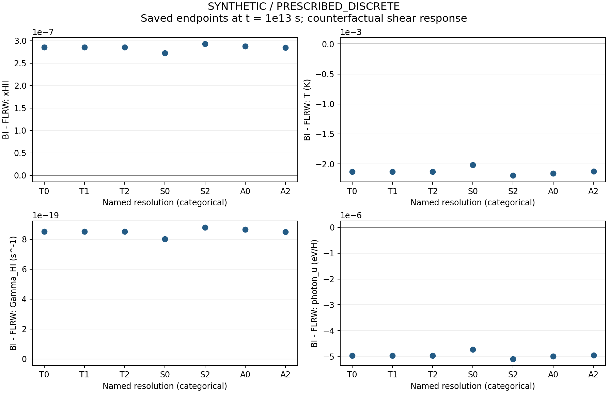

# RUX 과학 결과 작업 보고서 (초안)

상태: **작업 보고서 / 과학 admission HOLD**
권위 계획: ADOPTED v2 `REI-ATOMIC-REUSE-RESET-20261012`
실행 overlay: `REI-CODEX-SCIENCE-20261014`
현재 포함 범위: 보존된 F08 합성·처방 이산 paired endpoint 15행의 재표현. 새 물리 solver 실행은 0회다.

## 요약

현재 재현 가능한 결과는 동일한 `t = 10^13 s`에 저장된 F08 BI와 FLRW endpoint 15개에서 계산한 7개 resolution별 차이다. 이는 **SYNTHETIC / PRESCRIBED_DISCRETE** 결과다. endpoint는 범주형 비교이며 시간 이력, 물리적 EoR 예측, QV, 하늘 신호 또는 연속체 오차 상계를 제공하지 않는다. 저장된 campaign 상태 `PRESCRIBED_DISCRETE_PAIRED_HISTORY_INDEPENDENT_PASS`는 해당 이산 campaign에만 적용되고, 현재 physical/scientific admission은 `HOLD`다.

## 방법 및 관례

이 초안은 보존 산출물 `paired_endpoint_differences.csv`를 읽어 같은 해상도·같은 종료시각의 BI 값에서 FLRW 값을 뺀 paired difference를 보고한다. CSV에는 endpoint 행 15개가 있고, 결과 표에는 resolution별 7개 BI–FLRW 비교가 있다. 원래 계산을 재실행하거나 중간 시각 자료를 보간/복원하지 않았다. 저장된 표와 그림에서 endpoint 점만 제시하며 오차막대를 붙이지 않는다. 기존 ledger의 `max_abs`는 이전 matched endpoint 집합에 기록된 값으로 CSV에서 다시 계산한 값이 아니다.

과학 변수와 frame/unit 계약은 선택 시나리오와 provider가 고정될 때 적용한다. 현재 공개 input contract의 규약은 metric `(-,+,+,+)`, `u·u=-1`, proper seconds와 명시적 기원, proper density, `R: m^-3 s^-1`, `Q: J m^-3 s^-1`, `N=n u ⇒ div(N)=R/c`, `J=c n u ⇒ div(J)=R`이다. H/He electron census는 선언된 baseline에서 `ne=nH[xHII+fHe(xHeII+2xHeIII)]`; Case-A escape에서 방출 재결합 photon count는 정의되지 않는다. 미확정 물리량과 오차는 null/미측정으로 남기며 생략 물리를 0 오차로 취급하지 않는다. 이 관례 선언은 아직 미결 scenario 입력을 채운 것으로 간주되지 않는다.

## 보존 endpoint 차이

아래는 저장 CSV에서 가져온 `BI − FLRW` 차이다. 반올림은 표시용이다.

| Resolution | ΔxHII | ΔT (K) | ΔΓHI (s⁻¹) | Δ photon-u (eV/H) |
|---|---:|---:|---:|---:|
| T0 | 2.85204465933e−7 | −0.002130787325 | 8.52016099135e−19 | −4.96915592441e−6 |
| T1 | 2.85133106237e−7 | −0.002130623550 | 8.52064089494e−19 | −4.96776077163e−6 |
| T2 | 2.85097355501e−7 | −0.002130539571 | 8.52087888430e−19 | −4.96706198749e−6 |
| S0 | 2.72130656676e−7 | −0.002016012739 | 8.01608224488e−19 | −4.74069695955e−6 |
| S2 | 2.92732505125e−7 | −0.002191397478 | 8.78786470398e−19 | −5.09817932448e−6 |
| A0 | 2.87454196002e−7 | −0.002155060720 | 8.64299652724e−19 | −4.99780638052e−6 |
| A2 | 2.84681731411e−7 | −0.002125263149 | 8.49231368232e−19 | −4.96280683238e−6 |

그림의 x축은 해상도 category이며 시간축이 아니다. 데이터와 그림의 원본 identity는 `SOURCE_MANIFEST.json`에 기록했다. `EPS_HALF`/T0 끝점 비율은 저장된 결과의 제한적 진단으로만 해석하며 보편적 약한 전단 scaling 정리로 승격하지 않는다. 원래 보고서에 보존된 ledger 별도 값과 ratio는 retained source에서 확인할 수 있다.

## 현재 science 경계

- 관측된 재사용 상태: 15회, accepted trials 248000, 구간 `[0, 10^13 s]`, 처방 이산 paired history.
- 새 과학 solver 실행: 0. 이 작업은 저장 결과 후처리/보고서 작성이다.
- `physical_fit_error=NOT_MEASURED`, `model_error=NOT_MEASURED`, `continuum_error_bound=NOT_ESTABLISHED`, `QV=NOT_EVALUABLE`.
- 물리적 EoR, 전체 17-state history, 물리적 관측확률/하늘, 재구성된 시간 이력, 새 scientific PASS는 주장하지 않는다.
- unknown, tail, absolute-IVP 값은 unknown/null로 유지한다. warm provider의 `30000–110000 K` guard는 cold EoR 지원 근거가 아니며 확장하지 않는다.
- v2의 17개 핵심 의무 및 claim boundary는 adopted PLAN의 authority로 유지한다. 이 retained 산출물은 그 의무를 대체하거나 완료 처리하지 않는다.

## 다음 physical milestone와 미완료 절

### RUX05 — provider 연결 및 첫 FLRW 구간 (대기)

E-P `coupled_primary::PrimaryStage`와 EB warm source는 후보이며 실제 integration과 물리 admission은 미완료다. 배경/clock/time origin, gas 및 radiation IC, spectral emissivity 대 imposed UVB 역할, provider 실제 domain, closure/event owner와 source assumptions를 확정해야 한다. 첫 interval에는 실제 RHS 주입을 확인하고 positivity, nuclei/charge, photon/energy ledger, residual 및 적용 가능한 수렴 검사를 남겨야 한다. 입력 또는 domain이 부족하면 정확한 누락 필드와 실패를 보존하고 guard를 넓히지 않는다.

### RUX08 — 다중 epoch FLRW history (RUX05 후)

source/provider 유효 구간 안의 H/He 상태, 열, photon history, segment ledger와 단계별 그림이 없다. `xHII`는 QV가 아니다. provider 범위 밖으로 외삽하지 않는다.

### RUX09 — matched Bianchi–FLRW history (RUX07 및 RUX08 후)

같은 source, clock, 배경/초기조건 convention의 물리 쌍 이력과 차이/error ledger가 아직 없다. coupled counterfactual에서 `ne`와 `T`는 각각 풀어야 한다. endpoint-only retained plot은 이 결과를 대체하지 않는다.

### RUX10 — BASS τ/visibility receiver (RUX05 interval 후)

admitted proper `ne(t)` interval을 받는 segment τ/visibility 결과가 아직 없다. 전체 물리 τ에는 지원되는 관측자/clock 및 tail이 필요하다. unknown tail을 0으로 두지 않으며, full paired observable은 RUX09와 적절한 tail 이후에만 가능하다.

## 실행·갱신 기록

이 보고서는 REPORT-DRAFT packet의 owned paths 중 Markdown 및 LaTeX 초안이다. 새 admitted interval/history/paired/receiver 자료가 생길 때 같은 보고서를 갱신하고 이전 scope와 실패 기록을 보존한다. 최종 source-backed 전체 보고서와 figure set, full scientific admission은 별도 RUX16 및 독립 review 판단이 남아 있다.
